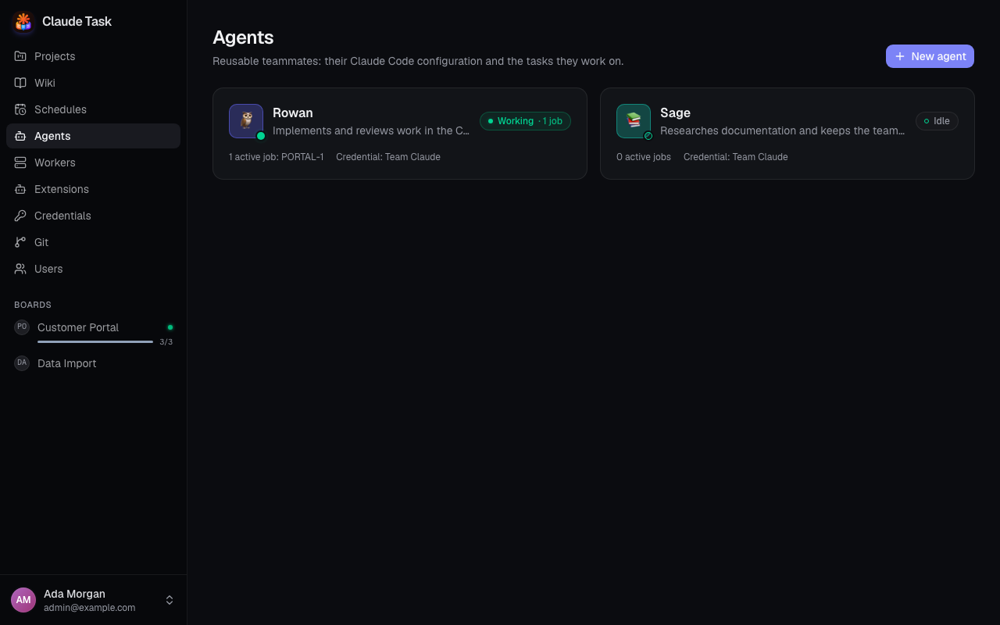
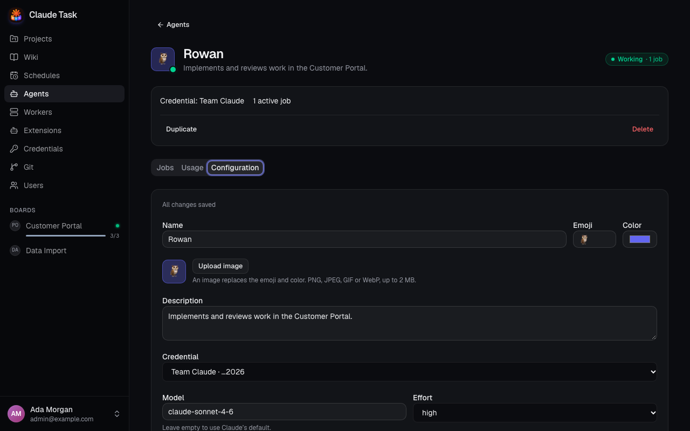
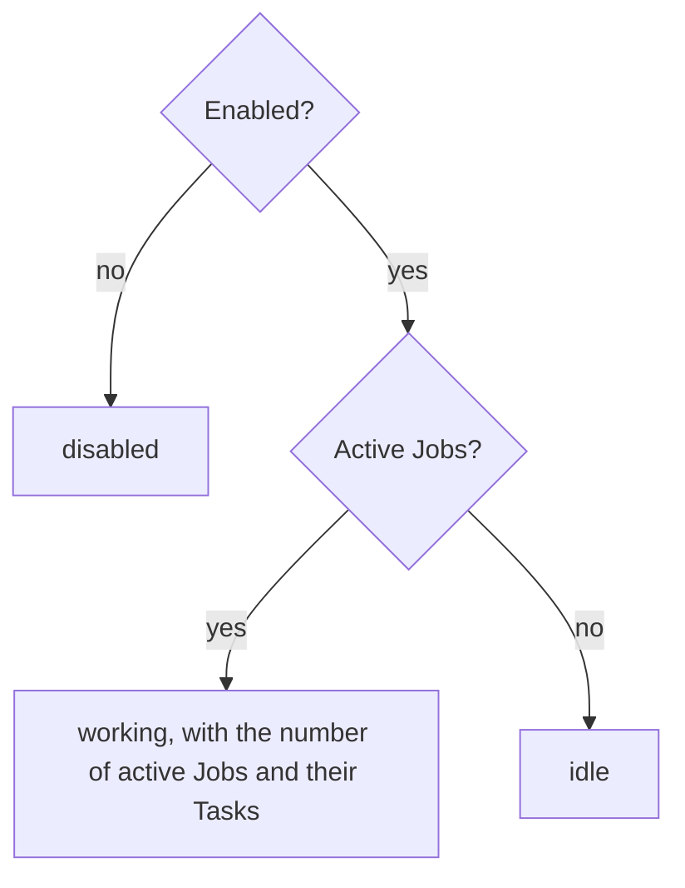

[Manual](README.md) › Administration

# Set up Agents and credentials

Create named Claude Code Agents with the model, instructions, tools and Credential your team needs. Admins manage their configuration; every User can view Agents and assign them to Tasks. Where an Agent runs is the concern of a Worker, not of the Agent.

An Agent can work several Tasks at once. Its Jobs run on the Worker of each Task's Project, one Job per Worker Container.

## Add a Credential

1. Open **Credentials** and click **New credential**.
2. Enter **Name** so your team can identify it.
3. Choose **Kind**: **Claude OAuth token (claude setup-token)**, **Anthropic API key** or **Anthropic auth token**. Use the auth token for Anthropic-compatible gateways that expect a bearer token, such as OpenRouter; set the endpoint with the Agent's `ANTHROPIC_BASE_URL` environment variable.
4. Enter **Secret** and click **Save credential**.

The saved secret cannot be read back. You see its kind, a last-four-character hint for secrets at least 12 characters long, the Agents using it and any observed rate limit. Agents sharing a Credential share its provider limits.

To rotate a secret, click **Edit / rotate**, enter **New secret** and save. Leave that field empty to keep the existing secret. The kind is fixed. Rotation reaches all linked Agents on their next Job, without recreating any Worker Container. Before deleting a Credential, change every linked Agent to another one.

## Create an Agent

1. Open **Agents** and click **New agent**.
2. Enter **Name**, select a **Credential**, and optionally set an emoji, color, image and description.
3. Choose the model, effort, permission mode and system prompt.
4. Add any environment variables and select the Skills, **MCP servers** and **Plugins** it needs.
5. Leave **Enabled** checked and click **Create agent**.

Creation saves the Claude Code configuration only. A new Agent is `idle` or `disabled` at once and can be assigned to a Task. Its Agent Profile on a Worker is created before its first Job there, when its Extensions are synchronized.

| Setting | What it controls |
| --- | --- |
| **Model** | Passed to Claude as entered; empty uses Claude's default. |
| **Effort** | Default, `low`, `medium`, `high`, `xhigh` or `max`. |
| **Permission mode** | Claude Code's execution mode: `bypassPermissions`, `auto`, `acceptEdits` or `dontAsk`. Default is `bypassPermissions`. |
| **System prompt** | The Agent's instructions, added to the platform and Project instructions. |
| **Environment variables** | One `NAME=value` per line, applied to every Job and winning over the Project's variables, for example `ANTHROPIC_BASE_URL`, `ANTHROPIC_MODEL` or `ENABLE_TOOL_SEARCH`. Plain text; keep secrets in a Credential or a Project secret. |
| **Enabled** | Allows new Jobs to start. Turning it off lets running Jobs finish and keeps queued work. |

You can upload PNG, JPEG, GIF or WebP avatar images up to 2 MB. **Remove image** restores the emoji and color.

## Where an Agent runs

An Agent has no image, no container and no storage of its own. Each Project runs on a [Worker](workers.md), and the Agent's Jobs run there:

- The Worker provides the Dockerfile, toolchains, Development Services, CPU and memory limits and the number of parallel Worker Containers.
- The Worker's shared volume holds the Worktrees, Claude transcripts and the Agent's Agent Profile.
- An Agent Profile stores the Agent's Skills, Plugins and settings. Every Agent Profile on a Worker shares the same transcripts, so changing the Task's Agent keeps its conversation.

Builds, container actions and the Queue are on the Worker page. See [Workers](workers.md) for capacity, images and Development Services.

## Change configuration

In the web app, open the Agent's **Configuration** tab. Every field saves automatically after a short pause or when a field loses focus. The form shows saving, saved or failed state and offers **Retry** after an error, keeping your edits visible. Switching settings tabs or navigating to another app view starts saving any pending changes.

| Change | When it applies |
| --- | --- |
| Credential, model, effort, permission mode, System prompt, Environment variables or name | From the next Job. A running Job keeps what it started with. |
| Skills, MCP servers or Plugins | Before the Agent's next Job on each Worker, after synchronization succeeds. |
| Enabled | Switching it off makes the Agent's entries wait; switching it on lets them dispatch again. |
| Description, avatar | Display change. |

A synchronization error appears on the Agent page and on the Worker page, and holds back only that Agent's entries on that Worker. Other Agents keep working. See [Workers](workers.md#agent-profiles-and-extension-synchronization).

## Configure an Agent in the native app

On a phone, tap the app icon in **Projects** or **Wiki** and choose **Agents** from the drawer. On desktop, open **Settings** → **Agents**.

Admins can choose **New agent** or open an existing Agent. Fill in its name, emoji, color, description, Credential, model, effort, permission mode, System prompt, Environment variables and Enabled choice. Select any **Skills**, **MCP Servers** and **Plugins** it needs from the shared catalog. Choose **Create agent** or **Save agent** to apply the form.

The native Agent form holds the Claude Code configuration only. Dockerfiles, Development Services and build logs are in the web app, and the native **Workers** settings show each Worker's slots and restart actions. The native form also offers **Duplicate**, **Delete agent** and **Manage shared Extensions**. Save your edits before opening the shared catalog.

The Agents list shows pending Extension changes and synchronization errors. Updates reach the next Job once synchronization succeeds. See [native Extension management](admin-extensions.md#use-extensions-in-the-native-app) for imports, MCP secrets and Plugin updates.

## Maintain or remove an Agent

| Action | Result |
| --- | --- |
| **Duplicate** | Copies the configuration into a new Agent. Assignments, Sessions, Jobs and history stay with the original. The copy gets its own Agent Profile on each Worker at its first synchronization there. |
| **Delete** | Removes the Agent's configuration, Credential link, Extension assignments and synchronization records. Past Jobs keep the Agent's name, and its Agent Profiles stay in the Worker Volumes until each Worker is deleted. |

Before **Delete**, unassign the Agent from every open Task, Wiki Chat, Wiki default and Schedule. Closing a Task also ends its Session. The app names what still uses the Agent and refuses the deletion until it is free.

## Agent state and view

The state shown for an Agent is the first that applies:

The Agents list shows each Agent with its avatar, state, active Jobs and their Tasks, and Credential name. Open an Agent to see:

- **Jobs**: active Jobs with their Task, Worker and slot, then recent Jobs. **Details** shows setup output, stderr and the Claude version.
- **Usage**: estimated cost, tokens and Turns in total, per day for the last 30 days (UTC), and for the 20 most expensive Tasks, plus the latest rate-limit status of the Agent's Credential.
- **Configuration** (Admins): the Agent form, with the synchronization state of the Agent on each Worker where one is pending or failed.
- **Actions** (Admins): **Duplicate** and **Delete**.

Queue, Builds and container logs belong to the Worker page. See [Workers](workers.md).

## Related

- [Workers](workers.md): execution environments, capacity, images and Development Services.
- [Extensions and environment](admin-extensions.md): fill the shared catalog and configure Project variables.
- [Agent sessions and queues](agent-sessions-and-queues.md): start, stop and prioritize work.
- [Troubleshooting](troubleshooting.md): recover from Build and connection failures.

---

← [Users and access](admin-users.md) · [Workers](workers.md) →
