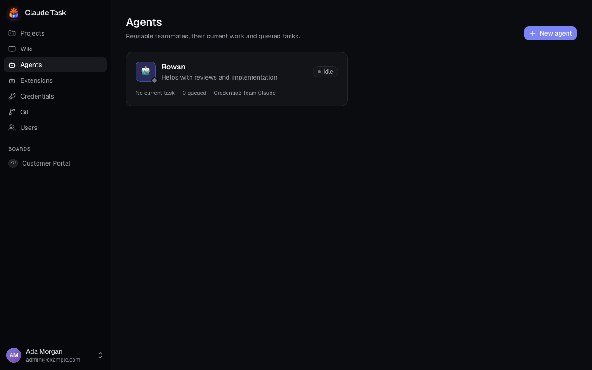
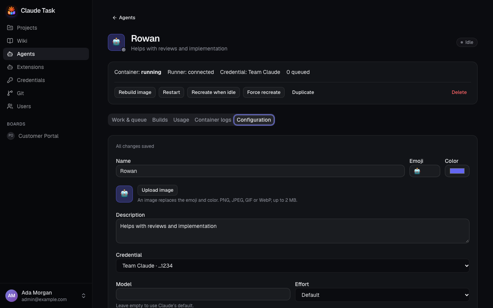

[Manual](README.md) › Administration

# Set up Agents and credentials

Create named Claude Code Agents with the tools and instructions your team needs. Admins manage their configuration; every User can view Agents and assign them to Tasks.

An Agent handles one Job at a time. Add another Agent when you need work to run in parallel.

## Add a Credential

1. Open **Credentials** and click **New credential**.
2. Enter **Name** so your team can identify it.
3. Choose **Kind**: **Claude OAuth token (claude setup-token)** or **Anthropic API key**.
4. Enter **Secret** and click **Save credential**.

The saved secret cannot be read back. You see its kind, a last-four-character hint for secrets at least 12 characters long, the Agents using it and any observed rate limit. Agents sharing a Credential share its provider limits.

To rotate a secret, click **Edit / rotate**, enter **New secret** and save. Leave that field empty to keep the existing secret. The kind is fixed. Rotation reaches all linked Agents on their next Job, without rebuilding them. Before deleting a Credential, change every linked Agent to another one.

## Create an Agent

1. Open **Agents** and click **New agent**.
2. Enter **Name**, select a **Credential**, and optionally set an emoji, color, image and description.
3. Choose the execution settings below.
4. Select the Skills, **MCP servers** and **Plugins** it needs from the shared catalog.
5. Choose **Services**, check the **Dockerfile**, and set resource limits if needed.
6. Leave **Enabled** checked and click **Create agent**.

Creation starts an image Build. Open **Builds** to follow the log. Once its container starts and the Runner connects, the Agent becomes `idle`. Assigning it to a Task creates a pending Session; the first User Comment starts work.

| Setting | What it controls |
| --- | --- |
| **Model** | Passed to Claude as entered; empty uses Claude's default. |
| **Effort** | Default, `low`, `medium`, `high`, `xhigh` or `max`. |
| **Permission mode** | Claude Code's execution mode: `bypassPermissions`, `auto`, `acceptEdits` or `dontAsk`. Default is `bypassPermissions`. |
| **System prompt** | The Agent's instructions, added to the platform and Project instructions. |
| **CPU limit** | Fractional CPU allowance, up to 256; empty means no limit. |
| **Memory (MB)** | Memory allowance from 256 to 1,048,576 MB; empty means no limit. |
| **Enabled** | Allows new Jobs to start. Turning it off lets the current Job finish and keeps queued work. |

You can upload PNG, JPEG, GIF or WebP avatar images up to 2 MB. **Remove image** restores the emoji and color.

## Prepare the development environment

The Dockerfile must start from `claude-task/agent-base` and finish as `USER agent`. Install your toolchains and any stdio MCP servers there. The platform pins the Base Image version during the Build.

Under **Services**, select PostgreSQL, Redis, MySQL, Mailpit or RustFS. Mailpit receives test email on SMTP port 1025; its mailbox interface is available inside the Agent Container on port 8025. PostgreSQL and Redis are selected by default. Each Agent has its own local Development Services; all its Tasks share them, so give different Projects distinct databases, namespaces and buckets.

Repositories, Worktrees, Claude transcripts, installed tools and Development Service data persist across container recreation. Deselecting a Development Service keeps its data for later use.

## Change configuration

In the web app, open the Agent's **Configuration** tab. General settings and Extension selections save automatically; wait for **All changes saved** before leaving. If saving fails, your edits stay visible and **Retry** sends them again. Apply Dockerfile, Services and resource-limit changes with **Save Docker configuration**.

| Change | When it applies |
| --- | --- |
| Credential, model, effort, permission mode or System prompt | Next Job. |
| Skills, MCP servers or Plugins | Before the next Job, after synchronization succeeds. |
| Dockerfile or Services | Starts a Build; switches containers when the current Job finishes. |
| CPU or memory limit | Recreates the container when idle, without a Build. |
| Avatar or description | Display change. |

A failed Build leaves the previous successful container available. Fix the Dockerfile or service choice and save, or use **Rebuild image**. A synchronization error appears on the Agent page and holds new work until synchronization succeeds.

## Configure an Agent in the native app

On a phone, tap the app icon in **Projects** or **Wiki** and choose **Agents** from the drawer. On desktop, open **Settings** → **Agents**.

Admins can choose **New agent** or open an existing Agent. Fill in its name, emoji, color, description, Credential, model, effort, permission mode, System prompt and Enabled choice. Select any **Skills**, **MCP Servers** and **Plugins** it needs from the shared catalog. Choose **Create agent** or **Save agent** to apply the form.

New Agents use the default Dockerfile. Use the web app to configure Dockerfiles, Development Services and resource limits, or inspect Builds and container logs. The native form also offers **Duplicate**, **Delete agent** and **Manage shared Extensions**. Save your edits before opening the shared catalog.

The Agents list shows pending Extension changes and synchronization errors. Updates reach the next Job once synchronization succeeds. See [native Extension management](admin-extensions.md#use-extensions-in-the-native-app) for imports, MCP secrets and Plugin updates.

## Maintain or remove an Agent

| Action | Result |
| --- | --- |
| **Rebuild image** | Builds the current configuration again. |
| **Restart** | Restarts the container, interrupting its current Job; its Session resumes after reconnection. |
| **Recreate when idle** | Replaces the container using the current image and limits after the current Job ends. |
| **Force recreate** | Replaces the container immediately; interrupted work resumes after reconnection. |
| **Duplicate** | Copies settings into a new Agent with its own empty storage, Build and container. History stays with the original. |
| **Delete** | Removes the Agent, its container, images, persistent storage, Sessions and execution history. Agent Comments remain on Tasks. |

Before **Delete**, unassign the Agent from every Task with an open Session. Closing a Task also ends its Session. Review the confirmation before deleting, because stored work and Claude transcripts are removed.

For diagnosis, open **Builds**, **Container logs**, or a Job's details in **Work & queue**. **Usage** shows estimated cost, token use and the Credential's latest observed rate limit.

## Related

- [Extensions and environment](admin-extensions.md): fill the shared catalog and configure Project variables.
- [Agent sessions and queues](agent-sessions-and-queues.md): start, stop and prioritize work.
- [Troubleshooting](troubleshooting.md): recover from Build and connection failures.

---

← [Users and access](admin-users.md) · [Extensions and environment](admin-extensions.md) →
