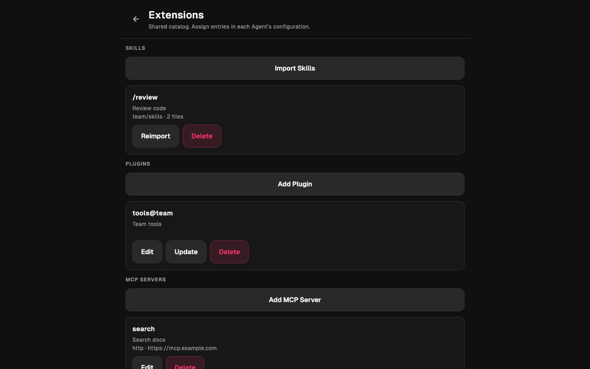
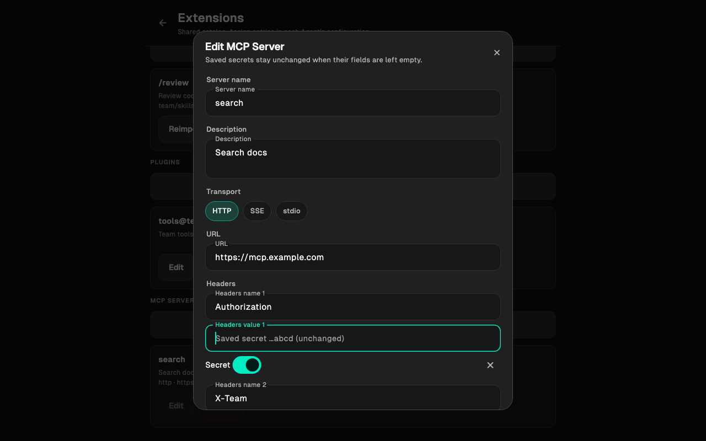
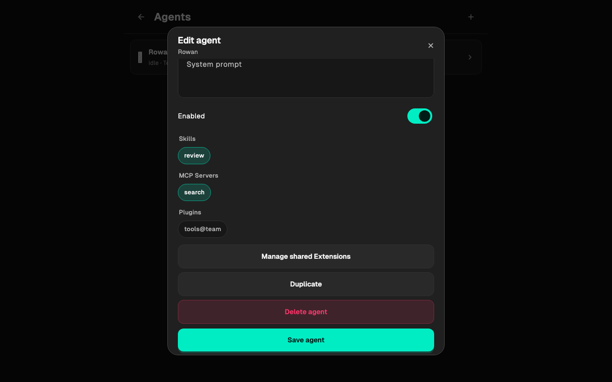
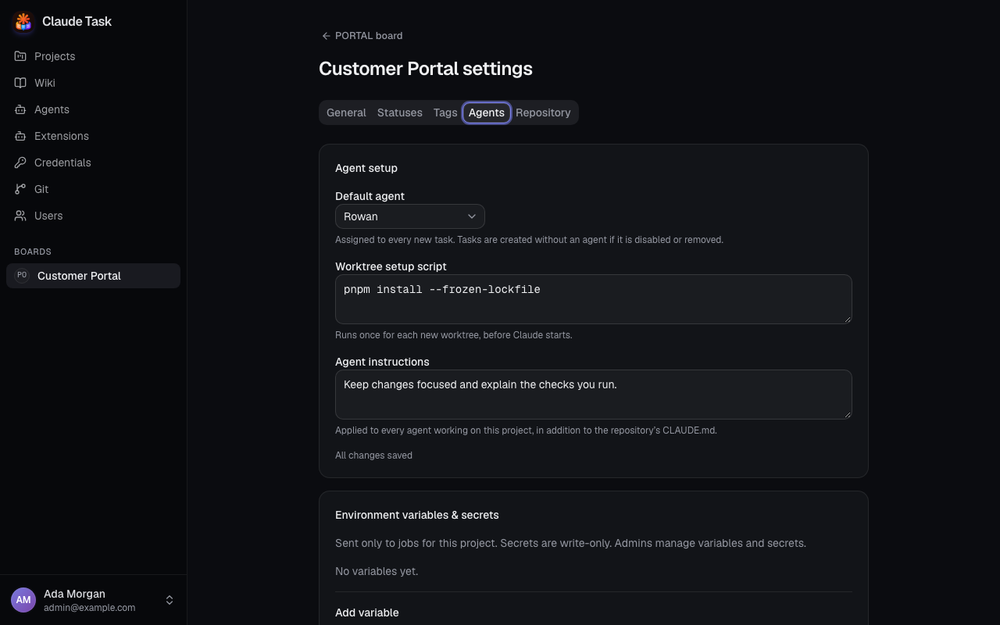

[Manual](README.md) › Administration

# Add Extensions and Project environment

Use **Extensions** to maintain the shared Skills, Plugins and MCP servers available to Agents. Use a Project's **Settings** → **Agents** to prepare its Worktrees and environment.

Admins manage the catalog in both clients. On a phone, tap the app icon to open the drawer and choose **Extensions**; on native desktop, open **Settings** → **Extensions**. The web app lists **Extensions** in its sidebar. The procedures below describe the web controls; [native controls](#use-extensions-in-the-native-app) follow.

Admins manage Project environment variables in the web app. Every User can edit a Project's setup script and Agent instructions there.

## Import Skills

1. Open **Extensions** → **Skills**.
2. Enter **Skill source** as `owner/repo`, a repository URL or a link to a remote Skill directory.
3. Optionally enter comma-separated **Skill names**. Leave it empty to import every Skill from that source.
4. Click **Import skills**.
5. Open an Agent's **Configuration** and select the imported Skills. Changes save automatically; check the save status.

Imports include scripts and supporting files. The catalog stores a snapshot, so upstream changes arrive when you click **Reimport**. Reimporting preserves assignments and updates assigned Agents before their next Job. A Skill marked **Hidden from slash commands** remains available to Claude but is absent from the command menu.

Local filesystem sources are not accepted. Private sources use the backend server's git access, separately from the app's Git Connections. An import supports up to 10 MB and 1,000 files and cannot contain symbolic links.

## Add a Plugin

1. Open **Extensions** → **Plugins**.
2. Enter **Plugin** and **Marketplace source**. You can use a plugin name with a public marketplace source, or `plugin@marketplace` with an empty source when Claude Code already knows the marketplace.
3. Optionally enter **Description** and click **Add plugin**.
4. Select it in the Agent's **Configuration**. The selection saves automatically.

Click **Update** on the catalog entry to request the marketplace's latest version for assigned Agents. Plugins are installed between Jobs. Supply any secrets through an MCP server entry or Project environment variables.

## Add an MCP server

1. Open **Extensions** → **MCP** and click **Add MCP server**.
2. Enter **Server name** and optionally **Description**. Use letters, digits, underscores or hyphens. The name `claude-task` belongs to the platform.
3. Choose **Transport** and provide its connection details.
4. Click **Save MCP server**.
5. Select it in an Agent's **Configuration**. The selection saves automatically.

| Transport | Fields |
| --- | --- |
| **HTTP**, **SSE** | **URL**, plus **Headers** when required. Mark sensitive header values **Secret**. |
| **stdio** | **Command**, **Arguments** with one argument per line and no shell quoting, plus **Environment variables**. Mark sensitive values **Secret**. Install the command and its runtime in the Agent's Dockerfile. |

On edit, an unchanged saved secret is preserved. To replace it, enter the new value. If you rename a secret header or environment variable, supply a replacement value for the new name. Changes reach the next Job; a running Job keeps its original configuration.

## Use Extensions in the native app

The **Extensions** screen groups **Skills**, **Plugins** and **MCP Servers** on one scrolling page.

| Action | Native controls |
| --- | --- |
| Import Skills | Choose **Import Skills**, enter **Skill source** and optional **Skill names**, then choose **Import Skills** again. Leaving names empty imports all Skills from the source. |
| Refresh a Skill | Choose **Reimport** on its card. |
| Add a Plugin | Choose **Add Plugin**, enter **Plugin name**, **Marketplace source** and optional **Description**, then choose **Save Plugin**. |
| Edit or update a Plugin | **Edit** changes its catalog details; **Update** requests the latest marketplace version for assigned Agents. |
| Configure an MCP Server | Choose **Add MCP Server** or **Edit**, fill its transport-specific fields, then choose **Save MCP Server**. |
| Remove a catalog entry | Choose **Delete**, then confirm **Delete Extension**. First remove the entry from every Agent. |

For HTTP and SSE, use **Add Headers** to create name/value rows. For stdio, enter **Command**, one **Arguments** value per line, and use **Add Environment variables**. Turn on **Secret** for sensitive values. Saved secrets show only their last four characters and stay unchanged until you enter a replacement. Use a row’s remove button to remove that header or environment variable. Duplicate names keep the form open with an error.

To assign entries, open **Agents**, choose an Agent, select **Skills**, **MCP Servers** and **Plugins**, then choose **Save agent**. You can also select Extensions while creating an Agent. **Manage shared Extensions** opens the catalog from the Agent form; save your Agent edits before leaving it.

Pull down to refresh the catalog. If loading fails, choose **Retry**. A failed save keeps your input in the form. Skill imports can take up to two minutes while the source is fetched.

## Apply catalog changes

Catalog imports and updates do not assign an Extension automatically. Select entries for each Agent. The web app saves selections automatically; the native app applies them with **Save agent**. New work waits while synchronization runs; errors appear on the Agent page and are retried automatically. Remove assignments from every Agent before deleting a catalog entry.

## Prepare a Project's Worktrees

1. Open the Project's **Settings** → **Agents**.
2. Enter **Worktree setup script**, such as the dependency installation commands that the repository needs.
3. Choose a **Default agent** if new tasks should start with an Agent assigned (it only starts working on the first comment; a disabled or removed Agent leaves new tasks unassigned).
4. Enter **Agent instructions** for every Agent working on this Project. Setup Script and Agent Instructions save automatically; check the save status.

The script runs once for each new Worktree before Claude starts. Existing Worktrees are not prepared again when the script changes. Repository tool-version files are handled with mise before the setup script. Repository `CLAUDE.md` instructions still apply alongside the Project's instructions.

## Add environment variables and secrets

1. In **Environment variables & secrets**, enter **Variable name** and **Value**.
2. Check **Secret** for a sensitive value.
3. Click **Add variable**.

Variables reach only Jobs for that Project, starting with the next Job. Plain values are visible to every User; secret values cannot be read back. To rotate one, click **Edit**, enter **New value** and click **Update variable**. **Delete** removes it from subsequent Jobs.

Variable names start with a letter or underscore, followed by letters, digits or underscores, up to 128 characters. The platform reserves `HOME`, `PATH`, `USER`, names beginning `CLAUDE_TASK_`, and its Claude authentication and resume variables.

### Import a .env file

1. Under **Import .env**, paste **.env content** or click **Choose file**.
2. Check the preview of names, especially those marked **overwrites** or **overwrites secret**.
3. Check **Import as secrets** if all imported values should be secret.
4. Click **Import** (the button includes the variable count when ready).

An import merges variables: matching names are overwritten; other existing names remain. Existing secrets stay secret. Variable references such as `${DATABASE_HOST}` remain literal. A file with an invalid line or reserved name writes nothing and shows the problems. The import supports files up to 500,000 characters, with up to 500 variables and values up to 100,000 characters each.

## Related

- [Agents and credentials](admin-agents.md): select Extensions and install tools.
- [Git repositories and pull requests](git-repositories.md): link a repository and choose a Base Branch.
- [Troubleshooting](troubleshooting.md): investigate synchronization and setup failures.

---

← [Agents and credentials](admin-agents.md) · [Installation and operations](installation-and-operations.md) →
