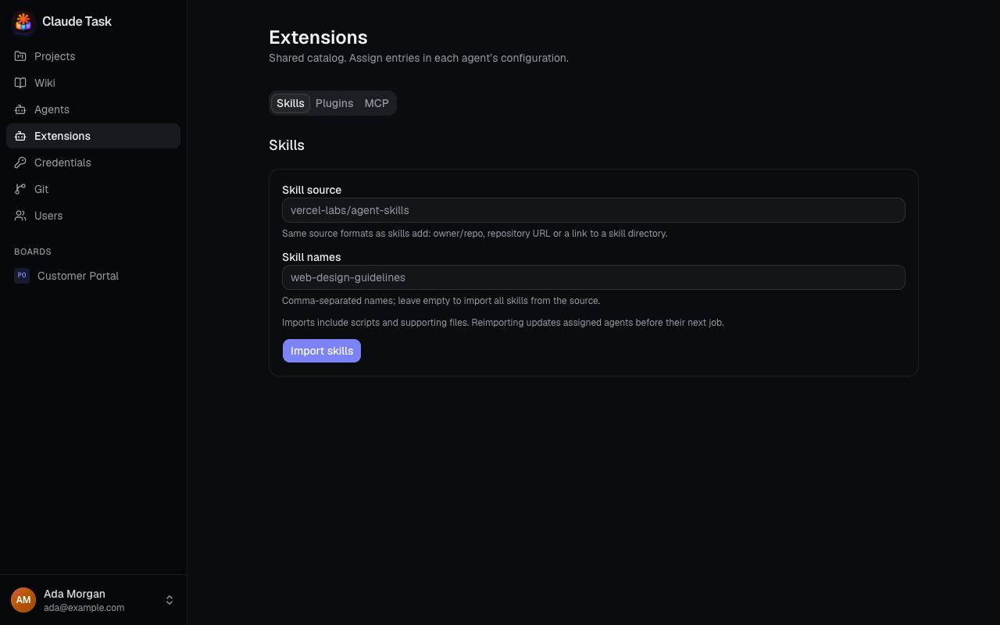

[Manual](README.md) › Administration

# Add Extensions and Project environment

Use **Extensions** to maintain the shared Skills, Plugins and MCP servers available to Agents. Use a Project's **Settings** → **Agents** to prepare its Worktrees and environment.

Admins manage the catalog and Project environment variables. Every User can edit a Project's setup script and Agent instructions.

## Import Skills

1. Open **Extensions** → **Skills**.
2. Enter **Skill source** as `owner/repo`, a repository URL or a link to a remote Skill directory.
3. Optionally enter comma-separated **Skill names**. Leave it empty to import every Skill from that source.
4. Click **Import skills**.
5. Open an Agent's **Configuration**, select the imported Skills and click **Save agent**.

Imports include scripts and supporting files. The catalog stores a snapshot, so upstream changes arrive when you click **Reimport**. Reimporting preserves assignments and updates assigned Agents before their next Job. A Skill marked **Hidden from slash commands** remains available to Claude but is absent from the command menu.

Local filesystem sources are not accepted. Private sources use the backend server's git access, separately from the app's Git Connections. An import supports up to 10 MB and 1,000 files and cannot contain symbolic links.

## Add a Plugin

1. Open **Extensions** → **Plugins**.
2. Enter **Plugin** and **Marketplace source**. You can use a plugin name with a public marketplace source, or `plugin@marketplace` with an empty source when Claude Code already knows the marketplace.
3. Optionally enter **Description** and click **Add plugin**.
4. Select it in the Agent's **Configuration** and save.

Click **Update** on the catalog entry to request the marketplace's latest version for assigned Agents. Plugins are installed between Jobs. Supply any secrets through an MCP server entry or Project environment variables.

## Add an MCP server

1. Open **Extensions** → **MCP** and click **Add MCP server**.
2. Enter **Server name** and optionally **Description**. Use letters, digits, underscores or hyphens. The name `claude-task` belongs to the platform.
3. Choose **Transport** and provide its connection details.
4. Click **Save MCP server**.
5. Select it in an Agent's **Configuration** and save.

| Transport | Fields |
| --- | --- |
| **HTTP**, **SSE** | **URL**, plus **Headers** when required. Mark sensitive header values **Secret**. |
| **stdio** | **Command**, **Arguments** with one argument per line and no shell quoting, plus **Environment variables**. Mark sensitive values **Secret**. Install the command and its runtime in the Agent's Dockerfile. |

On edit, an unchanged saved secret is preserved. Changes reach the next Job; a running Job keeps its original configuration.

## Apply catalog changes

Catalog imports and updates do not assign an Extension automatically. Select entries for each Agent and save its configuration. New work waits while synchronization runs; errors appear on the Agent page and are retried automatically. Remove assignments from every Agent before deleting a catalog entry.

## Prepare a Project's Worktrees

1. Open the Project's **Settings** → **Agents**.
2. Enter **Worktree setup script**, such as the dependency installation commands that the repository needs.
3. Enter **Agent instructions** for every Agent working on this Project.
4. Click **Save agent settings**.

The script runs once for each new Worktree before Claude starts. Existing Worktrees are not prepared again when the script changes. Repository tool-version files are handled with mise before the setup script. Repository `CLAUDE.md` instructions still apply alongside the Project's instructions.

## Add environment variables and secrets

1. In **Environment variables & secrets**, enter **Variable name** and **Value**.
2. Check **Secret** for a sensitive value.
3. Click **Add variable**.

Variables reach only Jobs for that Project, starting with the next Job. Plain values are visible to every User; secret values cannot be read back. To rotate one, click **Edit**, enter **New value** and click **Update variable**. **Delete** removes it from subsequent Jobs.

Variable names start with a letter or underscore, followed by letters, digits or underscores, up to 128 characters. The platform reserves `HOME`, `PATH`, `USER`, names beginning `CLAUDE_TASK_`, and its Claude authentication and resume variables.

### Import a .env file

1. Under **Import .env**, paste **.env content** or click **Choose file**.
2. Check the preview of names, especially those marked **overwrites** or **overwrites secret**.
3. Check **Import as secrets** if all imported values should be secret.
4. Click **Import** (the button includes the variable count when ready).

An import merges variables: matching names are overwritten; other existing names remain. Existing secrets stay secret. Variable references such as `${DATABASE_HOST}` remain literal. A file with an invalid line or reserved name writes nothing and shows the problems. The import supports files up to 500,000 characters, with up to 500 variables and values up to 100,000 characters each.

## Related

- [Agents and credentials](admin-agents.md): select Extensions and install tools.
- [Git repositories and pull requests](git-repositories.md): link a repository and choose a Base Branch.
- [Troubleshooting](troubleshooting.md): investigate synchronization and setup failures.

---

← [Agents and credentials](admin-agents.md) · [Installation and operations](installation-and-operations.md) →
