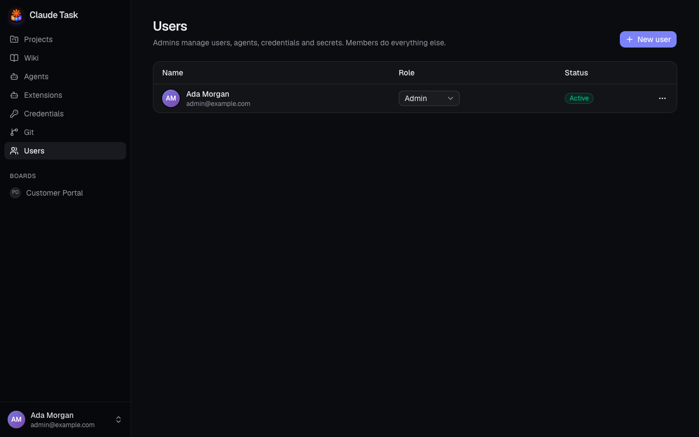
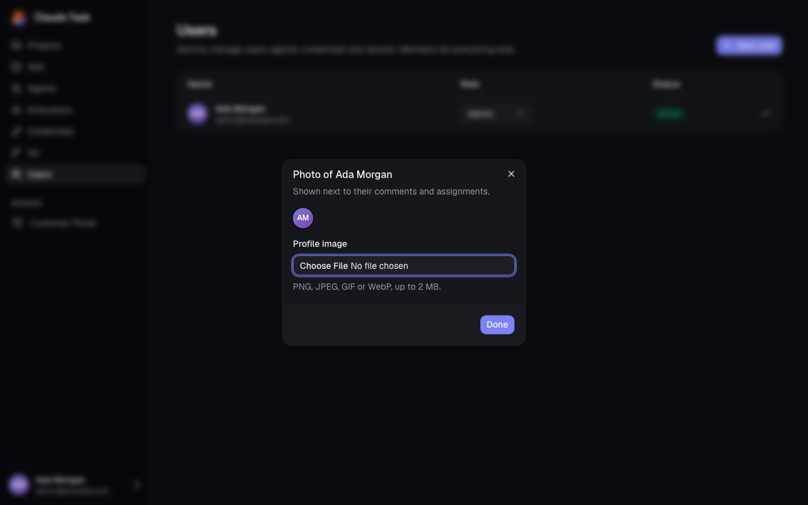

[Manual](README.md) › Administration

# Manage users and access

Create team logins, change roles and recover access from **Users** in the web sidebar or native Settings. These actions require an Admin. The procedures below use web controls; [native User management](#manage-users-in-the-native-app) follows.

Every active User can see every Project and Wiki in the installation. Use the Member role for team work and Admin for platform administration.

## Add a User

1. Open **Users** and click **New user**.
2. Enter **Name** and **Email**.
3. Select **Member** or **Admin** under **Role**.
4. Click **Create user**. The **Temporary password** dialog appears.
5. Use **Copy password** and share the password with that User through your team's private channel, together with the installation URL and email address.
6. Click **Done**. The password is not shown again.

The User signs in with the temporary password and chooses a new password before opening Projects. The app does not send an invitation email.

| Badge | Meaning |
| --- | --- |
| **Active** | The User can sign in and has chosen a password. |
| **Invited** | The User must replace a temporary password. This also appears after a password reset. |
| **Deactivated** | Access is disabled; existing history remains. |

## Change a role

1. Find the User in **Users**.
2. Change the role selector to **Member** or **Admin**. The change saves immediately and applies on their next request.

Keep at least one active Admin. The app refuses changes that would remove the last active Admin.

## Reset a forgotten password

1. Open the User's actions menu.
2. Choose **Reset password** and confirm.
3. Copy the new temporary password and share it privately with the User.

Resetting immediately ends all that User's Logins. They must choose a new password when they sign in again. A reset does not reactivate a deactivated User.

## Deactivate or reactivate a User

1. Open the User's actions menu.
2. Choose **Deactivate** and confirm. Their Logins end immediately.

Comments, Task assignments and history keep their name. To restore access, choose **Reactivate** in the same menu. Their existing password still applies; reset it separately if needed.

## Set profile images

Admins can open a User's actions menu, choose **Change photo**, and select **Profile image**. Upload a PNG, JPEG, GIF or WebP image up to 2 MB. The image saves as soon as you choose it. **Remove photo** restores their initials.

Every User can change their own photo in the native app: open **Profile**, choose **Change photo**, and select an image. Choose **Remove photo** to return to initials. Photo changes require a connection. A failed upload leaves the previous photo in place.

Profile images appear beside Comments and assignments, including earlier Comments. Initials appear while an image loads or if it is unavailable.

## Manage Users in the native app

On a phone, tap the app icon at the top left of **Projects** or **Wiki**, then choose **Users** in the drawer. On desktop, open **Settings** → **Users**.

1. Choose **New user** and enter **Email**, **Name** and **Role** (`member` or `admin`).
2. Optionally enter **Temporary password**. Leaving it empty generates a password.
3. Choose **Create user** and share the issued temporary password privately.

Open an existing User to change **Name**, **Role** or **Active**, then choose **Save user**. Turning **Active** off ends their Logins; turning it on restores access with their existing password. **Reset password** asks for confirmation and issues a new temporary password. The same last-active-Admin protection applies as on the web.

Use the web Users page to change another User's profile image; the native Profile screen changes your own image.

## Related

- [Roles and limits](roles-and-limits.md): compare Member and Admin permissions.
- [Installation and operations](installation-and-operations.md): recover Admin access from the server.
- [Getting started](getting-started.md): first login and password selection.
- [Native app and notifications](native-app-and-notifications.md): open navigation and your Profile.

---

← [Native app and notifications](native-app-and-notifications.md) · [Agents and credentials](admin-agents.md) →
