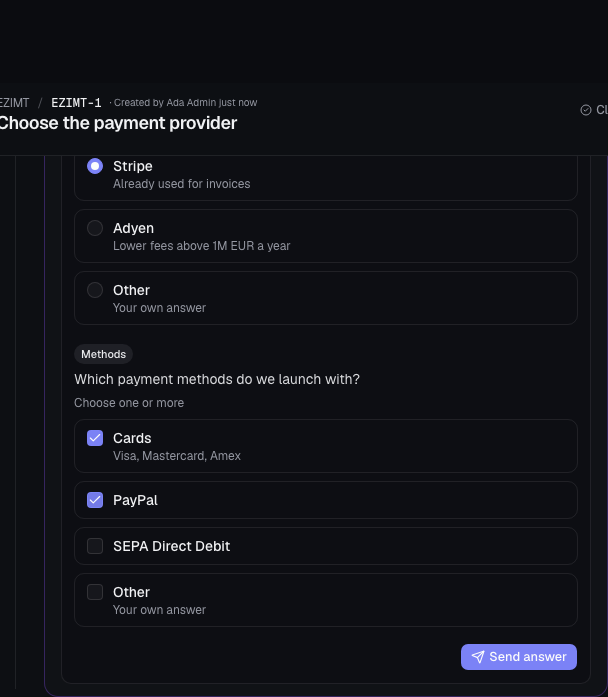
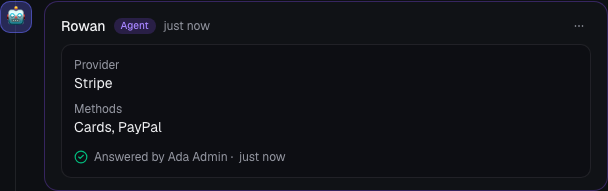
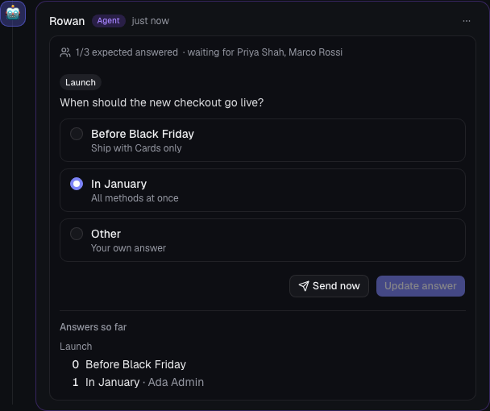
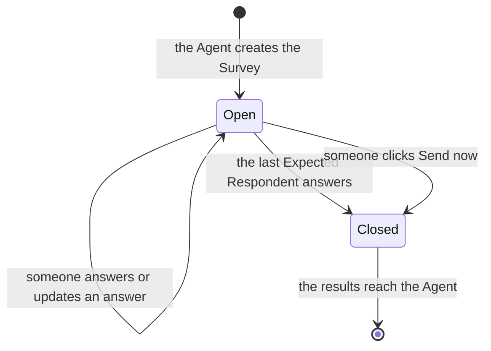

[Manual](README.md) › Learn and work

# Answer the Agent's questions and see its files

Agents can show you files, ask you to choose between options, and collect the team's opinion. This page explains what you see in the Conversation and how to answer.

Every signed-in User can answer a Question, answer a Survey and send a Survey early, on any Task.

## See files from the Agent

An Agent can post screenshots, charts, logs or reports from its working environment. They appear as an Agent Comment with an optional caption. Images show inline, like the ones your colleagues attach; other files are listed with name and size and download when you click them.

An Agent posts up to 10 files of up to 25 MB each at a time. If you need a file the Agent produced, ask for it in a Comment ("post the screenshot of the login page").

## Answer a Question

When an Agent needs a decision with clear options, it asks a Question and ends its Turn. The Question shows up as a card in its Agent Comment, with **The agent is waiting for an answer. The first answer decides.**

1. Read each item. A Question has one to four items, answered together.
2. For each item, pick an option. Items marked **Choose one or more** accept several options.
3. To answer in your own words, pick **Other** and write your answer in the text field that appears.
4. Click **Send answer**. The button is enabled once every item has an answer.

Your answer is posted as your Comment, shown as **Answered the question**, and reaches the Agent like any other Comment, with its Delivery badge. The message the Agent receives repeats the question, so it understands the answer even if it arrives hours later. In the web app, click **Answered the question** to scroll back to the Question.

Things to know:

- **The first answer decides.** If a colleague answers a moment before you, you see **Someone answered first** (in the native app, the name of who answered) and the card shows their answer.
- **An answer is final.** You can delete your answer Comment, but not edit it. To change your mind, post a regular Comment ("Use Adyen after all"): it reaches the Agent in order.
- **A Question stays open until someone answers it**, even if the conversation moves on. A free Comment does not close it.
- **The answer follows the usual Delivery rules.** It is queued while the Agent works on another Task, and it is **Not delivered** when the Task is closed or has no Agent. If the Task is handed to another Agent, the new Agent receives it together with the Question.

## Run a Survey with your team

A Survey collects answers from several people before the Agent continues. Ask for one in a Comment, for example "Ask the team when we should go live". The Agent creates Surveys only when someone asks.

The Task's assignees when the Survey is created are its Expected Respondents. The Survey needs at least one assignee: the Agent tells you if the Task has none. Assigning or removing people later does not change who the Survey waits for.

1. Pick your options, as for a Question.
2. Click **Save answer**. You can change your choices and click **Update answer** while the Survey is open.
3. Follow progress at the top of the card: **1/3 expected answered** and who it is still waiting for. **Answers so far** shows each option with the names that chose it.

Anyone can answer, including Users who are not Expected Respondents; their answers count in the results.

The Survey closes, and the Agent receives all the results in one message, when:

- every Expected Respondent has answered, or
- someone clicks **Send now**, which works even before anyone has answered.

A System Comment then says **Survey closed: every expected respondent answered.** or names who closed it early. The card shows the final results and **Everyone expected answered** or **Sent early by** with the name. A closed Survey takes no more answers.

## Answer from the native app

Questions and Surveys work the same way in the native app: tap the options, write **Other** if needed, then tap **Send answer**, **Save answer**, **Update answer** or **Send now**. A phone notification for the finished Turn brings you to the Question.

Answering needs a connection. Offline, the app keeps your choices and shows **Offline. Your choices are kept; answer once back online.**

## Related

- [Agent sessions and queues](agent-sessions-and-queues.md): how Turns, Delivery and the Queue work.
- [Tasks and conversations](tasks-and-conversations.md): Comments, Attachments and Delivery badges.
- [Native app and notifications](native-app-and-notifications.md): phone notifications for finished Turns.

---

← [Agent sessions and queues](agent-sessions-and-queues.md) · [Wikis](wikis.md) →
