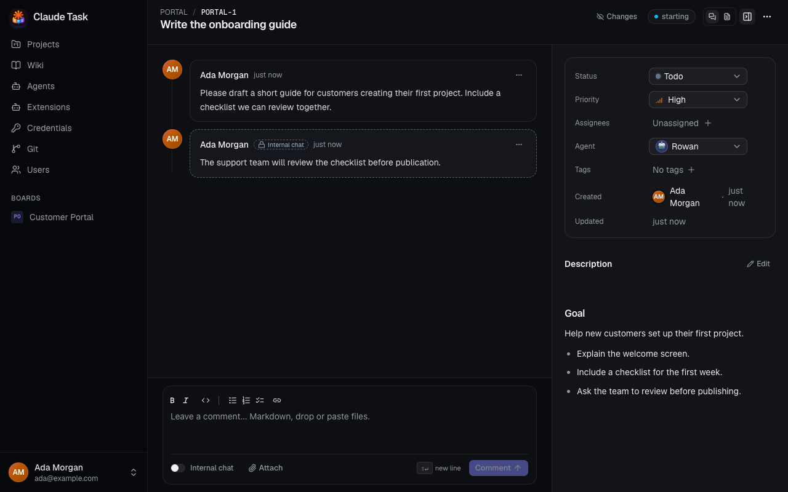
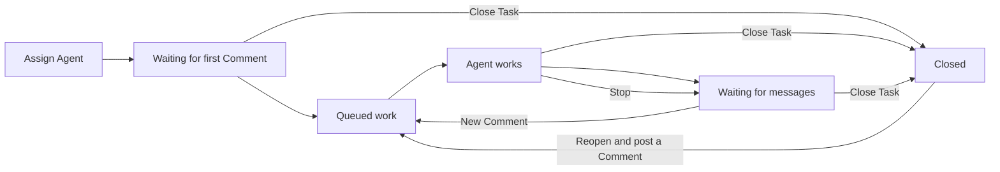

[Manual](README.md) › Team work

# Start, steer and monitor Agent work

Assign an Agent to a Task, then guide it through Comments. Every signed-in User can assign Agents, stop and retry their work, and manage their Queues.

## Understand Sessions, Jobs and Turns

A Session is one Agent's continuing conversation on one Task. A Job is a period when the Agent runs that Session. A Turn is the cycle of work that ends when the Agent hands control back to you.

An Agent runs one Job at a time across all its Tasks. Waiting work goes into that Agent's Queue. The Agent keeps its Session context between Jobs, so you can return later with feedback.

## Start and steer work

1. Open the Task's details and select an **Agent**.
2. Check the description explains the result you need.
3. Post a regular Comment, such as “Implement the description and report the checks you run.” The Session starts when the Agent is ready.
4. Read the streamed output and Timeline activity.
5. Post more Comments to steer the work or ask for changes.

Assigning an Agent alone starts no work. An Internal Note never starts it. Moving a Task to **In Progress** also starts no work.

New Tasks may already have the Project's **Default agent** assigned. Check the Agent shown in the Task's details before sending your first Comment; change it there if another Agent should do the work. The default applies to new Tasks and leaves existing assignments unchanged.

A Comment on the Agent's current Task can reach it during the Turn. Comments for other Tasks wait in its Queue. Several queued Comments for one Task are usually delivered together in posting order. Native commands wait between Turns.

## Read the Session indicator

| Indicator | What to do |
| --- | --- |
| **starting** | Post a Comment if you have only assigned the Agent; otherwise check its readiness. |
| **queued #N** | Wait for the earlier Queue entries, or change their order. |
| **running** | Follow the output, post feedback, or use **Stop**. |
| **waiting for messages** | The Agent has handed control back. Post another Comment to continue. |
| **waiting for retry** | Read the failure, fix its cause, then use **Retry**. |
| **paused** | The Agent was removed or replaced. Assign an Agent to continue. |
| **closed** | Reopen the Task before asking the Agent to work again. |

## Stop or retry

Click **Stop** on a running Task to interrupt the current Turn. Its Session remains available. Post another Comment to continue from it.

When starting work fails, the Task may show **waiting for retry** and a System Comment explaining the failure. Common causes include Repository access, a failing Setup Script or a process startup problem. Ask an Admin to fix configuration or Credential problems. Then click **Retry**, or post a new regular Comment, to release the waiting entry. Other Tasks in the Queue can proceed while this one waits for retry.

## Close, reopen or change Agent

Move a Task to a Status in the `closed` Category to end work. This stops the active Job, removes queued work and removes its Worktree. The remote Task Branch remains.

Reopening restores the assigned Agent's Session. It starts no work until you post a Comment or use **Notify agent** when available. Its Worktree is recreated when the next Job starts.

Choose **No agent** in the Agent picker to pause its Session. Choose another Agent to hand over the Task. A new Agent starts with the Task and its non-internal Conversation when you next post a Comment. Assigning an earlier Agent again resumes its own previous Session and queues a catch-up Message if that Session had already started.

## Manage an Agent's Queue

The Queue, Job details, Builds and usage controls described here are in the web app. Native **Agents** settings show configuration and Extension synchronization notices; use the Task or Wiki Conversation there for **Stop** and **Retry**.

1. Open **Agents** in the sidebar.
2. Select the Agent.
3. Open **Work & queue**.
4. In **Current work & queue**, drag an entry by its handle, or use its up and down arrows, to change the order.

The current Job finishes before the Agent takes another Task. Reordering waiting entries does not interrupt it.

To withdraw waiting Messages, use the entry's remove button and confirm **Remove**. Those Comments become **Not delivered**. An entry for a new Session cannot be removed here: unassign the Agent from its Task instead.

If the Agent is disabled, offline, building, awaiting container recreation or applying Extension changes, queued work waits (a stopped container starts as soon as work is queued) until it is ready. An Admin manages these conditions.

## Inspect results and failures

On the Agent page, **Recent jobs** lists recent work and its state, Turn count and cost. Click **Details** to read **Job details**, including setup output, process diagnostics and the Claude version. Use **Builds** to inspect image build output and **Usage** to review token and cost totals.

The Task Timeline shows the human-facing result, files the Agent posts, its Questions and Surveys, expandable Thinking and Activity, and Turn Summaries. Agent errors appear as System Comments. After a restart or lost connection, interrupted work can resume automatically; look for its recovery notice before sending duplicate instructions.

## Related

- [Tasks and conversations](tasks-and-conversations.md): delivery badges, Internal Notes and notifying the Agent of edits.
- [Agent questions and files](agent-questions-and-files.md): answer the Agent's Questions and Surveys, and see the files it posts.
- [Admin: agents and credentials](admin-agents.md): make an Agent ready to accept work.

---

← [Tasks and conversations](tasks-and-conversations.md) · [Agent questions and files](agent-questions-and-files.md) →
