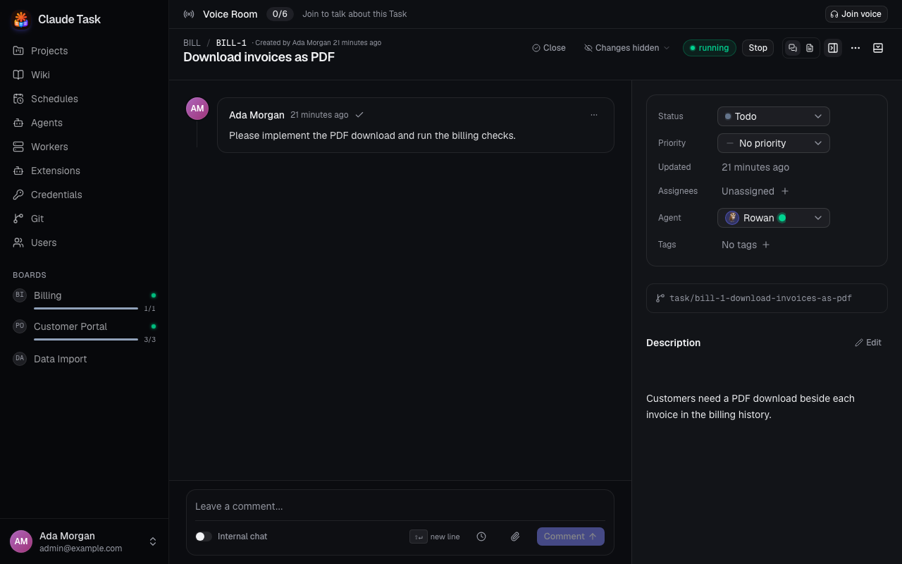
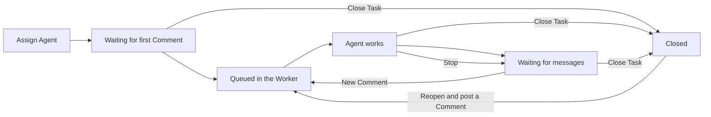
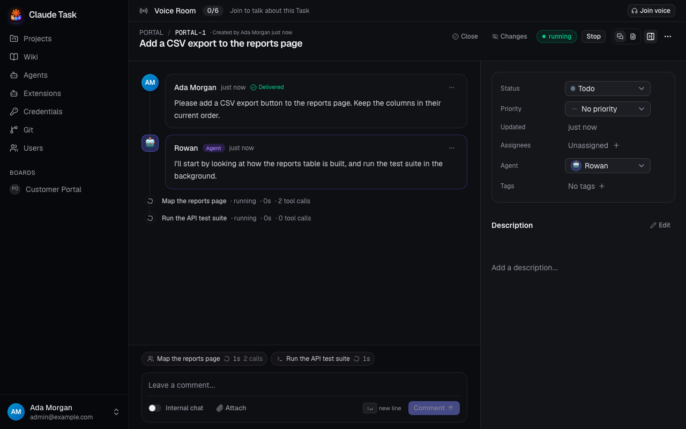
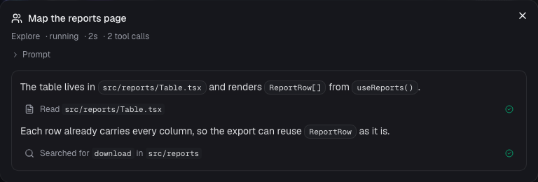

[Manual](README.md) › Team work

# Start, steer and monitor Agent work

Assign an Agent to a Task, then guide it through Comments. Every signed-in User can assign Agents, stop and retry their work, and manage the Queue of a Worker.

## Understand Sessions, Jobs and Turns

A Session is one continuing Claude Code conversation on one Task, whichever Agent works it. A Job is a period when an Agent runs that Session. A Turn is the cycle of work that ends when the Agent hands control back to you.

Jobs run on the Worker of the Task's Project. A Worker Container runs one Job at a time, and a Worker runs as many containers in parallel as its cap allows. An Agent has no concurrency limit of its own: the same Agent can work on several Tasks at once. The Queue belongs to the Worker, not to the Agent.

Changing the Task's Agent keeps the Session. The next Job resumes the same conversation with the new Agent's instructions, tools and model.

## Start and steer work

1. Open the Task's details and select an **Agent**.
2. Check the description explains the result you need.
3. Post a regular Comment, such as “Implement the description and report the checks you run.” The Session starts when the Worker has a free container and the Agent is ready.
4. Read the streamed output and Timeline activity.
5. Post more Comments to steer the work or ask for changes.

Assigning an Agent alone starts no work. An Internal Note never starts it. Moving a Task to **In Progress** also starts no work.

New Tasks may already have the Project's **Default agent** assigned. Check the Agent shown in the Task's details before sending your first Comment; change it there if another Agent should do the work. The default applies to new Tasks and leaves existing assignments unchanged.

A Comment on the Agent's current Task can reach it during the Turn. Comments for other Tasks wait in the Worker's Queue. Several queued Comments for one Task are usually delivered together in posting order. Native commands wait between Turns.

## Read the Session indicator

| Indicator | What to do |
| --- | --- |
| **starting** | Post a Comment if you have only assigned the Agent; otherwise check its readiness. |
| **queued #N** | Wait for the earlier entries in the Worker's Queue, or change their order. |
| **running** | Follow the output, post feedback, or use **Stop**. |
| **waiting for messages** | The Agent has handed control back. Post another Comment to continue. |
| **waiting for retry** | Read the failure, fix its cause, then use **Retry**. |
| **paused** | The Agent was removed. Assign an Agent to continue the same conversation. |
| **closed** | Reopen the Task before asking the Agent to work again. |

## Work on several Tasks at once

A Worker runs up to its cap of Jobs in parallel, each in its own Worker Container. The same Agent can work on several of them, so one team can run many Tasks without duplicating the Agent. A Task has at most one active Job.

The chats of one Wiki share a Worktree, so two Chats of the same Wiki never run at the same time. Work on another Wiki or Project can run in parallel.

## Watch the context

Once the Agent has finished a Turn, a chip beside the Session indicator shows how full the conversation's context is, for example **120.2K (53%)**: the tokens the Task's conversation carries and the percentage of the model's context window. It stays neutral as the context starts to fill, turns amber from 70% and red from 90%; hover it on the web or long-press it in the app for the exact counts. The same value appears on the Task's Board card (left of the tool call count on the web, beside the Agent badge in the app) whenever it is not zero. Before the first Turn there is no chip. When the context fills up the Agent compacts the conversation, and the chip drops after its next Turn.

## Stop or retry

Click **Stop** on a running Task to interrupt the current Turn. Its Session remains available. Post another Comment to continue from it.

When starting work fails, the Task may show **waiting for retry** and a System Comment explaining the failure. Common causes include Repository access, a failing Setup Script, a disabled Worker or a process startup problem. Preparing the worktree is retried a few times on its own first, so a one-off problem there often clears by itself; the retries appear in the Job's setup output. Ask an Admin to fix configuration or Credential problems, then click **Retry**, or post a new regular Comment, to release the waiting entry. Other Tasks in the Worker's Queue can proceed while this one waits for retry.

## Close, reopen or change Agent

Move a Task to a Status in the `closed` Category to end work. This stops the active Job, removes queued work and removes its Worktree. The remote Task Branch remains.

Reopening restores the assigned Agent's Session. It starts no work until you post a Comment or use **Notify agent** when available. Its Worktree is recreated when the next Job starts.

Choose **No agent** in the Agent picker to pause its Session. Choose another Agent to hand over the Task:

- The running Turn finishes with the Agent that started it. Comments you post after the change wait for the new Agent.
- The next Job resumes the same conversation with the new Agent's configuration, opened by an Agent Change Notice that names the previous Agent.
- Changing the Agent does not start a Job by itself. The first Comment remains the trigger.

Assigning an earlier Agent again resumes the same Session, not an older conversation. Removing the Agent interrupts the running Turn and pauses the Session; assigning any Agent resumes it.

## Manage a Worker's Queue

The Queue and Builds are on the Worker page, and Jobs and Usage on the Agent page, in the web app. Native **Agents** settings show configuration and Extension synchronization notices; the native **Workers** settings show slots and restart actions. Use the Task or Wiki Conversation for **Stop** and **Retry**.

1. Open **Workers** in the sidebar.
2. Select the Worker that runs the Project.
3. Open **Queue**.
4. Drag an entry by its handle, or use its up and down arrows, to change the order.

The current Job finishes before the Worker takes another entry. Reordering waiting entries does not interrupt it. The Queue mixes the Tasks of every Project on that Worker.

To withdraw waiting Messages, use the entry's remove button and confirm **Remove**. Those Comments become **Not delivered**. An entry for a new Session cannot be removed here: unassign the Agent from its Task instead.

If the Worker is disabled, offline, building, awaiting container recreation or applying Extension changes, queued work waits. A stopped container starts as soon as work is queued. An entry whose Agent is disabled waits without blocking the other Agents on the Worker. An Admin manages these conditions.

## Inspect results and failures

On the Agent page, **Jobs** lists active and recent work, with the Worker and slot of each Job. **Details** opens its setup output, process diagnostics and the Claude version. **Usage** shows token and cost totals.

On the Worker page, **Builds** shows image build output and **Containers** shows each slot, its Runner connection and its last activity. See [Workers](workers.md).

The Task Timeline shows the human-facing result, files the Agent posts, its Questions and Surveys, expandable Thinking and Activity, a row for each Run it started, and Turn Summaries. Agent errors appear as System Comments. After a restart or lost connection, interrupted work can resume automatically; look for its recovery notice before sending duplicate instructions.

## Follow the Agent's Runs

When the Agent hands work to a subagent or leaves a command running in the background, the bar above the composer lists those **Runs** while they are going. Each entry shows what the Run is doing, how long it has gone and how many tools it has called, with a spinner until it ends. The bar takes no space when there is nothing to show, and Wiki Chats show the same bar. The native app puts the same bar above the composer and opens a Run in a bottom sheet.

Click a Run to read it live: the subagent's text as it writes it, and the tools it calls, each one expanding to its input and output. Its Thinking stays out. The view follows the newest message while you stay at the bottom, and stops when you scroll up. Open **Prompt** to read what the Agent asked the subagent. When the Agent reports them, the Run's token count and cost appear under its title, and a tool call that started a nested Run offers **Open**, which switches the view to that Run.

A Run that ends leaves the bar on its own. A failed Run stays, outlined in red, until you dismiss it with the **Dismiss** button on its entry, so that you can read its error. The Timeline keeps a row for every Run with how it ended, its duration and its tool count, and clicking a row opens the same view while the Run is still in memory.

The transcript lives in memory for the length of the Agent's Job, and in your page for the length of the session: after a reload the bar shows only the Runs that are still going, and a Run that ended keeps its Timeline row alone. A Background Command keeps its output inside its Worker Container, so its entry reports how it ended and nothing more. To watch a server or a long check, read the command's log in the container.

## Related

- [Tasks and conversations](tasks-and-conversations.md): delivery badges, Internal Notes and notifying the Agent of edits.
- [Agent questions and files](agent-questions-and-files.md): answer the Agent's Questions and Surveys, and see the files it posts.
- [Workers](workers.md): capacity, containers and the Worker Queue.
- [Admin: agents and credentials](admin-agents.md): make an Agent ready to accept work.

---

← [Tasks and conversations](tasks-and-conversations.md) · [Agent questions and files](agent-questions-and-files.md) →
