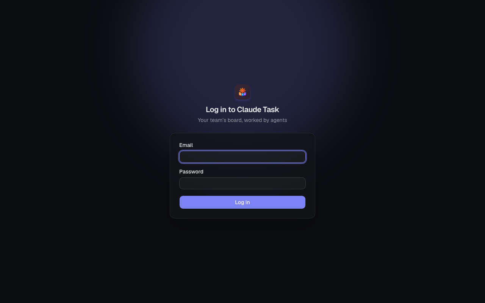
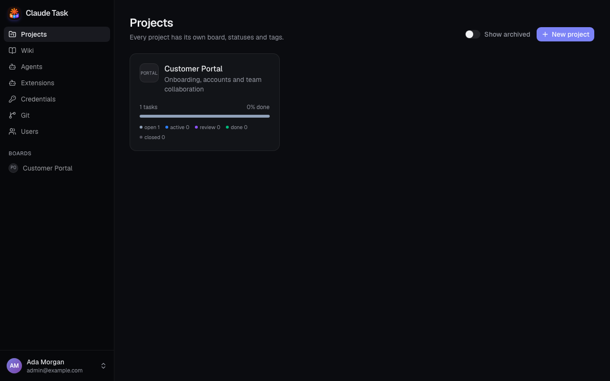

[Manual](README.md) › Start here

# Get your first Task ready

Sign in, find your team's Board and create a Task. You need your installation's URL and login details from an Admin.

## Sign in

1. Open the installation's URL in your browser.
2. Enter your **Email** and **Password**.
3. Click **Log in**.
4. If **Choose your password** appears, enter your **Temporary password**, a **New password (at least 8 characters)** and **Confirm new password**, then click **Change password**.

Ask an Admin for a password reset if you cannot sign in. There is no self-service registration or password reset email.

## Find your way around

**Projects** lists your team's Projects. Open one to see its Board, or use a shortcut under **Boards** in the sidebar. **Wiki** opens shared knowledge conversations. **Agents** shows available Agents and their work. Admins also see **Extensions**, **Credentials**, **Git** and **Users**.

In the native app on a phone, tap the teal app icon at the top left of **Projects** or **Wiki** to open navigation and Settings. On native desktop, use the Project rail and its **Settings** button. See [Native app and notifications](native-app-and-notifications.md#open-navigation-and-settings) for the available settings.

Click your name at the bottom of the web sidebar to choose **Dark**, **Light** or **System** under **Theme**, **Change password**, or **Log out**. Changing your password ends your other Logins.

## Create a Task

1. Open an existing Project. To create one, choose **New project**, enter **Name**, check its **Key**, and click **Create project**. The Key is permanent.
2. On the Board, choose **Add task** in the **Todo** column.
3. Type a clear title, such as “Write the onboarding guide”, and press Enter. The Task appears with a Task Key, such as `PORTAL-1`.
4. Click the Task to open it.
5. Write its **Description**, including the outcome and any constraints. Click outside to save.
6. Set its **Assignees**, **Priority** and **Tags** as needed.

Your team can now discuss and track the work without an Agent.

## Ask an Agent to help

1. Select an **Agent** in the Task details.
2. Write a regular Comment explaining what you want it to do.
3. Click **Comment** or press Enter.

The Agent starts when ready, or waits in its Queue. Assignment alone does not start work. Leave **Internal chat** off for instructions the Agent should receive. Read [Agent sessions and queues](agent-sessions-and-queues.md) before stopping, closing or reassigning active work.

## Related

- [Projects and boards](projects-and-boards.md): customize your workflow and find Tasks.
- [Troubleshooting](troubleshooting.md): resolve access or startup problems.

---

← [Manual](README.md) · [Projects and boards](projects-and-boards.md) →
