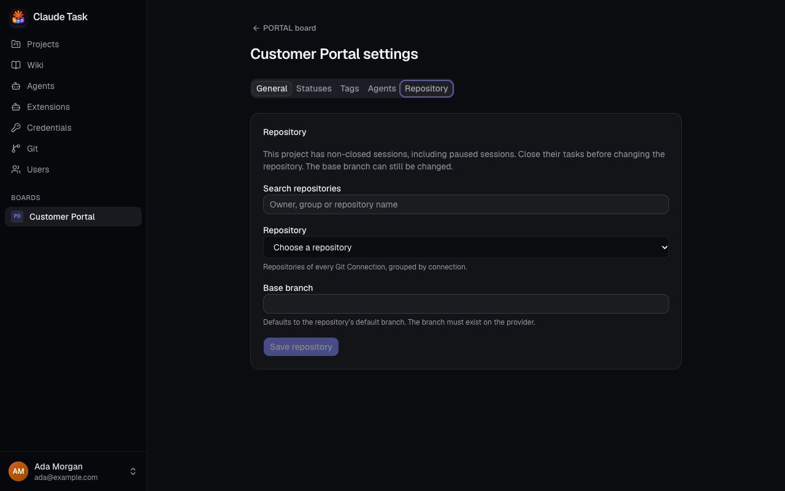
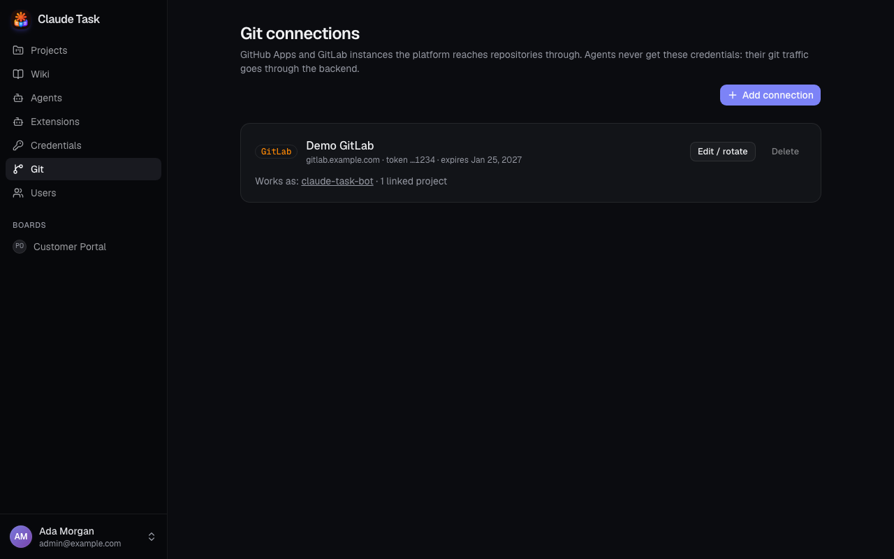

[Manual](README.md) › Team work and administration

# Connect a Repository and review Agent changes

Link a Project to GitHub or GitLab so its Agents can work on code and propose changes for review. Admins manage Git Connections; every User can link a Project's Repository.

## Add a Git Connection (Admins)

A Git Connection gives the installation access to a code host. Several connections can coexist, including several GitLab instances. Its Connection Secret stays in the backend; Agents use the platform's Git Proxy.

1. Open **Git** in the sidebar.
2. Click **Add connection**.
3. Select **Provider** and enter a recognizable **Name**.
4. Supply the fields for your provider:

| Provider | Fields and required access |
| --- | --- |
| **GitHub App** | **App ID** and **Private key (PEM)**, using an RSA key. Grant Contents read/write, Pull requests read/write and Metadata read. Administration read enables the optional provider protection check. Install the App on the Repositories you want to use. |
| **GitLab (gitlab.com or self-managed)** | **GitLab URL** and **Token**. The token needs `api` and `write_repository` scopes, and its User needs at least Developer access to the projects you want to list. |

5. Click **Save connection**. The application checks access before saving.

An App with no installations can be saved, but lists no Repositories. For GitLab, use the HTTPS instance URL, including any instance path prefix.

Use **Edit / rotate** to rename a stored connection or replace its secret. Leave the new secret field empty to retain the current one. The provider and GitLab URL are fixed after creation. Connections marked **Environment · read-only** are managed by your installation operator.

Stored GitLab tokens are rotated automatically before expiry. If a card reports a rotation failure, replace its token with **Edit / rotate**. Environment tokens require renewal by the operator. You can delete a stored connection once no Project or Wiki uses it.

## Link a Project's Repository

1. Open the Project's Board and click **Settings**.
2. Open the **Repository** tab.
3. Use **Search repositories** to find an owner, group or Repository name.
4. Choose **Repository** from the groups organized by Git Connection.
5. Check **Base branch**. It defaults to the Repository's default branch and must already exist on the code host.
6. Click **Save repository**. You see **Repository saved** when it succeeds.

If a connection is unavailable, its error appears beside the remaining choices. Ask an Admin to fix it if the Repository you need is missing.

You can change the Base Branch later. To change the Repository, first close every non-closed Session in the Project, including pending and paused Sessions. Unassigning an Agent pauses its Session and does not satisfy this requirement. Changing the Repository clears old branch and pull request links; each Task keeps its branch name for future work.

## Understand the protection indicator

**Base branch protection** shows **Protected**, **Not protected** or **Unknown**, based on what the code host reports. Use **Re-check protection** after changing provider settings.

The platform's Push Policy allows an Agent to push its own Task Branch, including force pushes. It blocks pushes to other branches, tags and branch deletions. The provider's Base Branch Protection is an additional control; **Unknown** means the application could not determine that control's state.

## Review and merge changes

1. Assign an Agent to a Task and send a Comment with the requested work.
2. Ask the Agent to commit, push and open or update a pull request when ready.
3. Open the Task's branch link to inspect the code, or its pull request badge to review on the provider.
4. Review the code. When the pull request is open and not a draft, click **Merge pull request** (**Merge merge request** on GitLab) in the Task's "Task code" section and confirm, or merge on GitHub or GitLab. The provider's own rules (required reviews, checks, conflicts) still apply: if it refuses, you see an error and nothing changes.
5. Set the Task's Status to reflect your team's workflow.

Task Branch names are assigned when the first Job starts, for example `task/web-12-improve-onboarding`. Renaming the Task keeps that branch name. GitLab badges use merge request terminology.

A Task has one pull request at a time. If you ask the Agent for changes while it is open, the Agent pushes to the same branch and the pull request updates; once it is merged or closed, the Agent opens a new one.

Pull request state and Task Status are independent. Merging a pull request leaves the Task's Status unchanged. Moving a Task to **Done** also leaves the Session available; a Status in the `closed` Category ends it.

Closing removes the Agent's local Worktree. Ask the Agent to push work before closing: reopening recreates its working files from the remote Task Branch.

## Related

- [Projects and boards](projects-and-boards.md): configure Project Statuses and settings.
- [Agent sessions and queues](agent-sessions-and-queues.md): start, stop and retry work.
- [Wikis](wikis.md): use a Repository as a shared knowledge base.

---

← [Wikis](wikis.md) · [Native app and notifications](native-app-and-notifications.md) →
