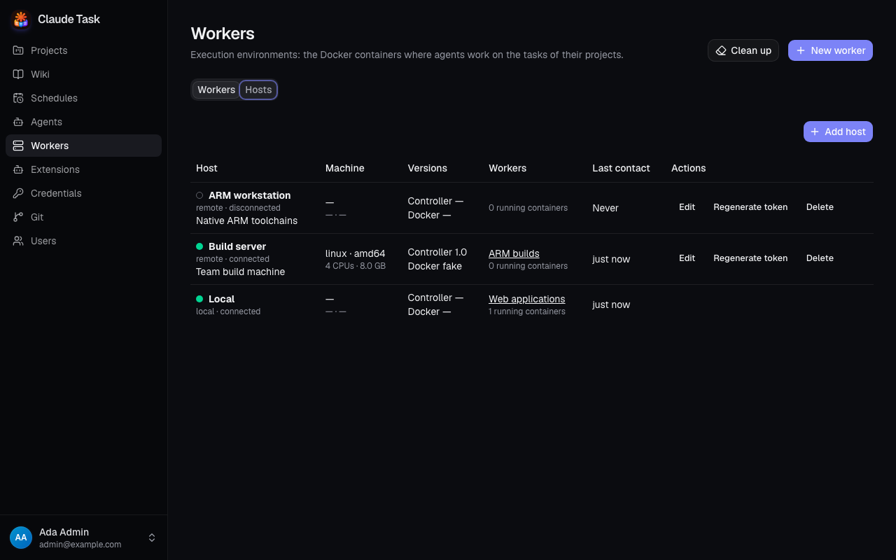
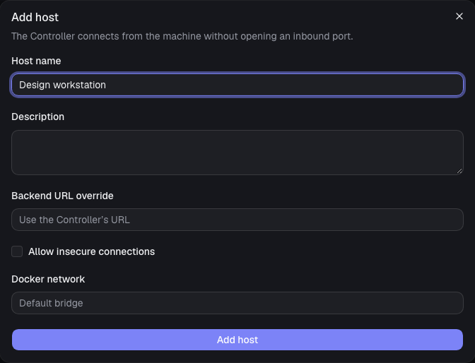
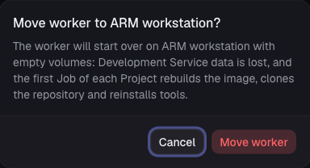

[Manual](README.md) › Administration

# Run Workers on other machines

A **Host** is the machine that runs a Worker's containers, images and volumes. The **Local Host**, named **Local**, is the backend's own machine. A **Remote Host** is another server or workstation connected by a **Host Controller** that you run there.

Every User can see Hosts and where Workers run. Admins add, edit and delete Remote Hosts and choose the Host of a Worker. Host management is in the web app.

## Read the Hosts list

Open **Workers** in the sidebar, then choose the **Hosts** tab. Each row shows the Host's kind, connection state, machine information, Controller and Docker versions, Workers, running containers and last contact. Any connection error appears beside the Host.

A connected Host has a filled green dot. A disconnected Host has a hollow grey dot. The connection is the Controller's path to Docker; each container's Runner has its own connection to the backend.

## Add and connect a Remote Host

You need access to the machine where Docker will run, and a clone of the repository at the backend's version. The machine needs outbound access to the backend. It needs no inbound port.

1. Open **Workers** → **Hosts** and click **Add host**.
2. Enter **Host name** and an optional **Description**.
3. Leave **Backend URL override** empty to use the URL the Controller connects with. Set an override when the Worker Containers need a different reachable address, such as a VPN address.
4. Leave **Docker network** empty for Docker's default bridge, or enter a named network for the Worker Containers. A missing named network is created on that Host.
5. Click **Add host**.
6. In **Connect the machine**, copy the Host Token and commands before closing the dialog. **This token is shown only once**.
7. On the new machine, run `scripts/deploy.sh host` from the clone. Enter the backend URL and Host Token when asked. The script installs Docker when needed, builds the Controller image and starts it with the Docker socket mounted.
8. Return to **Hosts** and wait for the Host to show **connected** with its machine details.

You can instead use **Copy command 1** and **Copy command 2** in the connect dialog to build and run the Controller yourself. **Copy command 3** copies the deploy-script alternative. Keep the token private; the Controller uses it to identify this machine to the backend.

Use an `https` backend URL. For a trusted development network that requires `http`, enable **Allow insecure connections** on the Host and allow insecure connections when the deploy script asks. A manual Controller run also needs `CLAUDE_TASK_ALLOW_INSECURE=true`.

## Edit a Host or replace its token

Use **Edit** on a Remote Host to change its name, description, backend URL override, insecure-connection choice or Docker network, then click **Save**. Changing the URL or network recreates each Worker Container as soon as its current Job finishes.

Use **Regenerate token** when you need a replacement or suspect the old token was exposed. Confirm **Regenerate token**, then copy the new token from **Connect the machine**. The current Controller is disconnected and the old token stops working. Run `scripts/deploy.sh host` again on that machine with the new token; it replaces the existing Controller container.

The **Local** row has no edit, token or delete actions. Its backend URL and network are configured by the installation operator.

## Choose or move a Worker's Host

When creating a Worker, choose **Host** in the form. **Local** is preselected when enabled. An installation with only one Remote Host preselects it; with several Remote Hosts, choose one.

To move an existing Worker:

1. Open the Worker and choose **Configuration**.
2. Change **Host** to the destination.
3. Read the confirmation and click **Move worker**.

The move applies immediately, separately from **Save Docker configuration**. It is accepted only after every started conversation on the Worker's Projects is closed and every active Job has ended. A refusal lists the Tasks to close. Delete the started Chats of a Wiki before moving its Worker.

> **Warning:** A moved Worker starts over with empty volumes. Its Development Service data is lost. Its images, repository clones, tools and Agent Profiles are rebuilt on the destination; volumes are not copied between machines.

The Worker keeps its Projects, Queue and Build history. Resources left on the old Host are removed while it is connected, or by a Cleanup after it reconnects.

## Understand a disconnected Host

| What you see or do | Result |
| --- | --- |
| A Worker shows **Host offline** | Its Host is disconnected and it has no connected Runner. Work waits. |
| A Worker keeps its usual state with a disconnected-Host banner | Its connected Runners keep processing Jobs. |
| Builds, scaling or Extension synchronization need Docker | They wait and resume after the Controller reconnects. |
| **Restart**, **Force recreate**, **Logs** or **Rebuild image** | The action answers **Host disconnected** until the Controller returns. |
| **Recreate when idle** | The request is kept and applied after reconnection. |
| A Cleanup includes a disconnected Host | The report shows it as pending and adds its results after reconnection. |

The Controller reconnects automatically after a temporary connection loss. If it stays disconnected, check the error in **Hosts**, the machine's network access and its Controller logs. A message asking you to rebuild the Controller means it needs the backend's current version.

## Delete a Remote Host

Move every Worker off the Host first. Click **Delete** on its row and confirm **Delete host**. A refusal names the Workers you still need to move.

For a connected Host, the app removes this installation's containers, volumes, images and network resources before retiring the Controller. For a disconnected Host, the confirmation explains that the resources stay on the machine and must be removed by hand. Deleting the Host revokes its token.

## Related

- [Workers and capacity](workers.md): configure toolchains, containers and Queues.
- [Installation and operations](installation-and-operations.md): run without a Local Host and back up volumes on every machine.
- [Troubleshooting](troubleshooting.md): resolve connection and move errors.

---

← [Workers and capacity](workers.md) · [Extensions and environment](admin-extensions.md) →
