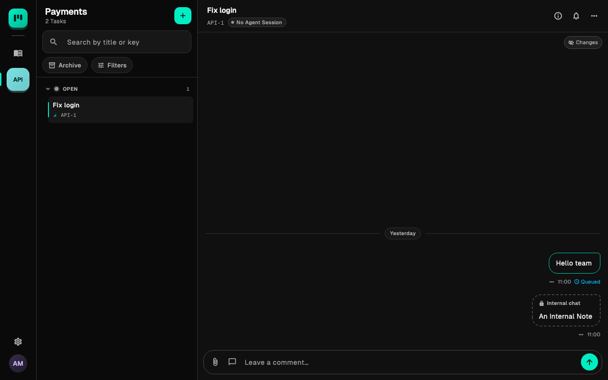
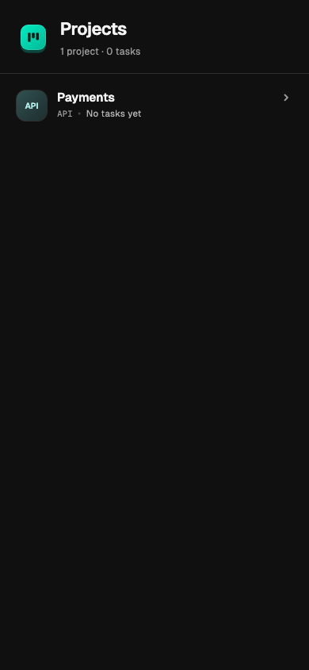
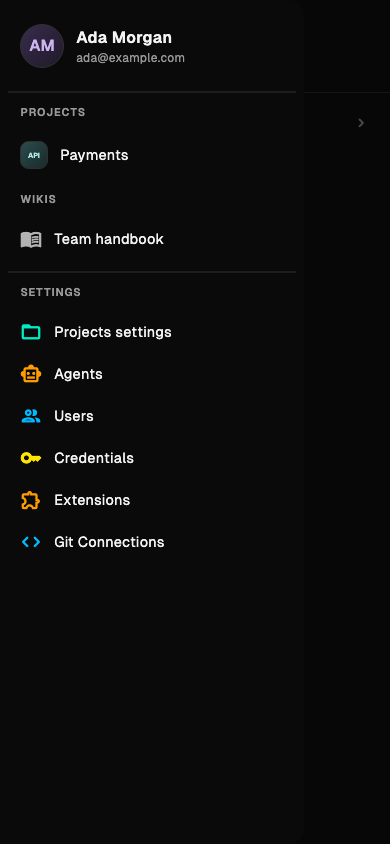
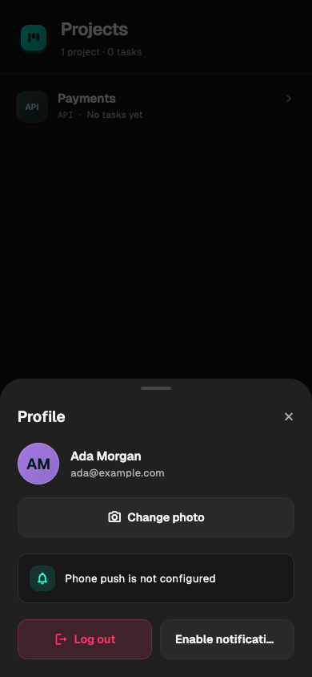

[Manual](README.md) › Team work

# Work from the native app and receive notifications

Use the native app to read Conversations, create and edit Tasks, work with Wikis and receive phone alerts. Settings also let you manage Projects and their Repositories. Admins can configure Agents, Credentials, Users, Extensions and Git Connections.

## Sign in

Ask your Admin for the native application and your installation's address.

1. Enter **Installation URL**, for example `https://tasks.example.com`. Enter the origin only, with no `/api` or other path.
2. Enter **Email** and **Password**.
3. Sign in. If you have a Temporary Password, choose a new password before continuing.

One installation and one User are active at a time. Open **Profile** and choose **Log out** before switching. Logging out clears that profile's cached Conversations, Drafts and downloaded Attachments on the device.

## Open navigation and Settings

On a phone, tap the teal Claude Task icon at the top left of **Projects** or **Wiki** to open the navigation drawer. You can also swipe in from the left edge. The icon is labelled **Menu** for accessibility. Back from a Task returns to its Project; Back again returns to Projects and its app icon.

The drawer shows your profile, Projects, Wikis and Settings. Tap a Project or Wiki to open it and close the drawer. Tap your profile to manage your photo, notifications or Login.

- **Projects settings** opens Project details, Statuses, Tags, archiving and Repository settings.
- **Agents** lists Agents. Admins can create or edit them and select their Extensions.
- Admins also see **Users**, **Credentials**, **Extensions** and **Git Connections**.

On desktop, choose Projects and Wikis from the left rail. The **Settings** button at the bottom of the rail opens the same Settings screens. Settings actions are available while online.

## Change your profile photo

Open your profile from the phone drawer or the avatar at the bottom of the desktop rail. Choose **Change photo**, select a PNG, JPEG, GIF or WebP image up to 2 MB, and wait for it to save. **Remove photo** restores your initials. Your photo appears in profile controls, assignee lists and Conversations. Agents show their own image, or their emoji when no image is set.

## Configure Extensions and Git

Admins can open **Extensions** from the drawer or desktop Settings hub to import Skills, manage Plugins and configure MCP Servers. Open **Agents**, choose an Agent and select its **Skills**, **MCP Servers** and **Plugins**, then choose **Save agent**. Pending changes and synchronization errors appear in the Agents list. See [Extensions and environment](admin-extensions.md#use-extensions-in-the-native-app).

Open **Git Connections** to add GitHub Apps or GitLab instances, inspect their health and rotate stored secrets. An empty replacement field keeps the saved secret. **Environment · read-only** connections are managed by the installation operator. See [Git repositories](git-repositories.md#use-git-settings-in-the-native-app).

Every User can open **Projects settings**, choose a Project, and open **Repository**. Search the Repositories grouped by connection, select one, check **Base Branch**, and choose **Save repository**. Open Sessions lock the Repository choice while leaving the Base Branch editable. The screen also shows provider protection and offers **Re-check protection**.

Dockerfiles, Builds, Development Services, resource limits and Project environment variables are configured in the web app.

## Find and update work

On a phone, open a Project, then a Task to reach its Conversation. Back returns one level. Wider windows show the Project rail, Task list and Conversation together; very wide windows also show Task details.

- Search by Task Key or title.
- Open **Filters** to choose priority, Tag or assignee. Use **Clear** to remove those filters.
- Enable **Archive** to show Tasks in closed-category Statuses.
- Open **Task details** to change Status, priority or Agent, or use **Edit Task** for title, description, assignees and Tags.
- Choose **Create Task** to add work. The Project’s Default Agent, when enabled, is assigned automatically. Choosing another Agent explicitly with **Create and assign** overrides it. Your first Comment starts the Agent.

If assignment fails after creating a Task, use **Retry assignment** on the created Task. It retries the assignment without creating another Task.

In the description editor, **Write**, **Markdown** and **Preview** share the same text. Content the visual editor cannot represent opens in Markdown mode. Image links appear as linked cards.

## Join the Conversation

Write in the composer and send. On a hardware keyboard, Enter sends, Shift+Enter inserts a newline, and Ctrl+Enter or Cmd+Enter also sends. Use the speech-bubble icon beside **Attach local files** to switch to **Internal chat**. It changes to a lock and keeps your text and attachments in place. Use the lock to switch back to a regular Comment. An Internal Note is visible to Users and hidden from the Agent.

Use **Attach local files** to stage files. They stay with your Draft until you send. Download received Attachments to open them with the device's viewer; downloaded images also have previews.

Scroll to the latest entry to mark the Conversation read while online and in the foreground. A bold Task row with a dot means it has unread entries. Read state is shared with your other devices and the web app. While reading older entries, use **Jump to latest** to return to the bottom.

The **Wiki** section offers shared Wiki Conversations and their settings, **Reset chat** and deletion. See [Wikis](wikis.md) before resetting a shared Conversation.

## Continue while offline

Previously fetched Projects, Tasks and Conversation pages stay readable. You can prepare Drafts and attach files; downloaded Attachments remain available. Live output is not part of the saved Conversation until stored by the server.

The app shows **Offline · loaded conversations and drafts are available** or **Reconnecting…**. Use **Reconnect** to try again. Reconnecting refreshes data. Send Drafts manually after reconnecting; the app does not submit them automatically.

If sending times out or loses its connection, the Comment may already have arrived. The app keeps the Draft and shows **Send outcome unknown. Check the refreshed conversation.**

1. Reconnect if necessary.
2. Choose **Refresh and review**.
3. Check the refreshed Conversation for your Comment.
4. Discard the Draft if it arrived, or send it manually if it did not.

## Follow, mute and enable phone notifications

Following determines which Tasks can notify you. Muting silences a followed Task without unfollowing it. Creating a Task, becoming an assignee, or posting a Comment or Internal Note can make you a follower; an explicit unfollow choice is preserved.

1. Open the Task's actions menu and choose **Follow Task**, or **Unfollow Task** to stop following.
2. Use **Mute Task** or **Unmute Task** in its header as needed. Wikis use **Follow wiki** and **Mute wiki**.
3. Open **Profile** and choose **Enable notifications** on an iOS or Android phone.
4. Grant the operating system's notification permission.

The Profile screenshot above shows the notification controls. Your status depends on the phone build and installation configuration.

Your installation and phone build must have push configured. If you see **Phone push is not configured on this installation**, ask your Admin. Declining permission leaves unread indicators available.

Alerts are sent for completed or failed Agent Turns and failed Jobs requiring attention on followed, unmuted Tasks. Their text is generic: **Claude Task** and **A Task you follow has an update.** Tap an alert to open the Task or Wiki, signing in first if needed. Alerts stay silent while the app is in the foreground. Desktop apps provide live updates and unread state while running.

## Related

- [Getting started](getting-started.md): access and your first useful result.
- [Extensions and environment](admin-extensions.md): manage the shared catalog and Agent assignments.
- [Git repositories](git-repositories.md): configure connections and Project Repositories.
- [Tasks and conversations](tasks-and-conversations.md): Comments, Attachments and delivery.
- [Troubleshooting](troubleshooting.md): resolve sign-in and Agent problems.

---

← [Git repositories and pull requests](git-repositories.md) · [Manage users and access](admin-users.md) →
