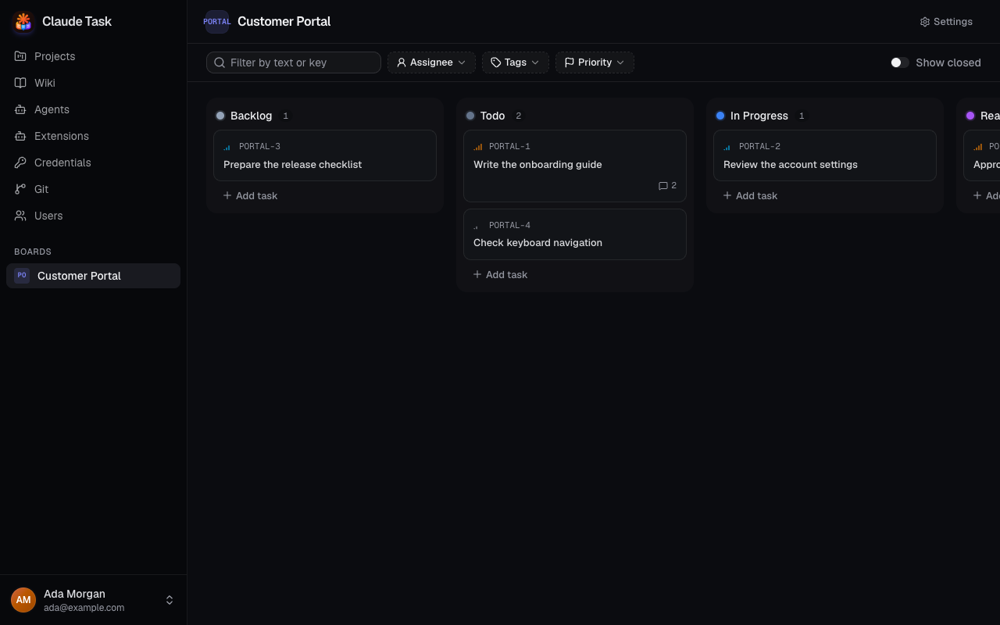
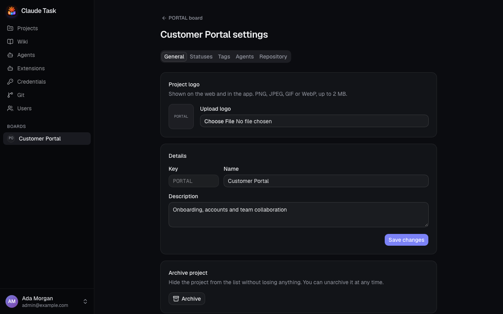

[Manual](README.md) › Team work

# Organize work in Projects and Boards

Use a Project to group related Tasks, then use its Board to track their progress. Every signed-in User can create Projects and manage their workflow.

## Create a Project

1. Open **Projects** in the sidebar.
2. Click **New project**.
3. Enter a **Name** and check the suggested **Key**. You can replace the Key with 2 to 6 uppercase letters.
4. Add an optional **Description**.
5. Click **Create project**. The new Board opens.

The Project Key is permanent. A Project with Key `WEB` has Task Keys such as `WEB-1` and `WEB-2`. Deleted Task numbers are not reused.

## See Project activity at a glance

Every Project in the sidebar's **Boards** list shows what is happening without opening it:

- A thin bar under the name splits the Project's Tasks: grey for open work (Backlog, Todo and In Progress), violet for review and green for Done. Closed Tasks are left out.
- The number beside the bar counts open Tasks over the total in the bar, for example `7/23`.
- A green dot means at least one Agent is running on that Project right now.
- An orange message with a number means Tasks with a finished Agent Turn you have not read. A Turn that ended with an error counts too. Tasks you muted and closed Tasks do not count, and Comments or edits on their own do not add to this number.

Hover a bar or the number for the exact count of each state. The cards on the **Projects** page show the same bar with the total Task count, the done percentage and a dot for each state.

## Read the Board

Each column represents a Status. A new Project starts with this workflow:

| Status | Category | Meaning |
| --- | --- | --- |
| Backlog | backlog | Work to consider, without an Agent. |
| Todo | open | Work ready to start. |
| In Progress | active | Work underway. |
| Ready for Review | review | Work ready for review. |
| Done | done | Work completed. |
| Closed | closed | Work ended and the Agent Session closed. |

Cards show the Task Key, title, priority, Tags, User assignees and Comment count. An assigned Agent has an avatar and may show a Queue position. A pull request badge appears when one exists.

Scroll horizontally to reach more columns. Turn on **Show closed** to include Statuses in the `closed` Category.

> **Note:** Moving a Task to **Done** keeps its Agent Session available. Moving it to a Status in the `closed` Category ends the Session and stops its work.

## Add and move Tasks

1. Click **Add task** at the bottom of the desired column.
2. Enter the title.
3. Press Enter. The Task appears at the end of that column, and the box stays ready for another Task.
4. Press Escape to close the box.

Click a card to open its details and Conversation. Drag cards between columns to change Status, or within a column to set their order. You can also change **Status** inside a Task.

Changes appear live for other Users viewing the same Project.

## Find Tasks

Use **Filter by text or key** to match part of a title or Task Key. Use **Assignee**, **Tags** and **Priority** to narrow the Board further. **Unassigned** in the Assignee filter means no User assignees, regardless of Agent assignment.

Multiple choices in one filter match any selected value. Different filters must all match. For example, choosing two Tags and **High** priority shows high-priority Tasks carrying either Tag. Click **Clear** to reset the filters.

## Customize Statuses and Tags

Open the Board's **Settings**. In the native app, open **Projects settings** from the phone drawer, or **Settings** → **Projects** on desktop, then choose the Project. Native settings include details, Statuses, Tags, archiving and **Repository**; the procedures below use web controls.

- In **General**, edit the Name or Description and click **Save changes**.
- In **Statuses**, enter **New status name**, choose its color and Category, then click **Add**. Existing names save when you leave their field. Use the up and down arrows to change column order.
- To delete a Status, click its delete button, choose **Move its tasks to**, then confirm **Delete status**. Its Tasks move to the destination column.
- In **Tags**, enter **New tag name**, choose a color, then click **Add**. Editing a Tag changes it on every Task using it. Deleting a Tag removes it from all those Tasks.

Each Project needs at least one `open` and one `closed` Status. Changing a Status's Category to `closed` closes the Sessions of every Task in it, so review the affected Tasks first.

The **Agents** and **Repository** tabs configure how Agents prepare and work on the Project. See [environment settings](admin-extensions.md) and [Git repositories](git-repositories.md).

## Set a Project logo and Default Agent

Every User can open the Project’s web **Settings** → **General** and use **Upload logo** or **Replace logo** under **Project logo**. Choose PNG, JPEG, GIF or WebP up to 2 MB. It saves immediately and appears in Project lists, headers and the native app. **Remove logo** restores the Project Key badge.

Open **Settings** → **Agents** and choose **Default agent** to assign an Agent to each new Task in that Project. The selection saves immediately. Choose **No agent** to clear it. An enabled Default Agent is assigned when a Task is created in either client; a disabled or removed Default Agent leaves new Tasks unassigned. Assignment creates a pending Session; the first regular User Comment starts work.

The native Create Task form can explicitly assign a different Agent after creating the Task. Configuring the Project’s Default Agent is available in the web app.

## Archive or delete a Project

To hide a Project while retaining its Tasks, open **Settings** → **General** and click **Archive**. Work continues, and the Board remains available through its URL.

To restore it, open **Projects**, enable **Show archived**, open the Project, then choose **Settings** → **General** → **Unarchive**.

An Admin can choose **Delete permanently** in an archived Project's General settings and confirm **Delete project**. This deletes its Tasks, Comments and Attachments. Stop active Agent work before deleting.

## Related

- [Tasks and conversations](tasks-and-conversations.md): edit a Task and collaborate with its Agent.
- [Agent sessions and queues](agent-sessions-and-queues.md): understand the effect of closing a Task.

---

← [Getting started](getting-started.md) · [Tasks and conversations](tasks-and-conversations.md) →
