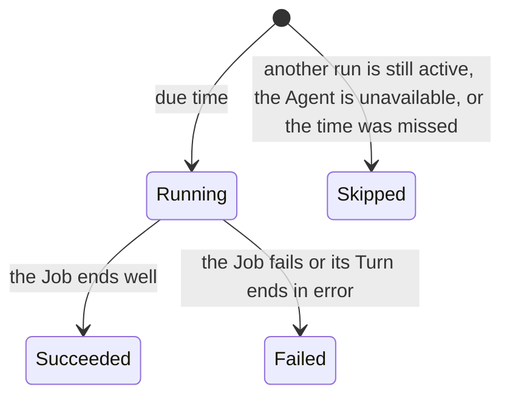
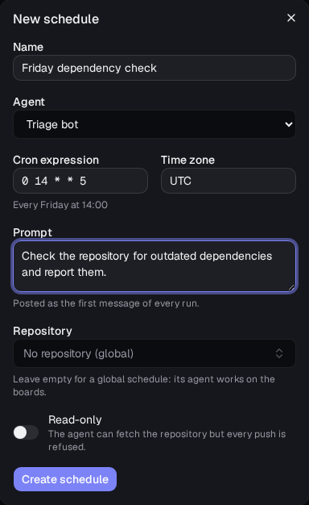
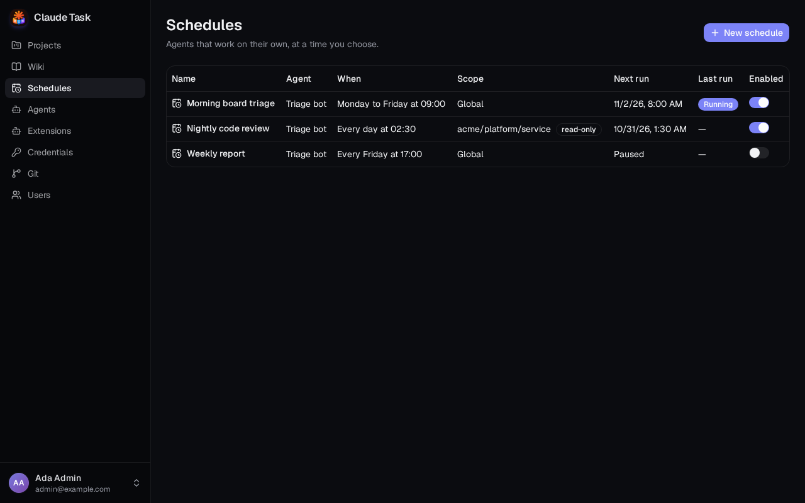
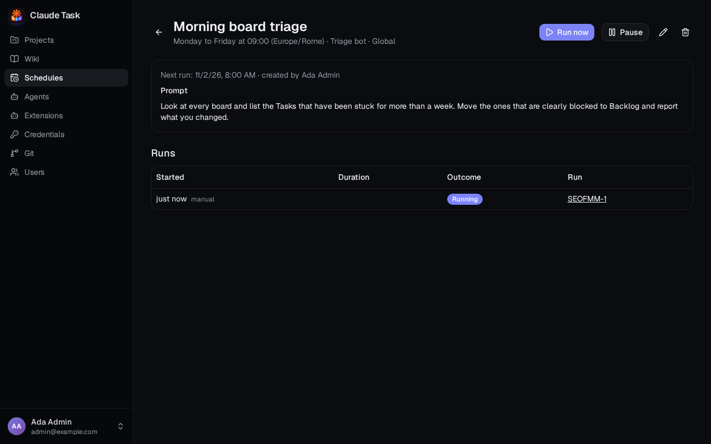
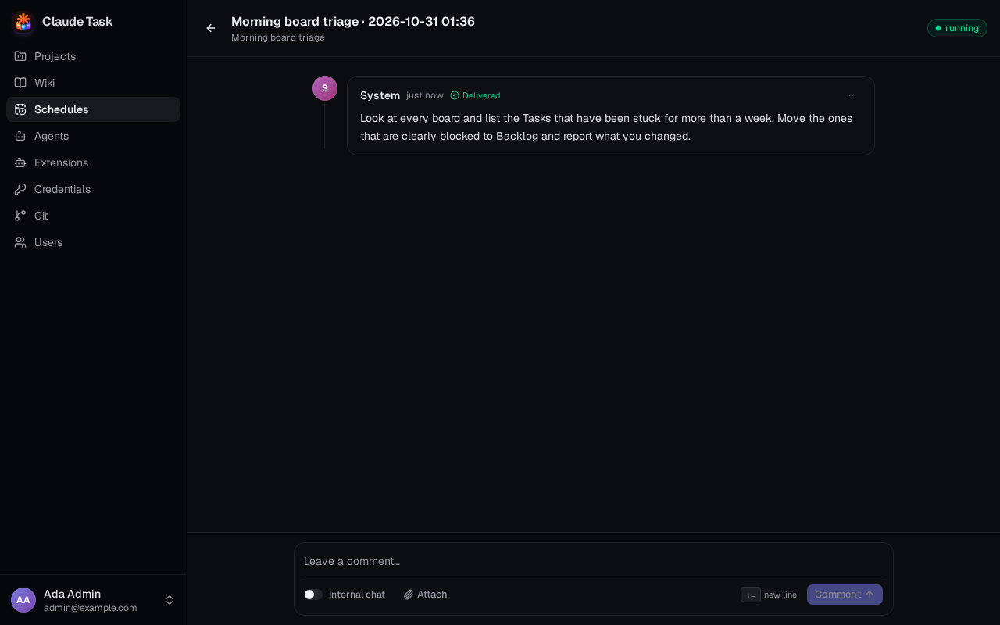

[Manual](README.md) › Team work

# Let an Agent work on a schedule

A Schedule starts an Agent's work by itself, at times you choose: a nightly review of a repository, a morning look at every board, a weekly report. Everyone can see the Schedules and read what their runs did. Only Admins create, change, pause and start them.

## How a Schedule works

A Schedule has a name, an Agent, a cron expression, a time zone and a prompt. Each time it is due, the platform starts a **Scheduled Run**:

1. It creates a Task for the run, named after the Schedule and the date.
2. It assigns the Agent and posts your prompt as the Task's first Comment, written by **System**. That Comment starts the Agent's work.
3. The Agent works unattended: no one answers it, so it decides on its own or ends with an explanation. **Questions** and **Surveys** are not available to it.
4. When the Agent's first Job ends, the run closes by itself as **Succeeded** or **Failed**, the Agent's working copy is removed and the Task's conversation stays readable.

Scheduled Runs live in the **Schedules** section, not on your boards. Their Tasks do not appear in the Projects list.

## Two kinds of Schedule

| Kind | Repository | What the Agent works on |
| --- | --- | --- |
| **Repository** | You choose one | A clean working copy of the Repository's base branch on every run, as for any Task |
| **Global** | None | The boards. The Agent works in an empty folder, and gets extra tools to see every Project, edit and create Tasks in any of them, assign Tasks to itself and start them |

A global Agent can move a Task to any Status of its Project except a closed one: closing is for people. A Task it assigns to itself and starts runs as an ordinary Task, in its own Session, after the run that started it.

A Schedule can be **Read-only**. The Agent can read and fetch the Repository, but every push is refused, with the message `claude-task: this schedule is read-only`. Nothing else changes for the Agent, so a read-only global Schedule can still edit Tasks.

## Create a Schedule

Admins only.

1. Open **Schedules** in the sidebar on the web, or from the drawer (phones) or the calendar button in the rail (desktops) in the native app, and click **New schedule**.
2. Enter a **Name** and choose an enabled **Agent**.
3. Write the **Cron expression**. A line under the field shows it in words, for example **Monday to Friday at 09:00**.
4. Check the **Time zone**. It starts with your browser's zone on the web and with **UTC** in the native app, where you pick it from a searchable list. The Schedule follows that zone's daylight saving changes.
5. Write the **Prompt**. It is posted as the first message of every run.
6. Optionally choose a **Repository** and its **Base branch**, and turn on **Read-only**. Leave the Repository empty for a global Schedule.
7. Click **Create schedule**.

A cron expression has five fields: minute, hour, day of the month, month and day of the week. It accepts lists (`1,3`), ranges (`1-5`), steps (`*/15`) and the names of months and days (`mon`, `jan`). When both the day of the month and the day of the week are restricted, a day matches if either does.

| Expression | Meaning |
| --- | --- |
| `*/15 * * * *` | Every 15 minutes |
| `0 9 * * 1-5` | Monday to Friday at 09:00 |
| `30 2 * * *` | Every day at 02:30 |
| `0 3 1 * *` | Day 1 of every month at 03:00 |

The most frequent Schedule runs once a minute. A time that does not exist when the clocks go forward runs at the first minute after the change; a time that happens twice when they go back runs once, the first time.

## Follow your Schedules

The **Schedules** list shows each Schedule's Agent, when it runs, its scope (the Repository or **Global**, with a **read-only** badge), the next run and the outcome of the latest run. Admins can pause or resume a Schedule with the switch in the last column.

Open a Schedule to see its prompt and its **Runs**: when each started, how long it took, its outcome and a link to its Task. Open the link to read the conversation and everything the Agent did. Skipped runs have no link.

A run is **Running** while its Agent works. While it runs you can write a Comment on its Task, for example to steer or stop the Agent. You cannot edit, move or delete the Task of a run; in the native app the conversation of a closed run is read-only and its Task details are hidden.

## Run now, pause and edit

On a Schedule's page, Admins can:

- **Run now**: start a run immediately, even while another run is active. It does not move the next run time.
- **Pause** or **Resume**: a paused Schedule starts no runs. Resuming it plans the next run from now, without catching up on what it missed.
- **Edit** (the pencil): change any field. Changes apply from the next run.
- **Delete** (the bin): remove the Schedule with all its runs. This fails while an Agent is working on one of them.

## When a run is skipped

A due time does not start a run in three cases, and the history shows a **Skipped** row with the reason, without a Task:

| Reason | What happened |
| --- | --- |
| **previous run still active** | The last run has not finished, so runs do not pile up behind a slow Agent. |
| **agent unavailable** | The Agent is disabled or was deleted. |
| **missed** | The backend was down and the due time is more than one period old. After a shorter outage, one catch-up run starts, whatever the number of missed times. |

## Alerts

The person who created a Schedule gets a phone alert when a run **fails** ("A scheduled run failed.") and when the Schedule has been skipped three times in a row ("A schedule keeps being skipped."). A succeeded run, or a single skip, sends no alert. These alerts do not depend on following or muting the run's Task. See [Native app and notifications](native-app-and-notifications.md).

## Related

- [Agent sessions and queues](agent-sessions-and-queues.md): how a run's Job is queued and followed.
- [Git repositories and pull requests](git-repositories.md): Repositories and the Push Policy that read-only Schedules extend.
- [Roles and limits](roles-and-limits.md): who can manage Schedules.

---

← [Wikis](wikis.md) · [Git repositories and pull requests](git-repositories.md) →
