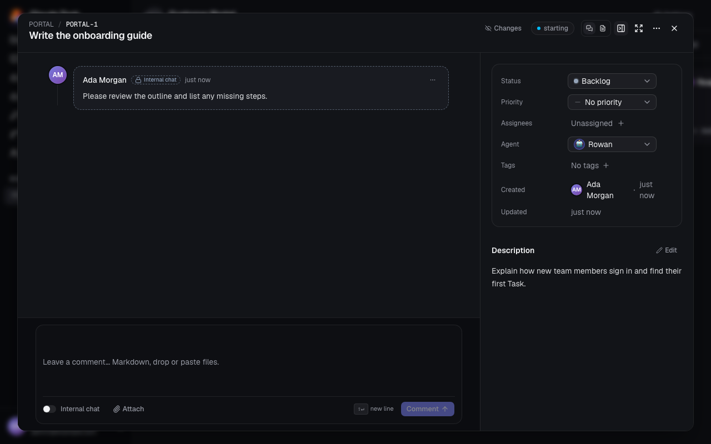
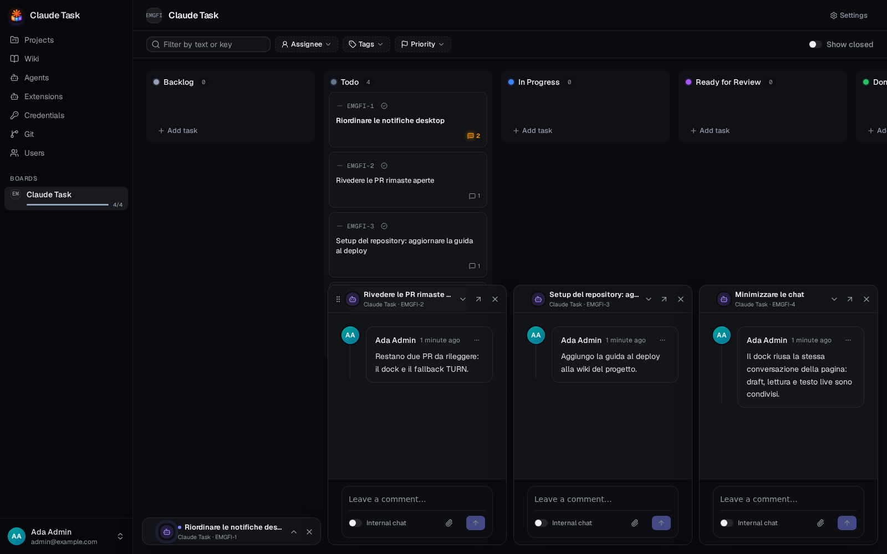

[Manual](README.md) › Team work

# Work on a Task with your team and Agent

A Task combines the work to do, its Conversation and the Agent's activity. Every signed-in User can edit and comment on any Task.

## Open and arrange a Task

Click a card on a Board. Use **Open full page** to open it as a page, or use **Task actions** → **Copy link** to share its permanent `/t/WEB-1` link.

The Conversation occupies the main panel by default, with Task details beside it. Use **Focus details** or **Focus activity** to choose the main panel. **Hide details**, **Show details**, **Hide activity** and **Show activity** control the other panel. This layout preference is remembered in your browser.

## Keep conversations at hand

Use **Minimize chat** in a Task's header, or in a Wiki Chat's header, to keep the conversation at the bottom of the window while you work elsewhere. The conversation leaves its page: a Task opened over the Board closes its dialog, a Task page returns to its Board, and a Wiki Chat returns to the Wikis list.

A newly minimized conversation sits by the bottom-right corner. Click its bar to open or collapse it: the three nearest the corner are open, and the others stay as title bars. **Open full page** takes a conversation back to its page and out of the Dock; **Close** removes it. A bar shows the Agent's avatar and state, the title with the Project and Task Key under it (the Wiki's name and the Chat's Task Key for a Wiki Chat), and a dot when there is something unread, with a halo pulsing around the avatar while the bar is collapsed. The Project and Task Key stay visible when the bar is collapsed, and the empty space around the bars leaves the page beneath clickable.

Visiting a minimized conversation's page, by clicking its card, following a link or going back, does not close it: its panel waits hidden while the page is open and comes back as it was when you leave, so the same chat is never shown twice. Only **Open full page** takes it out of the Dock for good.

To reorder the conversations, hover a bar and drag the grip that appears on its left: the row follows your order and remembers it. From the keyboard, focus the grip, press Space, move with the arrow keys and press Space again to drop. A conversation you minimize again returns to the corner.

An open conversation works like the page: Comments, the Active Runs bar, the Agent's live text and the composer, with Drafts and the read position shared. The composer of a panel keeps **Attach** and **Comment** as icons only, so the commands stay on one row; on a page they show their labels. A collapsed panel takes no room and marks nothing as read. The Dock stays above the composer of the page you are on, so you can still write there.

The Dock remembers up to six conversations in your browser, survives reloads, and is cleared when you sign in or out. On windows narrower than 768 pixels it is hidden and **Minimize chat** is not offered.

## Describe and assign the work

1. Edit the title at the top. Press Enter or click outside to save; Escape restores the previous title.
2. Set **Status**, **Priority**, **Assignees**, **Agent** and **Tags** in the details panel. Choices save immediately.
3. Click the **Description** text or **Edit** to update it. Use the formatting toolbar or Markdown shortcuts.
4. Click outside the description or press Escape to finish editing and save it.

You can assign several Users and one Agent. User assignees identify the people responsible for the Task. Assigning an Agent creates a pending Session; post a regular Comment to start its work. Changing the Agent later keeps the same conversation and applies the new Agent's configuration from its next Job.

A Project can have a **Default agent**, configured in its web **Settings** → **Agents**. New Tasks inherit that Agent when it is enabled. A disabled or removed default leaves new Tasks unassigned. Existing Tasks keep their assignment. In the native creation form, choosing another Agent assigns that Agent to the new Task. Your first regular Comment starts work in every case.

The Tag picker can create and apply a new Tag while you type. Tags belong to the Project.

If **Someone else changed this task** appears, the Task has refreshed and your conflicting change was not saved. Review the new value before editing again. A conflicting description draft stays available, with options to save it over the other edit or **discard your changes**.

Under the description, **Attachments** lists every file of the Task, newest first: files uploaded from the description editor and files attached to any Comment, by people or by the Agent. Each row shows an image thumbnail where available, the file name, its size, who uploaded it (or **Description**) and when. Click an image to open it in a new tab, or another file to download it. The list appears with the first upload, in the web app and in the native app's Task details.

## Send a Comment

1. Write in the Comment editor below the Conversation.
2. Leave **Internal chat** off when the Agent should receive it.
3. Click **Comment** or press Enter. Use Shift+Enter for a new line.

Comments support Markdown. Attach files with **Attach**, drag them into the composer, or paste them. You can send a file without text. Each Comment accepts up to 10 files, up to 25 MB each. Images preview in the Conversation; other files can be downloaded.

An unsent web draft, including its files and Internal chat choice, survives closing and reopening the Task in the current page. Reloading the page or logging out clears it.

### Keep a discussion among Users

Turn on **Internal chat**, write the Internal Note, then click **Send**. Every User can see it. Agents never receive it or its files. Its lock, dashed border and **Internal chat** label distinguish it from regular Comments.

The Internal Note choice cannot be changed after posting.

In the native app, use the speech-bubble icon beside Attach to switch to Internal chat. Its tooltip reads **Comment · switch to Internal chat**. Internal mode shows a lock icon, **Hidden from the Agent…**, and the tooltip **Internal chat · switch to Comment**. Switching modes keeps your text, files and focus. See [native Conversations](native-app-and-notifications.md#join-the-conversation) for sending and keyboard controls.

### Check whether the Agent received it

| Badge | Meaning |
| --- | --- |
| **Queued** | Waiting for the Agent to take the work. |
| **Delivered** | Passed to the Agent, which may still be working. |
| **Not delivered** | It will not be sent in this delivery. Hover over the badge for the reason. |

Comments on a Task that has never had an Agent have no delivery badge. They are included in the opening context after an Agent is assigned and a new Comment starts its work. Internal Notes are always excluded.

## Ask a side question with `/btw`

Type `/btw` followed by a question to ask something about the work while the Agent keeps going. The answer comes from a copy of the Agent's conversation that has no tools, so it can read what has happened so far but changes nothing, and the Agent's own work is not interrupted.

1. Type `/` in the composer and pick **/btw** among the **System** commands, or type `/btw ` and your question, for example `/btw why did you pick that library?`.
2. Click **Send**. Your question appears as a **Btw** box (pink on the web, violet in the native app) with **Thinking…** while the answer is prepared.
3. The answer appears under it in the same style, as a Comment from the Agent.
4. To keep talking about it, click **Reply** on the question or the answer, write your follow-up and send it. A **Replying to btw** label above the composer shows what you are continuing; dismiss it to write a normal Comment.

A new `/btw` starts a fresh side conversation from the Agent's conversation as it is at that moment. A reply continues the earlier one, which only knows what the Agent had done when that Btw began.

Btw Comments are visible to every User and are never sent to the Agent, like Internal Notes, but they have their own colour and no lock. They show no delivery badge. The copy sees finished steps, not a tool call still running or text the Agent is still writing.

`/btw` works once the Agent has started on the Task. It tells you why when it cannot run:

- the Task has no Agent, or the Agent has not started yet;
- the Task is closed (reopen it first);
- another Btw of the Task is still being answered;
- you are replying to a Btw from before a `/clear`; start a new `/btw` instead.

If the answer cannot be produced, a notice in the Btw style says why, and you can reply to try again. A Btw needs a connection and takes text only, no files.

## Start the conversation over with `/clear`

Send `/clear` on its own to make the Agent start a fresh conversation for the Task, as `/clear` does in Claude Code. Every Comment stays in the Task; only the Agent's memory starts over. Pick **/clear** among the **System** commands, then click **Send**.

1. If the Agent is idle, the chat clears at once and a line reading **‹name› cleared the chat** appears in the conversation.
2. If the Agent is working, the Session indicator adds **Clear pending**. The current Turn finishes untouched and the chat clears when the Agent's work ends; the line appears then.
3. The next Comment you send starts the new conversation. It begins with the Task and the Comments written after the line, plus anything you posted while the clear was pending.

Btw conversations started before a clear cannot be continued. `/clear` has nothing to clear on a Task with no Agent, one that has not started, or a closed one, and says so.

## Correct or remove a Comment

Open **Comment actions** on your own Comment, select **Edit**, change the text, then click **Save**. Use **Cancel** to leave it unchanged.

An edit to a queued Comment changes what the Agent receives. An edit to a delivered Comment changes only what Users see. Post another Comment when you need to correct instructions already delivered.

Choose **Delete** from Comment actions and confirm to remove your Comment and its files. A deletion notice remains on the Timeline. Deleting a queued Comment withdraws it; deleting one already delivered does not remove it from the Agent's memory. Admins can delete any Comment, but can edit only their own.

## Read activity and tell the Agent about edits

The Timeline combines Comments, the Agent's work and recorded field changes called Revisions. The **Timeline visibility** menu (the eye in the Task header) has a checkbox for each thing you can hide: **Task changes** hides Revisions and is checked at first, and **Agent activity** hides the Agent's work and tool calls. Choose either, both or neither; **Show everything** clears both. The menu names what is hidden now. The choice is yours, not the Task's: it applies to every Task in every Board, to the Chat Dock and to your other browser tabs, and it is remembered after a reload. Use **Load older activity** for earlier entries. Expand **Thinking** or an Activity group to inspect the Agent's work.

New output stays in view while you are at the bottom. Scroll up to read older activity without being pulled back down. Reaching the latest entry in a visible browser tab marks it read across your clients.

When **Notify agent** appears after you change the title, description, priority or Tags, click it to send the changes the Agent has not seen. It is available for an existing idle or running Session. Editing a field by itself does not deliver those changes to the Agent.

Type `/` to see the Agent's available commands and Skills, including the ones the repository carries in its `.claude/skills` and `.claude/commands` folders. Repository Skills appear once the Agent has started working in the Task. Use arrow keys and Enter or Tab to choose a suggestion, then finish and post the Comment. Native commands at the start of a Comment wait until the current Turn ends.

## Review code changes

The Task's details show its branch and Pull Request when available. For an open, non-draft Pull Request, use the merge action after checking the changes. The app asks you to confirm **Merge** and applies the code host's own review and check requirements. The merge leaves the Task's Status unchanged and never closes the Task. See [Git repositories and pull requests](git-repositories.md#review-and-merge-changes) for web and native controls.

To see what the Agent left uncommitted, open **Task actions** and choose **Changes**. The dialog lists the Worktree's modified, added, deleted and untracked files. It reads the Worktree when it opens and shows the last read when the Worker is not running. See [See the files an Agent left uncommitted](git-repositories.md#see-the-files-an-agent-left-uncommitted).

## Delete a Task

Choose **Task actions** → **Delete task** and confirm **Delete task**. Its Comments, Attachments and history are deleted. Stop active Agent work or close the Task before deleting it.

## Related

- [Agent sessions and queues](agent-sessions-and-queues.md): start, stop and retry Agent work.
- [Native app and notifications](native-app-and-notifications.md): follow and mute Tasks and receive phone alerts.

---

← [Projects and boards](projects-and-boards.md) · [Agent sessions and queues](agent-sessions-and-queues.md) →
