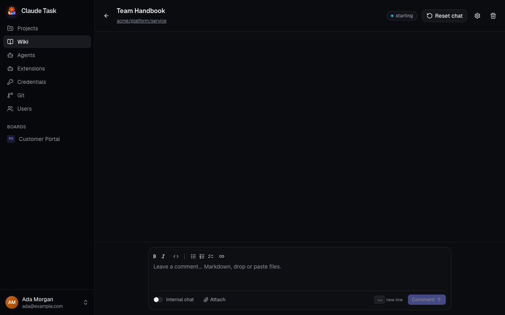

[Manual](README.md) › Team work

# Build and use a shared Wiki

A Wiki combines Markdown files in a Repository with shared Chats and one assigned Agent. A Chat is a separate Conversation with the Agent, open to everyone: start as many as you like, and come back to any of them later. Ask questions about your documentation or ask the Agent to update it. Every signed-in User can create, edit and delete Wikis, and start, rename and delete their Chats.

## Create a Wiki

Before you start, ask an Admin to configure a [Git Connection](git-repositories.md). Prepare a Repository containing your Markdown files and any Skills or `CLAUDE.md` instructions the Agent should follow.

1. Open **Wiki** in the sidebar.
2. Click **New wiki**.
3. Enter a **Name** and, optionally, a **Description** explaining the Wiki's purpose.
4. Choose an **Agent**.
5. Choose a **Repository**. Each choice includes its Git Connection's name.
6. Check **Base branch**. Selecting a Repository fills its default branch; you can choose another existing branch.
7. Click **Create wiki**. The Wiki opens with an empty Chat, ready for your first Comment.
8. Write your first Comment, for example, “Find the onboarding instructions and explain how a new colleague gets access.” Send it to start the Agent.

Assigning an Agent alone starts no work. Your first Comment starts its Session.

## Ask questions and request changes

Use the composer as you would on a [Task](tasks-and-conversations.md). Comments, Attachments, **Internal chat**, streamed Agent output, Thinking and Activity work the same way. An Internal Note stays visible to Users and is never delivered to the Agent.

Every Chat is shared with everyone using the Wiki. The Agent reads and changes files in the Repository on a dedicated Task Branch. Ask it to commit, push and open a pull request when changes are ready for review. The header shows branch and pull request links once available. Review and merge on GitHub or GitLab.

Use **Stop** to interrupt a running Turn in the open Chat. If starting work failed, fix the reported problem and use **Retry**. See [Agent sessions and queues](agent-sessions-and-queues.md).

If a Wiki has not been used for a while (30 minutes by default), its Agent's container stops to free resources. Your next Comment starts it again, and the first reply takes a little longer. See [Agents and credentials](admin-agents.md#containers-and-work).

## Change the Wiki's settings

1. Open **Wiki settings**, the gear button in the header.
2. Change **Name**, **Description** or **Agent**.
3. Click **Save wiki**.

The Repository and Base Branch are fixed when you create the Wiki. When you change the Agent, the Chats run by the previous Agent stay readable but you cannot write in them: the composer explains which Agent runs the Chat. Assign the Wiki back to that Agent to continue them. New Chats use the new Agent.

## Work with several Chats

The list on the left shows the Wiki's Chats, the most recently active first. Each row shows the Chat's title, when it last changed, a dot when it has Comments you have not read and a spinner while the Agent is working on it.

1. Click **New chat** to start a clean conversation. The Chat appears in the list when you send its first Comment, and its title is the start of that Comment.
2. Click a Chat in the list to read it. You can keep writing in any Chat; the Agent continues that Chat's own conversation, so it remembers what was said there.
3. Open a Chat's **Chat actions** menu (the three dots) and choose **Rename** to give it a better title. Everyone sees the new title.

All the Chats of a Wiki work in the same Repository, on the same Task Branch and the same pull request. A Chat you open later sees the files as they are now, which may have changed since you last wrote in it.

Use **Minimize chat** in a Chat's header to keep it at the bottom of the window while you read another Chat: the Chat leaves the page and returns to the Wikis list, and the Dock keeps it at hand. Opening it from the Dock brings it back to its page. See [Keep conversations at hand](tasks-and-conversations.md#keep-conversations-at-hand).

If the Agent's earlier conversation for a Chat is no longer available (for example after the Agent was rebuilt), the Chat says so and your next Comment starts a new conversation from the Chat's earlier Comments.

## Delete a Chat

1. Open the Chat's **Chat actions** menu and choose **Delete**.
2. Read the confirmation, then confirm.

> **Warning:** Deleting a Chat removes it for every User, including its Comments, Attachments and Agent output. You cannot get it back. Repository files, the Task Branch and any pull request are kept, and so are the other Chats.

If the Agent was working in that Chat, it stops first. Use this when a Chat holds something that must not stay, such as a secret pasted by mistake.

## Delete a Wiki

1. Stop any running Agent and wait for it to finish stopping.
2. Click **Delete wiki**, the trash button in the header.
3. Confirm **Delete wiki**.

Deletion removes the Wiki and all its Chats from the application. The remote Repository, its branch and pull request remain on the code host.

## Use Wikis on a phone

Tap the app icon in **Projects** or **Wiki** to open the navigation drawer, then choose an existing Wiki. It opens its list of Chats; open one to read it, or use **New chat**. Back from a Chat returns to the list of Chats, and back from there to the Wiki list; its app icon opens the drawer again, and **New wiki** starts another Wiki.

If the installation has no Wikis yet, create its first Wiki in the web app. It then appears in the phone drawer. Desktop native users can open the Wiki list directly from the Project rail.

## Related

- [Tasks and conversations](tasks-and-conversations.md): compose Comments, attach files and use Internal Notes.
- [Git repositories and pull requests](git-repositories.md): understand branches and review changes.
- [Native app and notifications](native-app-and-notifications.md): follow and mute a Wiki on your phone; a notification opens the right Chat.

---

← [Agent questions and files](agent-questions-and-files.md) · [Schedules](schedules.md) →
