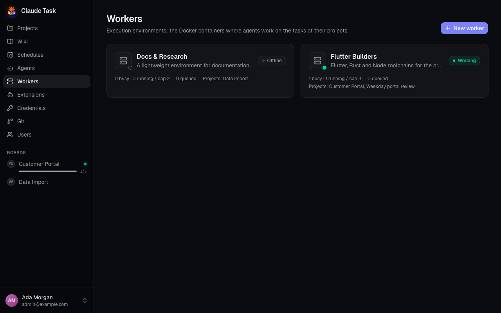
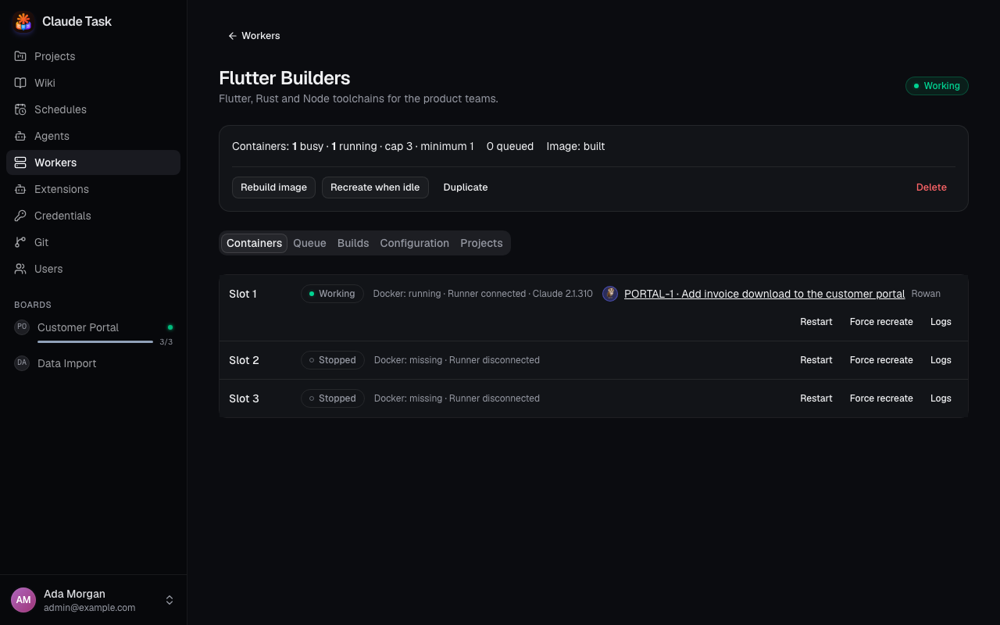
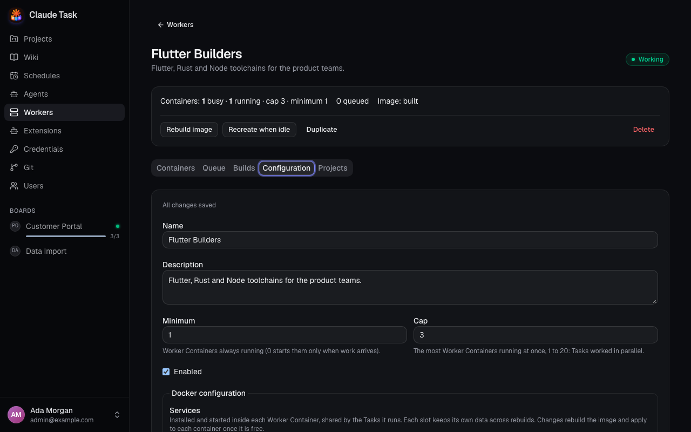
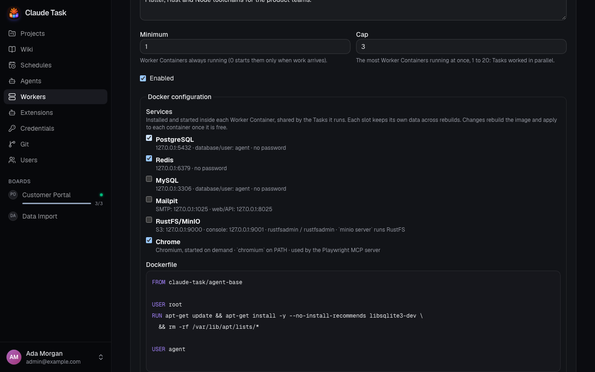

[Manual](README.md) › Administration

# Set up Workers and capacity

A Worker is the Docker environment where Agents work. Every Project, Wiki and Schedule runs on one Worker, and one Worker can serve many Projects. Admins create and configure Workers. Every User can see them, choose them for Projects, Wikis and Schedules, and manage their Queue.

Create at least one Worker before the first Project. The Project, Wiki and Schedule forms cannot be submitted until a Worker exists.

## Understand Workers and Agents

An Agent and a Worker do different jobs:

| Part | What it holds |
| --- | --- |
| **Agent** | The Claude Code configuration: Credential, model, effort, permission mode, system prompt, environment, Skills, MCP servers and Plugins. |
| **Worker** | The execution environment: Dockerfile, toolchains, Development Services, CPU and memory limits, and the number of Worker Containers. |

A Worker runs between its **minimum** and its **cap** of Worker Containers. Each Worker Container runs one Job at a time for any Agent, and all containers of a Worker share its files, repositories, Worktrees and Claude transcripts. An Agent has no limit of its own: the same Agent can work on several Tasks at once on several Worker Containers.

A Project's Tasks always run on that Project's Worker. Changing the Agent of a Task changes only its Claude Code configuration, not where it runs.

## Read the Workers list

Open **Workers** in the sidebar. Each card shows the Worker's state, its busy and running containers against its cap, how many entries wait in its Queue, and the Projects it runs.

| State | Meaning |
| --- | --- |
| **Idle** | Enabled, with an image and at least one connected Worker Container, and no active Job. |
| **Working** | At least one Worker Container runs a Job. The card also shows how many containers are busy. |
| **Offline** | Enabled, but no Worker Container is running. A Worker with minimum 0 rests here until work arrives. |
| **Building** | The latest image Build is running. Existing containers keep working on the previous image. |
| **Build failed** | The latest Build failed. Existing containers keep working on the previous successful image. |
| **Disabled** | The Worker takes no new work. Its Queue keeps accumulating entries. |

## Create a Worker

1. Open **Workers** and click **New worker**.
2. Enter **Name** and an optional **Description**.
3. Set **Minimum** and **Cap**. The minimum is how many Worker Containers stay running; 0 starts them only when work arrives. The cap, from 1 to 20, is the most Tasks the Worker can run at once.
4. Under **Services**, select the Development Services to install in every container: PostgreSQL, Redis, MySQL, Mailpit, RustFS/MinIO and Chrome. PostgreSQL and Redis are selected by default.
5. Edit the **Dockerfile** to install the toolchains your Projects need. It must start `FROM claude-task/agent-base` and finish as `USER agent`.
6. Optionally set a **CPU limit** and **Memory (MB)** per Worker Container.
7. Leave **Enabled** checked and click **Create worker**.

Creating a Worker starts its first image Build immediately. The Worker shows **Building** until the Build succeeds. It then starts the containers from slot 1 to the minimum, and further containers as work arrives.

## Work with Worker Containers

Open a Worker and use the **Containers** tab. Each row is one **Worker Slot**, numbered from 1 to the cap. A row shows the container state, whether its Runner is connected, its Docker state, the Task and Agent of its current Job, the Claude version and the last activity.

Admins have three actions per row:

| Action | Result |
| --- | --- |
| **Restart** | Restarts the existing container. Its current Job stops and its Session resumes after the Runner reconnects. A stopped container answers with an error, because it starts when work needs it. |
| **Force recreate** | Replaces the container immediately with the current image and limits. Its current Job is interrupted and resumes after reconnection. A stopped container applies the recreation at its next start. |
| **Logs** | Shows the last 500 lines of the container output, refreshed every three seconds. |

**Restart** and **Force recreate** ask for confirmation because they interrupt work. A recreation waiting for a running Job appears as a notice in the row and runs as soon as the Job ends.

Whole-Worker actions are at the top of the page:

- **Rebuild image** starts a new Build from the saved Dockerfile.
- **Recreate when idle** replaces every container with the current image and limits, each as soon as it has no active Job.
- **Duplicate** creates a copy of the Worker configuration with its own Build and empty storage.
- **Delete** removes the Worker, its containers, images and volumes. It is refused while any Project, Wiki or Schedule uses the Worker.

## Manage the Queue

The **Queue** tab lists the work waiting for this Worker, in order. Any User can drag an entry by its handle or use its up and down arrows. The entry at the top is dispatched first. The active Job always finishes before the Worker takes another entry.

To withdraw a waiting Comment, use the entry's remove button and confirm **Remove**. The Comment becomes **Not delivered**. An entry that starts a new Session cannot be removed here: unassign its Agent to remove it.

When an Agent is disabled, its entries wait in the Queue without blocking the Tasks of other Agents on the same Worker. When the Worker is disabled, offline, building or waiting for a container, work waits until it is ready. See [Agent sessions and queues](agent-sessions-and-queues.md#manage-a-workers-queue).

## Follow Builds

Open the **Builds** tab to see the 20 most recent Builds with their status, start time and Platform Version. The latest Build log updates live while it builds. Select an older Build to load its log.

A failed Build keeps the previous image and its containers serving, so a broken Dockerfile does not stop the Worker's Projects. Fix the Dockerfile or service selection and save, or click **Rebuild image**.

## Configure the Docker environment

Open the **Configuration** tab. Admins edit every field; other Users can read the form. **Name**, **Description**, **Minimum**, **Cap** and **Enabled** save automatically after a short pause or when a field loses focus. The form shows whether changes are being saved, have been saved or failed, and offers **Retry** after an error.

The **Dockerfile**, **Services** and **CPU** and **Memory** limits apply together with **Save Docker configuration**. An unfinished Dockerfile therefore never reaches running containers.

| Change | Effect |
| --- | --- |
| Dockerfile or Services | Starts a new Build. On success, each container switches to the new image as soon as it has no active Job. |
| CPU or memory limit | Recreates each container with the new limits as soon as it has no active Job, without a Build. |
| Minimum | Raising it starts the missing slots. Lowering it lets the extra slots stop when idle. |
| Cap | Raising it lets the Worker start more containers when work waits. Lowering it stops the extra slots as soon as each is free, keeping their data. |
| Enabled | See [Disable, duplicate or delete a Worker](#disable-duplicate-or-delete-a-worker). |
| Name, Description | Display only. |

The Dockerfile is checked while you edit and again on save:

- The first instruction must be `FROM claude-task/agent-base`, with any tag or digest. Only `ARG` instructions may come before it.
- The file may switch to `root` for installs and must end as `USER agent`. Claude runs with `bypassPermissions`, which refuses to run as root.

The services are installed in the Worker image and started inside every container. PostgreSQL, Redis, MySQL, Mailpit and RustFS/MinIO listen on the loopback interface. Chrome starts when a tool launches it. Each Worker Slot keeps its own service data, so a later Task on another slot may find different data.

## Agent Profiles and Extension synchronization

Each Worker Volume holds one **Agent Profile** per Agent that has worked there. The profile is the Agent's own Claude Code configuration directory: its Skills, Plugins and settings. Its transcripts and session data are shared with every other Agent Profile on the Worker, so the same conversation resumes under another Agent.

Before an Agent's first Job on a Worker, and after its Skills, MCP servers or Plugins change, the Worker synchronizes that Agent's profile:

1. It creates the profile and its links to the shared transcripts when missing.
2. It writes the assigned Skills and links them into the profile.
3. It installs, updates or removes the assigned Plugins.

A synchronization runs in one running Worker Container of the Worker and holds back only that Agent's Queue entries. Other Agents keep working. A failed synchronization shows its error on the Agent page with the Worker's name and on the Worker page with the Agent's name, and is retried automatically. Recreating a Worker Container keeps every Agent Profile, so no new synchronization is needed.

## Assign a Worker to Projects

Every Project, Wiki and Schedule runs on one Worker:

- **Projects**: choose the **Worker** when you create the Project, and change it in the Project's **Settings** → **Agents**.
- **Wikis**: choose the Worker and the default Agent when you create the Wiki, and change both in its settings.
- **Schedules**: Admins choose the Worker in the Schedule form.

When exactly one Worker exists, the forms preselect it. When none exists, the form says **Create a Worker first** for Admins or **Ask an Admin to create a Worker** for Members.

**Changing a Project's Worker** is allowed only while none of its Sessions is started and open. Otherwise the app lists the Tasks to close, and nothing changes. When the change is accepted, the Project's waiting Queue entries move to the new Worker, and its Worktrees and repository files stay on the old Worker. The new Worker creates its own Worktrees and repository files on the next Job. For a Wiki, delete its started Chats before changing the Worker.

## Disable, duplicate or delete a Worker

- **Disable** a Worker to take no new work. Running Jobs finish normally, its Queue keeps growing, and its containers stop once each has been idle. A due Schedule whose Worker is disabled is skipped with **worker unavailable**.
- **Duplicate** a Worker to start a variant of its toolchain. The copy takes every configuration field: description, Dockerfile, services, limits, minimum, cap and enabled choice. Its name is the one given, or the first free "‹name› (copy)", "‹name› (copy 2)", and so on. It gets its own Build and empty volumes; Projects, Queue and Build history stay with the original.
- **Delete** a Worker once no Project, Wiki or Schedule uses it. The app names the Projects that still use it and refuses the deletion. Deleting removes its containers, images, Worker Volume and Service Volumes, including every Worktree and Claude transcript on it.

## Use Workers in the native app

On a phone, open the drawer and choose **Workers**; on native desktop, open **Settings** → **Workers**. The list shows each Worker's state and capacity. Open a Worker to see its Worker Slots, their state, Runner connection and current Job.

Admins can choose **Rebuild image** and **Recreate when idle** for the Worker, and **Restart** or **Force recreate** for a slot, with the same confirmations as the web app. Build history and container logs are in the web app.

## Related

- [Agents and credentials](admin-agents.md): configure the Claude Code side that runs on Workers.
- [Projects and boards](projects-and-boards.md): choose a Worker and default Agent for a Project.
- [Wikis](wikis.md): choose a Worker and default Agent for shared knowledge.
- [Schedules](schedules.md): choose the Worker of unattended runs.
- [Installation and operations](installation-and-operations.md): back up Worker Volumes and upgrade the platform.

---

← [Agents and credentials](admin-agents.md) · [Extensions and environment](admin-extensions.md) →
