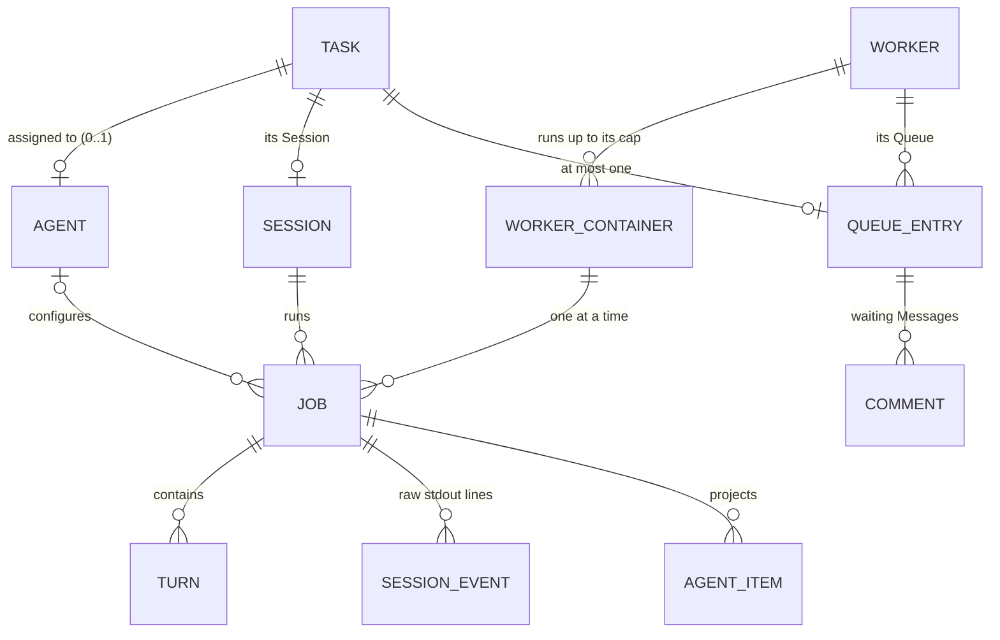
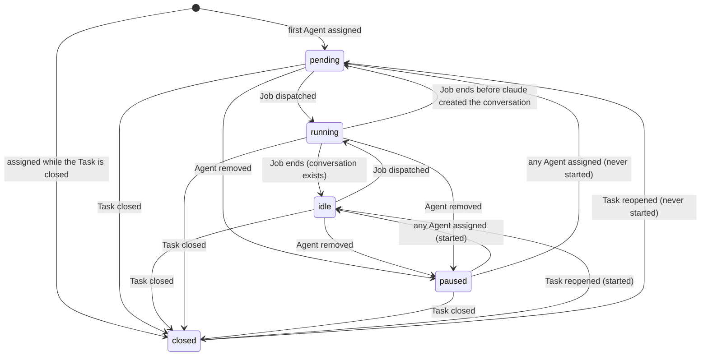
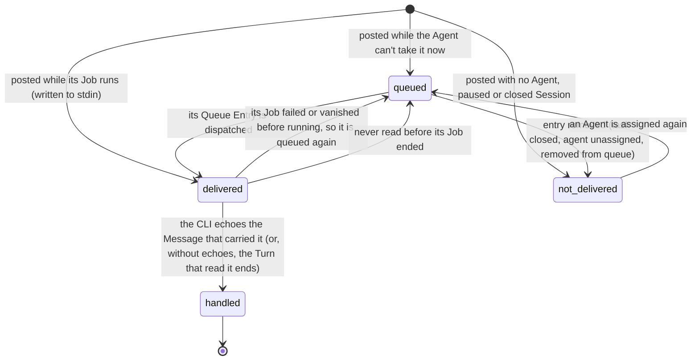
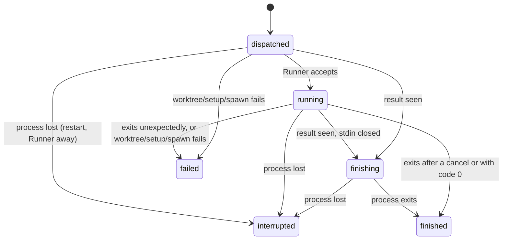
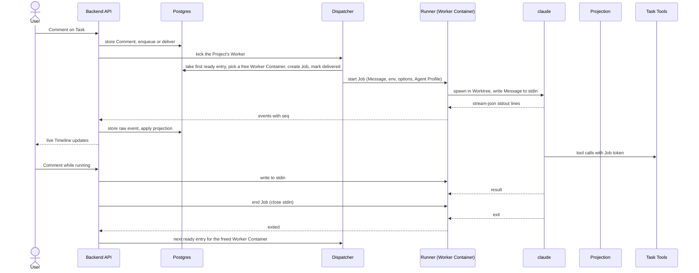

# Agent Sessions

Agent Sessions are how an **Agent** works a **Task**. Assigning an Agent opens the Task's **Session**: one continuous Claude Code conversation for that Task, whichever Agent works it, which lasts as long as the Task is open and resumes when it is reopened. People talk to the Agent through Task Comments; the backend turns them into **Messages**, keeps each **Worker**'s **Queue**, dispatches **Jobs** to the **Runners** of the Worker's **Worker Containers** (one Job at a time per Worker Container), writes Comments into the running `claude` process mid-turn, and projects everything the Agent says and does onto the Task's **Timeline**. The Agent acts on the board through the **Task Tools**. This spec covers the backend side of that loop; Workers and their containers, the Runner binary and its wire protocol, and git have their own specs (see [Related specs](#related-specs)).

## Concepts

- An **Assignment** links one Agent to a Task. A Task has at most one Agent at a time. The first Assignment creates the Session in `pending` and starts nothing.
- A **Session** belongs to one Task (to one Chat in a Wiki), and there is exactly one per Task, whichever Agent is assigned. It keeps the Claude session identity, the Worktree path, whether `claude` has already created the conversation (**started**), the last Task version the Agent has read, when its latest Job was dispatched, and the Worker Slot and Agent of its latest Job. Changing the Agent resumes the same conversation with the new Agent's configuration.
- The **Claude session identity** is the id passed to `claude` with `--session-id` or `--resume`. It defaults to the Session's own id. Delete Chat on a Wiki replaces it with a fresh one (see [Claude session identity](#claude-session-identity)).
- A **Job** is one `claude` process for a Session on one Worker Container, from dispatch to exit, configured by the Task's Agent at dispatch. A Worker Container, a Session and a Worktree each have at most one Job at a time; an Agent can have Jobs on any number of Worker Containers at once. A Job contains one or more **Turns**; each Turn ends with a `result` event in the stream.
- A **Message** is what the Agent receives: one or more Comments merged into one stream-json user message, the opening Task snapshot of a new Session, or a platform notice (change list, resume notice or Agent Change Notice).
- The **Agent Change Notice** opens the first Message a started Session receives after its Agent changed, telling the new Agent who it is now and which Agent worked before (see [Changing the Agent](#changing-the-agent)).
- The **Queue** is the ordered list of pending work of one Worker, for the Tasks of every Project that runs on it, whatever their Agent. It holds at most one **Queue Entry** per Task. An entry has a kind (`start`, `messages` or `resume_interrupted`), a position, and the Comments waiting to be delivered with it. An entry can be **held**: it stays in the Queue but waits for a Retry or a new Comment.
- An **Agent Profile** is an Agent's Claude Code configuration directory inside a Worker Volume. Every Job runs with the Agent Profile of its Agent, and every Agent Profile of a Worker Volume shares the same Session transcripts (see [Workers](workers.md)).
- A Comment's **Delivery** tells whether it reached the Agent: `queued`, `delivered` (with the Job), `handled` (the Agent has read it) or `not delivered` (with a reason).
- **Agent output** lands on the Timeline as **Agent Comments** (the Agent's text, stored as Comments of kind agent), **System Comments** (errors and platform notices), and **Agent Items**: Thinking, Activity, Runs, Turn Summaries and short notices.
- A **Run** is work the Agent starts and gets on with inside a Turn: a **Subagent Run** (a call to Claude Code's `Agent` tool, named `Task` in older CLIs) or a **Background Command** (a shell command left running in the container). Each Run has one Agent Item recording how it started and how it ended, and a transcript kept live while its Job lasts (see [Runs](#runs)).
- The **Job token** is a random secret created for each Job. It authenticates the Job's `claude` process on the Task Tools server and its git traffic on the Git Proxy, and it works only while that Job is active.

## Behaviour

### Assignment and the trigger

Any User can assign an Agent to a Task, change it, or remove it, by editing the Task's Agent field. Every change is recorded as a Revision. The Task's Status plays no part: an Agent can be assigned to a Task in any Status, and the Session waits in `pending` whatever the Status is.

The first Assignment of a Task:

- creates the Task's Session in `pending`, with the Worktree path fixed for the Task (deterministic per Project and Task Key);
- puts nothing in the Queue.

When the Task is in a `closed`-category Status at the moment of assignment, the Session is created `closed` instead. Every later Assignment keeps that same Session: it either changes the Agent (see [Changing the Agent](#changing-the-agent)) or gives an Agent back to a paused Session (see [Removing and assigning again](#removing-and-assigning-again)).

The **first Comment delivered after the assignment** is the trigger. It creates a `start` entry at the end of the Queue of the Worker of the Task's Project, with that Comment attached. The Session stays `pending` until the entry is dispatched. Only non-internal Comments trigger the Session, since only they are delivered to an Agent. Normally that first Comment is a User Comment. An Agent Comment written through the Task Tools starts the Session too: another Agent's in a Project with [Board Write Access](#writing-to-the-board), or the Agent's own `start_task` from a global Schedule (see [Schedules](schedules.md)). Notify agent is available only once a Session has started (see [Notify agent of changes](#notify-agent-of-changes)), so on a `pending` Session the first Comment is the only trigger.

Comments written before the assignment stay on the Task and reach the Agent as part of the opening Message.

### Session states

| State | Meaning |
| --- | --- |
| `pending` | Assigned; `claude` has not created the conversation yet. Waiting for the first Comment, or queued for it. |
| `running` | A Job of this Session is active (dispatched, running or finishing). |
| `idle` | The conversation exists; the Agent is waiting for the next Message. |
| `paused` | The Task has no Agent: it was removed. Nothing is delivered. |
| `closed` | The Task is in a `closed`-category Status. The Worktree is removed. |

Changing the Agent from one to another leaves the state as it is.

A Session is marked **started** as soon as the first stdout event of any of its Jobs is stored. From then on, every Job resumes it with `--resume`; before that, Jobs create it with `--session-id`.

The Task view shows the Session as a chip: `queued #N` while the Task has a Queue Entry (N is its 1-based position in its Worker's Queue), `waiting for retry` while that entry is held, and otherwise `starting` (pending), `running`, `waiting for messages` (idle), `paused` or `closed`. The Board card shows the Agent's avatar with the Session state and the queue position, and, once a Turn has measured it, the Session's Context Usage.

Beside the Session chip, the Session shows its **Context Usage** once a model call has measured it, and keeps it current while the Turn runs: the conversation's tokens followed by the percentage of the model's window, such as `120.2K (53%)`. Counts below a thousand are shown whole, thousands with one decimal and a `K`, and a million or more with one decimal and an `M`, so `1.2M` replaces `1,200,000`; the decimal is rounded before it is shown, so 119,960 reads `120K`, not `120.0K`. The percentage is rounded to a whole number and capped at 100%; when the CLI reports no window the count is shown alone. Before the Session's first Turn, or when the stream says nothing about the context, no chip appears. The Task details, in the web panel and in the native sheet, repeat the same chip as a read-only property.

### Closing and reopening the Task

Moving a Task into a `closed`-category Status ends the work on it. This also happens to every Task of a Status whose Category is switched to `closed`, and to Tasks moved there because their Status was deleted. When the Task's Session is not yet closed:

1. an active Job is cancelled: the Job is flagged as cancel-requested and the Runner of its Worker Container receives a cancel (interrupt, close stdin, `SIGTERM` after 10 s, `SIGKILL` after 20 s);
2. the Task's Queue Entry is removed and its Comments become `not delivered` with reason "task closed";
3. the Session becomes `closed`;
4. the Worktree is removed once the Session has no active Job, by a connected Runner of the Worker (the Runner of the Session's last Worker Slot first), right away when one is connected, otherwise as soon as one says hello. The Task Branch stays on the provider.

The cancelled Job ends quietly: its exit or setup failure produces no System Comment. Its Job token stops working immediately.

Moving the Task out of the `closed` Category reopens the Session: it returns to `idle` (or `pending` if it never started), with the same Claude session identity, and nothing is queued. The next User Comment or Notify agent queues a `messages` entry; at dispatch the Runner recreates the Worktree at the same path from the Task Branch.

Status changes have no other effect on Agents. Moving a Task between non-closed Statuses, by a User or by the Agent itself, leaves the Session and the Queue as they are.

### Changing the Agent

Any User can change the Agent of a Task from one Agent (A) to another (B) on a Session that is not `closed`. The Session stays the same, with its Claude session identity, its Worktree and its state, so B resumes the same conversation with its own configuration:

- an active Job of A continues: the Turn in progress is not interrupted and the Job ends as usual. Stop stays available for a User who wants A to stop at once;
- from the change on, Comments for the Task are queued instead of written to that Job, since its Agent is no longer the Task's. They go to the Task's entry at the front of the Worker's Queue, so B takes them as soon as A's Job ends;
- Comments already waiting in the Task's Queue Entry stay there and reach B;
- the change itself queues nothing and starts no Job: the next Comment does, as usual;
- a pending Limit Resume stays, and the work resumes with B after the limit resets.

On a `pending` Session the change only decides which Agent the first Job runs with. A queued `start` entry keeps its place and its Comments.

**Agent Change Notice.** At dispatch, when the Session is started and the Task's Agent differs from the Agent of the Session's latest Job, the Message opens with: "You are now working as agent "B" (previously "A"). Your instructions, tools and skills may have changed; the conversation so far is preserved." "A" is the name copied on that latest Job, so the notice still names an Agent deleted since. A Session that never started receives no notice, since its opening Message already introduces the Task.

A Wiki Chat changes Agent the same way, from the Chat itself (see [Wikis](wikis.md)).

### Removing and assigning again

Removing the Agent from a Task pauses its Session:

- if a Job is running (not yet finishing), the Runner receives an interrupt followed by an end, so `claude` stops the current Turn and exits once it has drained its input;
- the Task's Queue Entry is removed and its Comments become `not delivered` with reason "agent unassigned";
- a pending Limit Resume is cancelled;
- the Session becomes `paused`, so the Task view keeps showing it.

Later Comments on the Task are marked `not delivered` with reason "no agent assigned".

Assigning any Agent to a `paused` Session resumes it: it becomes `idle` when it has started and `pending` otherwise. When it has started, a `messages` entry is queued with every non-internal, non-deleted User and Agent Comment posted after the Session's last dispatch that no Job has read yet, leaving out the Agent's own Comments, System Comments and Comments already written to a running Turn; these Comments become `queued` again, including those marked "no agent assigned", and `delivered` once the Job starts. When there are no such Comments, nothing is queued and the next Comment continues the conversation. A Session that never started waits for its first Comment, and its opening Message carries the whole conversation. When the newly assigned Agent differs from the Agent of the Session's latest Job, the next Message opens with the Agent Change Notice.

### Comments reaching the Agent

When a non-internal Comment is posted on a Task with a Session (a User Comment, a Notify agent notice, or an Agent Comment written by another Agent through its Task Tools), the backend decides its Delivery in the same transaction:

| Situation | Delivery |
| --- | --- |
| The Task has no Agent, or its Session is `paused` | `not delivered`, "no agent assigned" |
| The Session is `closed` | `not delivered`, "task closed" |
| The Session's Job is `running`, its Agent is the Task's Agent, the Runner of its Worker Container is connected, the Task has no Queue Entry waiting, and the Comment is not a native command | `delivered` right away: the Message is written to the running process's stdin |
| Anything else (no free Worker Container, the Task's Agent disabled or its Agent Profile synchronizing, Job still being dispatched or finishing, the running Job belonging to the previous Agent, Runner disconnected, an entry already waiting, a native command) | `queued`: merged into the Task's Queue Entry, or into a new one. An entry for a Task with an active Job goes to the **front** of the Worker's Queue, so it runs before the other Tasks once that Job ends; an entry for any other Task goes to the end |

Comments on a Task that was never assigned an Agent carry no Delivery at all, like Internal Notes. An Agent Comment carries Delivery only when another Agent wrote it through its Task Tools; an Agent's own output and System Comments stay on the Timeline.

**Mid-turn delivery.** A Comment written to stdin during a Turn is read by `claude` at its next model call, after the current batch of tool calls, and belongs to that same Turn: one `result` covers it. This is how a User steers the Agent while it works.

**Interrupt and send.** A User stops the Session's running Turn so the Agent reads what they wrote without waiting for the tool calls in progress (a long test run, a build, a Subagent Run). It acts while the Session's Job is **interruptible**: `running`, with no cancel requested. A Job still being dispatched, or `finishing` after its `result`, is not. The Session view carries this as its `interruptible` flag. It comes in two forms:

- **With a new Comment**: the Comment is posted with the interrupt flag. When the Job is not interruptible, the flag is ignored and the Comment is delivered as usual.
- **With nothing new** (`POST /tasks/:id/session/interrupt`): it hurries the caller's own Comments the Agent hasn't read yet, those `delivered` to the running Job or `queued` in the Task's entry. It is available to the author of such a Comment and answers `409` when the caller has none waiting, or when the Job is not interruptible.

In both forms the Runner receives the interrupt first. `claude` rejects the running tool call, ends the Turn with an aborted `result` and stays alive. What follows it:

- Comments already written to the process and not read yet are read by the next Turn of the same process.
- When the Job's Agent is the Task's Agent, the Task's entry (`messages`, or `start` for a Session that had not started when they queued) is written right behind the interrupt as one Message, up to its first native command, which keeps waiting for a Job boundary. The new Comment, if any, joins the entry first, so everything waiting is read together in posting order. The entry is removed once it has nothing left.
- Otherwise (the running Job belongs to the previous Agent, a native command waits) the Comments stay in the entry at the front of the Queue and run as soon as the Job ends.
- A Message `claude` read just before the interrupt landed belongs to the model call the interrupt aborted, and no Turn answers it on its own. When an empty Interrupt and send hurried Comments that were on the process's stdin, and at the aborted `result` none of the Job's Comments is still `delivered`, the backend writes one short Message ("You were interrupted so you would act on the latest message above at once. Do that now.") right before closing stdin, so a new Turn answers them. With a new Comment this cannot happen: the Comment comes after the interrupt and always opens a Turn.

The aborted `result` moves the Job to `finishing` as any `result` does, and the Turns for what was written run before `claude` exits, so the Comments keep the Job, the Worker Container and the Worktree. The aborted Turn adds no System Comment, as with Stop. Internal Notes carry no Delivery, so the flag has no effect on them.

**Merging.** Comments that wait in the Queue for the same Task are delivered together as one Message, oldest first, each one opened by a bracketed header line naming its author and the ISO time it was posted, followed by its Markdown body. Comments by Agents carry "(agent)" after the name. The body delivered is the one at dispatch time, so editing a queued Comment changes what the Agent reads; edits after delivery stay on the Timeline only.

**Attachments.** Image attachments (PNG, JPEG, GIF, WebP) up to 5 MB are delivered as image blocks inside the Message. One Message inlines at most 20 images and 16 MB of images in total; the newest images get the budget first. Every other file, and every image beyond the budget, is fetched by the Runner into the Worktree under `.claude-task/attachments/<comment id>/<filename>` before the Message is written, and its path is listed under the Comment. The Runner downloads them from the backend with its own token, and only for the Task of the active Job of its Worker Container; files of Internal Notes and deleted Comments are refused.

**Files linked from the description.** Files embedded in the Task description stay linked by URL in the text, so the Agent can edit the description without breaking them. Whenever the description is delivered (the opening Message, a change notice), each linked file is also fetched into the Worktree and the Message lists which link maps to which path. Linked images within the same budget are also attached inline.

**Deleting a queued Comment.** When a deleted Comment leaves its Queue Entry with nothing to deliver, the entry is removed, so no Job starts for nothing. A `resume_interrupted` entry stays, since it has work of its own. A `pending` Session whose trigger Comment is deleted goes back to waiting for a Comment.

### Message delivery states

The reasons shown with `not delivered` are "no agent assigned", "task closed", "agent unassigned" and "removed from queue". A delivered Comment records the Job that carried it. Every Delivery records when it last changed state.

A Comment becomes `handled` when `claude` reads it, which can be in the middle of a Turn. Every Message the backend writes (a Job's initial Message, each mid-Turn Message) carries a fresh `uuid`, recorded on the Comments it carries. With `--replay-user-messages`, `claude` echoes a Message with that `uuid` at the moment it adds it to the conversation: at the start of the Turn it opens, or with the tool results it goes to the model with. The echo moves that Message's `delivered` Comments to `handled` and publishes them as updated Comments on the Task topic, so clients change the indicator live, before the Agent has answered.

A `claude` without the echo (an older version a repository's mise configuration selects) falls back to the end of each Turn. A Turn reads what was on stdin when it last called the model: at its start, and each time it hands a batch of tool results back and the model answers. In the same transaction that stores the Turn, every `delivered` Comment of the Task whose delivering Job belongs to that Turn's Session, and that was delivered before the Turn's last model call, moves to `handled`. A Comment written while the Turn was already writing its final answer stays `delivered` until the next Turn, which reads it, ends. Once a Job has echoed a Message, the end of a Turn no longer marks anything: the echoes decide alone.

**Unread at exit.** When a Job whose `claude` echoes Messages exits normally with Comments still `delivered`, those Comments never reached the Agent: they go back to the front of the Worker's Queue as `queued` and the next Job delivers them. This covers a Message an interrupt dropped before `claude` read it.
 `handled` is final: Retry and assigning an Agent again leave it as it is, a Job's Comments that go back to the Queue leave out the handled ones, and every rule that treats a Comment as already received by the Agent applies to `handled` as to `delivered`. The one exception is a mid-Turn write that never reached the process: when the Runner socket was already closed, the Comment goes back to the Queue even if a Turn ending meanwhile marked it handled.

### The Queue

Each Worker has one Queue, ordered by a fractional position, holding the pending work of the Tasks of every Project that runs on the Worker, whatever their Agent. It holds at most one entry per Task:

- **`start`**: the first Job of a Session that `claude` has not created yet.
- **`messages`**: pending Messages for a Session that exists.
- **`resume_interrupted`**: a Turn cut off by a container restart or a lost Runner, to be resumed.

New entries go to the end of the Queue, except recovery entries and entries for a Task that has an active Job (a Comment that could not be written into its stream, or one posted after the Agent changed), which go to the front: a Task being worked on keeps priority over the Tasks waiting behind it. A Comment for a Task that already has an entry joins it and the entry keeps its position, unless the Task has an active Job, in which case the entry moves to the front. When two kinds meet in one entry, `start` wins over `resume_interrupted`, which wins over `messages`.

What waits in the Queue: Comments for a Task without an active Job until a Worker Container is free (at the end), Comments for a Task with an active Job that could not be written to its stream or that came after the Agent changed (at the front), every Comment for a Task that already has an entry, native commands, and everything while the Worker is disabled, has no Worker Container ready, or the Task's Agent is disabled or its Agent Profile is out of date on the Worker.

When a Project moves to another Worker, its entries move to the end of the new Worker's Queue in the same transaction, keeping their relative order (see [Board](board.md)).

Any User can manage a Worker's Queue from the Worker's page (see [Workers](workers.md)), where each entry shows its Task and the Task's Agent:

- **reorder** entries by dragging (an entry moves to the front, after a given entry, before a given entry, or to the end);
- **remove** a `messages` or `resume_interrupted` entry, after a confirmation. Its Comments become `not delivered` with reason "removed from queue". A `start` entry stays: to drop it, unassign the Agent.

### Dispatch

The dispatcher runs per Worker. It is triggered when work is queued, when a Job ends (after any pending recreation of its Worker Container), when a Runner of the Worker says hello, when a Worker Container becomes running, when an Agent Profile synchronization finishes, and by a periodic tick every 30 seconds. Every trigger about a Task dispatches the Worker of the Task's Project.

An entry is **ready** when it is not held, the Task's Agent is enabled, and no active Job of the Worker uses the same Worktree path. Since a Task's Jobs all use its Worktree, this also keeps a Session to one Job at a time; Chats of one Wiki share one Worktree, so they run one at a time too. Entries that are not ready are skipped and keep their place, without being held, so a disabled Agent or a busy Worktree never blocks the Tasks behind them.

A Worker Container can take a Job when its container runs with the Worker's current image and limits, its Runner is connected, it has no Job in `dispatched`, `running` or `finishing`, no recreation is pending for it, it is not being stopped, and the Worker is enabled.

The dispatcher goes through the ready entries in Queue order. For each one:

1. It checks the synchronization of the Task's Agent on the Worker. When the Agent Profile is out of date, the dispatcher starts a synchronization (when none is running and the Agent has no active Job on the Worker) and skips the entry until it finishes (see [Workers](workers.md)).
2. It picks a Worker Container: the one of the Session's last Worker Slot when it is free, otherwise another free running Worker Container, lowest slot first. With none free, the entry waits; starting another Worker Container up to the Worker's cap is the reconciler's job (see [Workers](workers.md)), and the Job dispatches once its Runner has connected.
3. It takes the entry, locking it so that two dispatchers never take the same entry, and in one transaction:
   1. checks the Task Branch on the git provider and records the branch name and link on the Task when the Project has a Repository (see [Git integration](git-integration.md)). When the provider can't be reached, the entry is held, a System Comment explains the failure, and the dispatcher moves on to the next entry;
   2. builds the Message (below) and the Job's environment;
   3. creates the Job (`dispatched`) on the chosen Worker Container, with a fresh Job token, the Task's Agent and that Agent's name;
   4. removes the entry, or keeps it as `messages` when native commands remain in it;
   5. marks the included Comments `delivered` with this Job;
   6. sets the Session to `running`, records the dispatch time, the Worker Slot and the Agent of the Job, and raises the Session's last-read Task version (to the Task version for a new Session, to the version covered by any change notice included);
   7. sends the start of the Job to the Runner of that Worker Container.

**The Message of a Job:**

- **New Session** (`claude` has not created it, whatever the entry kind): "You have been assigned task KEY in project "Name"", the Task snapshot (key, title, Status with its Category, priority, tags, description and its linked files), the Task Branch when there is one, then "Conversation so far (oldest first):" followed by every non-internal, non-deleted User and Agent Comment, or "There are no comments yet."
- **Existing Session**: the merged Comments of the entry. A `resume_interrupted` entry with no Comments sends "The previous run was interrupted by a restart; continue where you left off." When the Task's Agent differs from the Agent of the Session's latest Job, the Message opens with the Agent Change Notice (see [Changing the Agent](#changing-the-agent)).

**The Job's environment and options** all come from the Task's Agent at dispatch, so a Job keeps its configuration until it ends, even when the Agent changes meanwhile. The environment is the Project's environment variables (secrets decrypted), then the Agent's environment (which wins over the Project's), then the Credential's variable (`CLAUDE_CODE_OAUTH_TOKEN`, `ANTHROPIC_API_KEY` or `ANTHROPIC_AUTH_TOKEN`), and `CLAUDE_CODE_RESUME_INTERRUPTED_TURN=1` for a resumed interrupted Turn. They travel in the Job's start message and never as container environment. The start also carries the Agent's model, effort and permission mode, the path of the Agent's Agent Profile, the composed system prompt, the MCP configuration (the Agent's catalog MCP servers plus the reserved `claude-task` server with the Job token as a bearer header), the Project's Setup Script, the Worktree path, the git settings, and the attachments to fetch.

**Native commands.** A User Comment whose body starts with `/name` runs as a native Claude Code command, as its own Job, in order with the other queued Comments. Commands that would replace the managed conversation or override the Agent's configuration (`clear`, `reset`, `new`, `resume`, `continue`, `branch`, `fork`, `exit`, `quit`, `background`, `bg`, `remote-control`, `rc`, `model`, `effort`, `config`, `settings`, `permissions`, `allowed-tools`, `fast`) are delivered as ordinary text. A command always waits in the Queue, so it starts at a Job boundary. When an entry holds a command, the Comments before it form one Job, the command alone forms the next, and the Comments after it follow. A command alone is written verbatim, without the header line. As the first Message of a new Session, the Task context comes in earlier blocks and the command is the last block, so `claude` runs it natively with the context available. Output a command prints locally is shown once as a System Comment.

The commands offered in the composers come from the `slash_commands` list reported at the start of the Session's latest Job (curated built-ins, plugin commands and MCP prompts; a plugin command, named `plugin:name`, is classed as a Skill so it is suggested anywhere in a comment and listed in the Task's Skills dialog), plus the Agent's user-invocable Skills, plus the user-invocable Project Skills the Runner reported for the Session's latest Job that reported any (see [Runner](runner.md)). Before any Job has reported, the list is `compact`, `context` and `usage` plus the Agent's Skills.

**Project Skills.** The backend parses each reported file like a catalog `SKILL.md`: the YAML frontmatter's `description`, or else the first paragraph after it (a leading heading marker removed), cut at 2,000 characters. A file with `user-invocable: false`, unparseable frontmatter or a name outside letters, digits, `_` and `-` (at most 64) is left out, and of two files with the same name the first wins, so a skill wins over a command. The result is stored on the Job and the Task's Session is republished. In the composer a Project Skill shows as a Skill. It gives way to an Agent's Skill of the same name, as `claude` gives personal skills precedence over project ones. Once the Session's `system/init` has reported its `slash_commands`, a Project Skill is offered only when that list names it, so one that settings disable, or that the CLI doesn't load, is not suggested. Before that, every reported Project Skill is offered. The composer itself is described in [Conversation](conversation.md).

The Project Skills a Job reported follow its Worktree exactly, so they win. The Session also keeps its own copy, read on request from any connected Runner of the Worker (every Worker Container sees the same Worker Volume) when a page opens the Session and no Job of it has reported any yet (see [Runner](runner.md)); that copy is what lets a Worktree created by an earlier Job fill the composer before the Session's next Job, and the Session is republished with it. A Session with no Job has no Worktree, so it has nothing to read.

### End of a Turn and of a Job

Every Job ends after its Turn. When the Runner reports a `result`, the backend records the Turn, moves the Job to `finishing` and tells the Runner to end it: the Runner closes stdin, `claude` processes anything already written (each such Message becomes a Turn of its own, recorded normally) and exits. From `finishing` on, new Comments are queued. When the process exits, the Job finishes, the Session returns to `idle`, and the Worker's dispatcher runs again, so the freed Worker Container takes the next ready entry.

Outcomes when a Job ends:

- **Normal exit**, or exit after a cancel or during `finishing`: the Job is `finished`.
- **Unexpected exit** (non-zero code or signal while running, without a cancel): the Job is `failed` and a System Comment says "The agent's process stopped unexpectedly", with the last 20 lines of stderr. The Session returns to `idle`; the next Comment continues it.
- **Worktree, setup or spawn failure**: the Job is `failed` with its stage. A System Comment names the stage ("preparing the worktree", "running the setup script", "starting Claude Code") with the error and the last 20 lines of setup output; for the worktree it comes after the Runner's Preparation Retries (see [Runner](runner.md)). The Job's Comments go back to `queued` in an entry at the front of the Queue, **held**: the dispatcher skips it so a broken setup doesn't loop. **Retry** on the Task, or any new Comment, releases it. Retry answers `409` when nothing is held.
- **Conversation missing**: when stderr says the conversation was not found (for example after the Worker Volume was reset, or when the new Agent's Credential can't resume a conversation started under another one), the Session is marked not started and a System Comment says the next run starts a new conversation with the Task's history.
- **Conversation already exists**: when a first Job fails because `claude` had already created the conversation, the Session is marked started, a System Comment says the next run resumes it, and the Job's Comments are queued again, held, waiting for a Retry or a Comment.
- **Remote Task Branch missing**: when the Runner had to recreate the Worktree of a started Session from the Base Branch because the remote Task Branch was gone, a System Comment says so.

Tool calls still waiting for a result when a Turn or a Job ends are shown as `interrupted` on the Timeline.

### Usage limits and Limit Resume

When a Turn stops with an error and the last `rate_limit_event` of that Turn has `status: rejected` and a `resetsAt` in the future, the System Comment that reports the error also carries the reset time and offers to resume. A limit without a usable reset time produces the System Comment alone.

The offer shows "Schedule resume" and "No", with the reset time in the reader's time zone. The first User who answers decides for everyone, and a later answer is answered with `409` and the name of who answered. "Schedule resume" on a Task that is closed or has no Agent is answered with `409`. "Schedule resume" creates a **Limit Resume**: a Scheduled Message (see [Conversation](conversation.md#scheduled-messages)) due one minute after the reset time. "No" closes the offer and leaves the Session as it is.

A Task whose automatic resume setting is on (see [Board](board.md)) gets the Limit Resume in the same transaction as the System Comment, which then shows it as scheduled and asks nothing.

A Task has at most one pending Limit Resume and at most one open offer:

- a new limit that reports a reset time cancels the pending Limit Resume ("replaced") and closes the open offer as no longer needed;
- a Turn of the Task that ends without error cancels the pending Limit Resume ("the Agent worked again") and closes the open offer as no longer needed;
- closing the Task or removing its Agent cancels the pending Limit Resume with that reason and closes the open offer as no longer needed, while changing the Agent to another one keeps both;
- an offer whose Limit Resume is cancelled for any reason shows as no longer needed;
- an offer still open one minute after its reset time is closed as no longer needed by the background tick, and answering it gets `409`.

When the Limit Resume is due it is published as a System Comment and delivered like a Notify agent notice: written to the running Turn, or queued and merged into the Task's entry, so the Agent continues in the same Session. When the Agent changed meanwhile, the resume runs with the Task's Agent at that time. Limits shared by several Agents through one Credential are handled per Task: each Task decides on its own, and the resumes go through their Workers' Queues in order after the reset.

### Stop (Interrupt)

The **Stop** button on a Task interrupts the current Turn without ending the Session. [Interrupt and send](#comments-reaching-the-agent) is the same interrupt with a Comment to read next. The Runner sends `claude` a stream-json interrupt control request: the running tool call is rejected, the Turn ends with a `result` marked as aborted, and the process stays alive. The normal end of Turn follows (the Job finishes), and the next Comment resumes the same conversation. Stop is available while the Session's Job is dispatched or running, including a Job of the previous Agent still running after the Agent changed, and answers `409` otherwise.

### Cancellation

A Job is cancelled when its Task is closed, or when its Chat is deleted (see [Wikis](wikis.md)). The Runner interrupts the Turn, closes stdin, and escalates to `SIGTERM` after 10 seconds and `SIGKILL` after 20 seconds. The Job keeps its Worker Container, its Session and its Worktree busy until the Runner reports the exit, so their next Job starts only afterwards. A cancelled Job's token stops working at once, and its exit or failure produces no System Comment.

### Recovery after restarts

The backend keeps all scheduling state, so a restart of either side resumes from the database.

**Runner hello.** Each Worker Container has its own Runner. Each time a Runner connects it reports the Job it still holds, if any (one whose process runs or whose messages are not all acknowledged):

- the Job is still active in the backend: it is kept, and the backend acknowledges the last message it processed, so the Runner resends the rest;
- the Job is already settled (or unknown): the backend acknowledges everything and cancels it;
- every other active Job of that Worker Container lost its process (container restart or crash) and is recovered as below. Jobs of the Worker's other Worker Containers are untouched.

The backend then sends the Worker's pending Worktree removals (see [Runner](runner.md#removing-a-worktree)), reconciles the Worker and runs its dispatcher.

**Recovering a lost Job.** The Job's pending tool calls are settled as interrupted and the Job becomes `interrupted`. If the Session was running:

- when the Job had started streaming and the conversation exists, and the Turn had not ended yet, a `resume_interrupted` entry goes to the **front** of the Queue and a System Comment says "The agent's container restarted in the middle of a turn. Resuming where it left off." The next Job resumes with `CLAUDE_CODE_RESUME_INTERRUPTED_TURN=1`, which makes `claude` continue the cut-off Turn on its own, re-running the interrupted tool;
- when nothing had run yet, the Job's Comments go back to the front of the Queue as they were;
- when the Job was already finishing, the Turn was complete and nothing is queued.

**Runner away.** While a Runner is disconnected, its Job keeps running inside its Worker Container and buffers its output. A Runner disconnected for more than 5 minutes has its active Job recovered by the periodic tick. The backend pings each Runner every 30 seconds and drops a connection that stays silent for a whole round, so a half-open connection is detected and recovered too. A second connection for the same Worker Container replaces the first.

**Exactly once.** Every Job message from the Runner carries a per-Job sequence number. The backend processes each one exactly once and in order, in a transaction, and acknowledges it afterwards; messages at or below the last processed number are acknowledged and ignored, and messages for settled Jobs are acknowledged and dropped. The wire format, reconnection and buffering on the Runner side are described in [Runner](runner.md).

### The `claude` invocation contract

Each Job runs the real Claude Code CLI in headless mode inside the Task's Worktree, with `CLAUDE_CONFIG_DIR` set to the Agent Profile of the Job's Agent, so that Agent's Skills, Plugins and settings load:

- `-p --input-format stream-json --output-format stream-json --verbose --include-partial-messages`;
- `--session-id <id>` for a conversation `claude` has not created yet, `--resume <id>` afterwards, always with the Session's Claude session identity;
- `--model`, `--effort` and `--permission-mode` from the Job's Agent when set;
- `--append-system-prompt` with the composed system prompt;
- `--mcp-config` with the Task Tools server and the Agent's catalog MCP servers;
- `--forward-subagent-text`, so a Subagent Run's text reaches its transcript, whenever the `claude` that starts supports it (from 2.1.211);
- `--disallowedTools AskUserQuestion`, because a headless Job has nobody to answer Claude Code's own question dialog; Agents ask through `ask_question` instead.

It runs without `--bare`, so the repository's CLAUDE.md, its `.claude/` settings and Skills, its `.mcp.json`, and the Agent's installed Skills and Plugins load exactly as in an interactive session. The platform configures no hooks; hooks a repository or Plugin brings run normally. The `claude` version is pinned centrally through `CLAUDE_CODE_VERSION` (default 2.1.310) with the auto-updater off, because the stream-json format is a contract for the projection. A repository's mise configuration can put another version in front of the pinned one through mise's shims, so the Runner asks the executable it is about to start for its version and passes the flags that version understands. Each Job records the `claude` version and the MCP servers reported at its start.

The Worktree path is deterministic per Project and Task, so a resumed conversation always runs in the same directory: tool state and relative paths in the transcript depend on it. Session transcripts live in the Worker Volume, in a directory every Agent Profile shares, so any Worker Container of the Worker resumes any Session, under any Agent. The raw stream in the database is the durable record.

### System prompt composition

The appended system prompt is composed at every dispatch from the Task's Agent, its Project and its Worker, so it stays the same across the Jobs of a Session until one of them changes. It holds no Task content beyond its key and Project, so the opening Message and the Task Tools carry the Task itself. It concatenates, separated by blank lines:

1. **The platform section**, which holds who and where the Agent is and the rules of the board, and no list of tools (each Task Tool describes itself, see [Task Tools](#task-tools)):
   - who the Agent is: its name, the Task Key and the Project name;
   - its working directory (the Worktree in the Worker Volume) and, when the Project has a Repository, that it is a git worktree on the Task Branch;
   - that everything it writes as text is posted as a Comment on the Task for humans, so it writes Markdown, leads with the result and keeps it short, without narrating tool calls the Timeline already shows;
   - that new messages can arrive while it works and should be taken into account as soon as it sees them;
   - that for a decision with clear options it asks with `ask_question`, for an open question in text, and then ends its Turn, since the answer arrives as a new Message; in a Scheduled Run it is told instead that it works unattended, that no human will answer and that it should decide on its own or finish with an explanation;
   - that `send_files` shows screenshots, logs and other files, and that files attached to Comments and linked in the description are saved under `.claude-task/attachments/`;
   - that it acts on the board through the `claude-task` tools, and that closing Tasks and choosing their people are for humans;
   - when the Project has Board Write Access: that it can also edit and move the Project's other Tasks, write to the Agents working on them and start Agents (see [Writing to the board](#writing-to-the-board));
   - for a global Schedule: that it can act on the board of every Project, including taking Tasks on itself with `assign_task_to_me` and `start_task` (see [Schedules](schedules.md));
   - when the Agent has the `claude-task` Platform Skill: that the skill is the playbook for searching the Project, working the board, coordinating Agents (with Board Write Access), acting on every Project (global Schedule) and handing off work, to read before going beyond its own Task;
   - in a read-only Schedule, that every push is refused; otherwise, when the Project has a Repository, that it commits and pushes only to its Task Branch and hands off by pushing and opening or updating the pull request with `open_pull_request` before moving the Task to a review Status;
   - when the Worker has Development Services: that they run in the current Worker Container and are shared with the other Tasks that run there, so Projects keep apart by their own database names, key prefixes or buckets; that a later Job of the same Task can run in another Worker Container with different data, so the Agent creates what it needs instead of assuming it is still there; and each selected service with its address and access (the descriptions the Worker form shows). Without this, the Agent would not know the services exist.
2. **Project instructions**, under the heading "Project instructions:", when the Project has Agent Instructions.
3. **The Agent's own system prompt**, when set.

### Timeline projection

The Agent's output reaches the Timeline from the stdout stream of `claude` and from nothing else. Every stdout line the Runner forwards is stored as a raw **Session Event** (idempotent per Job and sequence number; a line that isn't JSON is stored as an "unparsed" event with its first 10,000 characters). It is then projected by a pure function from the projection state of the Job and the event to the new state, the Timeline changes and the live broadcasts. The projection state is stored on the Job between events, and the ids of the items it creates derive from the Job and a counter, so replaying a stream yields the same rows.

What each event produces:

| Stream event | Timeline effect |
| --- | --- |
| Partial text or thinking delta (top level only) | Broadcast live to the Task's viewers; nothing is stored. A text delta carries the id of the Agent Comment being written, if any. |
| Assistant text block | Starts an **Agent Comment**, or appends to the open one with a blank line in between. The Comment stays open across messages until a tool call, thinking, a compaction or the end of the Turn. |
| Assistant thinking block with text | A **Thinking** entry (name `Thinking`, the text as its output) in the open **Activity** item, or a new Activity item; consecutive thinking extends the last entry. It does not count as a tool call, and it no longer interrupts the group. Empty thinking (the CLI redacts it for current models) produces nothing. Items of kind `thinking` stored before this change still render. |
| Assistant tool call | An entry in the open **Activity** item, or a new Activity item after text or once the open one holds 20 entries (thinking entries count), so a long Turn doesn't grow one group without bound. Each entry has the tool name, a one-line summary, status `pending` and the input (long strings cut at 20 KB). A call to `Agent` or `Task` starts a **Run** instead and adds nothing to Activity. |
| Tool result | Updates the matching entry: status `ok`, `error`, or `interrupted` when a Stop rejected it, a short outcome, and the output cut at 20 KB for display. The result of an `Agent` call settles its Run and its body is not kept. |
| Assistant message with `parent_tool_use_id` | Its text and tool calls become the transcript of the Run that owns the parent call, shown live only, and its thinking is dropped. A call to `Agent` or `Task` inside it starts a nested Run one level deeper. |
| `system/task_started`, `system/task_notification` | Start and settle the Run of a backgrounded call: a backgrounded subagent, or a **Background Command** for a `local_bash` task. See [Runs](#runs). |
| Synthetic assistant message (made by the CLI itself, e.g. spend limits) | A System Comment with its text. |
| `result` | Closes the Turn: settles pending calls as interrupted, adds a **Turn Summary** item, and records the Turn. See below for errors. |
| `system/init` | Records the `claude` version, MCP servers and available commands on the Job. A System Comment when the Task Tools server reports `failed` or `needs-auth`. |
| `system/api_retry` | A transient "retrying (attempt n/m)" status for the Task's viewers, cleared by the next assistant message or the `result`. A System Comment when retries are exhausted, or right away for a Credential error. |
| `system/compact_boundary` | A notice item "Context compacted (N tokens before)". |
| `system/local_command_output` | A System Comment with the command's output (terminal escape codes stripped). |
| `rate_limit_event` | A rate-limit observation for the Agent's Credential. |
| Anything else | Stored, no Timeline effect. |

Tool call summaries read as plain sentences: "Edited `path`", "Wrote `path`", "Read `path`", "Ran `command`" (first line, cut at 80 characters), "Searched for `pattern` in `path`", "Listed `pattern`", "Fetched url", "Searched the web for “query”", "Updated the to-do list", "Task tool `name`" for the Task Tools, "server: `tool`" for other MCP tools, and "Used `name`" otherwise. Outcomes: Bash shows "exit N" (or "interrupted"); other tools show the first line of the error when they fail.

**Turn Summary and Turn record.** Each `result` produces a Turn Summary with duration, number of tool calls (subagent calls included), cost, `result` subtype, error flag and token usage (input, output, cache read, cache creation). The CLI reports cost cumulatively per process, so the cost of a Turn is the difference from the previous `result` of the same Job. The Turn record also keeps its index in the Job, start and end times and stop reason.

The Turn also records its **Context Usage**. The `result`'s own token usage sums every model call of the Turn, so cached prompt tokens are counted once per call and overstate what the conversation holds. The context is therefore read from the Turn's last top-level assistant message: its input, cache-read and cache-creation tokens plus the output tokens it produced. Its window comes from the `result`'s `modelUsage`, matched by the message's model and otherwise taken from the model that read the biggest prompt; CLIs without `modelUsage` leave the window empty. Messages with `parent_tool_use_id` belong to a Run and never set the Session's context, synthetic messages are ignored, and a Turn with no model call records none. A `Session` reports the context of its latest Turn that measured one, so a Turn that died before calling the model leaves the previous measurement in place; a compaction or a new Job changes it at the next model call. The stored value moves when a Turn ends and clients see it on `session.changed`. In between, each top-level assistant message of the running Turn is broadcast as `live.context` (tokens only, window `null`, since `modelUsage` arrives with the `result`; not persisted). Clients keep it apart from the Session, show it over the stored context while the Session runs, keep the stored window, and drop it when the Session stops running or the Timeline resets. A refetch of the Session mid-Turn therefore cannot bring back a stale figure. The event is also published on the Project's topic, so Board cards and native Task rows follow it too; they trust it only while the card's Session is `running`, since a card isn't told when its Session stops.

Turns recorded before the platform kept this field are filled at startup, after the port opens, by replaying each Job's raw stream with the same projection: the backfill writes only Turns that still have no value, so it is idempotent and a long history never delays the backend from serving. A Turn the stream cannot measure gets 0 tokens, the mark that says it was checked: the Session view ignores 0, and the next startup does not replay that Job again.

**Errors at the end of a Turn.** A `result` that is an error (non-success subtype, or an error flag) adds a System Comment: "The turn stopped: it reached the maximum number of steps.", "The turn stopped because of an error.", "The turn stopped: it reached its budget.", "The turn ended with an error." or "The turn stopped (subtype).", followed by the detail. A Turn ended by Stop (its terminal reason is an abort) is an expected end and adds nothing. When a synthetic message already said the same thing, the `result` adds nothing more. A successful Turn with no visible text and no tool calls shows its result text as a System Comment.

**Credential errors** (`authentication_failed`, `billing_error`, `oauth_org_not_allowed`, `account_on_hold`) produce one System Comment per Job naming the Credential, e.g. "Credential **Team token** was rejected (authentication_failed). Check it in Credentials."

**Live updates.** Timeline changes reach the Task's viewers as events: Comments created or updated, Agent Items created or updated, live deltas, the retry status, Run updates and transcript messages, and Setup Script output while the Worktree is prepared. Clients merge Comments, Revisions and Agent Items by creation time; the Timeline API pages through them newest first.

### Runs

A Run is work the Agent starts and gets on with: a **Subagent Run**, started by a call to the `Agent` tool (named `Task` in older CLIs), or a **Background Command**, a shell command the Agent leaves running in its Worker Container. Each Run has one Agent Item of kind `run`, created when the call starts and updated when the Run ends. The item holds the Run's type, description, subagent type, depth, status (`running`, `ok`, `error` or `interrupted`), start and end times, tool call count, a short outcome line and the error when it failed. It is the only trace the Timeline keeps of a Run.

The Turn Summary counts the tool calls made inside Subagent Runs, so a delegated Turn's step count stays truthful.

**Transcript.** Each Run keeps a transcript while its Job lasts: the text the subagent writes, as whole Markdown blocks rather than streamed tokens, and its tool calls with input, output and status. Its thinking belongs to the CLI's own display and stays out. The Run's prompt is kept with the transcript, as is the token usage the CLI reports when it reports it. A Background Command has no transcript: its output stays in the container's file, and its `task_notification` summary becomes the item's outcome line. A nested Run gets its own item, its own transcript and a depth one higher than the Run that started it, and the parent's transcript names it on the tool call that started it.

**Where it lives.** The transcript is held in memory by the backend, in a **Run Registry** keyed by Run id, and only the item above reaches Postgres. The registry is written after the event's transaction commits, so an event that rolls back never reaches a viewer. It lives as long as the Job, so a Run that outlives its Turn, such as a Background Command, stays readable until the Job ends.

**Limits.** A transcript keeps at most 500 messages and 2 MB of content, and a Job keeps at most 30 Runs, evicting the oldest finished one first. A full transcript is reported as truncated; an evicted Run answers `404`, like one from a Job that has ended. Text blocks, tool inputs and tool outputs are cut at 20 KB, and an error is cut at 2 KB.

**Settling.** A Subagent Run settles on the tool result of its `Agent` call: `ok`, `error` with the body, or `interrupted` when the call was rejected by a Stop or the Job ended first. A Run the CLI reports as backgrounded settles on its `task_notification` instead, whose status decides between `ok` and `error` and whose summary becomes the outcome. `endJob` settles every Run still running as `interrupted`, like pending tool calls, and a Job that already ended leaves them as they are.

**CLI task events.** A `local_bash` task becomes a Background Command only when it is backgrounded; a foreground command is an ordinary tool call and nothing more. A `local_agent` start only enriches a Run that the tool call already created. `task_progress`, `task_updated`, `background_tasks_changed` and every other task type change nothing. A CLI version that reports no task events leaves Background Commands out of the Timeline, while Subagent Runs keep working from the tool call alone.

**Live updates and API.** A Run reaches the Task's viewers as `run.updated` when it starts and when it ends, and `run.message` for each transcript message and tool result. The registry counts a Run's tool calls as its transcript grows, so a Run read mid-flight carries its count so far, and the count the projector reports when the Run ends replaces it. The Task's current Runs are listed by `GET /tasks/:id/runs` (running first, then errored ones, by start time), and a transcript is read with `GET /tasks/:id/runs/:runId`, which answers `404` once the Run has left the registry or when it belongs to another Task. Both use the Timeline's permissions and serve Wiki Chats like any Task. [Clients](clients.md) describes how the bar, the dialog and the Timeline row use them.

**Subagent text.** The CLI forwards a subagent's text only when started with `--forward-subagent-text`. Without it the transcript holds the tool calls alone, and the Run is otherwise the same. [Runner](runner.md) describes how the Runner decides whether to pass the flag.

### Task Tools

The backend exposes the Task Tools as a stateless MCP server over Streamable HTTP (POST only; GET and DELETE answer `405`), registered in every Job's MCP configuration as the `claude-task` server. Each request carries the Job token as a bearer header. A token is accepted while its Job is `dispatched`, `running` or `finishing`, has no cancel requested, and its Session is `running`; otherwise the request gets `401`. So tools stop working the moment a human closes the Task or unassigns the Agent, even before the process exits.

Every tool acts as the Agent: mutations are Revisions attributed to it and appear on the Timeline. Answers are compact JSON. Errors come back as MCP tool errors with a message the model can act on (for example the list of valid names); unexpected errors answer `Internal error` and are logged.

Each request builds the tool list for its Job, and a tool is offered only where it can work: `update_task`, `set_status` and `create_task` only on a Task of an ordinary Project (not in a Wiki Chat or a Scheduled Run), `ask_question` and `create_survey` only outside Scheduled Runs, `open_pull_request` only when the Project has a Repository and the Job is not part of a read-only Schedule. A call to a tool that is not offered is an MCP error. Every tool's description states what it is for, what it answers and its limits, and every input except the self-explanatory ones carries a description.

| Tool | Inputs | Behaviour |
| --- | --- | --- |
| `get_task` | `key` (optional), `comments_before` (optional cursor) | Reads the Agent's own Task, or another Task of the same Project by key (a key from another Project is an error). Returns key, title, description, Status, priority, tags, assignees, creator, whether it is the Agent's own Task, branch and pull request; the Project's Statuses with their Categories; the Project's tags; and non-internal, non-deleted Comments, newest 50 in chronological order, with a cursor for older ones. Reading its own Task marks the Agent as having read the current version, which clears Unseen Changes. |
| `list_tasks` | `status_category`, `tag` (name), `assignee` (a User's display name, or `none`), `priority`, `updated_since` (ISO 8601 date-time), `text` (up to 200 characters), `limit` (1 to 200, default 50); all optional | Summary of the Project's Tasks: key, title, Status, Category, priority, tags, whether it is the Agent's own. `text` matches the title, the description or the Task Key: the query is split into words and every word appears somewhere in the Task, matched case-insensitively as a substring with `%` and `_` taken literally and accents compared as typed. `assignee` matches a User's display name in any letter case, and `none` selects Tasks without Assignees. Closed Tasks are listed only when `status_category` is `closed`. An unknown tag or assignee is an error. |
| `search_comments` | `query` (2 to 200 characters), `status_category`, `limit` (1 to 50, default 20); `project` for a Global Schedule's Job | Searches the bodies of the Project's Comments with `list_tasks`' word rule: every word appears in the same Comment. Answers up to `limit` hits, newest first, each with the Project, the Task's key, title, Status and Category, the Comment's id, author, kind and time, a snippet of about 250 characters around the first match, and the names of its Attachments. It reads non-internal, non-deleted Comments of Tasks whose Status is not `closed`; `status_category` `closed` searches only closed Tasks. Internal Notes and deleted Comments never match. |
| `read_comments` | `comment_id`, `before` (0 to 25, default 10), `after` (0 to 25, default 10) | Reads the conversation around one non-internal, non-deleted Comment of a Task the Agent can read: up to `before` Comments before it and `after` after it, in chronological order, with whether more exist on each side. Answers the Task's key and title and each Comment's id, author, kind, time, body and Attachment names. It leaves Unseen Changes as they are. |
| `update_task` | `title` (1 to 500 characters), `description` (up to 100,000), `priority` (`urgent`, `high`, `normal`, `low`, `none`), `tags` (up to 50 names, replacing the current set); all optional | Updates the Agent's own Task. Tag names match case-insensitively and must exist in the Project. The edit applies to the current version of the Task. |
| `set_status` | `status_name` | Moves the Agent's own Task to the named Status (case-insensitive). Statuses in the `closed` Category are refused with a message that closing is for humans. |
| `create_task` | `title`, `description`, `priority` (default `none`), `tags` | Creates a Task in the same Project, in its first `open` Status, with no assignees and no Agent, created by the Agent. |
| `send_files` | `paths` (1 to 10), `caption` (optional Markdown, up to 100,000 characters) | Posts the files as an Agent Comment with the caption as its body. Returns the Comment and the stored file names. |
| `ask_question` | `questions` (1 to 4 items), `paths` (0 to 10) | Posts a Question with the files, and answers that the Agent should end its Turn because the answer arrives as a new Message. |
| `create_survey` | `questions` (1 to 4 items), `paths` (0 to 10) | Posts a Survey whose Expected Respondents are the Task's User Assignees, and answers with their names. A Task without Assignees gets an error suggesting `ask_question`. Its description limits it to explicit requests from humans. |
| `open_pull_request` | `title`, `body`, `draft` | Opens or updates the pull request of the Task Branch. Offered only with a Repository, and not in a read-only Schedule. See [Git integration](git-integration.md). |

An item of `ask_question` and `create_survey` mirrors Claude Code's own question tool: `header` (1 to 12 characters), `question` (1 to 2,000 characters), `options` (2 to 4, each a `label` of 1 to 60 characters, unique within the item ignoring case, and a `description` of up to 300 characters) and `multiSelect` (default false). "Other" is added by the clients, so an option labelled "Other" is refused. How Users answer is described in [Conversation](conversation.md).

**Files from the container.** `paths` are relative to the Worktree or absolute, and name regular files of up to 25 MB that the `agent` user can read. Before posting anything, the backend asks the Runner of the Job's Worker Container for the files over its connection and waits up to 60 seconds for the Runner to upload them (see [Runner](runner.md)). The tool answers with an error naming each path that failed and why, and posts nothing, when any file is missing, not a regular file or too large; it fails at once when the Runner is not connected, and when the upload hasn't finished 60 seconds after the request. When the Job ended meanwhile (the Task was closed, the Agent unassigned or the Job cancelled), nothing is posted and the files are discarded.

In a Scheduled Run (see [Schedules](schedules.md)), `ask_question` and `create_survey` are not offered because nobody answers, `update_task`, `set_status` and `create_task` are not offered because the scheduler manages the run's Task, and the other tools work as on any Task. The Jobs of a global Schedule also get the global Task Tools described there; their calls are Revisions attributed to the Agent like any other.

In a Wiki's Session, the Task Tools act on the Task of the Job, which is the Chat the Agent is working in; `get_task`, `list_tasks`, `search_comments` and `read_comments` read the Wiki and its Project as usual, `send_files`, `ask_question`, `create_survey` and `open_pull_request` work as on any Task, while `update_task`, `set_status` and `create_task` are not offered, since a Wiki changes through the conversation and its Git Repository (see [Wikis](wikis.md)).

### Writing to the board

A Project can turn on **Board Write Access** (see the Agents settings in [Board](board.md)): a setting, off by default and editable by any User, that widens its Agents' Task Tools from their own Task to every Task of the Project. It belongs to ordinary Projects; a Wiki's Session and a Scheduled Run keep the tools of their own Task.

With it on, a Job also gets:

| Tool | Inputs | Behaviour |
| --- | --- | --- |
| `update_task_by_key` | `key`, and `title`, `description`, `priority`, `tags` as in `update_task` | Updates any Task of the Project. A Task in a `closed`-category Status is refused. |
| `set_task_status` | `key`, `status_name` | Moves any Task of the Project to the named Status. A Task in a `closed`-category Status and Statuses in the `closed` Category are refused. |
| `comment_on_task` | `key`, `body` (1 to 100,000 characters) | Posts an Agent Comment written by the calling Agent in another Task's Conversation and delivers it like a User Comment: written to the running process mid-Turn or queued, and starting the Session of an Agent that has not started yet. It notifies nobody. The Agent's own Task and a Task in a `closed`-category Status are refused. |
| `start_agent` | `key`, `agent` (name, case-insensitive), `prompt` (1 to 100,000 characters) | Assigns the named Agent to the Task when it has none, then posts the prompt as an Agent Comment written by the calling Agent and delivers it, which starts the Session or queues a Message when it has already started. Refused when the Agent is unknown or disabled, the Task is in a `closed`-category Status, the Task is the calling Agent's own, or it is assigned to another Agent. |
| `list_agents` | none | The enabled Agents, ordered by their number of active Jobs then name, so the least busy come first, each with its name, description, Agent State, number of active Jobs and the Tasks of those Jobs. |

A Comment starts a Session when the Task's Session is `pending` and no earlier Comment has already queued its first Message. Such a Comment, from `start_agent` or from `comment_on_task`, records the started Agent; both tools count those Comments for the calling Job and refuse the one that would start a fourth, so one Job starts at most three Sessions. The record also says who started whom.

Agent Comments on another Task are attributed to the writing Agent and appear on that Task's Timeline; the Agent reading them sees its name with "(agent)". They do not notify Users. They carry a Delivery like a User Comment: delivered when written mid-Turn, otherwise queued, then delivered when a Job takes them and handled when its Turn has read them. The Queue tells them from an Agent's own output by their Job, which belongs to another Task.

`update_task_by_key` and `set_task_status` are the same tools a global Schedule gets, with the same rules over its wider reach (see [Schedules](schedules.md)).

### Notify agent of changes

A Task has **Unseen Changes** when a User changed its title, description, priority or tags after the version the Agent last read, and the Session is `idle` or `running`. Changes by the Agent itself, Status changes and assignee changes don't count. The Agent's last-read version advances when a Job delivers the opening Message (the whole Task), when it reads its own Task with `get_task`, and when a change notice is delivered.

The Task view then shows a banner with **Notify agent**. Pressing it:

1. builds the change list from the User Revisions after the last-read version, field by field, comparing the first "before" with the last "after" and leaving out fields that ended where they started: "Title: "old" → "new"", priority the same way, tags as "added …; removed …", and the description as a unified diff with 3 lines of context. The header names the Users who made the changes;
2. posts a System Comment "<User> notified the agent of task changes." that carries the change list as its Message;
3. delivers that Comment like a User Comment: written mid-turn when the Task's Agent is running this Task, queued otherwise, with the same Delivery states;
4. on delivery, raises the last-read version to the one the list covers, so the banner clears.

Notify agent answers `409` when no Agent is assigned, when the Session is not `idle` or `running` ("nothing to be notified about yet"), and when there are no unseen changes.

### Claude session identity

A Session's Claude session identity defaults to the Session's own id. **Delete Chat** on a Wiki (a Chat is a Task of the Wiki Project, see [Wikis](wikis.md)) rotates it while keeping the Session, the Worktree and the Task Branch. On the Chat's Session, it:

- sets a new random Claude session identity and marks the Session not started, so the next Job creates a new conversation with `--session-id` instead of resuming;
- puts the Session in `pending`, and resets the last-read version and the last dispatch time;
- removes the Queue Entry of the conversation;
- cancels any active Job and flags it to **discard its output**. That Job keeps its Worker Container and the Wiki's Worktree busy until the Runner reports its exit or failure; until then every message from it is acknowledged and ignored, a Runner that reconnects with it is told to cancel it again, recovery requeues nothing for it, and Comments posted meanwhile are queued instead of written to it.

The next Comment in that Chat then starts a new conversation in the same Worktree. What Delete Chat clears and how clients learn about it are described in [Wikis](wikis.md).

### Observability of the Queue

- **Task view and Board card:** the Session and Context chips and the position in the Worker's Queue, Stop while running, Retry while held, the Unseen Changes banner, the Active Runs bar with a failed Run's error, and the Delivery of each User Comment.
- **Agents list:** each Agent's state (`disabled`, `idle`, or `working` with the number of its active Jobs and their Tasks) and its last activity, refreshed at most every 10 seconds while it streams.
- **Agent page:** the Agent's active Jobs, each with its Task, Worker and Worker Slot; the 30 most recent Jobs with state, kind, Worker, Turns and usage; Job details with Setup Script output and stderr (the last 64 KB of each) and the `claude` version; usage in tokens and cost in total, per UTC day for the last 30 days, and for the 20 most expensive Tasks; and the latest rate-limit status of the Agent's Credential.
- **Worker page:** the Queue in order with each entry's Task, Agent, kind, held flag, number of pending Messages and time queued, and one row per Worker Slot with the Task and Agent of its current Job (see [Workers](workers.md)).

Queue, Job and Session changes are pushed live to the Worker's page, the Agent's page, the Workers and Agents lists, the Task view and the Board.

## Architecture

- **Session lifecycle** applies Assignment, Agent changes, unassignment, assigning again, closing and reopening inside the same transaction as the Task change that triggers them, and decides each Comment's Delivery.
- **Unsent mid-Turn input** is returned to the Queue when the Runner socket closes before the backend can write it. Recovery locks Project, Task, Worker and Session before the Comment, rereads the current Assignment and Session state, and acts only on the Delivery belonging to the failed Job. Closing, Agent changes, unassignment and Comment deletion therefore serialize with recovery.
- **Queue** keeps each Worker's entries with fractional positions. Every change to a Worker's Queue holds that Worker's row lock, so enqueueing, dispatching, manual reordering and stopping an idle Worker Container are serialized per Worker.
- **Dispatcher** runs one dispatch loop per Worker in the backend process; a new trigger during a run makes it run again. It also builds Messages and the system prompt.
- **Runner handlers** process each Worker Container's Runner messages one at a time per connection, each in a transaction that locks Task, Worker, Session and Job in that order, and acknowledge them after commit.
- **Projection** is a pure function plus an applier that writes Comments, Agent Items, Turns and rate-limit observations and queues the matching live events.
- **Run Registry** is an in-memory map, owned by the backend process, from Run id to its summary, prompt, transcript and usage. The projection emits Run changes as mutations; the applier applies them to the registry only after the transaction commits, then broadcasts them.
- **Task Tools server** resolves the Job token to its Job, Agent, Task, Session and Project on every request, and calls the same Task operations the API uses.
- **Scheduler** runs the periodic tick (every 30 seconds: Worker reconcile, recovery of Jobs whose Runner has been away too long, dispatch for every Worker with queued work) and coalesces live updates for Queues, Sessions, Comments and Jobs into one flush per event loop turn.

Workers, their Worker Containers, Worker Images, Agent Profiles and their synchronization are managed as described in [Workers](workers.md); Agent configuration and Extensions in [Agents](agents.md); the Runner's process handling, Worktree preparation and wire protocol in [Runner](runner.md).

## Data model

- **Session**: Task (unique), state, Worktree path, Claude session identity (optional), started flag, last-read Task version, last dispatch time, the Worker Slot and the Agent of its latest Job (the Agent cleared when it is deleted), Project Skills read on request, Worktree removal pending flag, created and closed times. Deleted with its Task.
- **Queue Entry**: Worker, Task (unique), Session, kind, position, held flag, queued time.
- **Job**: Session, Task, Worker, Worker Slot, Agent (cleared when the Agent is deleted) and the Agent's name copied at dispatch, kind (the entry kind it came from), state (`dispatched`, `running`, `finishing`, `finished`, `failed`, `interrupted`), Job token hash, last processed sequence number, projection state, `claude` version, MCP servers and commands reported at start, Project Skills reported before start, Setup Script output and stderr (last 64 KB each), exit code, signal, failure stage (`worktree`, `setup`, `spawn`), error, cancel-requested and discard-output flags, created, started and finished times.
- **Turn**: Job, Task, Agent (cleared when the Agent is deleted), index in the Job, start and end, `result` subtype, error flag, stop reason, duration, tool call count, cost, usage, context tokens and context window.
- **Session Event**: Job, sequence number (unique together), received time, raw payload. Kept for audit and re-projection.
- **Agent Item**: Task, Session, Job, Agent (cleared when the Agent is deleted), kind (`thinking`, `activity`, `run`, `turn_summary`, `notice`), payload, created and updated times. A `run` item carries the Run's summary; its transcript lives only in the Run Registry.
- **Comment** (fields of this area): kind (`user`, `agent`, `system`), Delivery state (`none`, `queued`, `delivered`, `handled`, `not_delivered`), delivery reason, when the state last changed, the Job that delivered it and the `uuid` of the Message that carried it, the Queue Entry it waits in, the producing Job for Agent and projected System Comments, and for Notify agent notices the change list and the Task version it covers.
- **Rate-limit observation**: Credential, Agent (cleared when the Agent is deleted), payload, observed time. The latest one per Credential is shown.

## Non-functional requirements

- **One Job at a time per Worker Container, per Session and per Worktree**, enforced in the database under the Worker's row lock, across any number of concurrent triggers. An Agent can have Jobs on any number of Worker Containers at once.
- **No lost work:** every Runner message is processed exactly once, in order; a Runner away for more than 5 minutes, or silent for a whole 30-second ping round, has its Jobs recovered; interrupted Turns resume from the front of the Queue.
- **Message size:** a Message inlines at most 20 images and 16 MB of images, so a Job start stays well within the Runner connection's frame limit.
- **Display limits:** tool output and long tool inputs are cut at 20 KB on the Timeline; the raw stream keeps them whole. Setup output and stderr keep the last 64 KB per Job. A Run transcript keeps at most 2 MB over 500 messages, so a Job holds at most 60 MB of live transcripts.
- **Secrets:** the Credential and Project secrets are decrypted only to build a Job's start and go only to the Runner of the Worker Container that runs that Job. The Job token is stored as a hash and is valid only while its Job is active.
- **Isolation:** Task Tools read within the Agent's Project and write the Agent's own Task; new Tasks stay within the Project. A Project with Board Write Access widens writes to every Task of that Project, never across Projects and never into a `closed`-category Status, and the global Task Tools of a global Schedule act on every ordinary Project. A Runner downloads only attachments of the Task its Worker Container is working on, and only those visible to the Agent; an upload is accepted only from the Runner the backend asked, while the Job's tool call waits for it.
- **Live updates** are coalesced and flushed once per event loop turn; a browser whose backlog grows past 16 MB is disconnected and refetches on reconnect.

## Decisions

- **`handled` means `claude` read the Comment, as the CLI reports it.** Verified against the pinned CLI: `--replay-user-messages` echoes each user message, with the `uuid` it was written with, right when it joins the conversation, before the model call that reads it. Users can then see, mid-Turn, whether a Comment is still waiting, which tells them whether an Interrupt and send changes anything. The end of the Turn that read a Comment was the previous rule and stays as the fallback for a CLI without the echo: it made a Comment read early in a long Turn look unread until the Turn ended. Matching a Comment to the Agent Comment that answers it was rejected because it would mean reading the Agent's prose. A Comment read by a Turn that then fails or is stopped stays `handled`: the Agent read it, and the Turn Summary shows how it went.
- **A Comment never echoed by exit is requeued.** With echoes, `delivered` at exit can only mean `claude` never read it, whatever happened in between (an interrupt dropping its input queue among them), so delivering it again is safe and loses nothing.
- **An empty Interrupt and send nudges only when needed.** The pinned CLI keeps a message read just before an interrupt in the conversation but answers nothing after the aborted `result`. The backend checks at that `result`: a Comment still `delivered` will open the next Turn by itself, so the nudge is written only when nothing is waiting. Writing the nudge with every empty interrupt was rejected: it would add a Turn with nothing to say whenever the Comment was still queued in the process.
- **The resume after a limit is a Scheduled Message, not a special Queue operation.** Users already understand, see and can cancel scheduled messages, and the Agent receives a Message through the normal delivery path with no new kind of Queue Entry. The cost is one visible Comment per resume, which also tells everyone why the Agent started again.
- **One pending Limit Resume per Task, cancelled when it stops being useful.** Two resumes would tell the Agent to continue twice, and one that arrives after the Agent already worked again is noise. It belongs to the Task, so it survives an Agent change: the work still waits to be continued, now by the new Agent. Removing the Agent cancels it, since nobody would take it.
- **The offer lives on the System Comment that reports the limit.** The decision sits next to the error it answers, stays on the Timeline as a trace of who decided, and older clients still show the error text.
- **Headless `claude -p` with stream-json input and output, one process per Job, resumed with `--resume`.** It is the real Claude Code binary, so repository instructions, settings, Skills and `.mcp.json` load as usual; input and output are structured; and it is the documented headless path that also works with a subscription token from `claude setup-token`. Running the interactive TUI in a terminal multiplexer was rejected: simulated typing breaks on dialogs and multiline text, busy detection is unreliable, and hooks don't carry the assistant's text. The Claude Agent SDK was rejected for now: it drives the same binary and protocol, and would add a language runtime to every image without a capability we need. Consequence: the stream-json format is a contract, so the `claude` version is pinned centrally and upgraded on purpose. This setup is for internal team use with each person's or the organization's own Credentials.
- **The backend owns the Queue; the Runner dials out and holds no state.** Sessions, Jobs, Queue Entries and Deliveries live in Postgres and are decided by the backend. A container restart or a dropped connection loses no work: the backend sees a Job without an outcome and resumes it. The same design works on remote hosts later without opening ports on Worker Containers. Calling into the container (HTTP or exec) was rejected because it needs reachable ports and ties the backend to Docker networking; a queue inside the Runner was rejected because it would be lost on container recreation and invisible to the UI. Consequence: Credentials, the Agent's environment and Project environment travel with each Job, so rotation and Agent changes take effect on the next Job and Project secrets reach only that Project's Tasks.
- **One Job at a time per Worker Container; an Agent works as many Tasks at once as there are free Worker Containers.** Jobs in one container would share ports, Development Services and background processes at the same moment, so each Worker Container runs one. An Agent is only a configuration, so limiting it would buy nothing: throughput comes from the Worker's cap, and one Agent can work five Tasks on five Worker Containers. One Job at a time per Agent was rejected: parallel work would mean duplicating Agents, with their images, volumes, services and Queues, and Users choosing between the copies. When every Worker Container is busy, feedback on another Task waits behind running Jobs, which is why Users can reorder the Queue. See [Workers](workers.md) for the container side.
- **One Queue per Worker, taken by any free Worker Container.** The Worker is where the capacity is, so its Queue is what Users reorder to decide what runs next. An entry that is not ready (disabled Agent, busy Worktree) or waits for its Agent Profile is skipped rather than held, so one Agent's problem never stalls the other Tasks of the Worker. The dispatcher prefers the Worker Slot that last worked the Task, because its Service Volume still holds that Task's databases and its background processes may still run there; any other free slot comes next, so affinity never makes a Task wait.
- **One Job at a time per Worktree.** Chats of one Wiki share one Worktree, and two Agents editing the same files at once would undo each other's work. Checking the Worktree path at dispatch covers that case and, since every Job of a Task uses its Worktree, one Job per Session too.
- **The Timeline comes from the stdout stream alone.** Hooks don't expose the assistant's text, run as separate processes that would each need a way to call the backend, and give no single ordered stream. The platform configures no hooks; repository and Plugin hooks still run. The raw events are stored and projected by a pure function, so the projection can be tested exhaustively over recorded streams and replayed if display rules change.
- **A Run is its own Agent Item, and its transcript stays in memory.** A delegated Run matters while it runs, and afterwards what matters is how it ended, so the Timeline keeps a `run` item with its type, timing, status and error, while the transcript lives in a backend map for as long as the Job. Transcripts would make the Timeline and the projection state grow with every tool output, and the value is in watching, not in reading back. Nesting subagent tool calls under the `Agent` call in Activity was what this replaces: it showed no status and no text, and a Run could only be read as a tree of tool names. Dropping the transcript at Job end is accepted because the item still says what happened.
- **`--forward-subagent-text` is chosen per Job from the version actually started.** A repository's mise configuration can put another `claude` in front of the pinned one through mise's shims, and the flag exists only from 2.1.211. The Runner asks the executable it is about to start for its version, passes the flag when that version is 2.1.211 or later, and leaves it out when the probe fails, so an odd CLI costs the subagent's text and never the Job. Passing the flag unconditionally was rejected because an older CLI rejects an unknown flag and the Job would fail to start.
- **Subagent Runs are keyed off the `Agent` tool call, not off the CLI's task events.** The tool call is in every stream and every CLI version, carries the description and the prompt, and is what the transcript hangs from; the task events only refine it (backgrounded or not, usage, final summary). This keeps Subagent Runs working on CLIs whose task events change, and makes a Background Command the one thing that depends on them.
- **Project Skills come from the Worktree, checked against what `claude` loaded.** `slash_commands` lists every skill and built-in by name only, so a Project Skill can't be told from a bundled one there, and it carries no description. The Runner's reading of the Worktree supplies both. The runtime list then confirms what the session actually loaded, so a skill that settings disable or that a CLI version doesn't read isn't suggested.
- **Agent files travel through the Runner, on request.** The Task Tools server runs in the backend and the files are in the container. Asking the connected Runner for the files and letting it upload them keeps the tool a single call with a path. Passing file contents in the tool input was rejected because the bytes would go through the model's context; a separate upload command in the container was rejected because it makes two steps of one action and needs the Job token inside the container.
- **The platform's own question tools replace `AskUserQuestion`.** In a headless Job, Claude Code's dialog needs the permission protocol and keeps the Turn waiting for a human. `ask_question` posts and lets the Turn end, so the Agent is free while people decide (see [Conversation](conversation.md)).
- **Comments for the running Task are written to stdin mid-turn.** Verified against the pinned CLI: a message written during a Turn is consumed at the next model call and the same `result` covers it. Holding Comments until the `result` was the fallback, unused. Interrupt uses the stream-json control request, which ends the Turn and keeps the process alive; `SIGINT` would end the process, so it serves only as a stop. Messages written after a `result` each become their own Turn, so the backend merges pending Comments into one Message itself.
- **Interrupt and send writes the interrupt and the Message back to back.** Verified against the pinned CLI: after a control-request interrupt, a user message written right behind it opens a new Turn of the same process, the interrupted Turn leaves it alone, and closing stdin afterwards lets `claude` exit normally. Waiting for the aborted `result` before writing the Message was the fallback, unused; it would have needed a Job state between `running` and `finishing`. Stop followed by a Comment was not enough: the process exits after the Stop and the Comment waits in the Queue for a new Job, possibly behind other Tasks. A Comment that must go to the Queue still interrupts, because the User asked for the current work to stop.
- **Each Job ends after its Turn.** On `result` the backend closes stdin and lets `claude` exit, so an idle Session holds no process and its Worker Container is free for the next entry in the Worker's Queue. Comments arriving from that point go to the back of the Queue, which keeps the Queue fair across Tasks.
- **One Session per Task, whichever Agent works it.** Moving a Task to another Agent (another model, a cheaper Credential, other Skills) keeps everything Claude remembers of the work: the same transcript is resumed with `--resume` under the new Agent's configuration. This works because every Agent Profile of a Worker Volume shares one transcripts directory. A Session per (Task, Agent) was rejected: changing Agent would start Claude over from the Comments. Accepted risk: a conversation started under a Credential of one organization, or through a gateway, may refuse to resume under another; the Job then follows the Conversation-missing path, and the next run starts a new conversation with the Task's history.
- **Changing the Agent lets the running Turn finish.** Interrupting would throw away work in progress, and Stop is already there for a User who wants the old Agent to stop at once. Comments posted after the change wait in the Queue instead of going to the old Agent's stream, so they are read with the configuration the User just chose. Removing the Agent interrupts, because then nobody should keep working.
- **The Agent Change Notice rides on the next Message.** The change queues nothing, so the first Comment stays the trigger and Users decide when the new Agent works. The notice tells the new Agent who it is now and who worked before, since its instructions, tools and skills may differ from what the transcript shows. A Job started by the change alone was rejected: it would spend a Turn with nothing to do, and it would make an Assignment drive the Agent.
- **Only the `closed` Category of a Status affects an Agent.** Users prepare a Task in any Status and start the Agent with a Comment; moving cards between open Statuses leaves the work as it is. Closing is the one explicit end of a Session, and closing Tasks is reserved for humans.
- **Failed setups wait for a Retry instead of looping.** A held entry keeps the rest of the Worker's Queue moving while a broken Setup Script, Worktree or provider problem is fixed. A new Comment also releases it, since writing to the Agent is a clear signal to try again.
- **Deterministic Worktree paths and projection ids.** `--resume` and the transcript's relative paths depend on the working directory, so a recreated Worktree keeps its path, and every Worker Container of the Worker sees it at the same path in the shared Worker Volume. Item ids derived from the Job and a counter make reprocessing a resent event or replaying a stream idempotent.
- **A rotatable Claude session identity on the Session.** Delete Chat needs a fresh conversation while keeping the Session row, its Worktree and the bookkeeping of a Job still being cancelled. Sessions created before the identity existed fall back to their own id, which is what their transcripts use. Cancelled Jobs discard their remaining output so a late event can't repopulate a cleared conversation.
- **A Wiki's Chats are Tasks of its Wiki Project, so each has its own Session, Agent and Queue Entry.** Several independent Claude conversations per Wiki need several Sessions, one per Task, and the Queue, delivery, projection, notification and Agent change rules already work per Task. Chats of one Wiki share the Worktree, Task Branch and pull request of the Wiki's first Task, so every Session of a Wiki resumes in the same working directory, and their Jobs run one at a time.
- **Search matches words, not phrases, with portable SQL.** `list_tasks` text and `search_comments` split the query into words and require each one as a case-insensitive substring, in any field for a Task and in the same Comment for a conversation. Full-text search was rejected: stemming helps prose but hurts the Task Keys, file names and identifiers that dominate a team board, and it would tie the Task Tools to one database. Accents are not folded, so `perche` does not find `perché`: folding would need `unaccent`, a normalized column maintained at every Comment write, or a portable chain of `replace`, and the contract stays the same if recall improves later. The Board filter keeps its own rule over title and key, because clients apply it live to already loaded cards, which carry no description.
- **Board Write Access is a Project switch, off by default, editable by any User.** It widens Task Tools to the Project's Tasks and nothing more: closing a Task and choosing its User Assignees stay human decisions, since closing ends another Agent's Session and an Assignee answers Surveys. Wiki and Schedule Projects keep their own rules. A per-Agent permission was rejected because the human decision is about how a board is run, not about one Agent.
- **An Agent starts a Session with an Agent Comment, not a User Comment.** Delivery already starts a Session on the first non-internal Comment, and an Agent Comment keeps the author visible, so the started Agent reads who called it. `start_agent`, `comment_on_task` and the global `start_task` all post one. A User Comment authored by the system, which `start_task` used to post, was rejected because it hides the caller; a separate start channel was rejected because the delivery path already does the work.
- **At most three starts per Job, recorded on the Comment.** A delegation loop shows up as one Job that keeps starting Agents, so the Job is the natural place for the limit and the Comment already carries it. The Comment that starts a Session records the started Agent, which gives the count and a record of who started whom; a `comment_on_task` that wakes a pending Session counts too, otherwise it would bypass the limit. A global Schedule's `start_task` starts the Agent's own later work, so it is not capped. A per-Project rate limit was rejected as a complement for later: it smooths long-term abuse but does not stop one runaway Turn.
- **The tool list is the contract.** A tool is offered only where it can succeed, so the model never spends a call and context on a tool that always fails, and the list itself tells it what kind of Task it is in. Offering every tool and refusing at call time was the first design; it cost a failed call per attempt and taught nothing the list could not say.
- **The system prompt, the tool descriptions and the Platform Skill each say one thing.** The system prompt holds identity, place and the rules of the board, and is sent with every Turn; each tool's description holds its contract (what it does and answers, its limits), which Claude Code already sends with the tool; the Platform Skill holds the playbook (how tools combine, search recipes, coordination, special contexts) and loads only when needed. A one-line list of tools in the system prompt was rejected: it repeated the descriptions, cost context on every Turn and drifted from them.
- **Compact JSON answers.** Every tool answer goes into the model's context; indentation made answers about a third longer for no reader.

## Related specs

- [Users and authentication](users-and-auth.md): who can assign Agents, comment and manage Queues.
- [Board](board.md): Tasks, Statuses and Categories, Revisions, the Agent field on a Task, and the Worker of a Project.
- [Conversation](conversation.md): Comments, Internal Notes, attachments, mentions, the composer and notifications from the User's side.
- [Agents](agents.md): Agent configuration, Credentials, Project secrets and the Extensions catalog.
- [Workers](workers.md): Workers, Worker Containers and their autoscaling, the Worker Volume and Service Volumes, Development Services, Builds, the `claude` version, and Agent Profiles and their synchronization.
- [Runner](runner.md): the Runner binary, Worktree preparation and Setup Script, and the Runner Protocol (sequence numbers, acknowledgements, reconnection, message types).
- [Schedules](schedules.md): Scheduled Runs, which create Tasks and Sessions on a timetable, and the global Task Tools.
- [Git integration](git-integration.md): Task Branches, the Git Proxy and Push Policy with the Job token, and `open_pull_request`.
- [Wikis](wikis.md): Wiki Chats, each a Task with its own Session and Agent, the Wiki's Worker and default Agent, and Delete Chat.
- [Clients](clients.md): how the web and mobile apps show Sessions, Deliveries and the live Timeline.
