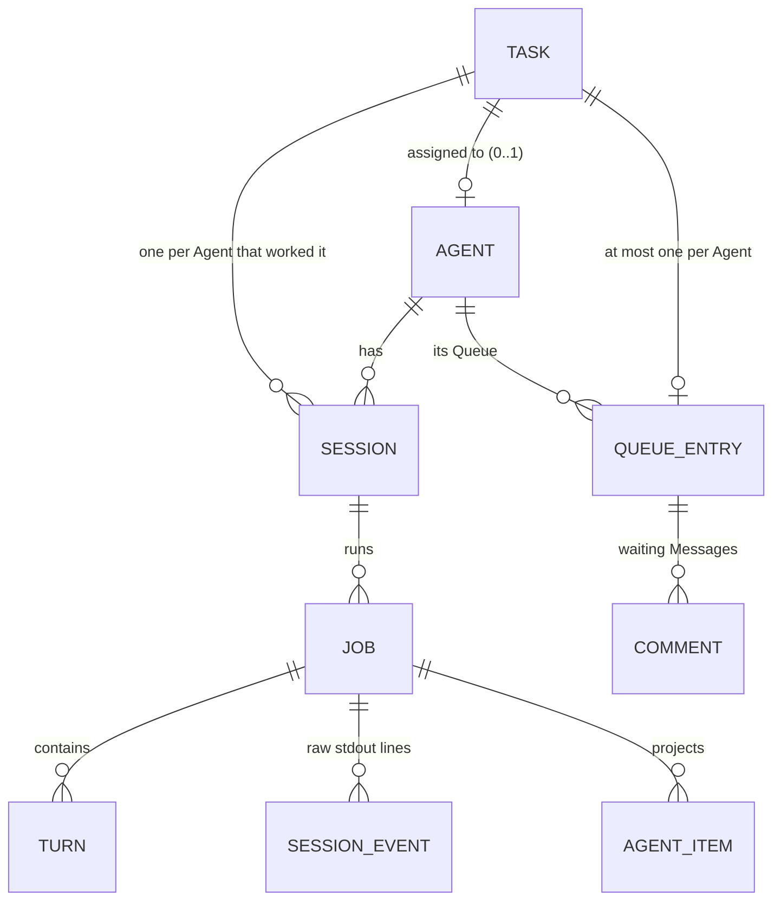
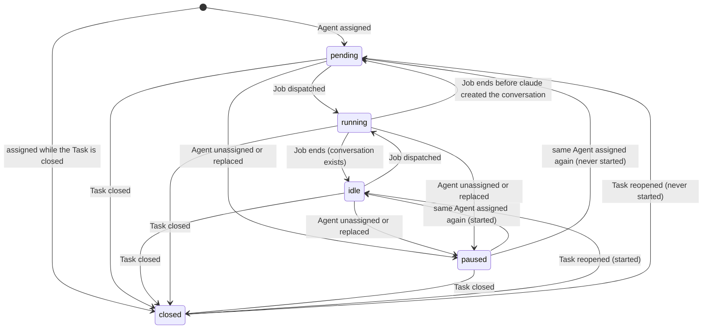
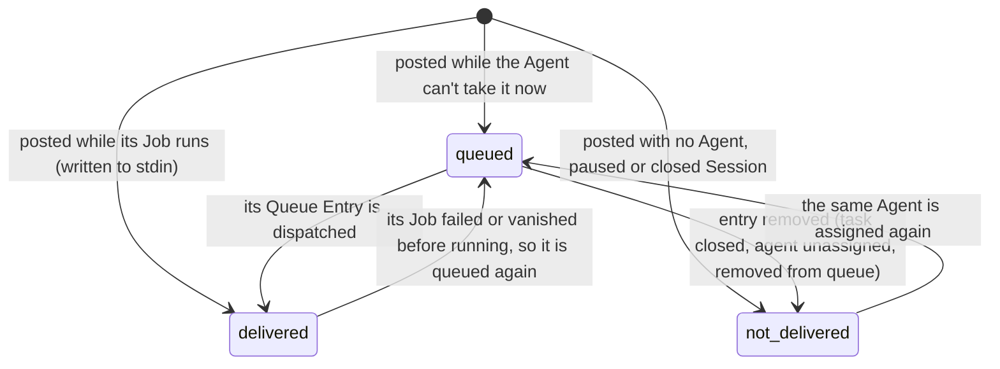
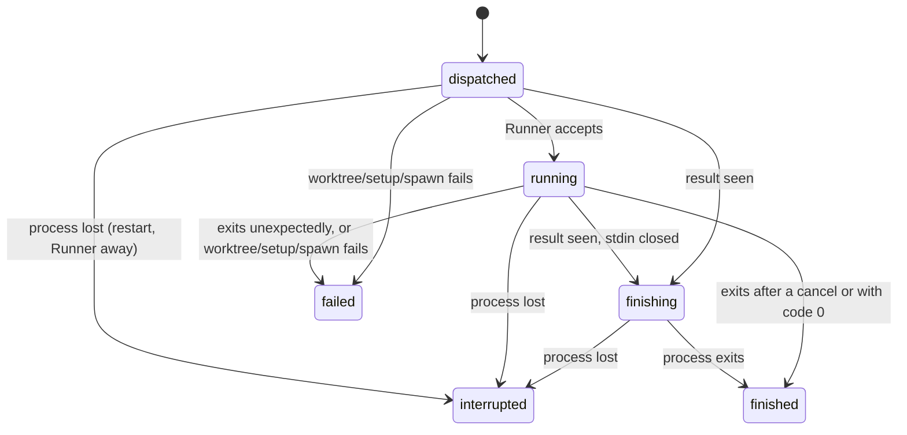
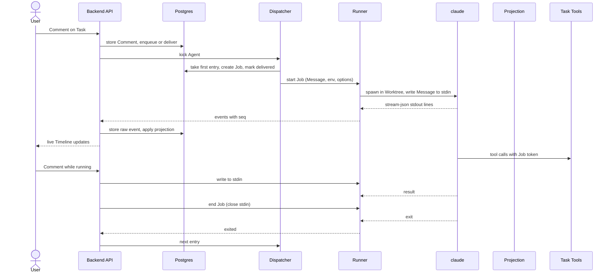

# Agent Sessions

Agent Sessions are how an **Agent** works a **Task**. Assigning an Agent opens a **Session**: one continuous Claude Code conversation between that Task and that Agent, which lasts as long as the Task is open and resumes when it is reopened. People talk to the Agent through Task Comments; the backend turns them into **Messages**, keeps each Agent's **Queue**, dispatches **Jobs** to the Agent's **Runner** one at a time, writes Comments into the running `claude` process mid-turn, and projects everything the Agent says and does onto the Task's **Timeline**. The Agent acts on the board through the **Task Tools**. This spec covers the backend side of that loop; the container, the Runner binary and its wire protocol, and git have their own specs (see [Related specs](#related-specs)).

## Concepts

- An **Assignment** links one Agent to a Task. A Task has at most one Agent at a time. Assignment creates the Session in `pending` and starts nothing.
- A **Session** belongs to one (Task, Agent) pair, and there is exactly one per pair. It keeps the Claude session identity, the Worktree path, whether `claude` has already created the conversation (**started**), the last Task version the Agent has read, and when its latest Job was dispatched. The Task points to its **current Session**: the Session of its assigned Agent, or of the last Agent it had.
- The **Claude session identity** is the id passed to `claude` with `--session-id` or `--resume`. It defaults to the Session's own id. Delete Chat on a Wiki replaces it with a fresh one (see [Claude session identity](#claude-session-identity)).
- A **Job** is one `claude` process for a Session, from dispatch to exit. An Agent runs at most one Job at a time. A Job contains one or more **Turns**; each Turn ends with a `result` event in the stream.
- A **Message** is what the Agent receives: one or more Comments merged into one stream-json user message, the opening Task snapshot of a new Session, or a platform notice (change list, resume or reassignment notice).
- The **Queue** is the ordered list of pending work of one Agent. It holds at most one **Queue Entry** per Task. An entry has a kind (`start`, `messages` or `resume_interrupted`), a position, and the Comments waiting to be delivered with it. An entry can be **held**: it stays in the Queue but waits for a Retry or a new Comment.
- A Comment's **Delivery** tells whether it reached the Agent: `queued`, `delivered` (with the Job) or `not delivered` (with a reason).
- **Agent output** lands on the Timeline as **Agent Comments** (the Agent's text, stored as Comments of kind agent), **System Comments** (errors and platform notices), and **Agent Items**: Thinking, Activity, Runs, Turn Summaries and short notices.
- A **Run** is work the Agent starts and gets on with inside a Turn: a **Subagent Run** (a call to Claude Code's `Agent` tool, named `Task` in older CLIs) or a **Background Command** (a shell command left running in the container). Each Run has one Agent Item recording how it started and how it ended, and a transcript kept live while its Job lasts (see [Runs](#runs)).
- The **Job token** is a random secret created for each Job. It authenticates the Job's `claude` process on the Task Tools server and its git traffic on the Git Proxy, and it works only while that Job is active.

## Behaviour

### Assignment and the trigger

Any User can assign an Agent to a Task, change it, or remove it, by editing the Task's Agent field. Every change is recorded as a Revision. The Task's Status plays no part: an Agent can be assigned to a Task in any Status, and the Session waits in `pending` whatever the Status is.

Assigning an Agent:

- creates the Session for (Task, Agent) in `pending`, with the Worktree path fixed for the Task (deterministic per Project and Task Key), and makes it the Task's current Session;
- puts nothing in the Queue.

When the Task is in a `closed`-category Status at the moment of assignment, the Session is created (or kept) `closed` instead.

The **first User Comment** on the Task, written after the assignment, is the trigger. It creates a `start` entry at the end of the Agent's Queue with that Comment attached. The Session stays `pending` until the entry is dispatched. Only non-internal Comments trigger the Session, since only they are delivered to an Agent. Notify agent is available only once a Session has started (see [Notify agent of changes](#notify-agent-of-changes)), so on a `pending` Session the first Comment is the only trigger.

Comments written before the assignment stay on the Task and reach the Agent as part of the opening Message.

### Session states

| State | Meaning |
| --- | --- |
| `pending` | Assigned; `claude` has not created the conversation yet. Waiting for the first Comment, or queued for it. |
| `running` | A Job of this Session is active (dispatched, running or finishing). |
| `idle` | The conversation exists; the Agent is waiting for the next Message. |
| `paused` | The Agent was unassigned from the Task (or replaced). Nothing is delivered. |
| `closed` | The Task is in a `closed`-category Status. The Worktree is removed. |

A Session is marked **started** as soon as the first stdout event of any of its Jobs is stored. From then on, every Job resumes it with `--resume`; before that, Jobs create it with `--session-id`.

The Task view shows the current Session as a chip: `queued #N` while the Task has a Queue Entry (N is its 1-based position in the Agent's Queue), `waiting for retry` while that entry is held, and otherwise `starting` (pending), `running`, `waiting for messages` (idle), `paused` or `closed`. The Board card shows the Agent's avatar with the Session state and the queue position.

### Closing and reopening the Task

Moving a Task into a `closed`-category Status ends the work on it. This also happens to every Task of a Status whose Category is switched to `closed`, and to Tasks moved there because their Status was deleted. For every Session of the Task that is not yet closed (the current one and any paused ones of earlier Agents):

1. an active Job is cancelled: the Job is flagged as cancel-requested and the Runner receives a cancel (interrupt, close stdin, `SIGTERM` after 10 s, `SIGKILL` after 20 s);
2. the Task's Queue Entry is removed and its Comments become `not delivered` with reason "task closed";
3. the Session becomes `closed`;
4. the Worktree is removed by the Runner, right away when it is connected, otherwise as soon as it says hello again. The Task Branch stays on the provider.

The cancelled Job ends quietly: its exit or setup failure produces no System Comment. Its Job token stops working immediately.

Moving the Task out of the `closed` Category reopens the current Session only: it returns to `idle` (or `pending` if it never started), with the same Claude session identity, and nothing is queued. The next User Comment or Notify agent queues a `messages` entry; at dispatch the Runner recreates the Worktree at the same path from the Task Branch.

Status changes have no other effect on Agents. Moving a Task between non-closed Statuses, by a User or by the Agent itself, leaves the Session and the Queue as they are.

### Unassigning and reassigning

Removing the Agent from a Task pauses its Session:

- if a Job is running (not yet finishing), the Runner receives an interrupt followed by an end, so `claude` stops the current Turn and exits once it has drained its input;
- the Task's Queue Entry is removed and its Comments become `not delivered` with reason "agent unassigned";
- the Session becomes `paused` and stays the Task's current Session, so the Task view keeps showing it.

Later Comments on the Task are marked `not delivered` with reason "no agent assigned".

Assigning a **different Agent** to an ordinary Task pauses the previous Agent's Session as above, then:

- if the new Agent never had a Session on this Task, a new `pending` Session is created and waits for the next Comment. Its opening Message carries the whole conversation, including the previous Agent's Comments, plus a line saying that another Agent worked on the Task before, on the same branch when there is one;
- if the new Agent has an earlier Session that never started, it returns to `pending`;
- if the new Agent has an earlier Session that did start, it returns to `idle` and a `messages` entry is queued right away. It carries every non-internal, non-deleted User and Agent Comment posted after that Session's last dispatch, leaving out the Agent's own Comments and System Comments. When there are none, the Agent receives a short notice: "You have been assigned to this task again. Read it with get_task to catch up on any changes."

**Wikis.** A Wiki's Agent is not assigned to its Chats afterwards: each Chat keeps the Agent that was the Wiki's when it was created. Changing the Wiki's Agent pauses the Sessions of the Chats run by the previous Agent and returns the Sessions of the new Agent's earlier Chats to `idle` (or `pending` when they never started); a User Comment in a Chat whose Agent is not the Wiki's current one is answered with `409` naming that Agent (an empty Chat takes the current Agent instead). No Session is created by the change itself.

Comments attached this way become `queued` again, including those previously marked "no agent assigned", and `delivered` once the Job starts.

### Comments reaching the Agent

When a non-internal User Comment (or a Notify agent notice) is posted on a Task with a current Session, the backend decides its Delivery in the same transaction:

| Situation | Delivery |
| --- | --- |
| The Task has no Agent, or its current Session is `paused` | `not delivered`, "no agent assigned" |
| The current Session is `closed` | `not delivered`, "task closed" |
| The Session's Job is `running`, the Runner is connected, the Task has no Queue Entry waiting, and the Comment is not a native command | `delivered` right away: the Message is written to the running process's stdin |
| Anything else (Agent busy on another Task, Job still being dispatched or finishing, Runner disconnected, an entry already waiting, a native command) | `queued`: merged into the Task's Queue Entry, or into a new one at the end of the Queue |

Comments on a Task that was never assigned an Agent carry no Delivery at all, like Internal Notes, Agent Comments and System Comments.

**Mid-turn delivery.** A Comment written to stdin during a Turn is read by `claude` at its next model call, after the current batch of tool calls, and belongs to that same Turn: one `result` covers it. This is how a User steers the Agent while it works.

**Merging.** Comments that wait in the Queue for the same Task are delivered together as one Message, oldest first, each one opened by a bracketed header line naming its author and the ISO time it was posted, followed by its Markdown body. Comments by Agents carry "(agent)" after the name. The body delivered is the one at dispatch time, so editing a queued Comment changes what the Agent reads; edits after delivery stay on the Timeline only.

**Attachments.** Image attachments (PNG, JPEG, GIF, WebP) up to 5 MB are delivered as image blocks inside the Message. One Message inlines at most 20 images and 16 MB of images in total; the newest images get the budget first. Every other file, and every image beyond the budget, is fetched by the Runner into the Worktree under `.claude-task/attachments/<comment id>/<filename>` before the Message is written, and its path is listed under the Comment. The Runner downloads them from the backend with its own token, and only for Tasks on which its Agent has an active Job; files of Internal Notes and deleted Comments are refused.

**Files linked from the description.** Files embedded in the Task description stay linked by URL in the text, so the Agent can edit the description without breaking them. Whenever the description is delivered (the opening Message, a change notice), each linked file is also fetched into the Worktree and the Message lists which link maps to which path. Linked images within the same budget are also attached inline.

**Deleting a queued Comment.** When a deleted Comment leaves its Queue Entry with nothing to deliver, the entry is removed, so no Job starts for nothing. A `resume_interrupted` entry stays, since it has work of its own. A `pending` Session whose trigger Comment is deleted goes back to waiting for a Comment.

### Message delivery states

The reasons shown with `not delivered` are "no agent assigned", "task closed", "agent unassigned" and "removed from queue". A delivered Comment records the Job that carried it.

### The Queue

Each Agent has one Queue, ordered by a fractional position. It holds at most one entry per Task:

- **`start`**: the first Job of a Session that `claude` has not created yet.
- **`messages`**: pending Messages for a Session that exists.
- **`resume_interrupted`**: a Turn cut off by a container restart or a lost Runner, to be resumed.

New entries go to the end of the Queue, except recovery entries, which go to the front. A Comment for a Task that already has an entry joins it and the entry keeps its position. When two kinds meet in one entry, `start` wins over `resume_interrupted`, which wins over `messages`.

What waits in the Queue: Comments for Tasks other than the one the Agent is running, Comments posted while a Job is being dispatched or is finishing (they go to the back), every Comment for a Task that already has an entry, native commands, and everything while the Agent is disabled, offline, rebuilding its container or synchronizing its Extensions.

Any User can manage an Agent's Queue from the Agent's page:

- **reorder** entries by dragging (an entry moves to the front, after a given entry, before a given entry, or to the end);
- **remove** a `messages` or `resume_interrupted` entry, after a confirmation. Its Comments become `not delivered` with reason "removed from queue". A `start` entry stays: to drop it, unassign the Agent.

### Dispatch

The dispatcher runs per Agent. When it finds a Queue Entry but the Agent's container is stopped for lack of work, it asks the reconciler to start the container (see [Agents](agents.md)); the Job dispatches once the Runner has connected. It is triggered when work is queued, when a Job ends (after any pending container recreation), when the Runner says hello, when the container becomes running, when Extensions finish synchronizing, and by a periodic tick every 30 seconds.

An Agent can take a Job when all of these hold: it is enabled, its Extensions are synchronized, its Runner is connected, its container is running with the current configuration (no recreation pending), and it has no Job in `dispatched`, `running` or `finishing`. The dispatcher then takes the first entry by position that is not held, locking it so that two dispatchers never take the same entry, and in one transaction:

1. checks the Task Branch on the git provider and records the branch name and link on the Task when the Project has a Repository (see [Git integration](git-integration.md)). When the provider can't be reached, the entry is held, a System Comment explains the failure, and the dispatcher moves on to the next entry;
2. builds the Message (below) and the Job's environment;
3. creates the Job (`dispatched`) with a fresh Job token;
4. removes the entry, or keeps it as `messages` when native commands remain in it;
5. marks the included Comments `delivered` with this Job;
6. sets the Session to `running`, records the dispatch time and raises the Session's last-read Task version (to the Task version for a new Session, to the version covered by any change notice included);
7. sends the start of the Job to the Runner.

**The Message of a Job:**

- **New Session** (`claude` has not created it, whatever the entry kind): "You have been assigned task KEY in project "Name"", the Task snapshot (key, title, Status with its Category, priority, tags, description and its linked files), the Task Branch when there is one, the line about a previous Agent when another Agent's Session on this Task has started, then "Conversation so far (oldest first):" followed by every non-internal, non-deleted User and Agent Comment, or "There are no comments yet."
- **Existing Session**: the merged Comments of the entry. A `resume_interrupted` entry with no Comments sends "The previous run was interrupted by a restart; continue where you left off." Any other entry with no Comments sends the reassignment notice.

**The Job's environment and options:** the Project's environment variables (secrets decrypted), then the Agent's environment (which wins over the Project's), then the Credential's variable (`CLAUDE_CODE_OAUTH_TOKEN`, `ANTHROPIC_API_KEY` or `ANTHROPIC_AUTH_TOKEN`), and `CLAUDE_CODE_RESUME_INTERRUPTED_TURN=1` for a resumed interrupted Turn. They travel in the Job's start message and never as container environment. The start also carries the Agent's model, effort and permission mode, the composed system prompt, the MCP configuration (the Agent's catalog MCP servers plus the reserved `claude-task` server with the Job token as a bearer header), the Project's Setup Script, the Worktree path, the git settings, and the attachments to fetch.

**Native commands.** A User Comment whose body starts with `/name` runs as a native Claude Code command, as its own Job, in order with the other queued Comments. Commands that would replace the managed conversation or override the Agent's configuration (`clear`, `reset`, `new`, `resume`, `continue`, `branch`, `fork`, `exit`, `quit`, `background`, `bg`, `remote-control`, `rc`, `model`, `effort`, `config`, `settings`, `permissions`, `allowed-tools`, `fast`) are delivered as ordinary text. A command always waits in the Queue, so it starts at a Job boundary. When an entry holds a command, the Comments before it form one Job, the command alone forms the next, and the Comments after it follow. A command alone is written verbatim, without the header line. As the first Message of a new Session, the Task context comes in earlier blocks and the command is the last block, so `claude` runs it natively with the context available. Output a command prints locally is shown once as a System Comment.

The commands offered in the composers come from the `slash_commands` list reported at the start of the Session's latest Job (curated built-ins, plugin commands and MCP prompts), plus the Agent's user-invocable Skills, plus the user-invocable Project Skills the Runner reported for the Session's latest Job that reported any (see [Runner](runner.md)). Before any Job has reported, the list is `compact`, `context` and `usage` plus the Agent's Skills.

**Project Skills.** The backend parses each reported file like a catalog `SKILL.md`: the YAML frontmatter's `description`, or else the first paragraph after it (a leading heading marker removed), cut at 2,000 characters. A file with `user-invocable: false`, unparseable frontmatter or a name outside letters, digits, `_` and `-` (at most 64) is left out, and of two files with the same name the first wins, so a skill wins over a command. The result is stored on the Job and the Task's Session is republished. In the composer a Project Skill shows as a Skill. It gives way to an Agent's Skill of the same name, as `claude` gives personal skills precedence over project ones. Once the Session's `system/init` has reported its `slash_commands`, a Project Skill is offered only when that list names it, so one that settings disable, or that the CLI doesn't load, is not suggested. Before that, every reported Project Skill is offered. The composer itself is described in [Conversation](conversation.md).

### End of a Turn and of a Job

Every Job ends after its Turn. When the Runner reports a `result`, the backend records the Turn, moves the Job to `finishing` and tells the Runner to end it: the Runner closes stdin, `claude` processes anything already written (each such Message becomes a Turn of its own, recorded normally) and exits. From `finishing` on, new Comments are queued. When the process exits, the Job finishes, the Session returns to `idle`, and the dispatcher picks the Agent's next entry.

Outcomes when a Job ends:

- **Normal exit**, or exit after a cancel or during `finishing`: the Job is `finished`.
- **Unexpected exit** (non-zero code or signal while running, without a cancel): the Job is `failed` and a System Comment says "The agent's process stopped unexpectedly", with the last 20 lines of stderr. The Session returns to `idle`; the next Comment continues it.
- **Worktree, setup or spawn failure**: the Job is `failed` with its stage. A System Comment names the stage ("preparing the worktree", "running the setup script", "starting Claude Code") with the error and the last 20 lines of setup output. The Job's Comments go back to `queued` in an entry at the front of the Queue, **held**: the dispatcher skips it so a broken setup doesn't loop. **Retry** on the Task, or any new Comment, releases it. Retry answers `409` when nothing is held.
- **Conversation missing**: when stderr says the conversation was not found (for example after the Agent Volume was reset), the Session is marked not started and a System Comment says the next run starts a new conversation with the Task's history.
- **Conversation already exists**: when a first Job fails because `claude` had already created the conversation, the Session is marked started, a System Comment says the next run resumes it, and the Job's Comments are queued again, held, waiting for a Retry or a Comment.
- **Remote Task Branch missing**: when the Runner had to recreate the Worktree of a started Session from the Base Branch because the remote Task Branch was gone, a System Comment says so.

Tool calls still waiting for a result when a Turn or a Job ends are shown as `interrupted` on the Timeline.

### Stop (Interrupt)

The **Stop** button on a Task interrupts the current Turn without ending the Session. The Runner sends `claude` a stream-json interrupt control request: the running tool call is rejected, the Turn ends with a `result` marked as aborted, and the process stays alive. The normal end of Turn follows (the Job finishes), and the next Comment resumes the same conversation. Stop is available while the Session's Job is dispatched or running, and answers `409` otherwise.

### Cancellation

A Job is cancelled when its Task is closed, or when its Chat is deleted (see [Wikis](wikis.md)). The Runner interrupts the Turn, closes stdin, and escalates to `SIGTERM` after 10 seconds and `SIGKILL` after 20 seconds. The Job keeps the Agent busy until the Runner reports the exit, so the next Job starts only afterwards. A cancelled Job's token stops working at once, and its exit or failure produces no System Comment.

### Recovery after restarts

The backend keeps all scheduling state, so a restart of either side resumes from the database.

**Runner hello.** Each time a Runner connects it reports the Job it still holds, if any (one whose process runs or whose messages are not all acknowledged):

- the Job is still active in the backend: it is kept, and the backend acknowledges the last message it processed, so the Runner resends the rest;
- the Job is already settled (or unknown): the backend acknowledges everything and cancels it;
- every other active Job of the Agent lost its process (container restart or crash) and is recovered as below.

The backend then sends any pending Worktree removals, reconciles the container and runs the dispatcher.

**Recovering a lost Job.** The Job's pending tool calls are settled as interrupted and the Job becomes `interrupted`. If the Session was running:

- when the Job had started streaming and the conversation exists, and the Turn had not ended yet, a `resume_interrupted` entry goes to the **front** of the Queue and a System Comment says "The agent's container restarted in the middle of a turn. Resuming where it left off." The next Job resumes with `CLAUDE_CODE_RESUME_INTERRUPTED_TURN=1`, which makes `claude` continue the cut-off Turn on its own, re-running the interrupted tool;
- when nothing had run yet, the Job's Comments go back to the front of the Queue as they were;
- when the Job was already finishing, the Turn was complete and nothing is queued.

**Runner away.** While the Runner is disconnected, its Job keeps running inside the container and buffers its output. A Runner disconnected for more than 5 minutes has its active Jobs recovered by the periodic tick. The backend pings each Runner every 30 seconds and drops a connection that stays silent for a whole round, so a half-open connection is detected and recovered too. A second connection for the same Agent replaces the first.

**Exactly once.** Every Job message from the Runner carries a per-Job sequence number. The backend processes each one exactly once and in order, in a transaction, and acknowledges it afterwards; messages at or below the last processed number are acknowledged and ignored, and messages for settled Jobs are acknowledged and dropped. The wire format, reconnection and buffering on the Runner side are described in [Runner](runner.md).

### The `claude` invocation contract

Each Job runs the real Claude Code CLI in headless mode inside the Task's Worktree:

- `-p --input-format stream-json --output-format stream-json --verbose --include-partial-messages`;
- `--session-id <id>` for a conversation `claude` has not created yet, `--resume <id>` afterwards, always with the Session's Claude session identity;
- `--model`, `--effort` and `--permission-mode` from the Agent when set;
- `--append-system-prompt` with the composed system prompt;
- `--mcp-config` with the Task Tools server and the Agent's catalog MCP servers;
- `--forward-subagent-text`, so a Subagent Run's text reaches its transcript, whenever the `claude` that starts supports it (from 2.1.211);
- `--disallowedTools AskUserQuestion`, because a headless Job has nobody to answer Claude Code's own question dialog; Agents ask through `ask_question` instead.

It runs without `--bare`, so the repository's CLAUDE.md, its `.claude/` settings and Skills, its `.mcp.json`, and the Agent's installed Skills and Plugins load exactly as in an interactive session. The platform configures no hooks; hooks a repository or Plugin brings run normally. The `claude` version is pinned centrally through `CLAUDE_CODE_VERSION` (default 2.1.310) with the auto-updater off, because the stream-json format is a contract for the projection. A repository's mise configuration can put another version in front of the pinned one through mise's shims, so the Runner asks the executable it is about to start for its version and passes the flags that version understands. Each Job records the `claude` version and the MCP servers reported at its start.

The Worktree path is deterministic per Project and Task, so a resumed conversation always runs in the same directory: tool state and relative paths in the transcript depend on it. Session transcripts live in the Agent Volume; the raw stream in the database is the durable record.

### System prompt composition

The appended system prompt is the same for every Job of a Session; it holds no Task content beyond its key and Project, so the opening Message and the Task Tools carry the Task itself. It concatenates, separated by blank lines:

1. **The platform section:**
   - who the Agent is: its name, the Task Key and the Project name;
   - its working directory (the Worktree in the Agent's home) and, when the Project has a Repository, that it is a git worktree on the Task Branch;
   - that everything it writes as text is posted as a Comment on the Task for humans, so it should write clearly in Markdown;
   - that new messages from humans can arrive while it works and should be taken into account as soon as it sees them;
   - that for a decision with clear options it asks with `ask_question`, otherwise in text, and then ends its Turn, since the answer arrives as a new Message;
   - that `send_files` shows screenshots and other files to humans, and that `create_survey` is only for when a human explicitly asks to collect several people's answers;
   - that files attached to Comments and linked in the description are saved under `.claude-task/attachments/` in its working directory;
   - the Task Tools on the `claude-task` server and what each is for;
   - when the Project has a Repository: `open_pull_request`, that it pushes only to its Task Branch, and that before moving the Task to a review Status it commits, pushes and opens or updates the pull request;
   - when the Agent has Development Services: that they are ready to use in its container, shared by all its Tasks so Projects keep apart by their own database names, key prefixes or buckets, and each selected service with its address and access (the descriptions the Agent form shows). Without this, the Agent would not know the services exist.
2. **Project instructions**, under the heading "Project instructions:", when the Project has Agent Instructions.
3. **The Agent's own system prompt**, when set.

### Timeline projection

The Agent's output reaches the Timeline from the stdout stream of `claude` and from nothing else. Every stdout line the Runner forwards is stored as a raw **Session Event** (idempotent per Job and sequence number; a line that isn't JSON is stored as an "unparsed" event with its first 10,000 characters). It is then projected by a pure function from the projection state of the Job and the event to the new state, the Timeline changes and the live broadcasts. The projection state is stored on the Job between events, and the ids of the items it creates derive from the Job and a counter, so replaying a stream yields the same rows.

What each event produces:

| Stream event | Timeline effect |
| --- | --- |
| Partial text or thinking delta (top level only) | Broadcast live to the Task's viewers; nothing is stored. A text delta carries the id of the Agent Comment being written, if any. |
| Assistant text block | Starts an **Agent Comment**, or appends to the open one with a blank line in between. The Comment stays open across messages until a tool call, thinking, a compaction or the end of the Turn. |
| Assistant thinking block with text | A **Thinking** item, collapsed by default, extended by consecutive thinking. Empty thinking (the CLI redacts it for current models) produces nothing. |
| Assistant tool call | An entry in the open **Activity** item, or a new Activity item after text or thinking. Each entry has the tool name, a one-line summary, status `pending` and the input (long strings cut at 20 KB). A call to `Agent` or `Task` starts a **Run** instead and adds nothing to Activity. |
| Tool result | Updates the matching entry: status `ok`, `error`, or `interrupted` when a Stop rejected it, a short outcome, and the output cut at 20 KB for display. The result of an `Agent` call settles its Run and its body is not kept. |
| Assistant message with `parent_tool_use_id` | Its text and tool calls become the transcript of the Run that owns the parent call, shown live only, and its thinking is dropped. A call to `Agent` or `Task` inside it starts a nested Run one level deeper. |
| `system/task_started`, `system/task_notification` | Start and settle the Run of a backgrounded call: a backgrounded subagent, or a **Background Command** for a `local_bash` task. See [Runs](#runs). |
| Synthetic assistant message (made by the CLI itself, e.g. spend limits) | A System Comment with its text. |
| `result` | Closes the Turn: settles pending calls as interrupted, adds a **Turn Summary** item, and records the Turn. See below for errors. |
| `system/init` | Records the `claude` version, MCP servers and available commands on the Job. A System Comment when the Task Tools server reports `failed` or `needs-auth`. |
| `system/api_retry` | A transient "retrying (attempt n/m)" status for the Task's viewers, cleared by the next assistant message or the `result`. A System Comment when retries are exhausted, or right away for a Credential error. |
| `system/compact_boundary` | A notice item "Context compacted (N tokens before)". |
| `system/local_command_output` | A System Comment with the command's output (terminal escape codes stripped). |
| `rate_limit_event` | A rate-limit observation for the Agent's Credential. |
| Anything else | Stored, no Timeline effect. |

Tool call summaries read as plain sentences: "Edited `path`", "Wrote `path`", "Read `path`", "Ran `command`" (first line, cut at 80 characters), "Searched for `pattern` in `path`", "Listed `pattern`", "Fetched url", "Searched the web for “query”", "Updated the to-do list", "Task tool `name`" for the Task Tools, "server: `tool`" for other MCP tools, and "Used `name`" otherwise. Outcomes: Bash shows "exit N" (or "interrupted"); other tools show the first line of the error when they fail.

**Turn Summary and Turn record.** Each `result` produces a Turn Summary with duration, number of tool calls (subagent calls included), cost, `result` subtype, error flag and token usage (input, output, cache read, cache creation). The CLI reports cost cumulatively per process, so the cost of a Turn is the difference from the previous `result` of the same Job. The Turn record also keeps its index in the Job, start and end times and stop reason.

**Errors at the end of a Turn.** A `result` that is an error (non-success subtype, or an error flag) adds a System Comment: "The turn stopped: it reached the maximum number of steps.", "The turn stopped because of an error.", "The turn stopped: it reached its budget.", "The turn ended with an error." or "The turn stopped (subtype).", followed by the detail. A Turn ended by Stop (its terminal reason is an abort) is an expected end and adds nothing. When a synthetic message already said the same thing, the `result` adds nothing more. A successful Turn with no visible text and no tool calls shows its result text as a System Comment.

**Credential errors** (`authentication_failed`, `billing_error`, `oauth_org_not_allowed`, `account_on_hold`) produce one System Comment per Job naming the Credential, e.g. "Credential **Team token** was rejected (authentication_failed). Check it in Credentials."

**Live updates.** Timeline changes reach the Task's viewers as events: Comments created or updated, Agent Items created or updated, live deltas, the retry status, Run updates and transcript messages, and Setup Script output while the Worktree is prepared. Clients merge Comments, Revisions and Agent Items by creation time; the Timeline API pages through them newest first.

### Runs

A Run is work the Agent starts and gets on with: a **Subagent Run**, started by a call to the `Agent` tool (named `Task` in older CLIs), or a **Background Command**, a shell command the Agent leaves running in its container. Each Run has one Agent Item of kind `run`, created when the call starts and updated when the Run ends. The item holds the Run's type, description, subagent type, depth, status (`running`, `ok`, `error` or `interrupted`), start and end times, tool call count, a short outcome line and the error when it failed. It is the only trace the Timeline keeps of a Run.

The Turn Summary counts the tool calls made inside Subagent Runs, so a delegated Turn's step count stays truthful.

**Transcript.** Each Run keeps a transcript while its Job lasts: the text the subagent writes, as whole Markdown blocks rather than streamed tokens, and its tool calls with input, output and status. Its thinking belongs to the CLI's own display and stays out. The Run's prompt is kept with the transcript, as is the token usage the CLI reports when it reports it. A Background Command has no transcript: its output stays in the container's file, and its `task_notification` summary becomes the item's outcome line. A nested Run gets its own item, its own transcript and a depth one higher than the Run that started it, and the parent's transcript names it on the tool call that started it.

**Where it lives.** The transcript is held in memory by the backend, in a **Run Registry** keyed by Run id, and only the item above reaches Postgres. The registry is written after the event's transaction commits, so an event that rolls back never reaches a viewer. It lives as long as the Job, so a Run that outlives its Turn, such as a Background Command, stays readable until the Job ends.

**Limits.** A transcript keeps at most 500 messages and 2 MB of content, and a Job keeps at most 30 Runs, evicting the oldest finished one first. A full transcript is reported as truncated; an evicted Run answers `404`, like one from a Job that has ended. Text blocks, tool inputs and tool outputs are cut at 20 KB, and an error is cut at 2 KB.

**Settling.** A Subagent Run settles on the tool result of its `Agent` call: `ok`, `error` with the body, or `interrupted` when the call was rejected by a Stop or the Job ended first. A Run the CLI reports as backgrounded settles on its `task_notification` instead, whose status decides between `ok` and `error` and whose summary becomes the outcome. `endJob` settles every Run still running as `interrupted`, like pending tool calls, and a Job that already ended leaves them as they are.

**CLI task events.** A `local_bash` task becomes a Background Command only when it is backgrounded; a foreground command is an ordinary tool call and nothing more. A `local_agent` start only enriches a Run that the tool call already created. `task_progress`, `task_updated`, `background_tasks_changed` and every other task type change nothing. A CLI version that reports no task events leaves Background Commands out of the Timeline, while Subagent Runs keep working from the tool call alone.

**Live updates and API.** A Run reaches the Task's viewers as `run.updated` when it starts and when it ends, and `run.message` for each transcript message and tool result. The registry counts a Run's tool calls as its transcript grows, so a Run read mid-flight carries its count so far, and the count the projector reports when the Run ends replaces it. The Task's current Runs are listed by `GET /tasks/:id/runs` (running first, then errored ones, by start time), and a transcript is read with `GET /tasks/:id/runs/:runId`, which answers `404` once the Run has left the registry or when it belongs to another Task. Both use the Timeline's permissions and serve Wiki Chats like any Task. [Clients](clients.md) describes how the bar, the dialog and the Timeline row use them.

**Subagent text.** The CLI forwards a subagent's text only when started with `--forward-subagent-text`. Without it the transcript holds the tool calls alone, and the Run is otherwise the same. [Runner](runner.md) describes how the Runner decides whether to pass the flag.

### Task Tools

The backend exposes the Task Tools as a stateless MCP server over Streamable HTTP (POST only; GET and DELETE answer `405`), registered in every Job's MCP configuration as the `claude-task` server. Each request carries the Job token as a bearer header. A token is accepted while its Job is `dispatched`, `running` or `finishing`, has no cancel requested, and its Session is `running`; otherwise the request gets `401`. So tools stop working the moment a human closes the Task or unassigns the Agent, even before the process exits.

Every tool acts as the Agent: mutations are Revisions attributed to it and appear on the Timeline. Errors come back as MCP tool errors with a message the model can act on (for example the list of valid names).

| Tool | Inputs | Behaviour |
| --- | --- | --- |
| `get_task` | `key` (optional), `comments_before` (optional cursor) | Reads the Agent's own Task, or another Task of the same Project by key (a key from another Project is an error). Returns key, title, description, Status, priority, tags, assignees, creator, whether it is the Agent's own Task, branch and pull request; the Project's Statuses with their Categories; the Project's tags; and non-internal, non-deleted Comments, newest 50 in chronological order, with a cursor for older ones. Reading its own Task marks the Agent as having read the current version, which clears Unseen Changes. |
| `list_tasks` | `status_category`, `tag` (name), `text` (matches title or key), `limit` (1 to 200, default 50); all optional | Summary of the Project's Tasks: key, title, Status, Category, priority, tags, whether it is the Agent's own. Closed Tasks are listed only when `status_category` is `closed`. An unknown tag is an error. |
| `update_task` | `title` (1 to 500 characters), `description` (up to 100,000), `priority` (`urgent`, `high`, `normal`, `low`, `none`), `tags` (up to 50 names, replacing the current set); all optional | Updates the Agent's own Task. Tag names match case-insensitively and must exist in the Project. The edit applies to the current version of the Task. |
| `set_status` | `status_name` | Moves the Agent's own Task to the named Status (case-insensitive). Statuses in the `closed` Category are refused with a message that closing is for humans. |
| `create_task` | `title`, `description`, `priority` (default `none`), `tags` | Creates a Task in the same Project, in its first `open` Status, with no assignees and no Agent, created by the Agent. |
| `send_files` | `paths` (1 to 10), `caption` (optional Markdown, up to 100,000 characters) | Posts the files as an Agent Comment with the caption as its body. Returns the Comment and the stored file names. |
| `ask_question` | `questions` (1 to 4 items), `paths` (0 to 10) | Posts a Question with the files, and answers that the Agent should end its Turn because the answer arrives as a new Message. |
| `create_survey` | `questions` (1 to 4 items), `paths` (0 to 10) | Posts a Survey whose Expected Respondents are the Task's User Assignees, and answers with their names. A Task without Assignees gets an error suggesting `ask_question`. Its description limits it to explicit requests from humans. |

An item of `ask_question` and `create_survey` mirrors Claude Code's own question tool: `header` (1 to 12 characters), `question` (1 to 2,000 characters), `options` (2 to 4, each a `label` of 1 to 60 characters, unique within the item ignoring case, and a `description` of up to 300 characters) and `multiSelect` (default false). "Other" is added by the clients, so an option labelled "Other" is refused. How Users answer is described in [Conversation](conversation.md).

**Files from the container.** `paths` are relative to the Worktree or absolute, and name regular files of up to 25 MB that the `agent` user can read. Before posting anything, the backend asks the Agent's Runner for the files over its connection and waits up to 60 seconds for the Runner to upload them (see [Runner](runner.md)). The tool answers with an error naming each path that failed and why, and posts nothing, when any file is missing, not a regular file or too large; it fails at once when the Runner is not connected, and when the upload hasn't finished 60 seconds after the request. When the Job ended meanwhile (the Task was closed, the Agent unassigned or the Job cancelled), nothing is posted and the files are discarded.

In a Wiki's Session, the Task Tools act on the Task of the Job, which is the Chat the Agent is working in; `get_task` and `list_tasks` read the Wiki and its Project as usual, `send_files`, `ask_question` and `create_survey` work as on any Task, while `update_task`, `set_status` and `create_task` answer with an error that a Wiki changes through the conversation and its Git Repository (see [Wikis](wikis.md)).
| `open_pull_request` | `title`, `body`, `draft` | Opens or updates the pull request of the Task Branch. See [Git integration](git-integration.md). |

### Notify agent of changes

A Task has **Unseen Changes** when a User changed its title, description, priority or tags after the version the Agent last read, and the Session is `idle` or `running`. Changes by the Agent itself, Status changes and assignee changes don't count. The Agent's last-read version advances when a Job delivers the opening Message (the whole Task), when it reads its own Task with `get_task`, and when a change notice is delivered.

The Task view then shows a banner with **Notify agent**. Pressing it:

1. builds the change list from the User Revisions after the last-read version, field by field, comparing the first "before" with the last "after" and leaving out fields that ended where they started: "Title: "old" → "new"", priority the same way, tags as "added …; removed …", and the description as a unified diff with 3 lines of context. The header names the Users who made the changes;
2. posts a System Comment "<User> notified the agent of task changes." that carries the change list as its Message;
3. delivers that Comment like a User Comment: written mid-turn when the Agent is running this Task, queued otherwise, with the same Delivery states;
4. on delivery, raises the last-read version to the one the list covers, so the banner clears.

Notify agent answers `409` when no Agent is assigned, when the Session is not `idle` or `running` ("nothing to be notified about yet"), and when there are no unseen changes.

### Claude session identity

A Session's Claude session identity defaults to the Session's own id. **Delete Chat** on a Wiki (a Chat is a Task of the Wiki Project, see [Wikis](wikis.md)) rotates it while keeping the Session, the Worktree and the Task Branch. For every Session of the Chat's Task (the current Agent and any earlier ones), it:

- sets a new random Claude session identity and marks the Session not started, so the next Job creates a new conversation with `--session-id` instead of resuming;
- puts the current Agent's Session in `pending` and earlier Agents' Sessions in `paused`, and resets the last-read version and the last dispatch time;
- removes the Queue Entries of the conversation;
- cancels any active Job and flags it to **discard its output**. That Job keeps its Agent busy until the Runner reports its exit or failure; until then every message from it is acknowledged and ignored, a Runner that reconnects with it is told to cancel it again, recovery requeues nothing for it, and Comments posted meanwhile are queued instead of written to it.

The next Comment in that Chat then starts a new conversation in the same Worktree. What Delete Chat clears and how clients learn about it are described in [Wikis](wikis.md).

### Observability of the Queue

- **Task view and Board card:** the Session chip and queue position, Stop while running, Retry while held, the Unseen Changes banner, the Active Runs bar with a failed Run's error, and the Delivery of each User Comment.
- **Agents list:** each Agent's state (`disabled`, `building`, `build_failed`, `offline`, `idle`, `working`), the Task it is working on, its Queue length and its last activity, refreshed at most every 10 seconds while it streams.
- **Agent page:** the Queue in order with each entry's Task, kind, held flag, number of pending Messages and time queued; the 30 most recent Jobs with state, kind, Turns and usage; Job details with Setup Script output and stderr (the last 64 KB of each) and the `claude` version; usage in tokens and cost in total, per UTC day for the last 30 days, and for the 20 most expensive Tasks; and the latest rate-limit status of the Agent's Credential.

Queue, Job and Session changes are pushed live to the Agent's page, the Agents list, the Task view and the Board.

## Architecture

- **Session lifecycle** applies Assignment, unassignment, reassignment, closing and reopening inside the same transaction as the Task change that triggers them, and decides each Comment's Delivery.
- **Unsent mid-Turn input** is returned to the Queue when the Runner socket closes before the backend can write it. Recovery locks Project, Task, Agent and Session before the Comment, rereads the current Assignment and Session state, and acts only on the Delivery belonging to the failed Job. Closing, unassignment and Comment deletion therefore serialize with recovery.
- **Queue** keeps each Agent's entries with fractional positions. Every change to an Agent's Queue holds that Agent's row lock, so enqueueing, dispatching and manual reordering are serialized per Agent.
- **Dispatcher** runs one dispatch loop per Agent in the backend process; a new trigger during a run makes it run again. It also builds Messages and the system prompt.
- **Runner handlers** process the Runner's messages one at a time per connection, each in a transaction that locks Task, Agent, Session and Job in that order, and acknowledge them after commit.
- **Projection** is a pure function plus an applier that writes Comments, Agent Items, Turns and rate-limit observations and queues the matching live events.
- **Run Registry** is an in-memory map, owned by the backend process, from Run id to its summary, prompt, transcript and usage. The projection emits Run changes as mutations; the applier applies them to the registry only after the transaction commits, then broadcasts them.
- **Task Tools server** resolves the Job token to its Job, Agent, Task, Session and Project on every request, and calls the same Task operations the API uses.
- **Scheduler** runs the periodic tick (every 30 seconds: container reconcile, recovery of Jobs whose Runner has been away too long, dispatch for every Agent with queued work) and coalesces live updates for Queues, Sessions, Comments and Jobs into one flush per event loop turn.

Agent Containers, images and Extensions are managed as described in [Agents](agents.md); the Runner's process handling, Worktree preparation and wire protocol in [Runner](runner.md).

## Data model

- **Session**: Task, Agent (unique together), state, Worktree path, Claude session identity (optional), started flag, last-read Task version, last dispatch time, Worktree removal pending flag, created and closed times. Deleted with its Task or its Agent.
- **Queue Entry**: Agent, Task (unique together), Session, kind, position, held flag, queued time.
- **Job**: Session, Agent, Task, kind (the entry kind it came from), state (`dispatched`, `running`, `finishing`, `finished`, `failed`, `interrupted`), Job token hash, last processed sequence number, projection state, `claude` version, MCP servers and commands reported at start, Project Skills reported before start, Setup Script output and stderr (last 64 KB each), exit code, signal, failure stage (`worktree`, `setup`, `spawn`), error, cancel-requested and discard-output flags, created, started and finished times.
- **Turn**: Job, Task, Agent, index in the Job, start and end, `result` subtype, error flag, stop reason, duration, tool call count, cost, usage.
- **Session Event**: Job, sequence number (unique together), received time, raw payload. Kept for audit and re-projection.
- **Agent Item**: Task, Session, Job, Agent, kind (`thinking`, `activity`, `run`, `turn_summary`, `notice`), payload, created and updated times. A `run` item carries the Run's summary; its transcript lives only in the Run Registry.
- **Comment** (fields of this area): kind (`user`, `agent`, `system`), Delivery state (`none`, `queued`, `delivered`, `not_delivered`), delivery reason, the Job that delivered it, the Queue Entry it waits in, the producing Job for Agent and projected System Comments, and for Notify agent notices the change list and the Task version it covers.
- **Rate-limit observation**: Credential, Agent, payload, observed time. The latest one per Credential is shown.

## Non-functional requirements

- **One Job at a time per Agent**, enforced in the database under the Agent's row lock, across any number of concurrent triggers.
- **No lost work:** every Runner message is processed exactly once, in order; a Runner away for more than 5 minutes, or silent for a whole 30-second ping round, has its Jobs recovered; interrupted Turns resume from the front of the Queue.
- **Message size:** a Message inlines at most 20 images and 16 MB of images, so a Job start stays well within the Runner connection's frame limit.
- **Display limits:** tool output and long tool inputs are cut at 20 KB on the Timeline; the raw stream keeps them whole. Setup output and stderr keep the last 64 KB per Job. A Run transcript keeps at most 2 MB over 500 messages, so a Job holds at most 60 MB of live transcripts.
- **Secrets:** the Credential and Project secrets are decrypted only to build a Job's start and go only to the Runner of that Job's Agent. The Job token is stored as a hash and is valid only while its Job is active.
- **Isolation:** Task Tools write only the Agent's own Task (reads and new Tasks stay within its Project); the Runner downloads only attachments of Tasks its Agent is working on, and only those visible to the Agent; an upload is accepted only from the Runner the backend asked, while the Job's tool call waits for it.
- **Live updates** are coalesced and flushed once per event loop turn; a browser whose backlog grows past 16 MB is disconnected and refetches on reconnect.

## Decisions

- **Headless `claude -p` with stream-json input and output, one process per Job, resumed with `--resume`.** It is the real Claude Code binary, so repository instructions, settings, Skills and `.mcp.json` load as usual; input and output are structured; and it is the documented headless path that also works with a subscription token from `claude setup-token`. Running the interactive TUI in a terminal multiplexer was rejected: simulated typing breaks on dialogs and multiline text, busy detection is unreliable, and hooks don't carry the assistant's text. The Claude Agent SDK was rejected for now: it drives the same binary and protocol, and would add a language runtime to every image without a capability we need. Consequence: the stream-json format is a contract, so the `claude` version is pinned centrally and upgraded on purpose. This setup is for internal team use with each person's or the organization's own Credentials.
- **The backend owns the Queue; the Runner dials out and holds no state.** Sessions, Jobs, Queue Entries and Deliveries live in Postgres and are decided by the backend. A container restart or a dropped connection loses no work: the backend sees a Job without an outcome and resumes it. The same design works on remote hosts later without opening ports on Agent Containers. Calling into the container (HTTP or exec) was rejected because it needs reachable ports and ties the backend to Docker networking; a queue inside the Runner was rejected because it would be lost on container recreation and invisible to the UI. Consequence: Credentials, the Agent's environment and Project environment travel with each Job, so rotation and Agent changes take effect on the next Job and Project secrets reach only that Project's Tasks.
- **One Job at a time per Agent.** An Agent is "one worker, one thing at a time", and Tasks in one container would otherwise share ports, databases and background processes. Throughput comes from more Agents. Feedback on another Task can wait behind a long Job, which is why Users can reorder the Queue. See [Agents](agents.md) for the container side.
- **The Timeline comes from the stdout stream alone.** Hooks don't expose the assistant's text, run as separate processes that would each need a way to call the backend, and give no single ordered stream. The platform configures no hooks; repository and Plugin hooks still run. The raw events are stored and projected by a pure function, so the projection can be tested exhaustively over recorded streams and replayed if display rules change.
- **A Run is its own Agent Item, and its transcript stays in memory.** A delegated Run matters while it runs, and afterwards what matters is how it ended, so the Timeline keeps a `run` item with its type, timing, status and error, while the transcript lives in a backend map for as long as the Job. Transcripts would make the Timeline and the projection state grow with every tool output, and the value is in watching, not in reading back. Nesting subagent tool calls under the `Agent` call in Activity was what this replaces: it showed no status and no text, and a Run could only be read as a tree of tool names. Dropping the transcript at Job end is accepted because the item still says what happened.
- **`--forward-subagent-text` is chosen per Job from the version actually started.** A repository's mise configuration can put another `claude` in front of the pinned one through mise's shims, and the flag exists only from 2.1.211. The Runner asks the executable it is about to start for its version, passes the flag when that version is 2.1.211 or later, and leaves it out when the probe fails, so an odd CLI costs the subagent's text and never the Job. Passing the flag unconditionally was rejected because an older CLI rejects an unknown flag and the Job would fail to start.
- **Subagent Runs are keyed off the `Agent` tool call, not off the CLI's task events.** The tool call is in every stream and every CLI version, carries the description and the prompt, and is what the transcript hangs from; the task events only refine it (backgrounded or not, usage, final summary). This keeps Subagent Runs working on CLIs whose task events change, and makes a Background Command the one thing that depends on them.
- **Project Skills come from the Worktree, checked against what `claude` loaded.** `slash_commands` lists every skill and built-in by name only, so a Project Skill can't be told from a bundled one there, and it carries no description. The Runner's reading of the Worktree supplies both. The runtime list then confirms what the session actually loaded, so a skill that settings disable or that a CLI version doesn't read isn't suggested.
- **Agent files travel through the Runner, on request.** The Task Tools server runs in the backend and the files are in the container. Asking the connected Runner for the files and letting it upload them keeps the tool a single call with a path. Passing file contents in the tool input was rejected because the bytes would go through the model's context; a separate upload command in the container was rejected because it makes two steps of one action and needs the Job token inside the container.
- **The platform's own question tools replace `AskUserQuestion`.** In a headless Job, Claude Code's dialog needs the permission protocol and keeps the Turn waiting for a human. `ask_question` posts and lets the Turn end, so the Agent is free while people decide (see [Conversation](conversation.md)).
- **Comments for the running Task are written to stdin mid-turn.** Verified against the pinned CLI: a message written during a Turn is consumed at the next model call and the same `result` covers it. Holding Comments until the `result` was the fallback, unused. Interrupt uses the stream-json control request, which ends the Turn and keeps the process alive; `SIGINT` would end the process, so it serves only as a stop. Messages written after a `result` each become their own Turn, so the backend merges pending Comments into one Message itself.
- **Each Job ends after its Turn.** On `result` the backend closes stdin and lets `claude` exit, so an idle Session holds no process and the Agent is free for the next Task in its Queue. Comments arriving from that point go to the back of the Queue, which keeps the Queue fair across Tasks.
- **One Session per (Task, Agent), kept across reassignment.** Reassigning back to an Agent resumes its own conversation, with what was said meanwhile, so its memory isn't lost; a new Agent starts fresh with the full non-internal history and the existing branch.
- **Only the `closed` Category of a Status affects an Agent.** Users prepare a Task in any Status and start the Agent with a Comment; moving cards between open Statuses leaves the work as it is. Closing is the one explicit end of a Session, and closing Tasks is reserved for humans.
- **Failed setups wait for a Retry instead of looping.** A held entry keeps the rest of the Agent's Queue moving while a broken Setup Script, Worktree or provider problem is fixed. A new Comment also releases it, since writing to the Agent is a clear signal to try again.
- **Deterministic Worktree paths and projection ids.** `--resume` and the transcript's relative paths depend on the working directory, so a recreated Worktree keeps its path. Item ids derived from the Job and a counter make reprocessing a resent event or replaying a stream idempotent.
- **A rotatable Claude session identity on the Session.** Delete Chat needs a fresh conversation while keeping the Session row, its Worktree and the bookkeeping of a Job still being cancelled. Sessions created before the identity existed fall back to their own id, which is what their transcripts use. Cancelled Jobs discard their remaining output so a late event can't repopulate a cleared conversation.
- **A Wiki's Chats are Tasks of its Wiki Project, so each has its own Session and Queue Entry.** Several independent Claude conversations per Wiki need several (Task, Agent) Sessions, and the Queue, delivery, projection and notification rules already work per Task. Chats of one Wiki share the Worktree, Task Branch and pull request of the Wiki's first Task, so every Session of a Wiki resumes in the same working directory.

## Related specs

- [Users and authentication](users-and-auth.md): who can assign Agents, comment and manage Queues.
- [Board](board.md): Tasks, Statuses and Categories, Revisions, and the Agent field on a Task.
- [Conversation](conversation.md): Comments, Internal Notes, attachments, mentions, the composer and notifications from the User's side.
- [Agents](agents.md): Agent configuration, Credentials, Project secrets, the Base Image, Agent Containers, Extensions and the `claude` version.
- [Runner](runner.md): the Runner binary, Worktree preparation and Setup Script, and the Runner Protocol (sequence numbers, acknowledgements, reconnection, message types).
- [Git integration](git-integration.md): Task Branches, the Git Proxy and Push Policy with the Job token, and `open_pull_request`.
- [Wikis](wikis.md): Wiki Chats, each a Task with its own Session, and Delete Chat.
- [Clients](clients.md): how the web and mobile apps show Sessions, Deliveries and the live Timeline.
