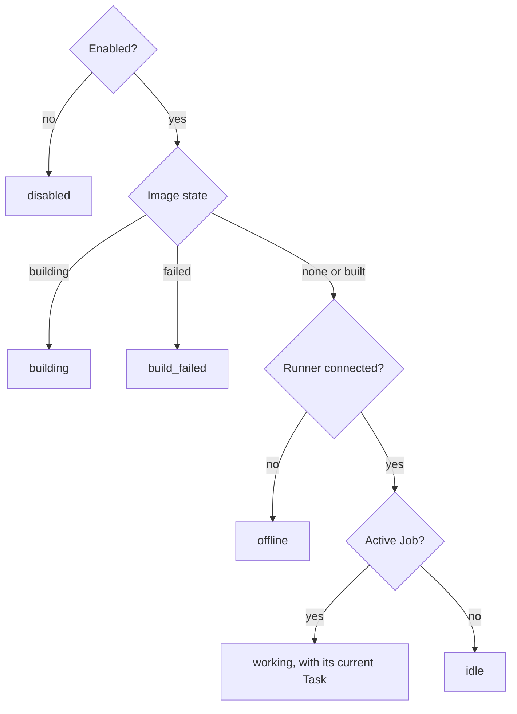
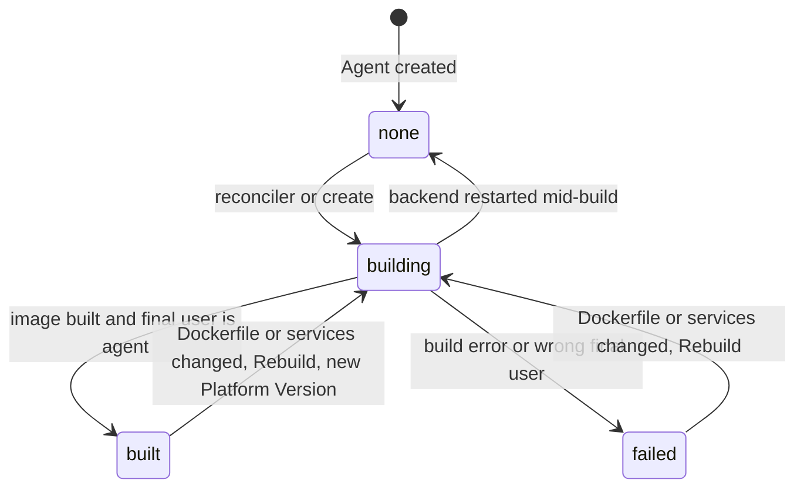
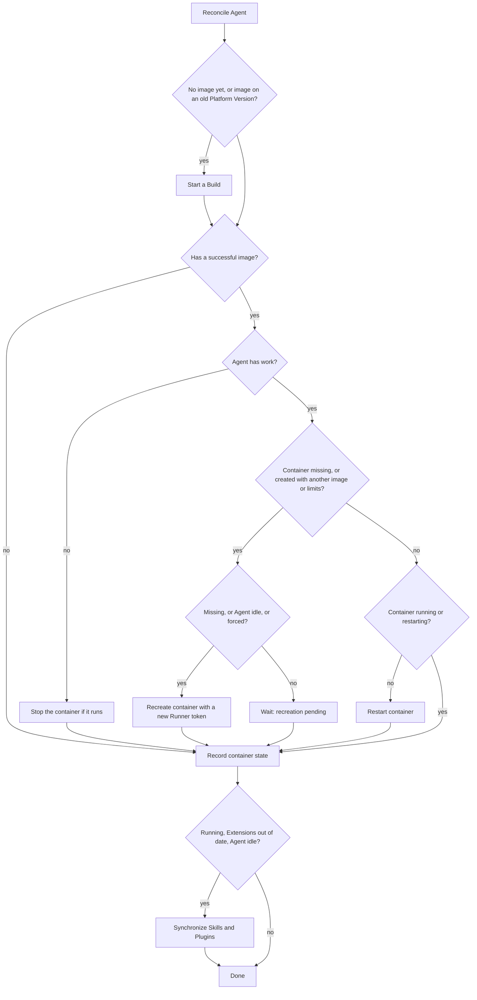
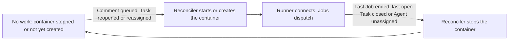
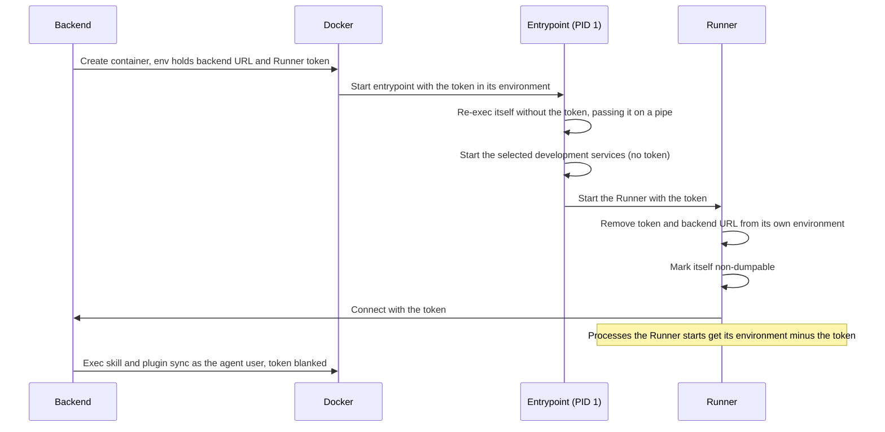
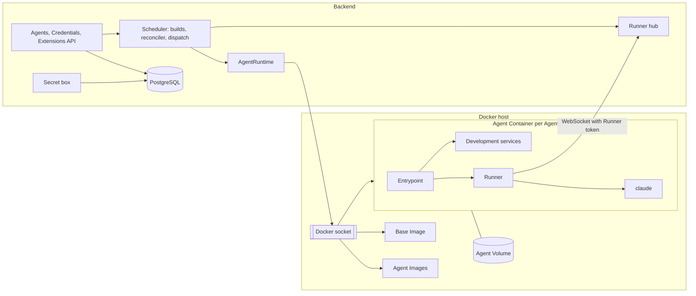
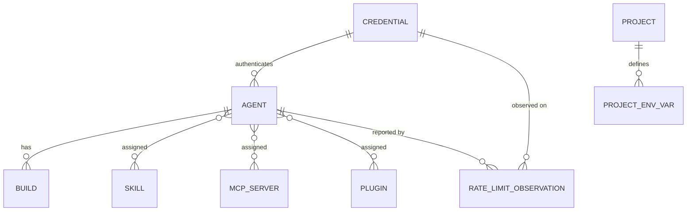

# Agents

Agents are the platform's Claude Code workers. This area covers an **Agent** as a configured entity (identity, Credential, model, environment and Extensions), the secrets it works with, and the runtime that turns that configuration into a running **Agent Container**: the Base Image, image builds, the container lifecycle, the development services inside the container and the Docker host the backend manages. It exists so that Admins can define a few reusable teammates once, give each the toolchains and credentials it needs, and let the platform keep their environments running and up to date without manual Docker work. What an Agent does once it works on a Task (Sessions, Jobs, the Queue, the Timeline) is described in [Agent sessions](agent-sessions.md); the process inside the container is described in [Runner](runner.md).

## Concepts

- An **Agent** is global: it is assignable to any Task in any Project, and to a Wiki. Admins configure it; every User sees it. Each Agent runs in exactly one Agent Container and works on one Job at a time.
- A **Credential** is a named Claude secret, either a Claude OAuth token (from `claude setup-token`) or an Anthropic API key. Every Agent uses exactly one Credential; one Credential can serve many Agents, which then share its rate limits.
- The **Base Image** (`claude-task/agent-base`) is the platform-provided image every Agent's environment builds on. It carries the default `claude` CLI, the Runner, the git credential helper, mise, the development-service scripts and the non-root `agent` user.
- The **Platform Version** is the Base Image's version. It combines the default Claude Code version with a fingerprint of the Base Image recipe, its scripts and the Runner sources, so any change to one of them produces a new version.
- An **Agent Image** is built from the Agent's own Dockerfile on top of the Base Image at the current Platform Version. A **Build** is one attempt to produce it, with its log and outcome.
- The **Agent Container** runs the Agent Image. The **Agent Volume** is mounted as the agent user's home and holds everything that must survive container recreation: bare repositories, Worktrees, Claude's configuration and Session transcripts, development-service data, mise tool installs, synchronized Skills and the record of installed Plugins.
- The **Runner token** is the secret the Runner uses to connect to the backend. It identifies exactly one Agent and changes every time the container is recreated. It is distinct from the Job token, which authorizes one Job's MCP and Git Proxy calls (see [Agent sessions](agent-sessions.md) and [Git integration](git-integration.md)).
- **Development services** are local databases and tools (PostgreSQL, Redis, MySQL, Mailpit, RustFS/MinIO, Chrome) installed and started inside an Agent Container, selected per Agent.
- **Extensions** are the entries of a shared catalog that Admins assign to Agents: **Skills** (files synchronized into the Agent's Claude configuration), **MCP servers** (added to each Job's MCP configuration) and **Plugins** (installed with Claude Code's own plugin manager).
- **Project environment variables** are name/value pairs defined per Project, optionally secret, delivered to every Job on that Project's Tasks.
- The **Agent state** is the single status the Agents list shows, derived from the Agent's configuration, image, Runner connection and Jobs.

## Behaviour

### Permissions

| Action | Who |
| --- | --- |
| List Agents, open an Agent, see its Builds and Build logs, Queue, recent Jobs and usage | Every User |
| Reorder and remove Queue Entries (see [Agent sessions](agent-sessions.md)) | Every User |
| Create, edit, duplicate, delete an Agent; upload or remove its avatar image | Admins |
| Rebuild the image, restart or recreate the container, read container logs | Admins |
| Manage Credentials | Admins |
| Manage the Extensions catalog and its MCP server list | Admins |
| Read the Skills and Plugins catalogs | Every User |
| Edit a Project's Setup Script, Agent Instructions and default Agent | Every User |
| Add, change, import and delete a Project's environment variables, plain or secret | Admins |
| Read a Project's environment variables (secret values appear as their last four characters) | Every User |

Requests outside these permissions are answered with `403`.

### Creating an Agent

An Admin creates an Agent from the Agents page. The fields and their rules:

| Field | Rule | Default |
| --- | --- | --- |
| Name | 1 to 100 characters, trimmed, unique ignoring case (a duplicate gets `409`) | required |
| Avatar emoji | 1 to 16 characters | 🤖 |
| Avatar color | hex color `#rrggbb` | `#6366f1` |
| Avatar image | optional PNG, JPEG, GIF or WebP up to 2 MB; replaces emoji and color on display | none |
| Description | up to 2,000 characters | empty |
| Credential | an existing Credential | required |
| Model | 1 to 100 characters, passed to `claude` as is | empty, meaning Claude's default |
| Effort | `low`, `medium`, `high`, `xhigh` or `max` | empty, meaning Claude's default |
| Permission mode | `bypassPermissions`, `auto`, `acceptEdits` or `dontAsk` | `bypassPermissions` |
| System prompt | up to 50,000 characters, appended after the platform and Project sections of the Job's system prompt | empty |
| Dockerfile | 1 to 100,000 characters, validated as described in [Agent Dockerfiles](#agent-dockerfiles) | `FROM claude-task/agent-base` followed by `USER agent` |
| Services | any subset of PostgreSQL, Redis, MySQL, Mailpit, RustFS/MinIO and Chrome, without duplicates | PostgreSQL and Redis |
| Skills, MCP servers, Plugins | up to 100 catalog entries of each kind, without duplicates | none |
| CPU limit | more than 0 and up to 256 CPUs, fractions allowed | no limit |
| Memory limit | 256 to 1,048,576 MB | no limit |
| Enabled | yes or no | yes |

An invalid field is answered with `400` and nothing is stored. The service selection is stored in a fixed canonical order, whatever order the request used.

Creating the Agent starts its first Build right away and answers immediately; the Agent shows `building` until the Build ends. Once the image is built the Agent has an image; its container is created and its Runner connects, which brings the Agent to `idle`, as soon as the Agent has work (see [Agent Containers and the reconciler](#agent-containers-and-the-reconciler)). Until then the Agent shows `offline`. The form links to the Credentials page when no Credential exists yet, since an Agent needs one.

The model, effort, permission mode and system prompt travel with each Job, and the Runner passes them to `claude` when it starts it (see [Agent sessions](agent-sessions.md) and [Runner](runner.md)).

### Editing an Agent

Admins edit every field from the Agent's Configuration tab. Identity, description, Credential, model, effort, permission mode, system prompt, enabled flag and Extension selections save automatically after 600 ms without edits or when a field loses focus. Avatar image changes also save automatically. The form shows saving, saved or failed state and offers Retry after an error, keeping the edits visible. Saves send only changed fields and run in order, including further edits made while a save is in progress. Switching settings tabs or navigating to another app view starts saving any pending changes.

Docker configuration groups the Dockerfile, Development Services and CPU and memory limits. These fields are applied together through "Save Docker configuration", after validation, so editing an unfinished Dockerfile or changing other settings leaves the running container configuration intact until the Admin applies it. New Agents are created through "Create agent", which submits the complete form. Each saved change takes effect in the way that matches where the setting lives:

| Change | Effect |
| --- | --- |
| Dockerfile (when its text differs) or services (when the selection differs) | A new Build starts; on success the container is recreated once the Agent is idle |
| CPU or memory limit | The container is recreated once the Agent is idle, with no Build |
| Skills, MCP servers or Plugins selection | An Extension synchronization runs before the Agent's next Job |
| Credential, model, effort, permission mode, system prompt, name | Applies from the next Job, since these travel with each Job |
| Enabled | Switching it off stops new Jobs; switching it on lets the Agent dispatch again right away |
| Description, avatar | Display only |

Saving a changed Extension selection sends that selection and runs a synchronization round before the next Job. Edits to other fields preserve the Agent's existing Extension assignments.

While a recreation waits for the running Job to end, the Agent view shows "Container recreation is waiting for the current job to finish". While an Extension synchronization is pending it shows that skill, MCP and plugin changes will apply before the next Job, and a failed synchronization shows its error.

### Avatar image

An Admin uploads, replaces or removes the avatar image from the web Configuration tab or the native app's Agent editor. The native editor shows the current image with its emoji fallback, accepts a single PNG, JPEG, GIF or WebP file up to 2 MB and reports upload failures beside the controls. Image changes save independently of the other Agent fields, preserving edits in the open form. An Admin uploads the avatar image as a single file. Files of another type are answered with `400`, files over 2 MB with `413`. Replacing the image deletes the previous one; removing it brings back the emoji and color. The image is served with a URL that changes whenever the image changes, so clients cache it indefinitely, and it is served with a sandboxing content policy and without content sniffing.

### Duplicating an Agent

An Admin duplicates an Agent to add throughput with the same environment. The copy takes every setting of the source: avatar (with its own copy of the image), description, Dockerfile, services, Credential, model, effort, permission mode, system prompt, limits, enabled flag and Extensions selection. Its name is the one given, or the first free one of "‹name› (copy)", "‹name› (copy 2)", and so on, shortened to fit 100 characters. The copy gets its own Build, container and empty Agent Volume; Sessions, Queue and history stay with the source.

### Disabling an Agent

A disabled Agent shows `disabled`, follows the same container rule as any other Agent (running while it has work, see [Agent Containers and the reconciler](#agent-containers-and-the-reconciler)), keeps its Extensions synchronized while its container runs, and keeps its Queue. Its running Job finishes normally; Comments keep queueing for it. No new Job starts until an Admin enables it again.

### Deleting an Agent

An Admin deletes an Agent once none of its Sessions is `pending`, `idle` or `running`. Otherwise the request is answered with `409` naming the Tasks that still have an open Session, with the advice to unassign the Agent first, and nothing changes.

When the deletion goes ahead:

- Tasks still assigned to the Agent (only closed ones can remain at this point) are unassigned, each with a Revision attributed to the Admin.
- The Agent's Sessions, Jobs, Turns, raw session events, Agent Timeline items (Thinking, Activity, Turn Summaries), Queue Entries, rate-limit observations and Builds are deleted with it. Agent Comments stay on their Tasks.
- The Runner connection is closed, and the container, the Agent's images and the Agent Volume (with the Claude transcripts) are removed in the background. A failure there is logged and leaves the leftovers on the Docker host.
- The avatar image is deleted.

### Agent state

The state shown for an Agent is the first that applies:

The state is a summary. The Agent view also shows the last observed container state (`running`, `exited`, `restarting`, `missing`, ...), whether the Runner is connected, the Credential, the Queue length and the time of the last activity (updated at most every 10 seconds while a Job streams output).

`building` and `build_failed` describe the latest Build, not the container: while a new image builds, or after it failed, the previous container keeps running and keeps taking Jobs, because dispatch only needs the container that matches the last successful image (see [Dispatch readiness](#dispatch-readiness)).

### Agent view

The Agents list shows every Agent with its avatar, state, current Task, Queue length, Credential name and last activity. The Agent view adds:

- **Work and queue**: the current Task, the Queue (see [Agent sessions](agent-sessions.md)), and the 30 most recent Jobs with their details (setup output, stderr, Claude version).
- **Builds**: the 20 most recent Builds with status, start time and Platform Version. The latest Build's log comes with the list and updates live while building; older logs load on request.
- **Usage**: estimated cost, tokens and Turns in total, per day for the last 30 days (UTC), and for the 20 most expensive Tasks, plus the latest rate-limit status of the Agent's Credential.
- **Container logs** (Admins): the last 500 lines of the container output, refreshed every three seconds. The API serves between 1 and 5,000 lines.
- **Configuration** (Admins): the Agent form, with a Dockerfile editor that highlights instructions and checks the Base Image rule before saving.
- **Actions** (Admins): Rebuild image, Restart, Recreate when idle, Force recreate, Duplicate, Delete. Restart and Force recreate ask for confirmation, since they interrupt the running Job.

Changes to an Agent, its Builds, its Queue and its Jobs reach open clients in real time, on the Agents topic (list) and on the Agent's own topic (details, Build log chunks).

### Credentials

Admins manage Credentials on the Credentials page.

- **Create**: a name (1 to 100 characters, unique ignoring case), a kind (Claude OAuth token or Anthropic API key) and the secret (8 to 10,000 characters, trimmed).
- **Read**: every response carries the name, kind, the last four characters of the secret, the Agents using it, and the latest rate-limit status observed on any of those Agents. The last four characters are shown only for secrets of 12 characters or more; shorter secrets show an empty hint, since four characters would reveal most of them.
- **Edit and rotate**: the name and the secret can change; the kind is fixed at creation. Rotating keeps the Credential's identity, so every Agent using it picks up the new secret on its next Job without any reconfiguration or rebuild.
- **Delete**: allowed while no Agent uses it. A Credential in use is answered with `409` naming its Agents, and the delete button is disabled with a hint to change those Agents' Credential first.

The platform stores the secret as given and checks it on first use: an authentication or billing error in a Job becomes a System Comment naming the Credential (see [Agent sessions](agent-sessions.md)). Each Job receives the secret as the environment variable `claude` reads for its kind: `CLAUDE_CODE_OAUTH_TOKEN` for an OAuth token, `ANTHROPIC_API_KEY` for an API key.

Rate-limit events from the stream are recorded per Credential and Agent; the Credentials page and the Agent's Usage tab show the most recent one.

The platform is meant for internal team use with the team's own Claude credentials: an organization API key, or Team or Enterprise seats with one token per accountable person. Sharing one personal subscription token across a team requires Anthropic's approval.

### Secrets at rest and per Job

Credentials, secret Project environment variables, secret MCP header and environment values, and Git Connection credentials are encrypted at rest with AES-256-GCM, using a random 12-byte IV per value and the master key from the `SECRETS_MASTER_KEY` setting. Each stored value carries a key version prefix, which leaves room for rotating the master key; one version exists today. The backend starts only with a master key that decodes to 32 bytes (base64 or 64 hex characters), and otherwise exits with an error explaining how to generate one. The key has to stay stable and be backed up with the database, since every stored secret depends on it.

Secrets are write-only in the API: after saving, responses carry only their last four characters. They are decrypted only while the backend builds a Job's start payload, which goes only to the Runner of the Agent that owns the Job, and they are kept out of logs.

The Agent Container's own environment holds only what the Runner needs to connect (the backend URL and the Runner token). Credentials, Project environment variables and MCP secrets travel inside each Job's payload. As a result:

- a rotated Credential or edited variable applies from the next Job, with no rebuild or recreation;
- a Project's variables reach only Jobs on that Project's Tasks, even though one Agent works across many Projects.

The Job's environment is the Project's variables, then the Credential's variable, then the resume flag the platform sets for interrupted Turns, each later one taking precedence.

### Project environment variables

Every User can choose an optional default Agent while creating a Project in the web and native apps. The picker offers enabled Agents and No Agent. Each Project has an "Agents" settings section holding its default Agent (assigned to new Tasks, see [Board](board.md)), its Setup Script and Agent Instructions (editable by every User; their use is described in [Git integration](git-integration.md) and [Agent sessions](agent-sessions.md)) and its environment variables (managed by Admins).

The Setup Script and Agent Instructions save automatically after 600 ms without edits, on leaving a field, or when switching settings tabs or navigating to another app view. Each save carries only the fields that changed. Saves run in order and include newer edits made during a request. The section shows saving, saved or failed state, preserves failed edits and offers Retry. Environment variables, secrets and imports use their own add, update, delete and import actions.

- A name matches a shell variable name of up to 128 characters (a letter or underscore, then letters, digits or underscores) and is unique within the Project.
- A value holds up to 100,000 characters. Saving a variable sets both its value and its secret flag.
- Names the platform sets itself are answered with `400`: `CLAUDE_CODE_OAUTH_TOKEN`, `ANTHROPIC_API_KEY`, `CLAUDE_CODE_RESUME_INTERRUPTED_TURN`, anything starting with `CLAUDE_TASK_`, `HOME`, `PATH` and `USER`.
- Plain values are shown to every User. Secret values are shown as their last four characters (empty for values under 12 characters).

**Importing a `.env` file.** An Admin pastes or picks a file of up to 500,000 characters and sees a live preview of the names it defines and which existing ones it overwrites. The parser accepts `NAME=value` lines with an optional `export ` prefix, `#` comments (including a trailing ` # comment` on unquoted values), and single, double or backtick quotes; quoted values can span lines, and double quotes expand `\n`, `\r`, `\t`, `\"` and `\\`. Variable references are kept literally. A name defined twice keeps its last value.

The import is merged into the Project's variables: names in the file are overwritten, the others are kept. The "import as secrets" option stores every imported value as secret; an existing secret stays secret even when imported as plain. The import is atomic: a file with any invalid line, a reserved name, a value over 100,000 characters, more than 500 variables or no variables at all is answered with `400` listing the problems (with line numbers), and nothing is written.

### Base Image

The Base Image is Ubuntu 24.04 (the `buildpack-deps:noble` image) with:

- bash, ca-certificates, curl, git, jq, less, OpenSSH client, procps and vim;
- FFmpeg and ffprobe for audio/video processing and inspection, ImageMagick's `convert` and `identify` commands for image transformations, and libvips' command-line tools for image processing;
- ripgrep (`rg`) and fd (`fdfind`) for searching source text and filenames, Poppler's tools for extracting text and rendering PDF pages, and the `sqlite3` CLI for inspecting and querying SQLite databases;
- the `claude` CLI at the platform's default version, installed through mise outside the agent's home so that the Agent Volume mounted there leaves it visible, with the auto-updater turned off. The Runner resolves `claude` through mise's shims, so a Repository or user mise configuration can select another version;
- Node.js and Python, installed through mise outside the agent's home and available as defaults during Agent Image builds and in every Agent Container, including login shells. The Base Image build arguments `NODE_VERSION` and `PYTHON_VERSION` select their versions, defaulting to `26` and `3.14`. Release-line requests select the latest available patch when installed. Repository mise shims take precedence when a Project declares its own runtime versions;
- the Runner and the git credential helper, compiled from the Runner sources in the same build and configured system-wide as git's credential helper (see [Git integration](git-integration.md));
- mise, which initializes its user and system shim paths through its shell activation script for login shells, Agent Image build commands and the Runner's environment, and the `flutter` mise plugin. The backend runs Claude's Plugin commands through mise's command execution so they also resolve the selected tools. The Base Image's default tools are selected in mise's system configuration and installed in its system installs directory; mise manages their shims and reuses those installs when a Repository requests matching versions. User shims precede system shims. The plugin is installed outside the agent's home, and the container entrypoint links it into the Agent Volume's mise data when that has no plugin of the same name, so existing Agent Volumes get it too. Every Node.js that mise installs gets Corepack enabled, so `pnpm` and `yarn` are on the `PATH` at the version a `package.json`'s `packageManager` field names, downloaded without Corepack's confirmation prompt (a prompt would stall a Job). The container entrypoint also enables Corepack for Node.js versions already in the Agent Volume, so existing Agents get it too. Node.js 25 and later no longer ship Corepack: repositories on those versions declare `pnpm` or `yarn` in their mise configuration instead;
- the development-service installer, used while building Agent Images, the container entrypoint and the `minio` command that the RustFS/MinIO service puts on the `PATH`;
- the non-root user `agent` with uid 1000 and home `/home/agent`, which is also the image's final user and working directory.

The Base Image sets `PLAYWRIGHT_MCP_ALLOW_UNRESTRICTED_FILE_ACCESS=true`, so Playwright MCP can save screenshots and read files outside the Worktree, including in `/tmp`. File access follows the `agent` user's filesystem permissions throughout the Agent Container.

The backend builds the Base Image locally through the Docker socket, without a registry. It is built on demand, as the first step of an Agent Build, whenever the image for the current Platform Version is missing, and is tagged with the Platform Version and as `latest`. Its build output appears in the log of the Agent Build that triggered it. The production backend image ships the Base Image recipe and the Runner sources, so it builds the Base Image without a source checkout.

The default Claude Code version comes from the `CLAUDE_CODE_VERSION` setting (2.1.310 by default). Repository and user mise configurations can override it, just like Node.js and Python. The selected Claude version is responsible for compatibility with the platform's stream-json contract.

**Platform upgrades.** When the backend starts with a different Platform Version (a new Claude Code version, Base Image recipe, service scripts or Runner), the reconciler finds every Agent whose last successful image was built on an older version and rebuilds it. Each Agent keeps working on its current container during the Build, and switches to the new image when it is idle, following the normal recreation rule. Agents whose latest Build failed keep their state until their next Build (a Dockerfile or service change, or a manual Rebuild).

### Agent Dockerfiles

The Agent's Dockerfile is where Admins install the toolchains their Projects need. The backend checks it on save (and the form checks it while editing), ignoring comments and blank lines and joining continuation lines:

- The first instruction is `FROM claude-task/agent-base`, with any tag or digest, an optional `--platform` flag and an optional stage name. Only `ARG` instructions may precede it. Anything else is answered with `400`: "The Dockerfile must start FROM claude-task/agent-base", "Only ARG instructions may come before the first FROM", or "The first FROM must be claude-task/agent-base (any tag)".
- The Dockerfile may switch to `root` for installs and has to end as `USER agent`. This is checked on the built image: its final user must be `agent`, `agent:agent`, `1000` or `1000:1000`, otherwise the Build fails with "The image must end with `USER agent`", because `bypassPermissions` refuses to run as root.

When building, the backend rewrites the first `FROM` to the Base Image at the exact current Platform Version, whatever tag the Dockerfile names, and inserts the installation of the selected development services right after it, before the Admin's own instructions.

Stdio MCP servers and their runtimes are installed in the Dockerfile too, since their commands run inside the Agent Container.

### Image Builds

A Build runs when an Agent is created or duplicated, when its Dockerfile or service selection changes, when an Admin clicks Rebuild, when the reconciler finds no image yet, and after a Platform Version change. One Build runs per Agent at a time; a request arriving during a Build queues exactly one more Build after it, which uses the configuration current at that point.

Each Build records the Dockerfile as saved, the Platform Version, its status (`building`, `succeeded`, `failed`), its log and its start and end times. The log keeps the most recent 256 KB, is saved every half second, and streams live to everyone viewing the Agent. A failed Build appends "Build failed:" with the reason to the log.

- **Success**: the Agent Image is tagged after the Agent and the Build, the Agent records it as its current image together with its Platform Version, and the reconciler takes over to recreate the container.
- **Failure**: the Agent shows `build_failed`; the previous image and container stay in service, so a broken Dockerfile leaves a working Agent working.
- **Backend restart during a Build**: on startup the interrupted Build is marked failed with the note "The backend restarted during this build", and the Agent goes back to having no Build in progress, which makes the reconciler build it again.

After a new container starts, the Agent's older images are removed, keeping the one in use.

### Agent Containers and the reconciler

The backend's reconciler brings each Agent's image and container in line with its configuration, and keeps the container running only while the Agent has work. It runs for every Agent at startup, every 30 seconds, after every Build, after each Job ends, when a Runner connects, and after configuration changes. Runs for one Agent are serialized.

**Work.** An Agent has work, and so needs its container running, while at least one of these holds: a Job is active, its Queue has an entry, or it has a Session in the `idle` or `running` state. A Task in the `done` category keeps its Session `idle`, because the Agent can still receive Comments there, so it counts as work. A Wiki's Session never closes, so it counts as work only for `AGENT_WIKI_IDLE_MINUTES` (30 by default) after its last Job ended; the periodic reconcile stops the container once that time passes, and the next Comment on the Wiki starts it again. The Agent has no work when all its Sessions are `pending` (assigned, no User Comment yet), `paused` (unassigned) or `closed`, or when it has none. When `AGENT_STOP_WHEN_UNUSED` is set to false, every Agent is treated as having work.

An Agent without work has its container stopped, not removed: the image and the Agent Volume stay, so repositories, Worktrees, transcripts and Development Service data survive. A container that does not exist yet is not created until work arrives, and a pending recreation (new image, limits or an Admin's Recreate) is applied at that wake-up. A Queue Entry held after a failed Job still counts as work, so the container stays up until the entry is retried or removed. The Runner connection closes when the container stops (close code 4003), and the Agent shows `offline` with container state `exited` (or `missing`). The reconciler leaves a stopped container without work alone on its periodic pass.

A Comment that queues an entry, a reopened Task, a Task assigned back to an Agent that worked on it and a retry all start the container right away: the dispatcher asks the reconciler to start it when it finds work and no running container, and every Session change triggers a reconcile of the Agents involved. The first Job dispatches once the Runner has connected and the Extensions are synchronized, so the first reply after a stop waits for the container and its Development Services to start (up to 60 seconds for the services, see [Development services](#development-services)).

The stop is decided under the Agent's row lock: the container state is set to stopped in the same transaction that re-checks for work, so a Job cannot be dispatched to a container that is about to stop.

Every Agent with a successful image gets a container while it has work, enabled or not. A container:

- is named after the Agent (`claude-task-agent-‹agent id›`) and labelled with the Agent's id;
- restarts automatically unless stopped, by hand or by the reconciler for lack of work;
- mounts the Agent's named volume (also named after the Agent) as the agent user's home;
- joins the network named by the `AGENT_NETWORK` setting, or Docker's default bridge, with outbound internet access and no published ports; `host.docker.internal` resolves to the Docker host, so a backend running on the host is reachable;
- gets the Agent's CPU and memory limits;
- receives two environment variables: the Runner's WebSocket URL, derived from the `AGENT_BACKEND_URL` setting, and a fresh Runner token.

Recreating a container replaces it with a new one on the same Agent Volume, so repositories, Worktrees, Session transcripts, service data, tool installs and Skills survive. Recreation generates a new Runner token, closes the old Runner connection, and marks the Extensions as needing synchronization in the new container. Because recreating kills whatever runs inside, it waits until the Agent has no active Job, unless the container is missing or an Admin forced it. A pending recreation runs right after the Job ends, before the next Job is dispatched.

### Backend shutdown

On a graceful backend shutdown, the Agent Containers of this Installation are stopped when `AGENT_STOP_ON_SHUTDOWN` is enabled. The setting defaults to enabled during local development and disabled when `NODE_ENV=production`; an explicit true or false overrides that default. The supplied local Compose stack enables it and allows 30 seconds for shutdown. Closing a web or native client leaves the backend and its Agents running.

The backend stops scheduling new Jobs, Builds and reconciliations, drains work already started, then stops the containers belonging to the Installation's stored Agents concurrently. Docker gets 10 seconds per container to stop its processes before terminating them. Missing and already stopped containers count as stopped. An error stopping one container is logged, the remaining stops are attempted, and backend cleanup finishes with a failed shutdown result.

Stopping preserves containers, images and Agent Volumes, including repositories, Worktrees, Session transcripts and Development Service data. At the next backend start the reconciler restarts the stopped containers of Agents that have work; running Jobs interrupted by the stop recover through the existing Runner reconnection and Session resume rules. With the setting disabled, containers continue running through backend restarts and their Runners reconnect.

### Restart and recreate

Admins have three container actions:

- **Restart** restarts the existing container. The running Job, if any, stops; when the Runner reconnects without it, the Job is treated as interrupted and its Session resumes at the front of the Queue (see [Agent sessions](agent-sessions.md)). When the container is missing, Restart is answered with `409`; the reconciler creates the container on its next run once the Agent has an image. An Agent without work (see [Agent Containers and the reconciler](#agent-containers-and-the-reconciler)) answers Restart with `409` too, since its container starts when work arrives.
- **Recreate when idle** recreates the container with the current image and limits as soon as the Agent has no active Job. It is answered with `409` while the Agent has no image yet. An Agent without work keeps the request pending and applies it when work arrives.
- **Force recreate** recreates it immediately. The running Job is interrupted and resumes after the new Runner connects, like after a crash.

A container found stopped (for example after `docker stop` or a crash that Docker did not restart) is restarted by the next reconciler run.

### Dispatch readiness

From the runtime's side, an Agent takes its next Job when all of these hold:

- it is enabled;
- its Extensions are synchronized at the current revision;
- its Runner is connected;
- its container is running and was created with the current image and limits;
- it has no active Job.

The Queue and the dispatch itself are described in [Agent sessions](agent-sessions.md).

### Runner connection and the Runner token

The Runner connects out to the backend over a WebSocket, authenticated by the Runner token as a bearer token. The backend stores only the token's SHA-256 hash and maps it to exactly one Agent; an unknown or outdated token is answered with `401`. A second connection for the same Agent replaces the first. The backend pings each Runner every 30 seconds and drops a connection that misses a whole round, so a half-open connection shows as `offline` and its Job can be recovered. Jobs whose Runner stays away for more than 5 minutes are treated as interrupted. Connection codes tell the Runner why it was closed: replaced by a new connection, container recreated, or Agent deleted. The protocol is described in [Runner](runner.md).

The token reaches only the Runner process, so that the code an Agent runs (its tools, the Setup Script, git hooks, development services, Plugins) has no way to impersonate the Runner:

- The container's first process re-executes itself without the token and reads it back from a pipe, so the environment Docker started it with (readable by any process of the agent user) no longer contains the token.
- The development services start without the token.
- The Runner reads the token, removes it and the backend URL from its own environment, marks its process non-dumpable so its memory and environment stay private to it, and starts `claude`, the Setup Script, mise and git with an environment that leaves the token out.
- The backend's own commands inside the container (Skill and Plugin synchronization) run as the `agent` user with the token variable set to empty, since commands executed in a container otherwise inherit its environment.

### Agent development environment

**Services.** Each Agent selects the development services installed in its image and started in its container. PostgreSQL and Redis are selected by default; MySQL, Mailpit, RustFS/MinIO and Chrome are optional; an empty selection is valid. Selected services are installed while building the image (packages for PostgreSQL 16, Redis and MySQL 8.0; release binaries for Mailpit and RustFS, on amd64 or arm64; Playwright's Chromium build with the system libraries browsers need, so a Project's own Playwright browsers run too), and the container entrypoint starts them as the `agent` user before the Runner. Chrome is the exception: nothing runs until a tool launches it. The others listen on the loopback interface only:

| Service | Address | Access |
| --- | --- | --- |
| PostgreSQL 16 | `postgresql://agent@127.0.0.1:5432/agent` | trust authentication; `agent` is a superuser and can create databases |
| Redis | `redis://127.0.0.1:6379` | no password; append-only persistence |
| MySQL 8.0 | `mysql://agent@127.0.0.1:3306/agent` | no password; `agent` holds every privilege and can create databases |
| Mailpit 1.32.0 | SMTP `127.0.0.1:1025`, web UI and API `http://127.0.0.1:8025` | messages kept in its own database |
| RustFS/MinIO (RustFS 1.0.4) | S3 API `http://127.0.0.1:9000`, console `http://127.0.0.1:9001` | access key and secret key `rustfsadmin` |
| Chrome (Chromium from Playwright 1.64.0) | `chromium` on the `PATH`, started on demand | the entrypoint points the Playwright MCP server at it (`PLAYWRIGHT_MCP_*` variables: Chromium, headless, without the browser sandbox), so that server works with no arguments |

**`minio` on RustFS.** The RustFS/MinIO service also installs a `minio` command that runs `minio server` command lines on RustFS, so a Project whose scripts or tests start their own MinIO works unchanged. It is a separate server from the one the entrypoint starts, with its own storage, so a Project starting it picks a port other than 9000. The command:

- accepts `minio server [flags] DIR...`, MinIO's `{1...N}` directory ranges included, plus `minio --version` and `minio --help`; other MinIO commands end with an error;
- creates missing local storage directories, as MinIO does (RustFS stops when a volume is missing), and lets several directories on one disk form a pool, as MinIO does;
- translates `--address`, `--console-address` and `--certs-dir` (MinIO's `public.crt` and `private.key`, also per-domain subdirectories, linked under RustFS's file names), defaulting to `~/.minio/certs` when it holds a certificate;
- translates MinIO's environment: root user and password (also their `_FILE` variants, read from Docker secrets first), volumes, addresses, domain, region and `MINIO_BROWSER=off`. MinIO's variables win over RustFS's, and credentials default to MinIO's `minioadmin` / `minioadmin`;
- serves the console on the first free port after the API's when no console address is given, standing in for MinIO's random console port, so it stays clear of the entrypoint's RustFS on 9001;
- ignores, with a warning, MinIO flags RustFS has no equivalent for (configuration files, FTP and SFTP, network tuning) and passes RustFS's own flags through.

MinIO's health endpoints (`/minio/health/live`, `/minio/health/ready`) answer on RustFS too.

PostgreSQL and MySQL also listen on the Unix sockets their clients look for by default (`/var/run/postgresql` and `/var/run/mysqld/mysqld.sock`), so `psql`, `mysql` and applications with no host configured connect without options. The Agent learns the selected services, with their addresses, from its system prompt (see [Agent sessions](agent-sessions.md)).

Service data and logs live in the Agent Volume, so they survive restarts and recreation. Nothing runs in the container before the entrypoint, so it removes the lock files a killed container leaves behind (PostgreSQL's `postmaster.pid` and socket locks, MySQL's socket lock): process IDs repeat in a new container, and a stale lock with a reused PID would make a service refuse to start or look ready before it is. Each Agent has its own services, shared by all the Tasks it works on; Projects keep apart by using separate database names, Redis key namespaces or databases, and S3 buckets. Deselecting a service keeps its data, and selecting it again reuses it. The entrypoint waits up to 60 seconds for each service to become ready; a service that exits or never becomes ready stops the container start with the tail of its log in the container logs, and Docker's restart policy tries again.

Changing the selection rebuilds the image. A failed Build keeps the previous container and its services running; a successful one replaces the container when the Agent is idle, or immediately when forced.

**Tool versions.** When a Job prepares a Worktree whose repository declares tool versions for mise (a `.tool-versions` file or a standard mise configuration file at the repository root), the Runner runs `mise install` before the Setup Script, trusting the repository's configuration. Installed tools persist in the Agent Volume and are on the `PATH` for the Runner, `claude` and login shells. Application packages stay the Setup Script's job. When this step runs, how its output is shown and how its failure is retried are described in [Runner](runner.md).

### Extensions

Admins manage a shared catalog of Skills, MCP servers and Plugins on the Extensions screen in either client, and select entries per Agent in the Agent's configuration. The native app offers the catalog actions and Agent selections through Settings, with the same role permissions, secret preservation and synchronization notices as the web app. Duplicating an Agent copies its selection. A catalog entry assigned to any Agent is deleted only after it is unassigned everywhere; otherwise the deletion is answered with `409`.

#### Skills

An Admin imports Skills from a source, optionally naming the Skills to take (up to 100 names; all Skills of the source when none are given). A source is `owner/repo`, an HTTPS repository or directory URL without embedded credentials, or a Git SSH URL. Sources are remote only, since a local path would expose files on the backend host; any other form is answered with `400`. The import runs the pinned `skills` CLI in a throwaway directory with its own state, telemetry off and no interactive prompts, with a 2-minute timeout. Private sources are fetched with the backend process's own git authentication (for example its SSH configuration); Git Connections are a separate mechanism. A failed fetch is answered with `400` asking to check the source, the Skill names and Git access.

The catalog stores a snapshot of every imported file, executable scripts and binary assets included, with their executable bit. Each import is limited to 10 MB and 1,000 files in total. Each Skill needs a directory name of 1 to 64 letters, digits, `_` or `-`, a `SKILL.md` with a frontmatter `description` (kept up to 2,000 characters), and regular files and directories only (an import containing a symbolic link is answered with `400`). An import that finds no Skill is answered with `400`. A Skill whose frontmatter sets `user-invocable: false` stays out of the slash-command menu; the others are offered as commands for the Agents they are assigned to (see [Conversation](conversation.md)).

Skill names are unique in the catalog. Importing a name that already came from another source is answered with `409`. **Reimport** fetches the same source again and updates the Skills in place, keeping their identity and assignments, and schedules a synchronization for every Agent they are assigned to.

#### MCP servers

An MCP server entry has a name (1 to 64 letters, digits, `_` or `-`, unique), a description and a transport:

- **HTTP or SSE**: an `http` or `https` URL without embedded credentials, plus headers.
- **stdio**: a command, up to 100 arguments (each up to 4,000 characters, no shell quoting) and environment values. The command runs inside the Agent Container, so the server and its runtime are installed in the Agent's Dockerfile.

The name `claude-task` is reserved for the platform's own Task Tools server, which every Job gets in addition to the assigned entries (see [Agent sessions](agent-sessions.md)).

Each header or environment value (up to 16,000 characters) can be marked secret. Secret values are encrypted with the master key and returned as their last four characters. When editing, a secret sent back without a value keeps its stored value; a secret without a stored value is answered with `400`. Values are resolved into the MCP configuration of each new Job only. A running Job keeps the configuration it started with; the change reaches the Agent's next Job. The MCP server list is visible to Admins only.

#### Plugins

A Plugin entry stores where to install the plugin from, not its files:

- a plugin name with a marketplace source (`owner/repo`, an HTTPS URL without credentials, or a Git SSH URL), or
- `plugin@marketplace` with no source, for a marketplace Claude Code already knows (such as `anthropic-plugin-directory`).

Names use letters, digits, `.`, `_` and `-`, up to 64 characters per part. A (name, source) pair appears once in the catalog; a duplicate is answered with `409`. **Update** schedules a synchronization for every Agent the Plugin is assigned to, which installs the marketplace's latest version.

Marketplace sources are public ones: inside the container git authenticates only through the Git Proxy, for the active Job, and synchronization runs between Jobs. The catalog keeps a plugin's name and marketplace only; a plugin that needs secrets gets them from an MCP catalog entry or a Project environment variable. Plugin hooks run like any hook a repository brings; the platform itself configures none, and the Timeline is still projected from the stdout stream.

#### Synchronization

Each Agent carries an Extensions revision that increases whenever its selection changes or one of its assigned entries is reimported, edited or updated. When the container is running, the Agent has no active Job and the revision is newer than the one last applied, the reconciler synchronizes the container:

1. **Skills**: the assigned Skills' files are written into a snapshot for this revision inside the Agent Volume, then each Skill is linked into the agent user's Claude skills directory. Links to earlier snapshots and earlier snapshots themselves are removed. Entries in that directory that the platform did not create are left in place; a Skill whose name matches one of them fails the synchronization with "Skill name conflicts with an unmanaged skill". Claude discovers the Skills natively; the platform's system prompt lists none.
2. **Plugins**: each assigned Plugin is installed with Claude Code's plugin manager in user scope, as the `agent` user and without a shell. Then each marketplace is refreshed and each Plugin updated, best effort, so an unreachable marketplace keeps the installed version. Plugins the platform installed earlier and that are no longer assigned are uninstalled. The platform records the Plugins it installed in the Agent Volume, so plugins installed by hand stay untouched.

Each command inside the container has a 5-minute timeout. Synchronization changes neither the image nor the container. While it runs, the Agent's Queue stays open to new Comments; the Agent's next Job waits until it succeeds.

A failed synchronization (an unknown plugin, an unreachable marketplace, a Skill name conflict) stores its error, up to 2,000 characters, which the Agent view shows; the reconciler tries again on its next run, every 30 seconds, and dispatch stays held until a synchronization succeeds. Any new change to the Agent's Extensions clears the stored error. A recreated container is synchronized again from scratch.

### Fake runtime

With the `AGENT_RUNTIME` setting at `fake`, the backend simulates images and containers in memory: Builds succeed with a one-line log, containers report `running` as soon as they are created, and nothing runs Claude. No Runner attaches by itself, so Agents stay `offline` unless a test harness connects a fake Runner with the container's token. It serves the backend test suite, the browser end-to-end suite and demos without Docker.

## Architecture

- **AgentRuntime** is the only component that talks to Docker. It builds the Base Image and Agent Images, creates, restarts, inspects and removes containers, volumes and images, reads container logs, and runs the Skill and Plugin synchronization inside a container. Two implementations exist: the Docker one, which talks to the host daemon over the socket named by the `DOCKER_SOCKET` setting, and the in-memory fake.
- **Scheduler** runs all background work around Agents: one Build at a time per Agent, the serialized per-Agent reconciler, the 30-second tick (reconcile every Agent, recover Jobs whose Runner stayed away, dispatch Agents with waiting Queue Entries) and the coalesced real-time publishing of Agent, Build, Queue and Job changes.
- **Runner hub** holds one WebSocket per Agent, authenticates Runners by token, pings them, and lets the backend send messages to an Agent's Runner or close its connection.
- **Secret box** encrypts and decrypts every secret with the master key.
- The **database** is the source of truth for configuration, Builds, the observed container state and the Extensions revisions; the containers themselves hold no scheduling state, so any container can be recreated at any time between Jobs (see [Runner](runner.md)).

### Deployment

The production image serves the API, the WebSocket endpoints and the web app, and runs as a non-root user. It contains the Base Image recipe and the Runner sources (so it builds every image locally), plus git and the OpenSSH client for Skill imports.

The Docker Compose deployment runs two services: PostgreSQL and the app. The app mounts the host's Docker socket, joins the host group that owns the socket (the `DOCKER_GID` setting, `0` by default, which suits Docker Desktop), keeps its data on a named volume, and joins a dedicated `claude-task-agents` network. Agent Containers join that same network and reach the backend by its service name, so no backend port needs to be reachable from outside for the Runners. Agent Containers are siblings of the app container on the host's Docker daemon, not nested inside it.

In local development the backend runs on the host and Agent Containers reach it through `host.docker.internal`.

When the backend stops, the scheduler stops and Runner connections close; Agent Containers keep running under their restart policy, and Runners reconnect when the backend is back (see [Runner](runner.md)).

### Configuration settings

| Setting | Effect | Default |
| --- | --- | --- |
| `SECRETS_MASTER_KEY` | Master key for every secret at rest; 32 bytes, base64 or hex | required |
| `AGENT_RUNTIME` | `docker` manages real containers, `fake` simulates them | `docker` |
| `DOCKER_SOCKET` | Docker daemon socket the backend uses | `/var/run/docker.sock` |
| `CLAUDE_CODE_VERSION` | Default Claude Code version in the Base Image; changing it rebuilds every Agent Image. Repository and user mise configurations can override it | `2.1.310` |
| `AGENT_BACKEND_URL` | How Agent Containers reach the backend (HTTP base URL; the Runner, MCP and Git Proxy URLs derive from it) | `http://host.docker.internal:‹PORT›` |
| `AGENT_NETWORK` | Docker network Agent Containers join | Docker's default bridge |
| `AGENT_COMMIT_EMAIL_DOMAIN` | Domain of Agents' commit email addresses (see [Git integration](git-integration.md)) | `agents.claude-task.local` |
| `DOCKER_GID` | Docker Compose only: group that owns the Docker socket on the host | `0` |
| `AGENT_BASE_DOCKERFILE`, `RUNNER_SOURCE_DIR` | Locations of the Base Image recipe and the Runner sources, when they differ from the bundled ones | bundled |

Fixed values: reconciler interval 30 seconds, Runner ping interval 30 seconds, Runner reconnect timeout 5 minutes, Build log cap 256 KB, container command timeout 5 minutes, Skill import timeout 2 minutes.

## Data model

- **Credential**: name (unique ignoring case), kind (`claude_oauth_token` or `anthropic_api_key`), encrypted secret, last four characters, timestamps. It is deletable once no Agent references it.
- **Agent**: name (unique ignoring case), avatar emoji, avatar color, optional avatar image, description, Dockerfile, services, Credential, model, effort, permission mode, system prompt, CPU and memory limits, enabled; runtime bookkeeping: Runner token hash, current image and its Platform Version, image state (`none`, `building`, `built`, `failed`), the image and limits the current container was created with, last observed container state, a pending forced recreation flag, Extensions revision and applied revision, Extensions error, Runner connection and disconnection times, Runner and Claude versions reported by the Runner, last activity, timestamps.
- **Build**: Agent, Dockerfile as saved, Platform Version, status (`building`, `succeeded`, `failed`), image produced, log (latest 256 KB), start and end times. Deleted with its Agent.
- **Skill**: name (unique), description, source, user-invocable flag, files (path, content, executable flag), content hash.
- **MCP server**: name (unique), description, transport (`http`, `sse`, `stdio`), URL, command, arguments, headers and environment values (each plain or encrypted with its last four characters).
- **Plugin**: name, marketplace source (empty for `plugin@marketplace`), description; unique per (name, source).
- **Agent assignments**: Agent to Skill, Agent to MCP server, Agent to Plugin. Deleted with the Agent; they hold their catalog entry in place.
- **Project environment variable**: Project, name (unique per Project), secret flag, plain value or encrypted value with its last four characters.
- **Rate-limit observation**: Credential, Agent, the stream's rate-limit payload, time observed. The latest per Credential is shown.

Sessions, Jobs and Queue Entries belong to [Agent sessions](agent-sessions.md).

## Non-functional requirements

- **Secrets**: encrypted at rest with AES-256-GCM; returned only as their last four characters (none for secrets under 12 characters); decrypted only to build a Job payload for the owning Agent's Runner; absent from logs and from container environments.
- **Runner token**: 256 random bits, stored as a SHA-256 hash, rotated on every container recreation, readable only by the Runner process inside the container.
- **Isolation**: every Agent runs as the non-root `agent` user in its own container and volume, with optional CPU and memory limits, loopback-only services and no published ports. The backend holds the host's Docker socket, which gives it full control of the Docker host, so it is the only component with that access.
- **Availability**: an Agent with work has a running container, and one without work is started within one reconcile when work arrives; a failed Build keeps the previous container serving; a configuration change interrupts a running Job only when an Admin forces it; containers restart automatically; the reconciler repairs drift within 30 seconds.
- **Responsiveness**: Extension synchronization holds no database lock while Docker works, so Comments on the Agent's Tasks keep flowing during long Plugin installs.
- **Observability**: Build logs stream live and are kept per Build; container logs are available to Admins; the Agent view shows image, container, Runner and Extension status with their errors.

## Decisions

- **Stop local Agent Containers with the backend, preserving their volumes.** Local development releases CPU and memory when the backend exits, while production defaults to keeping Agents alive through backend restarts. An environment setting selects either lifecycle explicitly. Container selection follows the Installation's Agent records, so other Docker workloads keep their own lifecycle.

- **Automatic saves for Agent settings, explicit application of Docker configuration.** Saving only edited fields keeps other Users' settings and Extension assignments intact, and serializing saves preserves the latest edits during slow requests. Dockerfile, Development Services and resource limits share an explicit action because applying them can build an image or recreate a container.

- **Stop an Agent's container while it has no work, keeping its volume.** Idle Agents hold CPU, memory and Development Services (PostgreSQL, Redis, ...) for nothing, and an Installation can configure many Agents. Work means an active Job, a Queue entry or an `idle` or `running` Session. A `pending` Session does not count because the first User Comment is the trigger and queues an entry that wakes the container; a `done` Task counts because it still takes Comments, and only `closed` ends a Session. The cost is a start delay on the first Job after a stop. A Wiki is the exception to the Session rule: its backing Task is never closed, so an idle Wiki Session would keep the container up forever; it counts as work only for a grace period after its last Job. The `AGENT_STOP_WHEN_UNUSED` setting turns the behaviour off. Keeping every container running was the previous behaviour; stopping after a grace period was not needed because the Session rule already keeps the container up while people may still write to the Agent.
- **One container per Agent, one Job at a time.** An Agent behaves like one teammate doing one thing at a time, and its Dockerfile, not the Project's, defines the toolchains. Tasks in one container would otherwise share ports, local databases and background processes. More throughput comes from duplicating an Agent. A container per Task was rejected (more images and volumes to manage, and it breaks the teammate model), as was a container per Project shared by its Agents (Agents are global and bring their own environment). The cost: feedback on one Task can wait behind a long Job on another, which Users mitigate by reordering the Queue.
- **Sessions live on the Agent Volume.** Claude's transcripts and the Worktrees survive any container recreation because they live on the volume, and resume needs the same working directory, so Worktree paths are deterministic per Project and Task. Deleting an Agent deletes its volume and with it its transcripts.
- **Credentials and Project environment travel per Job, not as container environment.** Rotation applies on the next Job without recreating anything, and a Project's secrets reach only that Project's Tasks although Agents are global. The container environment carries only the Runner's connection details.
- **The Runner token is handed to the Runner alone.** Every tool the Agent runs shares the `agent` user, which can read any of its processes' start-up environment. The entrypoint therefore re-executes without the token and passes it over a pipe, the Runner scrubs it and makes itself non-dumpable, and the backend's own execs blank it. The token outlives any single Job, unlike the Job token, so it has to stay out of reach of Agent code.
- **The Base Image is built locally from bundled sources, with a default Claude Code version.** The platform supplies a tested `claude` default with the auto-updater off. Repository and user mise configurations can choose a different version for their work. Building locally needs no registry and keeps the Runner and the Base Image versioned together. The Platform Version fingerprints the default CLI version, the recipe, its scripts and the Runner sources, so any of them changing rebuilds every Agent on its own.
- **Mise manages the base toolchains as system installs.** Claude Code, Node.js and Python share the image's tool manager, system configuration and shims. System installs keep the defaults available across home-volume mounts and image upgrades, while Repository and user configurations select their own versions of any tool, including Claude Code. The agent user owns the system installs and shims so mise can maintain its version aliases and language package managers can add global commands.
- **Agent Dockerfiles start from the Base Image and end as the `agent` user.** `bypassPermissions` refuses to run as root, and the Runner, credential helper and entrypoint come from the Base Image. The backend pins the base to the exact Platform Version itself, so a Dockerfile naming any tag still builds on the current platform.
- **A failed Build keeps the previous container in service, and recreation waits for idle.** A working Agent stays online through a typo in its Dockerfile, and a rebuild interrupts work in progress only when an Admin forces it.
- **Chrome is installed, not started.** Browser clients (the Playwright MCP server, test runners) launch their own browser per session, so a resident browser would only cost memory on every idle Agent and share one profile across Tasks. Unconfigured, the Playwright MCP server looks for Google Chrome, which has no Linux arm64 build, and runs it headed with the sandbox, which needs a display and user namespaces; the entrypoint's variables point it at Chromium instead.
- **MinIO is provided as a `minio` command on RustFS, not as MinIO itself.** MinIO's open-source server is no longer distributed as maintained binaries, while RustFS speaks the same S3 API and health endpoints. A `minio` command that translates MinIO's command line, environment and certificate layout keeps Projects that start MinIO themselves working without a second object store in the image.
- **Development services run inside the Agent Container, as the `agent` user, on loopback.** Agents can run tests against real databases with no extra infrastructure or credentials; one set per Agent matches the one-Job-at-a-time model, and data lives on the volume so it survives rebuilds.
- **Extensions synchronize into the running container instead of the image.** Skills and Plugins change more often than toolchains; synchronizing between Jobs avoids a rebuild and a recreation for each change. Plugins are installed with Claude Code's own plugin manager, so the platform stores only where they come from.
- **The platform configures no hooks and no guardrails inside the container.** The Timeline comes from the stdout stream, and the Base Branch is protected by the Git Proxy's Push Policy, so an Agent's permission mode governs only what it does inside its own container.
- **Docker through the host socket, behind one runtime component.** It is the simplest way to manage sibling containers on one host. Keeping every Docker call in one component, with the Runner dialing out, leaves room for remote hosts or Kubernetes later and lets tests run against an in-memory fake.

## Related specs

- [Agent sessions](agent-sessions.md): Sessions, Jobs, Turns, the Queue, dispatch, the system prompt and Task Tools that use an Agent's configuration.
- [Runner](runner.md): the process inside the Agent Container, its WebSocket protocol and Job preparation (Worktree, mise, Setup Script).
- [Git integration](git-integration.md): Git Connections, the Git Proxy, the credential helper in the Base Image, Task Branches, Worktrees and Agent commit identity.
- [Board](board.md): Projects and Tasks that Agents are assigned to.
- [Conversation](conversation.md): Comments, delivery and the slash-command menu built from an Agent's Skills.
- [Users and auth](users-and-auth.md): Admins and Members, who manage and use Agents.
- [Wikis](wikis.md): Wikis, each with one assigned Agent.
- [Clients](clients.md): the web and mobile views of Agents.
