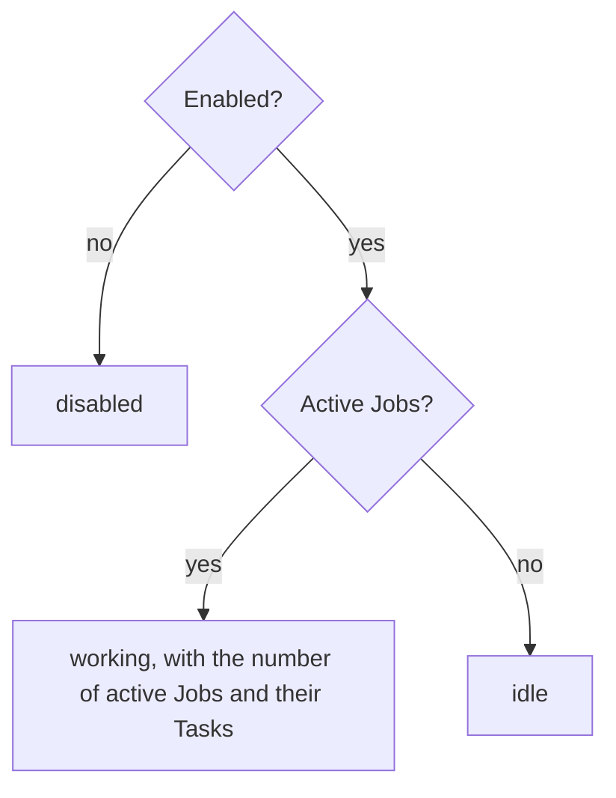
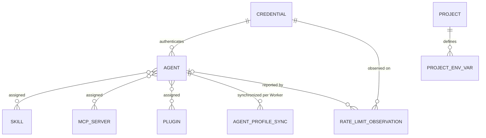

# Agents

Agents are the platform's Claude Code teammates. This area covers an **Agent** as a configured entity (identity, Credential, model, effort, permission mode, instructions, environment and Extensions), the Credentials and secrets it works with, the shared catalog of Extensions, and the environment variables Projects give to every Job. It exists so that Admins define a few reusable Claude Code configurations once and Users assign whichever fits a Task. An Agent owns no container: its Jobs run on the Worker of the Task's Project, described in [Workers](workers.md), together with the Base Image, the Worker Containers, the Development Services and the Agent Profiles the Extensions are installed into. What an Agent does once it works on a Task (Sessions, Jobs, the Queue, the Timeline) is described in [Agent sessions](agent-sessions.md).

## Concepts

- An **Agent** is global: it is assignable to any Task in any Project and to any Wiki Chat, it can be the default Agent of a Project or a Wiki, and it is the Agent of a Schedule. Admins configure it; every User sees it. Its Jobs run on the Worker of the Task's Project, any number at once: the same Agent can work five Tasks on five Worker Containers.
- A **Credential** is a named Claude secret: a Claude OAuth token (from `claude setup-token`), an Anthropic API key, or an Anthropic auth token for an `ANTHROPIC_AUTH_TOKEN` gateway such as OpenRouter. Every Agent uses exactly one Credential; one Credential can serve many Agents, which then share its rate limits.
- The **Agent Environment** is the set of plain environment variables an Agent applies to every one of its Jobs, e.g. `ANTHROPIC_BASE_URL`, `ANTHROPIC_MODEL` or `ENABLE_TOOL_SEARCH`. It is more specific than the Project's environment variables, and it is sent inside each Job's payload.
- **Extensions** are the entries of a shared catalog that Admins assign to Agents: **Skills** (files synchronized into the Agent's Agent Profiles), **MCP servers** (added to each Job's MCP configuration) and **Plugins** (installed with Claude Code's own plugin manager into the Agent's Agent Profiles).
- An **Agent Profile** is the Agent's own Claude Code configuration directory in a Worker Volume, one per Worker the Agent has run on. Its Skills and Plugins are synchronized there before the Agent's first Job on the Worker and after each change (see [Workers](workers.md#agent-profiles-and-extension-synchronization)).
- **Project environment variables** are name/value pairs defined per Project, optionally secret, delivered to every Job on that Project's Tasks.
- The **Agent State** is the single status the Agents list shows: disabled, idle, or working with its active Jobs.

## Behaviour

### Permissions

| Action | Who |
| --- | --- |
| List Agents, open an Agent, see its active and recent Jobs and its usage | Every User |
| Create, edit, duplicate, delete an Agent; upload or remove its avatar image | Admins |
| Manage Credentials | Admins |
| Manage the Extensions catalog and its MCP server list | Admins |
| Read the Skills and Plugins catalogs | Every User |
| Choose a Project's Worker; edit its Setup Script, Agent Instructions, default Agent and Board Write Access | Every User |
| Add, change, import and delete a Project's environment variables, plain or secret | Admins |
| Read a Project's environment variables (secret values appear as their last four characters) | Every User |

Requests outside these permissions are answered with `403`. Workers have their own permissions (see [Workers](workers.md#permissions)).

### Creating an Agent

An Admin creates an Agent from the Agents page with "Create agent", which submits the complete form. The fields and their rules:

| Field | Rule | Default |
| --- | --- | --- |
| Name | 1 to 100 characters, trimmed, unique ignoring case (a duplicate gets `409`) | required |
| Avatar emoji | 1 to 16 characters | 🤖 |
| Avatar color | hex color `#rrggbb` | `#6366f1` |
| Avatar image | optional PNG, JPEG, GIF or WebP up to 2 MB; replaces emoji and color on display | none |
| Description | up to 2,000 characters | empty |
| Credential | an existing Credential | required |
| Model | 1 to 100 characters, passed to `claude` as is | empty, meaning Claude's default |
| Environment | up to 100 plain name/value pairs; names follow the shell-variable rule and the platform's own names are rejected (see [Project environment variables](#project-environment-variables)); values up to 100,000 characters | empty |
| Effort | `low`, `medium`, `high`, `xhigh` or `max` | empty, meaning Claude's default |
| Permission mode | `bypassPermissions`, `auto`, `acceptEdits` or `dontAsk` | `bypassPermissions` |
| System prompt | up to 50,000 characters, appended after the platform and Project sections of the Job's system prompt | empty |
| Skills, MCP servers, Plugins | up to 100 catalog entries of each kind, without duplicates | the Platform Skill |
| Enabled | yes or no | yes |

An invalid field is answered with `400` and nothing is stored. The form links to the Credentials page when no Credential exists yet, since an Agent needs one.

A new Agent is `idle` (or `disabled`) as soon as it is created and can be assigned right away. Its Agent Profile on a Worker is created by the first synchronization there, which runs before its first Job on that Worker.

The model, effort, permission mode, system prompt, environment and MCP configuration travel with each Job: a Job takes them from the Task's Agent at dispatch, and the Runner passes them to `claude` when it starts it (see [Agent sessions](agent-sessions.md) and [Runner](runner.md)).

### Editing an Agent

Admins edit every field from the Agent's Configuration tab. Every field saves automatically after 600 ms without edits or when a field loses focus. Avatar image changes also save automatically. The form shows saving, saved or failed state and offers Retry after an error, keeping the edits visible. Saves send only changed fields and run in order, including further edits made while a save is in progress. Switching settings tabs or navigating to another app view starts saving any pending changes. Each saved change takes effect in the way that matches where the setting lives:

| Change | Effect |
| --- | --- |
| Skills, MCP servers or Plugins selection | The Agent's Extensions revision increases; on each Worker, a synchronization applies it before the Agent's next Job there, holding back only that Agent's entries on that Worker |
| Credential, model, effort, permission mode, system prompt, environment, name | Applies from the next Job, since these travel with each Job; a running Job keeps what it started with |
| Enabled | Switching it off makes the Agent's entries wait; switching it on lets them dispatch again right away |
| Description, avatar | Display only |

Saving a changed Extension selection sends that selection. Edits to other fields preserve the Agent's existing Extension assignments.

While a synchronization is pending on a Worker, the Agent view shows that skill, MCP and plugin changes will apply before the Agent's next Job there, and a failed synchronization shows its error with the Worker's name.

### Avatar image

An Admin uploads, replaces or removes the avatar image from the web Configuration tab or the native app's Agent editor. The native editor shows the current image with its emoji fallback, accepts a single PNG, JPEG, GIF or WebP file up to 2 MB and reports upload failures beside the controls. Image changes save independently of the other Agent fields, preserving edits in the open form. An Admin uploads the avatar image as a single file. Files of another type are answered with `400`, files over 2 MB with `413`. Replacing the image deletes the previous one; removing it brings back the emoji and color. The image is served with a URL that changes whenever the image changes, so clients cache it indefinitely, and it is served with a sandboxing content policy and without content sniffing.

### Duplicating an Agent

An Admin duplicates an Agent to create a variant, for example with another model or prompt. The copy takes every configuration field of the source: avatar (with its own copy of the image), description, Credential, model, effort, permission mode, system prompt, environment, enabled flag and Extensions selection. Its name is the one given, or the first free one of "‹name› (copy)", "‹name› (copy 2)", and so on, shortened to fit 100 characters. Assignments, Sessions, Jobs and history stay with the source; the copy gets its own Agent Profile on each Worker at its first synchronization there.

### Disabling an Agent

A disabled Agent shows `disabled`. Its running Jobs finish normally, and Comments on its Tasks keep queueing. Its entries wait in their Workers' Queues without being held, and the dispatcher skips them, so the Tasks of other Agents on the same Worker keep dispatching. Enabling the Agent again lets its entries dispatch right away, after any pending synchronization.

### Deleting an Agent

An Admin deletes an Agent once no open work depends on it. The request is answered with `409`, naming what still uses the Agent, and nothing changes, while the Agent is:

- assigned to any Task whose Status is not in the `closed` category, Wiki Chats included;
- the default Agent of a Wiki;
- the Agent of a Schedule.

When the deletion goes ahead:

- Projects whose default Agent it was get no default Agent.
- Tasks still assigned to the Agent (only closed ones can remain at this point) are unassigned, each with a Revision attributed to the Admin.
- The work history stays: Sessions, Jobs, Turns, raw Session events, Agent Items (Thinking, Activity, Turn Summaries) and rate-limit observations keep existing with their Agent reference cleared, and each Job keeps the Agent's name as copied at dispatch, so the Timeline and Job lists still say who did the work. Agent Comments stay on their Tasks.
- The Agent's Extension assignments and its synchronization records are deleted. Its Agent Profiles stay in the Worker Volumes until each Worker is deleted.
- The avatar image is deleted.

### Agent State

The state shown for an Agent is the first that applies:

A Job is active while it is `dispatched`, `running` or `finishing`, on any Worker. Agent pickers show the state as a colored dot. Agents with Board Write Access read the same state through their Task Tools, which list enabled Agents by number of active Jobs, then name (see [Agent sessions](agent-sessions.md#writing-to-the-board)).

### Agent view

The Agents list shows every Agent with its avatar, state, number of active Jobs and their Tasks, and Credential name. The Agent view adds:

- **Active Jobs**: each with its Task, Worker and Worker Slot.
- **Recent Jobs**: the 30 most recent Jobs with their details (Task, Worker and slot, setup output, stderr, Claude version).
- **Usage**: estimated cost, tokens and Turns in total, per day for the last 30 days (UTC), and for the 20 most expensive Tasks, plus the latest rate-limit status of the Agent's Credential.
- **Configuration** (Admins): the Agent form, with the synchronization state of the Agent on each Worker where one is pending or failed.
- **Actions** (Admins): Duplicate, Delete.

The Queue, Builds and containers belong to the Worker page (see [Workers](workers.md#workers-list-and-worker-page)). The native app's Agent sheet holds the Agent's configuration.

Changes to an Agent and its Jobs reach open clients in real time, on the Agents topic (list) and on the Agent's own topic (the Agent and its Jobs).

### Credentials

Admins manage Credentials on the Credentials page.

- **Create**: a name (1 to 100 characters, unique ignoring case), a kind (Claude OAuth token, Anthropic API key or Anthropic auth token) and the secret (8 to 10,000 characters, trimmed).
- **Read**: every response carries the name, kind, the last four characters of the secret, the Agents using it, and the latest rate-limit status observed on any of those Agents. The last four characters are shown only for secrets of 12 characters or more; shorter secrets show an empty hint, since four characters would reveal most of them.
- **Edit and rotate**: the name and the secret can change; the kind is fixed at creation. Rotating keeps the Credential's identity, so every Agent using it picks up the new secret on its next Job without any reconfiguration.
- **Delete**: allowed while no Agent uses it. A Credential in use is answered with `409` naming its Agents, and the delete button is disabled with a hint to change those Agents' Credential first.

The platform stores the secret as given and checks it on first use: an authentication or billing error in a Job becomes a System Comment naming the Credential (see [Agent sessions](agent-sessions.md)). Each Job receives the secret as the environment variable `claude` reads for its kind: `CLAUDE_CODE_OAUTH_TOKEN` for an OAuth token, `ANTHROPIC_API_KEY` for an API key and `ANTHROPIC_AUTH_TOKEN` for an auth token. The auth-token kind is for Anthropic-compatible gateways that read the token from the `Authorization: Bearer` header, such as OpenRouter; the endpoint is set with the Agent's `ANTHROPIC_BASE_URL` environment variable.

Rate-limit events from the stream are recorded per Credential and Agent; the Credentials page and the Agent's Usage tab show the most recent one.

The platform is meant for internal team use with the team's own Claude credentials: an organization API key, or Team or Enterprise seats with one token per accountable person. Sharing one personal subscription token across a team requires Anthropic's approval.

### Secrets at rest and per Job

Credentials, secret Project environment variables, secret MCP header and environment values, and Git Connection credentials are encrypted at rest with AES-256-GCM, using a random 12-byte IV per value and the master key from the `SECRETS_MASTER_KEY` setting. Each stored value carries a key version prefix, which leaves room for rotating the master key; one version exists today. The backend starts only with a master key that decodes to 32 bytes (base64 or 64 hex characters), and otherwise exits with an error explaining how to generate one. The key has to stay stable and be backed up with the database, since every stored secret depends on it.

Secrets are write-only in the API: after saving, responses carry only their last four characters. They are decrypted only while the backend builds a Job's start payload, which goes only to the Runner of the Worker Container that runs the Job, and they are kept out of logs.

A Worker Container's own environment holds only what its Runner needs to connect (the backend URL and its Runner token, see [Workers](workers.md#runner-connection-and-the-runner-token)). Credentials, Project environment variables, the Agent's environment and MCP secrets travel inside each Job's payload. As a result:

- a rotated Credential or edited variable applies from the next Job, with no rebuild or recreation;
- a Project's variables reach only Jobs on that Project's Tasks, and an Agent's environment and Credential only that Agent's Jobs, even though one Worker Container runs Jobs of many Projects and Agents.

The Job's environment is the Project's variables, then the Agent's environment, then the Credential's variable, then the resume flag the platform sets for interrupted Turns, each later one taking precedence. The Runner also sets `CLAUDE_CONFIG_DIR` to the Agent Profile of the Job's Agent. Agent environment values are stored and returned as plain text, like plain Project variables; secrets belong in Project variables marked secret or in MCP secret values.

### Project environment variables

When creating a Project in the web and native apps, every User chooses its Worker (required, see [Workers](workers.md#assigning-a-worker-to-projects)) and an optional default Agent. The Agent picker offers enabled Agents and No Agent. Each Project has an "Agents" settings section holding its Worker picker (any User; the change rules are in [Workers](workers.md#assigning-a-worker-to-projects)), its default Agent (assigned to new Tasks, see [Board](board.md)), its Board Write Access switch (off by default, see [Agent sessions](agent-sessions.md#writing-to-the-board)), its Setup Script and Agent Instructions (editable by every User; their use is described in [Git integration](git-integration.md) and [Agent sessions](agent-sessions.md)) and its environment variables (managed by Admins).

The Setup Script and Agent Instructions save automatically after 600 ms without edits, on leaving a field, or when switching settings tabs or navigating to another app view. Each save carries only the fields that changed. Saves run in order and include newer edits made during a request. The section shows saving, saved or failed state, preserves failed edits and offers Retry. Environment variables, secrets and imports use their own add, update, delete and import actions.

- A name matches a shell variable name of up to 128 characters (a letter or underscore, then letters, digits or underscores) and is unique within the Project.
- A value holds up to 100,000 characters. Saving a variable sets both its value and its secret flag.
- Names the platform sets itself are answered with `400`: `CLAUDE_CODE_OAUTH_TOKEN`, `ANTHROPIC_API_KEY`, `ANTHROPIC_AUTH_TOKEN`, `CLAUDE_CODE_RESUME_INTERRUPTED_TURN`, `CLAUDE_CONFIG_DIR`, anything starting with `CLAUDE_TASK_`, `HOME`, `PATH` and `USER`. The same names are rejected in an Agent's environment.
- Plain values are shown to every User. Secret values are shown as their last four characters (empty for values under 12 characters).

**Importing a `.env` file.** An Admin pastes or picks a file of up to 500,000 characters and sees a live preview of the names it defines and which existing ones it overwrites. The parser accepts `NAME=value` lines with an optional `export ` prefix, `#` comments (including a trailing ` # comment` on unquoted values), and single, double or backtick quotes; quoted values can span lines, and double quotes expand `\n`, `\r`, `\t`, `\"` and `\\`. Variable references are kept literally. A name defined twice keeps its last value.

The import is merged into the Project's variables: names in the file are overwritten, the others are kept. The "import as secrets" option stores every imported value as secret; an existing secret stays secret even when imported as plain. The import is atomic: a file with any invalid line, a reserved name, a value over 100,000 characters, more than 500 variables or no variables at all is answered with `400` listing the problems (with line numbers), and nothing is written.

### Extensions

Admins manage a shared catalog of Skills, MCP servers and Plugins on the Extensions screen in either client, and select entries per Agent in the Agent's configuration. The native app offers the catalog actions and Agent selections through Settings, with the same role permissions, secret preservation and synchronization notices as the web app. Duplicating an Agent copies its selection. A catalog entry assigned to any Agent is deleted once it is unassigned everywhere; until then the deletion is answered with `409`.

Each Agent carries an Extensions revision that increases whenever its selection changes or one of its assigned entries is reimported, edited or updated. Skills and Plugins reach the Agent's Agent Profile on each Worker through a synchronization that runs before the Agent's next Job there; how it runs, what it writes and how failures are retried is described in [Workers](workers.md#agent-profiles-and-extension-synchronization).

#### Skills

An Admin imports Skills from a source, optionally naming the Skills to take (up to 100 names; all Skills of the source when none are given). A source is `owner/repo`, an HTTPS repository or directory URL without embedded credentials, or a Git SSH URL. Sources are remote only, since a local path would expose files on the backend host; any other form is answered with `400`. The import runs the pinned `skills` CLI in a throwaway directory with its own state, telemetry off and no interactive prompts, with a 2-minute timeout. Private sources are fetched with the backend process's own git authentication (for example its SSH configuration); Git Connections are a separate mechanism. A failed fetch is answered with `400` asking to check the source, the Skill names and Git access.

The catalog stores a snapshot of every imported file, executable scripts and binary assets included, with their executable bit. Each import is limited to 10 MB and 1,000 files in total. Each Skill needs a directory name of 1 to 64 letters, digits, `_` or `-`, a `SKILL.md` with a frontmatter `description` (kept up to 2,000 characters), and regular files and directories only (an import containing a symbolic link is answered with `400`). An import that finds no Skill is answered with `400`. A Skill whose frontmatter sets `user-invocable: false` stays out of the slash-command menu; the others are offered as commands for the Agents they are assigned to (see [Conversation](conversation.md)).

Skill names are unique in the catalog. Importing a name that already came from another source is answered with `409`. **Reimport** fetches the same source again and updates the Skills in place, keeping their identity and assignments, and schedules a synchronization for every Agent they are assigned to, on every Worker.

The platform also carries a **Platform Skill** named `claude-task`: the playbook for working a Task. Its `SKILL.md` is a short index with what every Task needs: the model of Sessions, Turns and Messages, which tool serves which need, the rules of the board, the git handoff and what lives where in the Worker Container. Reference files hold what only some Tasks need, read when they apply: `references/search.md` (how search matches, recipes), `references/coordination.md` (Board Write Access: other Tasks, other Agents, Queues, reporting back, limits) and `references/contexts.md` (Scheduled Runs, global Schedules, Wiki Chats). It complements, without repeating, the tool descriptions and the system prompt, which points to it only for Agents that have it (see [Agent sessions](agent-sessions.md#system-prompt-composition)). The backend seeds it into the catalog at startup under the source `platform`, so its files follow the platform version rather than an import someone remembered to run, and it belongs to every Agent by default: new Agents get it when they are created, and existing Agents get it once when it first appears in an upgrade. An Admin can unassign it from an Agent like any other Skill; the catalog answers its deletion with `409`. When its content changes, the Agents that have it synchronize again before their next Job on each Worker.

The Task view's **Skills** dialog shows every Skill of the Session — the Agent's Skills and the Worktree's Project Skills, as the slash-command menu lists them — one card each, with a dot filled for the Skills activated in that Session. Activation is either the User's slash command in a Comment or the Agent's `Skill` tool, subagent Runs included; a Skill the Agent activated but the Session doesn't list (a bundled or Plugin Skill) appears too, so activation is never hidden. Activated Skills come first, then the rest alphabetically. The dialog reads the Session when it opens; the same list serves both clients (see [Clients](clients.md)).

#### MCP servers

An MCP server entry has a name (1 to 64 letters, digits, `_` or `-`, unique), a description and a transport:

- **HTTP or SSE**: an `http` or `https` URL without embedded credentials, plus headers.
- **stdio**: a command, up to 100 arguments (each up to 4,000 characters, no shell quoting) and environment values. The command runs inside the Worker Container, so the server and its runtime are installed in the Dockerfile of each Worker whose Projects the Agent works on (see [Workers](workers.md#worker-dockerfiles)). On a Worker without the runtime, the server fails to start, and the Job records it as failed among the MCP servers reported at its start (see [Agent sessions](agent-sessions.md#timeline-projection)).

The name `claude-task` is reserved for the platform's own Task Tools server, which every Job gets in addition to the assigned entries (see [Agent sessions](agent-sessions.md)).

Each header or environment value (up to 16,000 characters) can be marked secret. Secret values are encrypted with the master key and returned as their last four characters. When editing, a secret sent back without a value keeps its stored value; a secret without a stored value is answered with `400`. Values are resolved into the MCP configuration of each new Job only. A running Job keeps the configuration it started with; the change reaches the Agent's next Job. The MCP server list is visible to Admins only.

#### Plugins

A Plugin entry stores where to install the plugin from, not its files:

- a plugin name with a marketplace source (`owner/repo`, an HTTPS URL without credentials, or a Git SSH URL), or
- `plugin@marketplace` with no source, for a marketplace Claude Code already knows (such as `anthropic-plugin-directory`).

Names use letters, digits, `.`, `_` and `-`, up to 64 characters per part. A (name, source) pair appears once in the catalog; a duplicate is answered with `409`. **Update** schedules a synchronization for every Agent the Plugin is assigned to, on every Worker, which installs the marketplace's latest version.

Marketplace sources are public ones: inside the Worker Container git authenticates only through the Git Proxy, for the active Job, and synchronization runs between the Agent's Jobs. The catalog keeps a plugin's name and marketplace only; a plugin that needs secrets gets them from an MCP catalog entry or a Project environment variable. Plugin hooks run like any hook a repository brings; the platform itself configures none, and the Timeline is still projected from the stdout stream.

## Architecture

- The **Agents, Credentials and Extensions API** stores configuration in the database and bumps an Agent's Extensions revision when its Skills, MCP servers or Plugins change.
- The **scheduler** of each Worker reads the Task's Agent at dispatch, synchronizes that Agent's Profile on the Worker when its revision is newer, and builds the Job's payload from the Agent's configuration (see [Workers](workers.md#architecture)).
- The **secret box** encrypts and decrypts every secret with the master key; it is used to store secrets and to build Job payloads.
- The **Skills importer** runs the pinned `skills` CLI in a throwaway directory on the backend host and stores the snapshot in the catalog.

## Data model

- **Credential**: name (unique ignoring case), kind (`claude_oauth_token`, `anthropic_api_key` or `anthropic_auth_token`), encrypted secret, last four characters, timestamps. It is deletable once no Agent references it.
- **Agent**: name (unique ignoring case), avatar emoji, avatar color, optional avatar image, description, Credential, model, effort, permission mode, system prompt, environment, enabled, Extensions revision, timestamps. Its synchronization state lives per Worker (see [Workers](workers.md#data-model)).
- **Skill**: name (unique), description, source, user-invocable flag, files (path, content, executable flag), content hash.
- **MCP server**: name (unique), description, transport (`http`, `sse`, `stdio`), URL, command, arguments, headers and environment values (each plain or encrypted with its last four characters).
- **Plugin**: name, marketplace source (empty for `plugin@marketplace`), description; unique per (name, source).
- **Agent assignments**: Agent to Skill, Agent to MCP server, Agent to Plugin. Deleted with the Agent; they hold their catalog entry in place.
- **Project environment variable**: Project, name (unique per Project), secret flag, plain value or encrypted value with its last four characters.
- **Rate-limit observation**: Credential, Agent (cleared when the Agent is deleted), the stream's rate-limit payload, time observed. The latest per Credential is shown.

Sessions, Jobs and Queue Entries belong to [Agent sessions](agent-sessions.md); Workers, Worker Containers, Builds and Agent Profile synchronizations to [Workers](workers.md).

## Non-functional requirements

- **Secrets**: encrypted at rest with AES-256-GCM; returned only as their last four characters (none for secrets under 12 characters); decrypted only to build a Job payload for the Runner of the Worker Container running that Job; absent from logs and from container environments.
- **Concurrency**: an Agent has no limit of its own on parallel Jobs; capacity comes from the cap of each Worker (see [Workers](workers.md)).
- **Responsiveness**: editing an Agent answers without touching Docker; Extension changes reach each Worker before the Agent's next Job there, and holding back that Agent's entries leaves other Agents working.
- **Observability**: the Agent view shows active Jobs with their Worker and slot, recent Jobs with their setup output and stderr, usage, the Credential's latest rate-limit status and the synchronization errors per Worker.

## Decisions

- **An Agent is a Claude Code configuration; where it runs is the Worker's concern.** Switching a Task's Agent then changes only the configuration of its next Job and keeps the Session, since every Agent Profile on a Worker shares the transcripts (see [Workers](workers.md#decisions)). Toolchains, services and capacity are configured once per Worker, and an Agent works on any number of Tasks at once, so Admins create Agents for what they are (a model, a prompt, a Credential, a set of Skills) rather than to add throughput.
- **The platform's own Skill is a catalog entry seeded by the backend.** Admins see it and can unassign it like any other Skill, which keeps one mental model and one synchronization path, while seeding from the backend makes its content follow the platform version. Its source is `platform`, its deletion is answered with `409`, and a content change bumps the Extensions revision of the Agents that have it, so their Agent Profiles synchronize again. A reserved entry outside the catalog was rejected because it needs a second installation mechanism; an imported repository Skill was rejected because a fresh installation could not obtain it without network access and an Admin step.
- **Automatic saves for every Agent setting.** Saving only edited fields keeps other Users' settings and Extension assignments intact, and serializing saves preserves the latest edits during slow requests. No Agent field builds an image or recreates a container, so none needs an explicit apply step.
- **Credentials, environment and Project variables travel per Job, not as container environment.** Rotation applies on the next Job without recreating anything, and a Project's secrets and an Agent's Credential reach only the Jobs they belong to, although one Worker Container runs Jobs of many Projects and Agents. The container environment carries only the Runner's connection details.
- **Deleting an Agent keeps its history.** Past Jobs, Turns and Agent Items explain what happened on a Task long after the Agent is gone, so they stay with their Agent reference cleared and the Agent's name copied onto each Job at dispatch. Deletion is refused while open work depends on the Agent (an open Task, a Wiki's default, a Schedule) so that no Task, Chat or Schedule is left without one.
- **Extensions are a shared catalog assigned per Agent.** One import or one Plugin entry serves every Agent that needs it, reimports and updates reach all of them, and secrets of MCP servers are stored once and encrypted. Skills are stored as snapshots, so a synchronization reproduces exactly what the Admin imported; Plugins are installed with Claude Code's own plugin manager, so the platform stores only where they come from.

## Related specs

- [Workers](workers.md): where Agents run: Worker Containers, the Base Image, Development Services, and the Agent Profiles Extensions are synchronized into.
- [Agent sessions](agent-sessions.md): Sessions, Jobs, Turns, the Queue, Agent changes, the system prompt and Task Tools that use an Agent's configuration.
- [Runner](runner.md): the process that starts `claude` with an Agent's options and Agent Profile.
- [Git integration](git-integration.md): Git Connections, the Git Proxy, Task Branches, Worktrees and Agent commit identity.
- [Board](board.md): Projects and Tasks that Agents are assigned to, and the default Agent.
- [Conversation](conversation.md): Comments, Delivery and the slash-command menu built from an Agent's Skills.
- [Users and auth](users-and-auth.md): Admins and Members, who manage and use Agents.
- [Wikis](wikis.md): the default Agent of a Wiki and the Agent of each Chat.
- [Schedules](schedules.md): Schedules, which start an Agent's work on a timetable.
- [Clients](clients.md): the web and native views of Agents.
