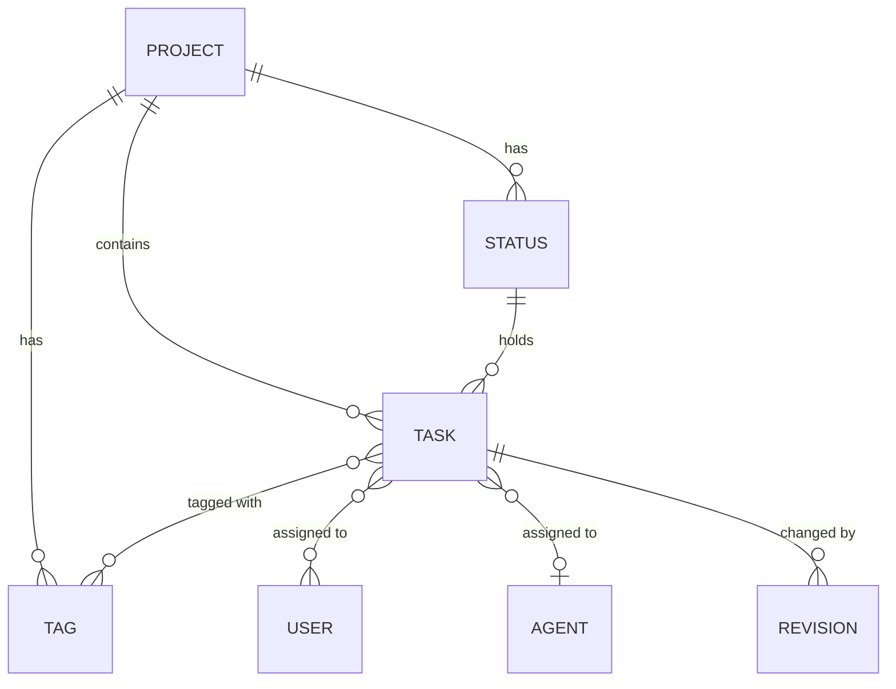
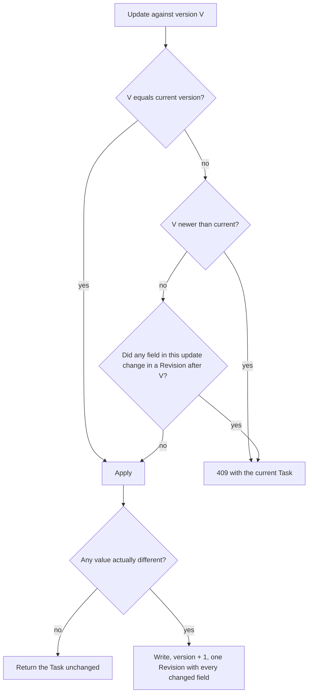

# Board

The board is where the team organizes work. It covers **Projects** (each with its own key, settings, Statuses and Tags), **Statuses** and their **Categories**, **Tags**, and **Tasks** with their fields, ordering, assignees, history (**Revisions**) and filters, plus the **Board** view that shows a Project's Tasks as a kanban. Agents work on these same Tasks; this spec describes the Tasks themselves, while the conversation on a Task and the Agent's work on it are described in their own specs.

## Concepts

- A **Project** is a body of work with its own Board, Statuses and Tags. It has a **Project Key**, a name, a description, an optional link to a code **Repository** (see [Git integration](git-integration.md)), Agent-related settings, and an archived flag.
- The **Project Key** is a short uppercase code of 2 to 6 letters (`API`, `WEB`), unique across the installation and fixed at creation. It prefixes the Project's Task Keys.
- A Project has a **kind**. Ordinary Projects have kind `project`. Each Wiki is stored as a Project of kind `wiki` with one backing Task; these Projects are kept out of the Projects list, absent from the Project API and managed only through the Wiki (see [Wikis](wikis.md)).
- A **Status** is a named step of a Project's workflow, with a color and a position. Each Status belongs to one **Category**: `backlog`, `open`, `active`, `review`, `done` or `closed`. The Category gives the Status its fixed meaning whatever its name. Only `closed` changes how Agents behave, and `backlog` changes how Agents are assigned (see [Updating Tasks](#updating-tasks)): a Task entering a `closed`-category Status ends its Agent's Session (see [Agent Sessions](agent-sessions.md)).
- A **Tag** is a colored, Project-scoped label. A Task can carry several.
- A **Task** is a unit of work in a Project: title, Markdown description, Status, priority, Tags, User assignees, at most one assigned Agent, and its position within its Status. It is identified by its **Task Key**, the Project Key followed by a sequential number (`API-42`).
- **Priority** is one of `urgent`, `high`, `normal`, `low` or `none` (the default).
- A **Revision** is a recorded change to a Task's fields, attributed to an **Actor** (a User, an Agent or the system), with the value before and after for each changed field.
- The **Board** is the kanban view of a Project: one column per Status in Status order, with `closed`-category Statuses hidden unless asked for. A Task shown on the Board is a card.

## Behaviour

### Projects

A Project has a kind: `project`, `wiki` or `schedule`. Wiki Projects and Schedule Projects are hidden from the Projects list, the Boards list and Project search, and their rules are in [Wikis](wikis.md) and [Schedules](schedules.md). A Schedule Project has three fixed Statuses (`Running`, `Succeeded`, `Failed`) that nobody edits, and its Tasks are created and moved by the scheduler.

**Creating.** Any User creates a Project with a key, a name (1 to 100 characters after trimming) and an optional description (up to 10,000 characters). Creation also accepts an optional Repository with its Base Branch and an optional default Agent. Clients offer enabled Agents and a No Agent option; the API accepts an existing Agent or an empty value. The default Agent applies to new Tasks under the usual assignment rules. The Repository is checked through the same Git Connection, accessibility, Base Branch and protection checks as Project settings. A selected Repository, default Agent, Project and default Statuses are saved in one transaction. An unknown Agent or invalid Repository selection answers `400` and leaves the Project Key available for another attempt. The key must be 2 to 6 uppercase letters; anything else is answered with `400`, and a key already in use with `409` "A project with this key already exists". A new Project starts with six Statuses and no Tags:

| Status | Category | Color |
| --- | --- | --- |
| Backlog | backlog | `#94a3b8` |
| Todo | open | `#64748b` |
| In Progress | active | `#3b82f6` |
| Ready for Review | review | `#a855f7` |
| Done | done | `#22c55e` |
| Closed | closed | `#6b7280` |

The answer, `201`, bundles the Project with its Statuses and Tags, and the web app opens the new Board. In the web "New project" dialog the key is suggested from the name as it is typed: the initials of a multi-word name, or the first four letters of a single word, uppercase and capped at 6 letters. The User can overwrite it; the dialog then accepts only letters and shows the resulting Task Keys (`KEY-1`, `KEY-2`) with a reminder that the key is fixed for good.

**Addressing.** A Project is reachable by id or by key, the key matched in any letter case, so Board URLs read `/p/API`.

**Editing.** Any User can change a Project's name and description. The key is fixed: a request that includes it is rejected with `400`. Every Project change is published on the Project's realtime topic as `project.updated`.

**Logo.** Any User can upload, replace or remove a Project's optional logo from General settings in the web app or Project settings in the native app. An upload contains one PNG, JPEG, GIF or WebP image of up to 2 MB. Unsupported formats, empty files and missing files receive `400`; oversized uploads and uploads with several files receive `413`. A failed upload preserves the current logo. Reading a logo requires a valid Login and returns `404` when the Project has no logo. Project details and list entries include the logo URL, or an empty value when absent. The URL changes on replacement. The logo appears on Project cards, in the sidebar and in the Board header on the web, and in the native app's Project list, rail and phone Task list header. Loading failures and Projects without a logo show the Project Key instead.

Logo changes use the same realtime event as other Project edits. Concurrent replacements and removals are serialized with other Project edits. Archiving preserves the logo; replacement, removal and permanent Project deletion clean up the old stored image after the database change commits.

**Listing.** The Projects list shows the non-archived Projects of kind `project`, ordered by name; a "Show archived" switch shows the archived ones instead. Each Project comes with its number of Tasks per Category. The web page shows one card per Project with key, name, description, total Tasks, the share done (Tasks in `done` and `closed` Statuses over all Tasks), a bar split by Category and the count per Category. The sidebar lists the non-archived Projects under "Boards" for quick access, each with its logo and name, a thin stacked bar of its open, review and done Tasks (backlog and active counted as open, closed Tasks left out), the open Tasks over that total, and its activity indicators: a green dot while an Agent Session runs and an orange message icon with the number of Tasks that have an unread Turn Summary for the User.

**Archiving.** Any User can archive a Project, which hides it from the Projects list and the sidebar while keeping everything: its Board stays reachable by URL with an "Archived" badge, and its Tasks, Comments and Agent work carry on as before. Archiving an already archived Project keeps its original archive time. Unarchiving brings it back to the list.

**Deleting permanently.** An Admin can delete an archived Project for good, from its settings after a confirmation. The Project must be archived first (otherwise `400` "Archive the project before deleting it"), and no Agent may have an active Job on any of its Tasks (otherwise `409` "An agent is working on this. Stop it, or close the task, before deleting."). Deletion removes the Project's Tasks, Comments, attachments (including the stored files), Revisions, Statuses and Tags, asks the Agents to remove the Tasks' Worktrees, and frees the key for a new Project.

**Settings.** A Project's settings page has five tabs:

- **General**: logo upload, replacement and removal, name, description (the key is shown read-only), archive and unarchive, and for Admins on archived Projects, "Delete permanently".
- **Statuses** and **Tags**: described below.
- **Agents**: the **Automatic resume at limit** switch (off by default; new Tasks copy its value, see Creating Tasks), the Setup Script and Agent Instructions (each up to 100,000 characters, editable by any User and saved automatically after a 600 ms pause or when leaving the field or view) and the Project's environment variables and secrets (Admins only). The section shows save progress and errors with a Retry action. See [Agents](agents.md) and [Agent Sessions](agent-sessions.md).
- **Repository**: the linked Repository and its Base Branch. See [Git integration](git-integration.md).

### Statuses

Any User manages a Project's Statuses from its settings. A Project always has at least one `open` Status (where new Tasks land by default) and at least one `closed` Status (the way out).

- **Adding**: a name (1 to 100 characters after trimming, unique within the Project in any letter case, otherwise `409`), a color (`#rrggbb`) and a Category. The new Status goes to the end of the order.
- **Editing**: rename, recolor, or change the Category. A Category change that would leave the Project without an `open` or a `closed` Status is answered with `400` 'A project needs at least one "open" status' (or "closed"). Moving a Status into or out of the `closed` Category closes or reopens the Sessions of every Task in it, exactly as if those Tasks had moved (see [Agent Sessions](agent-sessions.md)).
- **Reordering**: the order is set as a whole, listing every Status of the Project exactly once; anything else is answered with `400`. The web settings move a Status one step up or down at a time.
- **Deleting**: needs a target Status of the same Project for its Tasks. A missing target or the Status itself as target is answered with `400`, a target from another Project with `404`, and a deletion that would leave no `open` or no `closed` Status with `400`. The Status's Tasks move to the end of the target, keeping their relative order; each move is a Revision attributed to the User who deleted the Status, and the usual Session rules apply to it (moving into a `closed` Status ends the Session). The web dialog asks where the Tasks go, preselecting the first other Status.

Every change publishes the Project's full, ordered Status list as `statuses.changed`. Status changes in one Project are serialized, so concurrent edits and deletions of the same Status get clean answers (`200`, `204` or `404`), and Task moves racing a Status deletion either land before it (and are relocated) or are answered with `400` "Unknown status for this project". No Task is ever left without a Status.

### Tags

Any User manages a Project's Tags from its settings or creates one on the fly from a Task's Tag picker.

- A Tag has a name (1 to 100 characters after trimming, unique within the Project in any letter case, otherwise `409` "A tag with this name already exists in the project") and a color (`#rrggbb`). Tags are listed by name.
- Tags created from a Task's picker get the next color of a fixed palette, so neighbours differ, and are applied to that Task right away.
- Renaming and recoloring change the Tag everywhere at once.
- Deleting a Tag, after a confirmation in the web app, takes it off every Task that has it. Each of those Tasks gets a new version and a Revision of its Tags, attributed to the User; Tasks without the Tag are untouched.

Every change publishes the Project's full Tag list as `tags.changed`.

### Creating Tasks

Any User creates a Task in a Project, from the "Add task" box at the bottom of a Board column (Enter adds, Escape closes) or from a client's create form. Agents create Tasks through their Task Tools (see [Agent Sessions](agent-sessions.md)).

- **Title**: 1 to 500 characters after trimming. Required.
- **Description**: Markdown, up to 100,000 characters, empty by default.
- **Status**: any Status of the Project; by default the first `open` Status in order (Todo in the default set, never a `backlog` one).
- **Agent**: the Project's **default Agent** (set in its "Agents" settings) when it is enabled, otherwise none; a Task created in a `backlog`-category Status has no Agent. Assigning it creates the usual `pending` Session; nothing starts until the first User Comment. A disabled or deleted default Agent leaves new Tasks without an Agent (deleting an Agent clears the setting).
- **Automatic resume at limit**: copied from the Project's switch when the Task is created, by a User, an Agent or a Schedule. It is the Task's own switch from then on: changing the Project's does not change existing Tasks. When it is on, a Turn that stops at a usage limit with a known reset time gets its Limit Resume without asking (see [Agent sessions](agent-sessions.md#usage-limits-and-limit-resume)). Any User changes it from the Task's menu; it is a dedicated call that creates no Revision and leaves the Task's version as it is.
- **Priority**: `none` by default.
- **Tags**: up to 50, all from the same Project.
- **Assignees**: up to 50 existing Users.

A Status or Tag from another Project is answered with `400` "Unknown status for this project" or "Unknown tag for this project", and an unknown User with `400` "Unknown user". Duplicates in the lists are ignored.

The Task gets the next number of its Project. Numbers start at 1, are unique and gapless even under concurrent creation, are consumed only when creation succeeds, and are never reused after a Task is deleted. The Task is placed at the end of its column, starts at version 1, and records its creator as an Actor and its creation time. The creator and the assignees start following the Task (see [Conversation](conversation.md)). The new card is published as `task.created`.

An Agent is assigned with a separate update after creation (see [Updating Tasks](#updating-tasks)).

### Reading Tasks

A Task is reachable by id or by Task Key, the key matched in any letter case (`/t/api-42` opens `API-42`). A key with no matching Task, or a malformed one, is answered with `404`. Reading a Task also refreshes its branch and pull request information from the provider (see [Git integration](git-integration.md)).

A full Task carries:

- id, Task Key, number, Project;
- title, description, Status, priority, Tag ids, assignee ids;
- the assigned Agent and a summary of its Session (state and Queue position, see [Agent Sessions](agent-sessions.md));
- Task Branch name and link, and pull request state (see [Git integration](git-integration.md));
- the number of Comments (every Comment not deleted, Internal Notes and Agent and System Comments included);
- the number of tool calls across its Turns (subagent calls included, see [Agent Sessions](agent-sessions.md));
- version, creator, created and updated times.

A card is the same without the description and the creator.

### Updating Tasks

Any User edits a Task's title, description, Status, priority, Tags, User assignees and assigned Agent. Agents edit their own Task through Task Tools, within the limits described in [Agent Sessions](agent-sessions.md).

Every update carries the Task **version** the client last saw. The platform applies it field by field:

- A conflict is answered with `409`, code `conflict`, "The task was changed by someone else", and the current Task in the body. Nothing is written.
- An update that touches only fields nobody changed since V goes through, so two people editing different fields never collide.
- An update that changes nothing records no Revision and keeps the version.
- Changing the Status through an update puts the Task at the end of the new column.
- Changing the Status or the Agent triggers the Session rules: assigning, reassigning or unassigning an Agent, closing and reopening (see [Agent Sessions](agent-sessions.md)). Status itself never starts an Agent; only entering or leaving a `closed`-category Status matters.
- **Backlog holds Tasks without an Agent.** Assigning an Agent to a Task in a `backlog`-category Status, through an update without a Status, also moves it to the first `open` Status (the clients ask for confirmation first and send both together). A Task leaving `backlog` for a non-`backlog` Status, through an update or a move, gets the Project's default Agent when it has none and that Agent is enabled; the Agent change is part of the same Revision. A Task already in Backlog with an Agent keeps it. Projects created before the `backlog` Category existed keep their Backlog Status as `open` until its Category is changed in settings.
- Newly added assignees start following the Task.

After a successful update the card is published as `task.updated` on the Project's topic, the full Task as `task.changed` on the Task's topic, and the Revision as `revision.created`.

The web Task view saves each field as soon as it is edited: Status, priority, assignees, Agent and Tags on selection, the title on Enter or when the field loses focus (Escape restores it), and the description when its editing ends (clicking outside, Escape, or leaving the Task), so one editing session is one Revision. Saves from the same view run one at a time and each counts the previous one as seen, so quick successive edits never conflict with each other. On a conflict the view shows the refreshed Task with "Someone else changed this task"; an unsaved description draft stays open, and finishing it again saves it over the other change.

The web pickers offer active Users plus the Task's current assignees, and enabled Agents plus the current one. Through the API any existing User can be an assignee, deactivated ones included.

### Moving and ordering Tasks

Within a column, Tasks are kept in a manual order. A **move** sets a Task's Status and its place in that column in one request, naming the neighbour it lands below (`afterTaskId`) or above (`beforeTaskId`):

- with a neighbour below which it lands, it goes right below that Task; this wins over the other neighbour;
- otherwise, with a neighbour above which it lands, it goes right above that one;
- with only an explicit empty "after" neighbour, it goes to the top;
- with no neighbour, or with neighbours no longer in that column, it goes to the end.

Moves never conflict: the last move wins, whatever version the client saw. A move within the same Status changes neither the version nor the history. A move to another Status increases the version, records a Revision of the Status change, and applies the Session rules like any Status change. Every moved card is published as `task.moved`.

Positions are fractional keys, so a move rewrites only the moving Task. When concurrent moves into the same gap leave two Tasks with the same key, the next move into that gap renumbers the whole column; every renumbered card is published, and no Task is lost or misplaced.

A Status change made through an update (instead of a move) uses the same rules, except that it carries a version, so it conflicts with a Status change made since that version.

Merging a Task's Pull Request from the Task view moves the Task like a move to the next Status in order, skipping `closed`-category Statuses (see [Git integration](git-integration.md#merging-from-the-task-view)).

### Deleting Tasks

Any User deletes a Task, after a confirmation in the web app. Deletion removes the Task with its Comments, attachments (stored files included), Revisions, Session history and preferences, and asks the Agent to remove its Worktree. A Task with an active Agent Job can be deleted once the Agent is stopped or the Task closed; until then the request is answered with `409` "An agent is working on this. Stop it, or close the task, before deleting." The removal is published as `task.deleted` on the Project's topic and `task.removed` on the Task's topic. The Task's number stays used.

### Bulk actions

`POST /projects/:projectId/tasks/bulk` applies one action to up to 200 Tasks of a Project: `move` (with a `statusId`) puts them, in the given order, at the end of that Status, and `delete` removes them. Closing several Tasks is a `move` to a `closed`-category Status. Each Task is handled on its own, with the rules and events of a single move or deletion (Revisions, Session rules, `task.moved`, `task.deleted`), so one refused Task does not stop the others: the answer lists `succeeded` ids and `failed` entries with the Task id and the reason (an unknown Task or one of another Project is "Task not found", a Task with an active Agent Job is the deletion's `409` message). Duplicated ids count once.

### Revisions

Every change to a Task's fields is recorded as a Revision in the same transaction as the change. A Revision holds the Task version it produced (unique per Task), the Actor, the time, and the list of changed fields with their values before and after. Recorded fields: title, description, Status, priority, Tags, User assignees, Agent, and pull request state.

- Changes by Users carry the User, changes through Task Tools carry the Agent, and changes made by the platform carry the system or the User whose action caused them (deleting a Tag or a Status, deleting an Agent).
- Tag and assignee lists are stored sorted, so a Revision lists exactly what was added and removed.
- Revisions appear on the Task's Timeline next to Comments and Agent work, newest first (see [Agent Sessions](agent-sessions.md) and [Conversation](conversation.md)).
- Revisions after the version an Agent last read drive the Unseen Changes banner and the Notify agent message (see [Agent Sessions](agent-sessions.md)).
- Revisions also back the per-field conflict check described in [Updating Tasks](#updating-tasks).

### Filtering and search

A Project's Task list can be narrowed by:

- **assignee**: User ids, or `none` for Tasks without User assignees;
- **Tag**: Tag ids;
- **priority**: one or more priorities;
- **text**: up to 200 characters, matched case-insensitively as a substring of the title or the Task Key (`api-4` finds `API-4`), with `%` and `_` taken literally.

Values of one kind combine with OR, kinds combine with AND. Lists are given as repeated parameters or comma-separated. Malformed ids or priorities are answered with `400`. `closed`-category Tasks are left out unless explicitly included. The list comes in Board order: Status position, then position within the Status.

The same matching rule is shared by the server and the clients, so a client can apply live updates to a filtered view and keep exactly the cards the server would return.

### The Board view

The web Board of a Project shows:

- a header with the Project Key, name, an "Archived" badge when archived, and a link to the settings;
- a filter bar: free text ("Filter by text or key"), multi-selects for Assignee (Unassigned plus active Users), Tags and Priority, and "Clear" while any filter is set. Filters apply instantly in the browser and reset when the page is reloaded;
- a "Show closed" switch, kept in the URL, which adds the `closed`-category columns and their Tasks;
- one column per shown Status in Status order, each with its color dot, name, number of visible cards, and an "Add task" box.

A card shows the priority icon, the Task Key, the assigned Agent's avatar with its Session state and Queue position (`#2`), up to three assignee avatars, the pull request badge, the title, the Tags, the tool call count (a wrench icon) and the Comment count (a message icon). The tool call count is always muted and never marks unread work; only unread Comments highlight, in amber.

A card also carries the same **Close** action as the Task view (accessible name "Close task"), next to the Task Key: it moves the Task to the first `closed`-category Status in Status order, which ends its Session. It appears while the Task is in a Status of another Category, and a tooltip names the target Status. While the Agent is working on the Task (Session running or queued) it asks for confirmation first, since closing cancels that work; otherwise it closes at once. Clicking it does not open the Task and does not start a drag.

Cards are dragged with the mouse (after moving 5 pixels) or the keyboard. Crossing into another column places the card among that column's cards at the pointer; dropping it sends a move with the card's new neighbour. The Board updates immediately; if the move fails, only that card goes back, a "Couldn't move API-42" message explains why, and the Board reloads from the server.

Clicking a card opens the Task in a large dialog over the Board, with the Task Key in the URL, so it can be shared and reopened. Every Task also has its own full page at `/t/<Task Key>`, and a "Copy link" action. Escape closes the dialog, except while a field inside it is being edited.

The Board stays live: card, Status, Tag and Project changes from other Users and from Agents appear without reloading (see [Clients](clients.md) for the realtime transport). The Flutter app presents the same Tasks as a list grouped by Status, with its own search, filters and a switch for closed Tasks (see [Clients](clients.md)).

## Architecture

The board lives in four backend modules, each owning its records and checks: **Projects**, **Statuses**, **Tags** and **Tasks**. The Tasks module owns numbering, ordering, the concurrency check, Revisions and the card projection, and calls the Session lifecycle whenever a Task's Status or Agent changes. An **Actor resolver** turns stored Actor references into display names in one batch per response.

The backend applies database migrations on startup and records their completion. Applied migrations keep their original timestamps and SQL; further schema changes use new migrations. Restarts and upgrades preserve existing Project data and logos.

Every write runs in one database transaction. Realtime events and side effects (deleting stored files, messages to Runners) are collected during the transaction and released only after it commits, so clients never see a change that was rolled back. Each event carries the new projection of what changed (a card, a full Task, the whole Status or Tag list), and clients replace their copy with it.

Concurrency is handled with row locks in a fixed order:

- creating a Task increments the Project's next-number counter, which locks the Project row and serializes creation within the Project;
- Status changes lock the Project row exclusively, and Task writes take a shared lock on it, so Task edits wait for a Status deletion instead of racing it;
- deadlocks and serialization failures are answered with `409` and code `retry`, with nothing written, so the client can simply try again.

Realtime topics: `project:<id>` carries `task.created`, `task.updated`, `task.moved`, `task.deleted`, `statuses.changed`, `tags.changed` and `project.updated`; `task:<id>` carries `task.changed`, `task.removed` and `revision.created`, next to the conversation and Agent events described in their own specs.

## Data model

- **Project**: key (unique, 2 to 6 uppercase letters, fixed), kind (`project` or `wiki`), name, description, archived at, Repository link, default Agent, automatic resume switch (off by default), next Task number (starts at 1), Setup Script, Agent Instructions, created at, updated at.
- **Status**: Project, name (unique within the Project, case-insensitive), color, Category, position.
- **Tag**: Project, name (unique within the Project, case-insensitive), color.
- **Task**: Project, number (unique within the Project), title, description, Status, priority, position (fractional key compared byte by byte), creator Actor, assigned Agent, automatic resume switch, current Session, Task Branch and pull request, conversation generation (see [Wikis](wikis.md)), version (starts at 1, increased on every recorded change), created at, updated at.
- **Task assignee**: Task, User. **Task Tag**: Task, Tag.
- **Revision**: Task, version (unique per Task), Actor, changes (field, before, after), created at.

Deleting a Project removes its Statuses, Tags and Tasks; deleting a Task removes its assignees, Tags, Revisions, Comments and everything else attached to it. Deleting a Tag removes it from its Tasks. A Status is deleted only after its Tasks have moved elsewhere.

## Non-functional requirements

- Board changes made by one User or Agent appear on every other open Board within one second.
- Task numbers stay unique and gapless under concurrent creation; concurrent moves never lose or duplicate a Task.
- Edits racing deletions of the same Status, Tag or Task get a clean answer (`404`, `400` or `409`), never a server error.
- The Board list is one query per request, whatever the number of Tasks.

## Decisions

- **The automatic resume switch is copied to the Task at creation.** A Task of a Project that resumes automatically keeps doing so when the Project's switch changes later, and a Task can opt out on its own. A single inherited value would make a Project-wide change silently alter Tasks mid-work.
- **Project creation saves the initial Repository and default Agent atomically.** Both clients send the initial configuration in the creation request, so a failed Repository check or Agent selection leaves the User free to retry with the same Project Key.

- **Project-owned logos in the shared file store.** The Project stores a reference to its own image. Authenticated downloads reuse the existing file store and Login rules, while changing the URL on replacement lets both clients refresh the image. Cleanup runs after commit so failed edits keep the existing logo available.

- **Fixed Project Keys and per-Project sequential numbers.** Task Keys appear in branch names, links and conversations, so they never change and are never reused. The counter lives on the Project row, whose lock serializes creation and keeps numbers gapless.
- **Categories give Statuses a fixed meaning.** Teams name and arrange Statuses freely, while the platform and Agents rely on the Category. Only `closed` has an effect on Agents: Status never starts or steers an Agent, and entering a `closed` Status ends its Session. A Project always keeps an `open` and a `closed` Status, so there is always an entry point and an exit.
- **Deleting a Status requires a target.** No Task is ever left without a Status, and each relocation is recorded like any other move.
- **Fractional positions, with moves that never conflict.** A move rewrites one Task, and the last move wins because ordering is a shared, low-stakes arrangement. Duplicate keys left by concurrent moves are repaired by renumbering the column on the next move into that gap.
- **Per-field optimistic concurrency.** An update conflicts only when it touches a field someone else changed since the version the client saw. People editing different fields of the same Task never block each other, and nobody silently overwrites someone else's change.
- **Revisions written in the same transaction as every change.** The history is complete by construction and serves three purposes: the Timeline, the per-field conflict check, and telling an Agent what changed since it last read the Task.
- **Archive before permanent deletion, and deletion for Admins only.** Archiving is the everyday, reversible way to retire a Project. Permanent deletion destroys history, so it takes two deliberate steps and the Admin role.
- **Wikis are Projects of a separate kind, hidden from the Projects list and the Project API.** A Wiki reuses the Task conversation and Agent runtime unchanged, while Users see Wikis only in their own section. See [Wikis](wikis.md).
- **Readable addresses.** Projects and Tasks are reachable by key as well as by id, so URLs and conversations can use `API` and `API-42`.
- **One filter rule shared by server and clients.** Live updates can be applied to a filtered Board without asking the server whether a changed card still matches.

## Related specs

- [Users and authentication](users-and-auth.md): who can do what on Projects, Statuses, Tags and Tasks.
- [Conversation](conversation.md): Comments, Internal Notes, attachments (including files embedded in descriptions), following and notifications.
- [Agents](agents.md): Agents assignable to Tasks, and the Project's environment variables and secrets.
- [Agent Sessions](agent-sessions.md): Assignment, Sessions and the effect of `closed` Statuses, the Timeline, Unseen Changes, and the Task Tools Agents use to read, edit, move and create Tasks.
- [Git integration](git-integration.md): the Project's Repository, Task Branches, Worktrees and pull requests shown on Tasks.
- [Wikis](wikis.md): Projects of kind `wiki`.
- [Schedules](schedules.md): Projects of kind `schedule`, whose Tasks are Scheduled Runs.
- [Clients](clients.md): the web and Flutter interfaces and the realtime transport.

- [Voice Rooms](voice-rooms.md): Deleting a Task also ends its active Voice Room participation; Task Status remains independent of voice.
