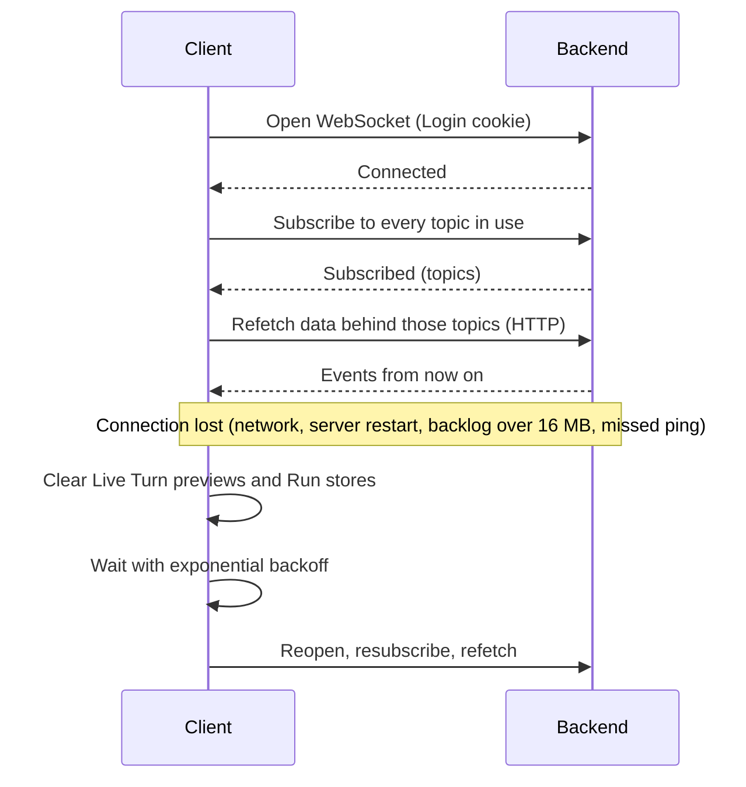
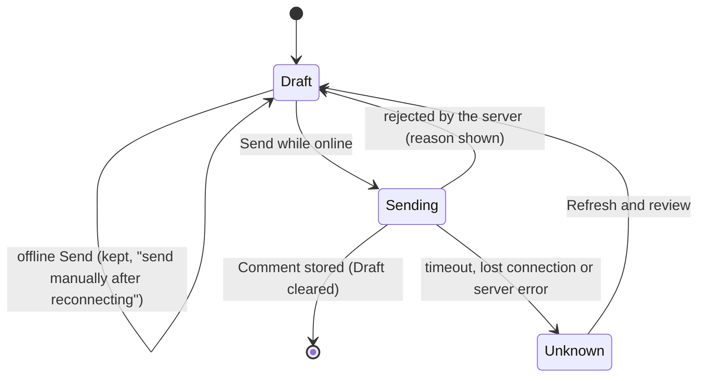
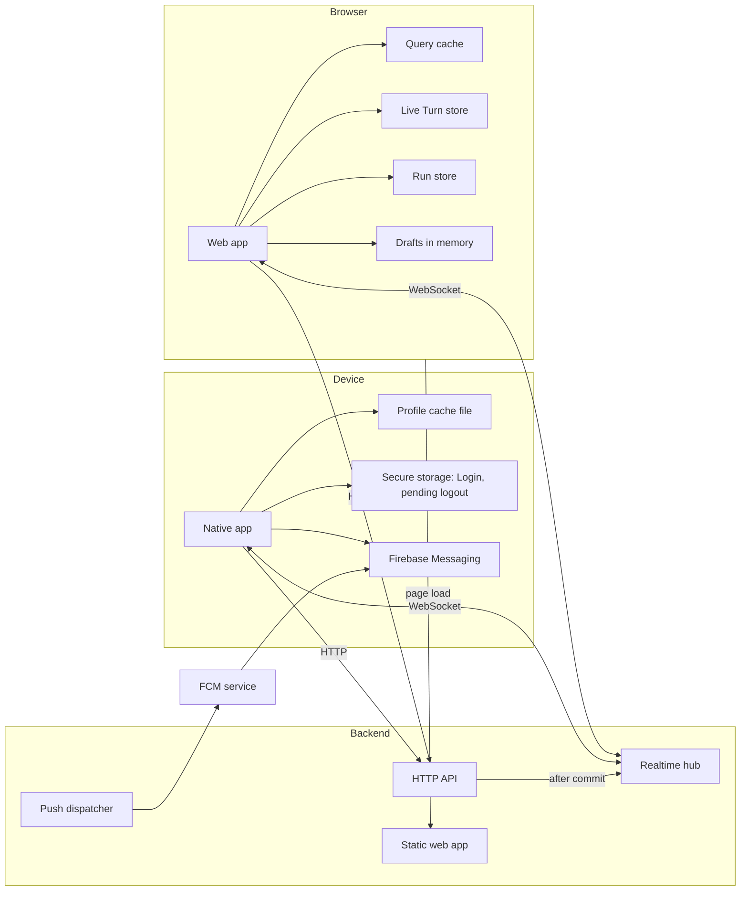

# Clients

Users work with Claude Task through two clients that share one backend: the **web app**, a React single-page application served by the backend itself, and the **native app**, a Flutter application for phones and desktops. Both read and change data through the same HTTP API and keep themselves live through one WebSocket per client, on which the backend pushes events about everything the client is looking at. This spec covers what each client shows, how it navigates, how it stays consistent while many people and Agents change the same data at once, and how the real-time layer that feeds them behaves. The domain rules behind what the clients display (Tasks, Comments, Sessions, Wikis and so on) live in the sibling specs linked at the end.

## Concepts

- **Web app**: the full interface, used from a browser. It covers every area of the product, including administration (Users, Agents, Credentials, Extensions, Git Connections, Project settings).
- **Native app**: a conversation-first client for iOS, Android, macOS, Windows and Linux. It covers Projects, Tasks, their conversations, Agent assignment and Wikis, plus Project and Agent settings, and for Admins Users, Credentials, Extensions, Git Connections and Project Environment Variables. Docker configuration is managed in the web app. Its layout borrows from chat apps: Projects play the role of servers and Tasks the role of channels, grouped by Status. These are presentation metaphors only; the domain terms stay authoritative.
- **Installation**: one deployment of Claude Task, identified by its origin URL (for example `https://tasks.example.com`). The web app always talks to the installation that served it; the native app asks for the installation URL at sign-in.
- **Live connection**: the single WebSocket a client keeps open to the backend while a User is signed in.
- **Topic**: a named stream of events a client subscribes to over its live connection: one Project's Board, one Task's Timeline, the Agents list, one Agent, the Wikis list, or the User's own private stream.
- **Event**: a notification pushed on a topic. It carries the new projection of what changed (the updated card, the new Comment, the whole Status list), so a client can apply it without a further request.
- **Live Turn preview**: the text, Thinking, API-retry status and Setup Script output of a running Turn, streamed as it is produced. It is transient: the stored Agent Comment, Thinking or Activity replaces it on the Timeline as soon as it is persisted (see [Agent sessions](agent-sessions.md)).
- **Active Runs bar**: the row above the composer listing the Agent's Runs that have not finished, plus the ones that failed and haven't been dismissed. It reads from a Run store per Task, filled by the Run events and by the Task's Runs endpoint.
- **Run transcript**: what the Run dialog or sheet shows for one Run: its text and its tool calls, live, without Thinking (see [Runs](agent-sessions.md#runs)). It is transient, like the Live Turn preview.
- **Draft**: an unsent Comment kept per Task, with its Internal Note flag and the files picked for it.
- **Minimized Chat**: a Conversation or a Wiki Chat kept in the web app's Chat Dock, out of its page, so it stays readable and writable while the User works elsewhere. A conversation is either in the Dock or on a page, never both.
- **Following, mute and read position**: per-User, per-Task state, shared by both clients for unread indicators and by the native app for push notifications. Their data rules belong to [Conversation](conversation.md); this spec covers how the clients use them.
- **Conversation generation**: a counter on a Task's conversation that grows each time a Wiki's Delete Chat clears it. Clients use it to notice a deletion they missed while disconnected.

## Behaviour

### Real-time layer

#### Connection and authentication

Each signed-in client opens one WebSocket to the API's real-time endpoint. The handshake is authenticated with the same Login cookie as HTTP requests: the browser sends it automatically, and the native app attaches the cookie it keeps in secure storage. A handshake without a valid Login is refused, which the clients treat as a possibly expired Login (see [Reconnection and resync](#reconnection-and-resync)).

The backend accepts a handshake whose `Origin` header, when present, matches the host being called, and refuses the others with `403`. This blocks cross-site WebSocket hijacking from other web pages; native clients send no `Origin` and pass.

#### Topics and subscriptions

A client subscribes and unsubscribes by sending small control messages listing topics. Every User can see every Project, so any well-formed topic is accepted, with one exception: a User's private topic is accepted only for that User's own id, and any other User topic in a request is silently dropped.

| Topic | One per | Carries |
| --- | --- | --- |
| Project (`project:<id>`) | Project | The Board: Task cards created, updated, moved and deleted; the Status list; the Tag list; Project details. |
| Task (`task:<id>`) | Task (including a Wiki's conversation) | The Task view: Task fields, removal, Comments, Revisions, Agent Timeline items, Session state, Live Turn preview, Setup Script output, Run updates and transcripts, and for a Wiki's Chat the reset event sent when it is deleted. |
| Agents (`agents`) | installation | Agent created, updated or deleted, for the Agents list and Agent pickers. |
| Agent (`agent:<id>`) | Agent | One Agent's detail view: the Agent itself, its Queue, builds and build logs, Jobs. |
| Wikis (`wikis`) | installation | A Wiki was created, changed (including a Chat renamed or deleted, and every Comment in one of its Chats) or deleted. |
| User (`user:<id>`) | User | Private changes to the User's own following, mute and read state. |

A subscribe request lists up to 100 topics; extra topics are ignored. The backend answers every subscribe with an acknowledgement listing the topics now being delivered. Events start flowing at that moment, so anything that changed between a client's HTTP fetch and its subscription would be missed; both clients close that gap by refetching once the acknowledgement arrives (the web app refetches the data each acknowledged topic keeps current; the native app moves to its "connected" state and refreshes its open views).

Control messages are limited to 64 KB; a larger message closes the connection with code `1009`. A message that isn't valid JSON, or has an unknown type, gets an error reply and the connection stays open.

#### Event catalogue

Events are grouped by the area that emits them. Each one carries the new state, so clients apply it directly.

| Area | Topic | Events | What the clients do with them |
| --- | --- | --- | --- |
| Board | Project | Task created, updated or moved (each with the Task card); Task deleted; Status list changed (whole list); Tag list changed (whole list); Project updated | Put the card in every cached Board list of that Project, or take it out; replace the Status or Tag list; refresh Project details and repository settings. A card update also reflects Session state and Queue position, since the scheduler emits one whenever they change. |
| Task view | Task | Task changed (full Task); Task removed; Comment created, updated or deleted (an update also carries a Question's answer or a Survey's answers and state); Revision created; Session changed (new Session state, or none) | Replace the Task (and refresh its Session for the "unseen changes" flag); show the Task as deleted; place the item on the Timeline; replace the Session. |
| Agent work | Task | Agent Timeline item created or updated (Thinking, Activity, a Run, Turn Summary, notices); Live Turn text or Thinking delta; Live Turn retry status (or cleared); Setup Script output chunk; Run updated; Run transcript message | Place stored items on the Timeline; append deltas to the Live Turn preview; show the retry line; show the Worktree preparation output; update the Active Runs bar and the open Run transcript. |
| Wiki Chat | Task | Reset event, sent when the Chat is deleted (the event keeps the name `timeline.reset`) | Remove the Chat from the list, empty its Timeline and Live Turn preview for everyone viewing it, close its Chat Dock panel, and open the most recent remaining Chat. |
| Wiki Chat list | Wikis | Wiki changed | Refetch the Wiki's Chat list (order, titles, unread and working indicators). |
| Wikis | Wikis | Wiki changed | Refetch the Wikis list and that Wiki. |
| Agents | Agents and Agent | Agent updated (full Agent); Agent deleted | Update the Agents list and the Agent's detail view; drop a deleted Agent. |
| Agent detail | Agent | Queue changed (whole Queue); build updated; build log chunk; Job updated | Replace the Queue; update the build list and append log text; update the Job list, the Job's detail and usage figures. |
| Private | User | Task preference (following, mute, read and latest positions, unread) | Every client of that User updates unread and following indicators, whichever one moved the read position. |

Domain changes publish their events only after their database transaction commits, so a rolled-back change publishes nothing. Scheduler and Agent-management events (Session changes, Queue changes, builds, Jobs, Agent updates) are published as soon as the scheduler has written them.

#### Ordering and consistency

The backend writes events to each connection in the order it publishes them, but a client also receives HTTP responses, and the two race: a response fetched before a change can arrive after that change's event. Events from different code paths can also reach a client in a different order from the order things happened. Clients therefore never trust arrival order:

- Task data is guarded by the Task's version: a card or Task older than the one already cached is ignored.
- Timeline items are placed by their position in the server's order (creation time, then kind, then id), and an item already shown is replaced in place.
- The Session's state from an event wins over an HTTP snapshot already in flight.

The web app's detailed rules are in [Consistency under concurrent and out-of-order updates](#consistency-under-concurrent-and-out-of-order-updates); the native app's are in [Live updates](#live-updates).

#### Heartbeat, limits and backpressure

- The backend pings every connection every 30 seconds. A connection that hasn't answered the previous ping by the next one is terminated, so a dead client is dropped within about a minute.
- Before writing an event, the backend checks how much data is still queued for that connection. A connection with more than 16 MB waiting is terminated on the spot instead of receiving more. A browser tab that stops reading (asleep, frozen, on a stalled network) would otherwise make the backend hold every event for it, and Live Turn deltas can grow that to hundreds of megabytes. The client sees an ordinary disconnection, reconnects and refetches everything, so nothing is lost.
- Event messages from the backend can be large (a whole Status list, a whole Queue, a full Task with its description); the limit above applies to what the backend has queued, not to single messages.

#### Reconnection and resync

Events are notifications, not a log: a client catches up by refetching, not by replaying. After any disconnection, a client resubscribes and refetches what it shows.

- **Web app**: waits 0.5 s, then 1, 2, 4, 8, 16 s, and then 30 s between attempts, resetting after a successful connection. On every reopen after the first, it marks every cached query stale so open views refetch, each subscribe acknowledgement triggers a refetch of that topic's data, and the open Task refetches its Runs.
- **Native app**: waits 1, 2, 4, 8, 16 and then 32 s between attempts, resetting after a successful connection, with a 15-second timeout on each attempt. Every change of connection state empties its Run store, so a lost connection clears the Active Runs bar until the next snapshot brings back what still runs; on reaching "connected" again it clears Live Turn previews, refreshes its global lists and the open Project and Task, and retries any pending logout (see [Sign-in, Login and profiles](#sign-in-login-and-profiles)). Coming back to the foreground also reconnects and refreshes.

#### When a Login ends

When a Login ends (logout, deactivation, password change or reset), the backend closes that Login's live connections with code `4001`. On `4001` the web app stops reconnecting and re-checks the Login, which sends the User to the sign-in page; the native app treats it as an expired Login and returns to sign-in. On any other close, the web app also re-checks the Login before reconnecting, so a Login that expired while the connection was down leads to sign-in rather than to endless reconnection attempts.

### Web app

#### Sign-in and routing

Everything except the sign-in page sits behind the Login check. The web app asks the backend who the current User is; the answer is cached for one minute.

- Without a Login, any page redirects to sign-in, remembering the requested page; after signing in the User lands there (or on the Projects list). Only same-site paths are honoured as a return target.
- A User with a temporary password is sent to "Choose your password" and can reach nothing else until it is changed. The voluntary "Change password" form asks for the current password and the new one twice (at least 8 characters), and tells the User that their other Logins were logged out.
- When the backend can't be reached, the app shows "Can't reach the server" with the error instead of redirecting.
- Any request answered with `401` triggers a new Login check, so a Login ending anywhere leads back to sign-in.
- Signing in and logging out both clear every cached query and every Draft, since another User may sign in next in the same browser. Logging out also closes the live connection.

The live connection starts once the User is signed in with a usable password and stops on logout. It subscribes to the User's private topic to receive Task Preferences, including read-position changes from other clients. Pages subscribe to the topics they display while mounted; the web app counts subscribers per topic and sends a subscribe for the first one and an unsubscribe after the last one.

| Page | Address | Who |
| --- | --- | --- |
| Projects list | `/` | everyone |
| Board | `/p/<Project Key>` (with optional `?task=<Task Key>` and `?closed=1`) | everyone |
| Project settings | `/p/<Project Key>/settings` | everyone (secrets and admin-only fields per [Board](board.md) and [Agents](agents.md)) |
| Task page | `/t/<Task Key>` | everyone |
| Wikis list and Wiki conversation | `/wikis`, `/wikis/<id>` | everyone |
| Agents list and Agent detail | `/agents`, `/agents/<id>` | everyone (editing for Admins) |
| Users, Credentials, Git Connections, Extensions | under `/admin/` | Admins |
| Sign-in, change password | `/login`, `/change-password` | everyone |

Members who open an admin page get the "not found" page (Users, Credentials, Git Connections) or "Admin access required" (Extensions). Any unknown address shows "not found".

#### Navigation

A fixed sidebar holds the product name, links to Projects, Wiki and Agents for everyone, links to Extensions, Credentials, Git and Users for Admins, and a "Boards" list with every non-archived Project: its logo (the key's first two letters while it loads or when there is none), its name and, on the right, the Project's activity — a green dot while an Agent Session of the Project is running, and an orange message icon with the number of its Tasks that have unread entries for the User. A Project with Tasks also shows a thin stacked bar under its name, split like the Project cards' bars (open, review and done, with backlog and active Tasks counted as open and closed Tasks left out), and the open Tasks over that total, such as `7/23`; hovering the bar or the number gives the exact count per state. Projects without Tasks keep one compact line. Each indicator is hidden when there is nothing to show, and the unread rule is the one of the Projects list below.

#### Chat Dock

The Chat Dock keeps the conversations the User minimized at the bottom of the window, so they can be read and answered from any page. A Task view and a Wiki Chat each offer **Minimize chat** in their header; minimizing moves the conversation into the Dock and leaves its page: the Board dialog closes, a Task page returns to its Board and a Wiki Chat returns to the Wikis list. A conversation is either in the Dock or on a page, never both: opening one from the Dock shows its full page and takes it out of the Dock, and opening that page any other way does the same.

- Panels sit bottom-right, the newest nearest the corner, in a row kept above the Voice Bar and above a page's own composer (a Task's or a Wiki Chat's), whose measured height moves the row up so the page stays writable.
- Width adapts between 300 and 380 px to the room available: one panel from 768 px wide windows, two around 1024 px, three around 1280 px, four around 1600 px, and up to six on very wide screens. Below 768 px the Dock is not shown and **Minimize chat** is not offered; the entries stay saved and come back on a wider window.
- The three most recent panels are open, up to 470 px tall or 60% of the window, whichever is less; older ones stay as 50 px title bars. Beyond the Dock's capacity of six conversations, the oldest closes.
- A panel's bar shows the Agent's avatar with its Session state, the title, a context line under it (the Project and the Task Key, or the Wiki's name and the Chat's Task Key, shown also while collapsed), an unread dot and **Close**; an open panel adds **Open full page**. Clicking the bar opens or collapses the panel. The row's empty space, above a collapsed panel included, does not take clicks away from the page.
- An open panel is the same conversation as the page: the Timeline, Active Runs bar, Live Turn preview and composer, with Revisions hidden as the Task view hides them by default. It advances the User's read position while it is scrolled to the bottom, as the page does; a collapsed panel neither takes room nor marks anything read.
- Deleting the Task or the Wiki Chat (or its Wiki) closes its panel. A Task or Chat that cannot be loaded shows its error rather than a panel.
- The Dock is a per-browser preference, kept with the theme and the Task layout and not in the address: entries, their order and which are collapsed survive reloads and are cleared on sign-in and logout. It holds no server state: each panel subscribes to the Task's topic and uses the cached queries of the page.

#### Projects list

Projects appear as cards with key, name and a bar of Task counts per Category. Project progress shows only open, review and done: backlog and active Tasks count as open, and closed Tasks are left out of the bar, the Task count and the done percentage. Next to the name, a green dot shows that at least one Agent Session of the Project is running, and a number badge shows how many open Tasks have unread entries for the User; Tasks the User muted and Tasks in a `closed` Status do not count, and each indicator is hidden when there is nothing to show. The sidebar's Boards list repeats condensed versions of the same indicators, with the open/total count instead of the done percentage. The Projects list carries this as `activity` (`runningAgents`, `unreadTasks`), computed per User with the unread rule of [Conversation](conversation.md). The list is not on a live topic: the web app refetches it every 15 seconds, and the native app on refresh. A "Show archived" switch swaps to archived Projects. "New project" opens a creation dialog with Name, Key, Description, an optional default Agent and an optional Repository. The Repository picker groups choices by Git Connection, supports search, and shows connection failures while keeping available Repositories usable. Selecting a Repository fills its default Base Branch, which the User can edit. No Agent and No Repository are explicit choices. Failed submissions preserve all fields, and submission stays disabled while saving. Project rules (keys, archiving, deletion) are in [Board](board.md).

The Project logo appears on its card, sidebar entry and Board header. General settings offers upload, replacement and removal with an image preview, format and size guidance, and feedback when saving succeeds or fails. The controls stay disabled while a logo change is being saved. Image loading failures show the Project Key. Accepted formats and lifecycle rules are in [Board](board.md#projects).

#### Board

The Board shows one column per Status in Status order, closed-category Statuses included only while "Show closed" is on (kept in the address so it survives reloads and links). Each column shows its colour dot, name and the number of cards currently shown, the cards in their stored order, and an "Add task" button.

A card shows the priority icon, Task Key, the assigned Agent's avatar with a state dot (animated while running) and its Queue position when queued, up to three User assignee avatars, the Pull Request badge (see [Git integration](git-integration.md)), the title, its Tags and the Comment count.

An unread card has a bold title. When it has unread Comments, its Comment count icon and number turn orange and the icon glows; the count itself stays the total of Comments, and the accessible label and tooltip give the unread Comment count. Unread Timeline activity that isn't a Comment only bolds the title. Counts include every kind of Comment and Internal Notes, including the User's own, and use the Read Position rules in [Conversation](conversation.md#read-position-and-unread). Muted Tasks keep the indicators. The Board fetches the User's Task Preferences separately from the shared Task cards and updates them on live Task changes, private preference events and reconnection. Reading the conversation clears them on every connected client of the same User.

- **Quick add**: "Add task" opens a title field in the column. Enter creates the Task in that Status and keeps the field open for the next one; Escape or leaving it empty closes it.
- **Filters**: free text (matching title or Task Key), assignees (including "Unassigned"), Tags and priorities, each multi-select, combined together. "Clear" resets them. Filters apply to the cards shown and to the column counts, and last while the Board is open.
- **Drag and drop**: a card is dragged after the pointer moves 5 px, or with the keyboard. Crossing into another column places the card among that column's cards right away, so it can be dropped at a precise spot. Dropping moves the Task to that Status and position (see [Consistency under concurrent and out-of-order updates](#consistency-under-concurrent-and-out-of-order-updates)). The dragged card has no drop animation, so a new drag can start immediately after a drop.
- Clicking a card opens the Task in a dialog over the Board, recorded in the address so it can be shared and so the browser's back button closes it.

#### Task view

The Task view appears in two places with the same content: a large dialog over the Board, and a full page at the Task's address. The dialog adds "Open full page" and "Close". Pressing Escape while editing a field (title, description, Comment) ends that edit and keeps the dialog open.

The header shows the Project and Task Key, the editable title, and these controls:

- **Close** (accessible name "Close task"): moves the Task to the first `closed`-category Status in Status order, which ends its Session (see [Agent Sessions](agent-sessions.md#closing-and-reopening-the-task)). It turns green on hover, and a tooltip names the target Status. While the Agent is working on the Task (Session running or queued) it asks for confirmation first, since closing cancels that work; otherwise it closes at once. It appears while the Task is in a Status of another Category; once closed, the Task is reopened from the Status field.
- **Changes**: shows or hides Revisions on the Timeline; hidden by default.
- **Session chip**: the Session's state ("starting", "queued #N", "running", "waiting for messages", "paused", "waiting for retry", "closed"), coloured by state.
- **Stop** while the Session runs (the Interrupt), **Retry** when the Session is held after a failed Job, and **Notify agent** (with an explanatory tooltip) when the Task has Unseen Changes. These actions refetch the Session afterwards instead of trusting their own response, because the scheduler may already have moved it on.
- **Layout**: "Focus activity" or "Focus details" decides which panel takes the main area; the other sits in a collapsible right sidebar. Both choices are remembered per browser for every Task. The sidebar starts open on screens at least 1024 px wide and closed on narrower ones, where it slides over the main area.
- **Task actions**: "Copy link" (the Task page address) and "Delete task" (with confirmation).
- **Minimize chat**: moves the conversation into the [Chat Dock](#chat-dock) and leaves the Task, between the Task actions and the dialog's close button.

The details panel holds Status, priority, User assignees, Agent (enabled Agents, plus the current one if disabled; picking one for a Task in a `backlog` Status asks for confirmation that the Task moves to the first `open` Status, the native app does the same), Tags (with inline creation, cycling through eight colours), last update, the Task Branch link and Pull Request badge (with a Merge button while the Pull Request is open and not a draft, see [Git integration](git-integration.md)), the description, and under it the Task's attachment list. When the panel is at least 42rem wide (typically with "Focus details"), the properties sit in two columns: Status, priority and last update on the left; User assignees, Agent and Tags on the right. The creator and creation time appear in small text beside the Task key in the header.

The **description** is edited in place: clicking the text starts editing with the caret where the User clicked, the formatting toolbar appears in the heading's row, and the edit is saved once when it ends (clicking outside, Escape, or leaving the Task), producing one Revision per edit. Links in the description open in a new tab, and only for `http`, `https` and `mailto` addresses. Checkboxes stay clickable and selecting text doesn't start an edit. Images can be uploaded into the description or linked by URL. If someone else changed the description meanwhile, the draft is kept and a notice offers to save it over the other change (by clicking outside again) or to discard it.

The **attachment list** sits under the description and appears once the Task has a file: every file of the description and of its Comments, newest first, one compact row each with an image thumbnail where available, the name, the size, who uploaded it (or "Description") and when. Images open in a new tab; other files download. It updates as Comments and description uploads arrive.

The **activity panel** is the conversation: the Timeline, oldest first, with the composer docked below. While it is on screen and scrolled to the bottom, it moves the User's read position to the newest entry as entries arrive, and it does so again when the reader scrolls back down or returns to the browser tab. The read position itself is in [Conversation](conversation.md).

- Fifty items load first; "Load older activity" brings the previous page.
- Comments show the author's avatar (the Agent's avatar for Agent Comments), name, a badge for Agent and System Comments and for Internal Notes, time, "edited", and the Delivery badge (queued, delivered, not delivered with its reason in a tooltip). Internal Notes have a dashed slate border, Agent Comments a violet tint, System Comments an amber one. Bodies taller than 320 px are clamped with "Show more".
- Image attachments (PNG, JPEG, GIF, WebP, AVIF) show inline previews; other files are listed with name and size and download on click. Files an Agent posts appear the same way.
- A Question shows as a card in place of its body, with its files below. Each item shows its header, its question, and its options with descriptions as radio buttons (one choice) or checkboxes (several), followed by an "Other" text field. "Send answer" is enabled once every item has a choice or a non-blank "Other". An answered Question shows the choices read-only with "Answered by ‹name› · ‹time›". When someone else answered first, a toast says so and the card turns into their answer as the update arrives. The answer Comment itself reads "answered the question", with a link that scrolls to the Question.
- A Survey shows as a card with the same items, the User's own choices (editable while open) and "Save answer" or "Update answer", the answers so far per option with names, "‹n›/‹m› expected answered" with the names still missing, and "Send now". A closed Survey shows the final results and who closed it, or that everyone answered.
- A User's own Comments offer "Edit"; deletion is available to their author and to Admins, after confirmation. A deleted Comment leaves a one-line "deleted a comment" marker.
- Revisions read as sentences ("moved it from Todo to In Progress"); identical consecutive Revisions by the same Actor fold into one line with a count.
- Thinking and Activity are collapsed by default. Activity shows the number of actions, an icon per kind of tool, the number of failed actions and the last action's summary; expanding it lists each tool call with its outcome, and expanding a call shows input and output. Turn Summaries show outcome, duration, tool calls, tokens and cost.
- A Run shows as one compact row: an icon for its type, its description, its status, how long it took, its tool calls and, when it failed, the error. Pressing it opens the Run dialog.
- Below the stored items, the Live Turn preview shows "Preparing the worktree" with the Setup Script output (expandable, last 64 KB kept), a "Retrying the Claude API (attempt N/M)" line, "Thinking…", and the Agent's text as it is written, in a dashed bubble with a cursor. Like Comment bodies, the bubble is clamped at 320 px with "Show more" and stays anchored at the top, so the beginning can be read while the text grows. If the reader expanded it, the Agent Comment that replaces it at the end opens expanded too.
- While the User is within 96 px of the bottom, new content keeps the view scrolled to the bottom; once they scroll up to read, it stays where they are. Expanding a clamped body ("Show more") also stops following, so the box grows downward from where it is and can be read from its top; following resumes when the User scrolls back to the bottom.

The **Active Runs bar** sits between the Timeline and the composer, outside the scrolling area, and takes no room when it has nothing to show. It lists the Task's Runs that run now first, then the failed ones still to read, each in start order: an icon per type, the description cut short, the elapsed time and the tool call count, with a spinner while one runs and the error icon when one failed. A finished Run leaves the bar at once, unless it failed: a failed Run stays until its own dismiss button is pressed, for the length of the page session. Clicking a Run opens the **Run dialog**, a centred dialog showing the Run's description, its subagent type, its status, its tool calls and usage when the CLI reported them, its prompt in a collapsed section, and its transcript: the subagent's Markdown text and its tool calls, each expanding to input and output, with no Thinking. The dialog follows the newest message while the reader stays at the bottom, and stops when they scroll up. A tool call that started a nested Run offers "Open", which switches the dialog to that Run. A Run whose transcript the backend no longer has (one from an earlier Job) shows its status and error alone.

The Task's Runs are also read from the API when the Task opens or the connection comes back, so a Task opened mid-run shows what is running then; Runs that ended before a reload do not return to the bar, and their Timeline rows remain.

The **composer** writes Markdown. It has no formatting toolbar, to leave the room to the Timeline: formatting comes from keyboard and Markdown shortcuts. Its text starts as a single line, grows up to three, then scrolls. Comments edited in place work the same way, without the height limit. Enter sends and Shift+Enter starts a new line. Files can be attached by button, drag and drop, or paste (pasted images get unique names), up to 10 files of 25 MB each per Comment; the composer reports the limit when a file would exceed it. The "Internal chat" switch turns the Comment into an Internal Note: the composer turns dashed and slate, shows "only people see this, never the agent", and the button reads "Send". Typing `/` at the start, or a skill name anywhere, suggests the Session's chat commands (skills, MCP prompts, Claude commands) for keyboard or mouse selection; suggestions are hidden in Internal Notes.

Typing `@` at a word boundary opens the active-User suggestions above the composer. Search matches name and email, and keyboard navigation supports Up, Down, Enter, Tab and Escape. Mouse selection preserves the editor caret. Selected mentions appear as labelled links in the rich editor and as highlighted text on the Timeline, including in Internal Notes. Identity and notification rules are in [Conversation](conversation.md#mentioning-users).

Sending keeps whatever the User typed or attached while the request was in flight: only the sent text and files leave the composer. The unsent Draft of each Task survives closing the Task and coming back to it, until the page reloads, the User signs in or the User logs out.

#### Wikis

The Wiki section lists Wikis as cards (name, description or repository, repository) with a "New wiki" dialog that asks for name, description, Agent and repository (grouped by Git Connection, with unreachable connections listed as errors) and an optional Base Branch prefilled from the repository. A Wiki opens as a Chat page: name, repository link, settings and delete in the header, and under it the Chat list on the left (ordered by latest activity; each Chat with its title, time of last Comment, an unread indicator and a working indicator, a "New chat" button on top and a menu with Rename and Delete, confirmed with "Delete this chat and everything in it for everyone. Wiki files are kept.") beside the open Chat with its Session chip, Stop and Retry. The most recent Chat opens first; a Wiki without Chats shows an empty composer, and the Chat is listed once its first Comment is sent. The Task Branch and review link appear under the header when they exist. The Chat is the same activity panel as a Task's, with Revisions always hidden. The composer of a Chat run by another Agent than the Wiki's is disabled and says which Agent runs it. The Chat header also offers **Minimize chat**, which moves the Chat into the [Chat Dock](#chat-dock) and returns to the Wikis list.

Deleting a Chat from this page removes it from the list at once and empties its Timeline and Live Turn preview, without waiting for the event; everyone else viewing it sees the same through the reset event. Wiki rules are in [Wikis](wikis.md).

#### Agents and administration

The Agents list (everyone) shows each Agent's avatar, state, current Task, Queue length, Credential and last activity; Admins see "New agent". The Agent detail page has tabs for current work and Queue (Members can reorder by dragging and remove entries), builds with live logs, usage, container logs (the last 500 lines, refreshed every 3 seconds while the tab is open) and configuration. Project settings has tabs for General, Statuses, Tags, Agents and Repository. Admin pages manage Users, Credentials, Extensions (Skills, Plugins, MCP servers) and Git Connections. The behaviour behind each of these is in [Users and auth](users-and-auth.md), [Board](board.md), [Agents](agents.md) and [Git integration](git-integration.md).

Project Setup Scripts and Agent Instructions, and the non-Docker fields of an existing Agent's Configuration tab, save automatically after a 600 ms pause or when focus leaves a field. Pending edits are also submitted when switching settings tabs or navigating to another app view. Each section shows whether changes are being saved, have been saved or failed, with a Retry action on failure. Dockerfile, Development Services and CPU and memory limits share a separate explicit save action. Creating an Agent and managing Project environment variables and imports use their own submit actions. See [Agents](agents.md#editing-an-agent).

#### Theme

The web app uses a dark theme by default, with Light and System as alternatives in the User menu. The choice is stored per browser and applied before the first paint, so the first paint already uses it; when storage is unavailable the choice lasts for the open page. The UI kit and colour tokens are shared across pages.

Dots showing an Agent's or a Session's state — on the Board cards, in the Agents list and on the Agent page, and in the Session chips of a Task or Wiki Chat — share one palette: green filled for a running Session, green hollow for an idle Agent, blue filled for a starting Session and for a Build in progress, amber filled for a paused Session, red filled for a failed Build, red hollow for a disabled Agent, and grey hollow for an offline Agent or a closed Session. Running and building dots pulse.

#### Consistency under concurrent and out-of-order updates

The web app keeps server data in a query cache that HTTP responses and events both write into. These rules keep it correct when requests, responses and events cross:

- **Version guard for Tasks.** A card or Task arriving from any source is applied only if its version is at least the newest version cached anywhere (any Board list or Task view). A late HTTP answer can't bring back an older title, Status or Tag set that an event already replaced.
- **Initial list snapshots.** Board, Build and Job lists finish their initial HTTP snapshot even when partial events arrive during loading, then fetch a complete snapshot to reconcile those events. Events received during that reconciliation keep the full refresh pending until it succeeds. Once a list is complete, events update it directly and cancel older snapshots in flight.
- **Closed-category filtering.** A card whose Status is closed-category is removed from Board lists that hide closed Statuses and added to those that show them. When the Status list changes, Board lists are refetched, since a Category change can move cards in or out.
- **Timeline placement.** An item already shown is replaced in place. A new item is inserted at its position in the server's order, so items arriving out of order still read in the order they happened. An item older than everything loaded, with older pages still unloaded, waits for "Load older activity" instead of appearing at the bottom. An item seen on two pages (because it crossed a page boundary between fetches) is shown once.
- **Session state.** A Session event cancels any Session request in flight and replaces the cached Session. Session actions (Stop, Retry, Notify agent) refetch afterwards.
- **Run snapshots.** A fetched transcript is merged with the messages that arrived while it was in flight: a Run update replaces the Run in the bar and the open transcript, and a message is kept only when its number reaches the snapshot's next index, so nothing is duplicated or lost.
- **Serialized field saves.** Edits to one Task are saved one at a time, in order. Each save sends the version the User saw, or the version of their own previous save if that is newer, so quick consecutive edits by the same User never conflict with each other. While a save is queued or in flight, its values are shown over the Task; a field stays pending until its latest save completes.
- **Conflicts.** A save that conflicts with someone else's change (`409`) applies the server's current Task and warns "Someone else changed this task", leaving the User's change unsaved. The title field follows remote renames except while the User is typing in it.
- **Optimistic Board moves.** A drop updates the card immediately, with a position computed between its new neighbours (when the neighbours share a position, the card keeps its old one until the server respaces the column and answers). The request names the neighbour the card goes after or before. On failure only that card goes back, unless newer news of it already arrived, so cards created or moved by others meanwhile stay; the Board and the Task view are then refetched and a "Couldn't move" message appears.
- **Deletions.** A deleted Task disappears from Boards; an open Task view, either on its own page or in a Board dialog, clears its editor and shows "This task doesn't exist (or was deleted)". Cached views are reset and active views refetch the Task to resolve its deletion.
- **One place per conversation.** Showing a conversation in the Task view or a Wiki Chat page takes it out of the Chat Dock, and minimizing it takes it out of the page, so the same conversation is never live in two places.
- **Requests.** A request that fails with a server error or a network failure is retried up to twice; client errors are reported at once. Data stays current through events and reconnection, so refocusing the window leaves queries as they are.

### Native app

#### Sign-in, Login and profiles

The sign-in screen asks for the installation URL (prefilled from the build configuration when given), email and password. The URL must be an `http` or `https` origin with a host, no credentials, path, query or fragment. The app signs in through the regular login API and keeps the Login cookie, the installation URL, the User and a device id generated at sign-in in the platform's secure storage (Keychain, Android Keystore, Secret Service on Linux). Passwords are never stored. Every request carries the cookie and the CSRF header explicitly, and whenever the backend renews the cookie the app stores the new one.

One installation and one User are active at a time; switching requires logging out. Data cached for a profile is kept separately per installation and User. Responses that arrive after the profile changed are discarded.

- A temporary password leads to the change-password screen before anything else; a request rejected because a password change is required leads there too.
- A `401` or a live connection closed with `4001` ends the profile: the stored Login is removed and the sign-in screen says "Your Login expired. Sign in again."
- **Logout** asks the backend to end the Login, removes the push token, and deletes the profile's cache, Drafts, staged draft files, downloaded attachments and the Login. When the backend can't be reached, local data is cleared immediately and the old Login is kept only in secure storage as a pending logout, sent again on the next start and every reconnect until the backend confirms. A pending logout is never used as an active Login.

#### Navigation and presentation

The layout adapts to the window width.

| Width | Layout |
| --- | --- |
| Below 1000 px (phones, narrow windows) | Successive screens: Projects list, then the Project's Tasks, then the conversation. Back (button, gesture or system back) returns one level. Task details open on demand. A navigation drawer, opened by tapping the app icon in the Projects and Wiki headers or by swiping from the left edge, holds the profile, Projects, Wikis and Settings. |
| 1000 px to 1499 px | Three panes: a 76 px Project rail, a 340 px Task list, the conversation. Task details open on demand from the conversation header. |
| 1500 px and wider | The same three panes plus a 360 px Task details panel next to the conversation. |

Every screen and pane follows one page structure, so moving between them never changes where things are:

- **Header.** One header serves every screen and pane: Back (when there is somewhere to go back to, with the platform's arrow: a chevron on iOS and macOS, an arrow elsewhere), an optional leading mark (the app icon, the Project logo), the title, one secondary line (counts, a Task Key with its Session state, the Project name) and the actions on the right, ending with the primary one as a filled button (New project, Create Task, New wiki, New Agent and the other creation actions in Settings). Headers share their height and bottom border, so the panes of the wide layout line up.
- **Sections.** Page content is grouped in sections with an uppercase title, an optional one-line explanation and, when the section holds a list the User can extend, an add button beside the title.
- **Rows.** Lists in Settings, pickers and the Wiki list use one row style: a card with an optional leading avatar, logo or tinted icon, a title, a muted subtitle and a chevron when the row opens something. Rows that open a page outside the app (Repository, branch, Pull Request, provider settings) show an external-link mark instead. A selected row is tinted with the accent.
- **Empty states.** An empty page shows an icon, a title, a sentence on what to do and, when available, the action. An empty section inside a page shows a short dashed hint ("No tags yet.").
- **Forms.** Modal forms show each field's label above the input, with a short qualifier beside it ("optional", "Markdown") and an explanation under it when needed. Choices from a list (Agent, Repository, Status) are select fields that show the current value and open a picker. Yes/no options are labelled switches; tapping the whole row toggles them. Cancel and the primary action sit in the sheet footer, with the primary action last; secondary and destructive actions on the edited entry (Duplicate, Delete, Reset password) follow the fields, after a divider. Errors appear at the top of the form.

On phones, the app icon at the left of the Projects and Wiki headers opens the navigation drawer, with a 44 px touch target and the accessible label "Menu". On wider windows, the Wiki header keeps its decorative app icon and navigation uses the Project rail.

The **Project rail** lists Projects as badges, with the Wiki button at the top and New project after the last Project in the scrollable list. At the bottom, a Settings button (online only) sits above the Profile avatar. The phone's **drawer** shows the User's avatar, name and email (opening the Profile sheet), permanent Projects and Wikis entries that open their lists even when empty, shortcuts to individual Projects and Wikis, and New project and New wiki actions. Selecting an entry closes the drawer and opens its destination. The Settings screens are listed directly instead of behind a hub: Projects, Agents and, for Admins, Users, Credentials, Extensions and Git Connections (online only).

The phone's **Projects list** shows each Project's key, name and Task count. For a Project with Tasks it also shows a stacked bar of Task counts per Category and the percentage of done Tasks, as the web's Project cards do: only open, review and done, with active Tasks counted as open and closed Tasks left out of the bar, the count and the percentage. Its header offers New project, and the empty list offers the same action with an explanation. The creation form asks for Key, Name, an optional Description, an optional default Agent and an optional Repository. The Agent picker offers enabled Agents and No Agent, with their avatars, like the Agent picker of the Task and Wiki forms. The Repository picker groups choices by Git Connection and supports search; connection failures remain visible while available Repositories can be selected. No Repository clears the choice. Selecting a Repository fills its default Base Branch, which the User can edit. Repository list loading failures offer Retry, and basic Project creation remains available. The form converts the trimmed Key to uppercase, refreshes the list and opens the new Project's Tasks. The same form is available in Project settings, where creation refreshes the list and keeps settings open. Creation actions are available online for every User. Failed submissions keep the form and its input open and show the error. Empty panes say what to pick next ("Select a Project", "Select a Task to join the conversation").

Project badges, Project list rows and the phone Task list header show the Project's logo when available, falling back to its key while loading, offline or after an image error. Logo downloads use the native client's authenticated API connection and the current Installation's origin validation. The selected Project refreshes its logo from the Project details alongside its Statuses and Tasks. Project settings shows the current logo, format and size guidance, and controls to upload, replace or remove it while online. Any User can change it. Agent editing offers the same controls to Admins for the Agent avatar. These image controls accept one PNG, JPEG, GIF or WebP up to 2 MB, stay disabled during changes, refresh displayed images after success and preserve the current image on failure.

The **Task list** header shows the Project name and Task count, with the Project logo on phones, and offers Edit project (a pencil) and Create Task as its actions on phones and desktops. Every User can open that Project's settings through the pencil while online. The Task list groups Tasks under their Status, in Status order, with collapsible group headers. Closed-category Statuses appear when Show closed tasks is enabled inside Filters. Project settings offers Archive as a red action, alongside Unarchive for archived Projects. A search field matches Task Key and title; a filter sheet offers one priority, one Tag and one assignee (or "Unassigned") at a time, with a count on the "Filters" chip and a "Clear" action. While searching or filtering, empty groups are hidden. Each row shows priority, Task Key, title (bold when unread), Tags, up to two assignee avatars, the Agent's badge with Session state and Queue position, and the Comment count. Like on the web Board, unread Comments turn the Comment icon and count orange with a glow, with a tooltip and accessible label giving the unread count, and muted Tasks keep it. "Create Task" opens the creation form.

The **Profile** sheet shows the User and their avatar, "Change photo", "Remove photo" when a photo is present, "Enable notifications" with the current push status, and "Log out". Settings are not in the sheet: they live in the rail (desktop) and the drawer (phone). Photo changes are available while online, accept PNG, JPEG, GIF or WebP up to 2 MB, and update the User's avatars immediately after saving. Failures are shown in the sheet and leave the previous image visible.

User avatars show the profile image and fall back to initials while loading or after a download or decoding failure. Images use the authenticated API client with the current Installation's origin validation. Profile images appear in profile controls, User pickers, assignees and conversations. The Users list refresh supplies updated images, including changes made by an Admin from the web app.

The app uses a dark charcoal theme with neon teal accents, orange for Agents, slate for Internal Notes and amber for System Comments.

On phones, modal forms, details, pickers and action sheets keep their content and touch targets inside the device's safe area, above Android's gesture indicator or navigation buttons and the iOS home indicator. Modal forms and pickers move above the keyboard when it opens and use the remaining height for their scrollable content and actions. The sheet surface extends to the bottom edge, with the safe spacing inside it.

#### Settings

The Settings hub on desktop and the Settings entries in the phone drawer use the same API and permissions as the web app. Every User can configure a Project's Repository and Base Branch from Project settings. Admins manage the Extensions catalog and Git Connections and assign Extensions when creating or editing an Agent.

Project settings includes Agent setup: every User can choose the default Agent, edit the Worktree Setup Script and edit Agent Instructions. The picker lists enabled Agents and the currently selected Agent when disabled, and offers No Agent to clear the default. Scripts and instructions each accept up to 100,000 characters. Changes save after a 600 ms pause, when leaving a field or before navigating back. Saves run in order, carry only changed fields and include edits made during a request. The screen shows saving, saved and failed states, preserves failed edits and offers Retry.

Every User can read the Project Environment Variables, with plain values visible and secrets represented by their available last four characters. Admins can add, replace and delete variables, and import a pasted or selected `.env` file with a preview of variable names and overwritten entries. Replacing a stored secret requires a new value. Import limits, parsing, reserved names and secret preservation follow [Agents](agents.md#project-environment-variables). Changing variables or importing keeps pending Script and Agent Instructions edits intact.

The Extensions screen groups Skills, Plugins and MCP Servers. Admins import all Skills from a source or name the Skills to import, reimport a Skill, and delete unassigned catalog entries. Plugins support creation, editing, updating and deletion. MCP Servers support HTTP, SSE and stdio, with transport-specific fields, one argument per line, and editable header or environment rows. Each row has a name, value and Secret choice. A saved secret appears as an empty field with its last four characters; saving it unchanged preserves its stored value. An explicit edit replaces it. Renaming a saved secret’s header or variable requires a replacement value; reverting the name keeps the saved secret. Duplicate header or variable names show an error before saving. Agent forms offer independent selections from all three catalogs. Unchanged selections are omitted when updating an Agent, preserving concurrent changes made elsewhere. The Agents list shows pending Extension changes and synchronization errors and updates those notices from live Agent events.

The Git Connections screen shows each connection's provider, host, App ID or token suffix, expiry, health, access links and linked Project count. Admins create GitHub App and GitLab connections and rename or rotate stored connections. An empty replacement secret keeps the saved secret. Environment Connections show their read-only origin; stored connections become deletable when their linked Project count reaches zero. Provider and GitLab instance are chosen at creation. Connection Secrets are kept in the open form only and are released with it.

The Repository screen groups accessible Repositories by Git Connection and supports searching by owner, group or name. Selecting a Repository fills its default Base Branch. Each failed connection shows its own error while the other connections remain usable. The currently linked Repository stays selected even when its connection is unavailable. Open Sessions lock the Repository choice while leaving the Base Branch editable. Saving refreshes Project and Task data. Base Branch Protection shows the provider's result, explanation and check time, opens the provider's settings and supports an on-demand re-check. Re-checking protection keeps any unsaved Repository and Base Branch edits in the form.

Settings load on entry, refresh after a successful change and support pull-to-refresh. The screen's header, Back and title stay available while loading and after a failure; an initial load failure fills the page with the error and Retry, and a failed refresh keeps the loaded data with the error above it. Admin-only screens opened by a Member say that Admin access is required. Project settings is ordered as Details (logo, name and description), Statuses, Tags, Agents and code (Agent setup and Repository) and Archive, which holds Archive, Unarchive and, for Admins on an archived Project, Delete permanently. Save failures keep the form and its input open for correction. Catalog deletion conflicts keep the entry visible and explain that it must be unassigned from Agents first. Extension and Git administration data stays in screen memory; the profile cache retains only the public Agent and Project projections it already uses.

#### Conversation

The conversation shows the Task's Timeline oldest first, with day separators ("Today", "Yesterday", dates), and Comments by the same author, of the same kind and visibility, within 5 minutes grouped under one header. Markdown and code are rendered; long Comments are clamped with "Show more". Revisions are hidden behind a "Changes" toggle and read as sentences, with identical consecutive ones folded. Thinking and Activity are collapsed; a Run reads as one row with its description, status and duration; Turn Summaries read "Turn completed" or "Turn failed" with duration and tool calls. Delivery state shows on User Comments. The Live Turn preview shows the running Job's preparation output as an expandable "Preparing the worktree" (the last 64 KB kept, open on request), then the Agent's text and "Thinking · streaming" as they arrive, and "Agent retrying request" during API retries. As on the web, the preparation output and the agent's live text give way in the same update to the Activity item and the Agent Comment that replace them. As on the web, the Agent's text is clamped with "Show more" and anchored at its top, and an expanded live text opens expanded again as the Agent Comment that replaces it. "Show more" and "Show less" animate the box open and closed. Because the Timeline scrolls up from the bottom, expanding, collapsing and new text in an expanded box move the scroll position by the same amount, so the box's top stays where it is on screen; this also stops the view following the newest content until the User scrolls back to the bottom.

Own Comments remain aligned to the right and show their body, timestamp and Delivery indicators. Other User avatars appear on the left at the start of each group. Consecutive grouped Comments reserve the same avatar space to keep their bubbles aligned. Internal Notes use the same presentation rules.

- While the reader is within 80 px of the bottom, new content keeps the view at the bottom. When they read older entries, their position is kept as content arrives and a "Jump to latest" button appears. "Load older entries" fetches the previous page.
- The header shows the Task Key and title, the Session state, Stop, Retry and Notify agent when they apply, a details button, Mute or Unmute, and an actions menu with Follow or Unfollow, the Session actions, and Delete Task.
- An empty conversation says "Your first Comment starts the Agent" when an Agent is assigned.
- Own User Comments offer copy, edit and delete while online.
- Attachments are listed with name and size. They download on request into the profile; a downloaded image shows a preview and any downloaded file opens with the system's viewer. Files an Agent posts appear the same way.
- Questions and Surveys show as cards with the same content and actions as on the web. Each option is a full-width row with its description, marked with a radio icon for single choice or a check box for several; "Other" is the last row and opens a text field. A Survey shows, on each option, its count and the names that chose it, then "‹n›/‹m› expected answered" with the names still missing, "Save answer" or "Update answer" and "Send now". The User's own Survey answer is filled in again only when it changes on the server, so other people's answers arriving live leave an edit in progress as it is. Answering and closing need a connection: offline, the card keeps the selection and the banner says to answer once back online. A `409` shows the server's message and refetches the Task, so the card shows who answered or that the Survey closed. The answer Comment reads "‹name› answered the question" on one line with its Delivery.

The **composer** stays visible at the bottom. Above it sits the Active Runs bar, with the same contents and rules as on the web: a row per Run with its description, elapsed time, tool calls and status, a spinner while it runs, a dismiss button on a failed one, and nothing at all when there is nothing to show. Tapping a Run opens its transcript as a modal bottom sheet, with the same prompt section, Markdown text, expandable tool calls and follow rule as the web dialog. Opening a nested Run replaces the sheet's contents, with a back control to the Run it came from. Runs are read from the API when the conversation opens and when the connection comes back, like on the web.
 Enter sends and Shift+Enter inserts a newline at the caret; Ctrl or Cmd+Enter also sends, and the phone keyboard shows a Send action. Text being composed by an input method is left to it. A compact 36 px icon button beside Attach switches between Comment and Internal chat within the composer row. Its speech-bubble icon changes to a lock with a muted slate background in Internal chat; its tooltip names the current mode and the action, and accessibility exposes the toggle state. Switching preserves the draft, focus, keyboard and composer position. Internal chat makes the Comment an Internal Note, with a dashed slate style and the hint "Hidden from the Agent…". Attach opens an Images or Files choice and supports selecting several files. Selecting files validates their local availability, count and size before changing the Draft. Attaching files copies them into the profile (up to 10 files of 25 MB each), so they survive restarts; they are uploaded only as part of a manual send. Chat command suggestions work as in the web app. Typing `@` offers active Users by name or email in an overlay above the composer, in both Comment and Internal chat modes. Tapping a User inserts a Markdown mention link at the caret and preserves the surrounding Draft. Desktop keyboards support Up and Down, Enter or Tab to choose, and Escape to dismiss. The first Enter chooses the highlighted suggestion; the next Enter sends. The saved Comment displays its mention label with the Markdown link styling and keeps taps within the conversation. Mention notifications open the Task or Wiki through the existing push navigation.

#### Creating and editing Tasks

The "New Task" form asks for a title, a Markdown description and an optional Agent. With an Agent chosen, the button reads "Create and assign" and the form notes that the Agent starts on the first Comment. Creation is two requests: create the Task, then assign the Agent against the new Task's version. If the assignment fails, the Task stays created and opens, with a "Retry assignment" action that only repeats the assignment.

The details panel offers **Close Task** beside Edit Task, turning green under the pointer, with the same rules as the web app's Close: it moves the Task to the first `closed`-category Status, asks first while the Agent is running or queued, and appears only while the Task is not closed. The details panel shows Status, priority, Agent, User assignees, Tags, Task Branch and Pull Request links (plus a Merge button for an open, non-draft Pull Request, after confirmation), the description and, under it, the Task's attachment list, and lets the User change Status, priority, Agent, User assignees and Tags directly. The attachment list is the web app's: every file of the description and of the Comments, newest first, one compact row each with its name, size, uploader (or "Description") and time, downloading on tap into the profile and opening with the system viewer. It is also kept in the profile cache, so it reads offline. Status, priority and Agent open a single-choice picker and save on selection. User assignees (active Users, plus any inactive User already assigned) and Tags (the Project's Tags) open a multi-choice picker that saves the new selection with one change when the User taps Save; Cancel or dismissing the picker leaves the Task unchanged. The Tags picker has a "Search or create tags" field, like the web app's: typing filters the Tags, and a name that matches no Tag (ignoring case) offers "Create tag “name”", which creates the Tag in the Project with the next colour of the web app's eight-colour cycle and selects it; the Task changes only when the User taps Save. A Project without Tags says to type a name to create one. "Edit Task" opens a form for the title and description only. Every change is sent with the Task's version, so a conflicting change by someone else is reported instead of overwriting. Task changes and Session actions are available while online.

The description editor offers a visual mode (headings, emphasis, inline code, links, lists, checklists, quotes, dividers, code blocks with a language, tables as Markdown blocks), a Markdown mode and a preview, all on the same Markdown text. Opening a description or switching modes keeps its source as it is; a visual edit may normalize spacing and delimiters. Content the visual mode can't represent opens in Markdown mode. Image links are kept and shown as linked cards, without fetching remote images. When editing an existing Task, Upload images or files uses the same system picker and uploads Attachments to that Task, up to 10 files per selection and 25 MB per file. The editor inserts Markdown image links for supported inline images and ordinary links for other files. Saving the Task persists these links in the description. Opening a description Attachment downloads it through the authenticated API into the profile and opens it with the system viewer; cached files remain available offline. Failed uploads preserve the description and show the error; saving waits for an upload to finish. Uploading requires a connection.

#### Wikis

The Wiki section lists Wikis and offers "New wiki" in its header and empty state. The same action is available from the phone drawer, including when the list is empty. Creation is available online for every User, asks for name, description, Agent (chosen from the Agent picker, listing enabled Agents and the current one), repository and Base Branch, and opens the new Wiki's conversation. Failed submissions keep the form and its input open and show the error. Wiki settings link to the repository, the Wiki's branch and its review. Opening a Wiki shows its Chat list (title, time of last Comment, unread indicator, working indicator, "New chat", and Rename and "Delete chat" online only, with confirmation), and opening a Chat shows its conversation like a Task's, with Mute and Follow (for the whole Wiki), Session actions and "Delete wiki". The composer of a Chat run by another Agent is disabled with the reason. On wide windows the section shows the rail, the Wiki list, the Chat list and the conversation; on phones, the successive screens Wiki list, Chat list and Chat, and Back returns one level. Cached Chats are read offline, and a notification for a Wiki opens its Chat.

#### Local state and offline use

The app caches what it has fetched in a file inside the profile's application-support folder, written atomically and one write at a time so an older write can't overwrite a newer Draft:

- global lists: Projects, Wikis, Agents, Users;
- per Project: Statuses, Tags, every Task (closed ones included) and the User's Task preferences;
- per Task: the Task, the loaded Timeline pages, the cursor for older pages and the Session;
- per Task: the Draft (text, Internal Note flag, staged files, and whether its last send had an unknown outcome).

Live Turn previews and Run transcripts stay in memory only, so the offline cache holds stored Comments and Run rows alone.

On start the app shows the cached data right away and refreshes it. Offline, cached Projects, Tasks and conversations stay readable, Drafts can be written and files attached, and downloaded attachments open; everything that changes data waits for a manual action once the app is back online. The top of the screen shows "Offline · loaded conversations and drafts are available" or "Reconnecting…" with a "Reconnect" button, and errors appear in a dismissible banner.

#### Sending and unknown outcomes

Before sending, the app marks the Draft as possibly sent. If the request times out, the connection drops or the server answers with an error of its own, the outcome is unknown: the Draft is kept and marked, and Send is disabled until the User chooses "Refresh and review". That refetches the conversation so the User can check whether the Comment arrived, and then send again manually or discard the Draft. Sending and changing Tasks always start from a User action; reconnecting only refreshes.

#### Live updates

The native app subscribes to its User topic, the Agents and Wikis topics, the open Project and the open Task, and replaces the set whenever the selection changes. It treats events like this:

- Comments, Revisions and Agent Timeline items of the open Task are merged into the Timeline at once, in the server's order. An update to an entry that isn't loaded waits for the next refresh instead of appearing at the bottom.
- When a stored Agent Comment, Thinking, Activity, Run or Turn Summary arrives, the matching Live Turn preview is retired in the same update, so the text stays on screen continuously from preview to stored version. The Activity item also retires the preparation output.
- A Session change replaces the Session; when the Session is no longer running, the live text, Thinking and retry status are cleared and the Active Runs bar refetched, so Runs that ended meanwhile leave it. The preparation output stays, as on the web, until its Activity or Turn Summary replaces it, so a failed setup keeps showing its error.
- Run updates change the Active Runs bar and the open Run sheet in place, without a refresh.
- A Task removal closes the open Task.
- Any other event schedules a refresh 180 ms later (restarted by each new event, one refresh at a time), which refetches the global lists and the open Project and Task. Live Turn deltas, retry status and preference events are applied directly without a refresh.

#### Following, unread state and notifications

The native app shows the User's following, mute and unread state per Task, shared across all of the User's devices through the backend and the private User topic. The rules for automatic following, explicit choices and read positions are in [Conversation](conversation.md).

- A Task is unread while it has persisted entries newer than the User's read position, whether the User read it in the app or on the web. Its row is bold with a dot.
- Reading advances only when the conversation is the open, visible screen, the app is in the foreground and online, and the reader reaches the bottom (within 80 px): the app then reports the newest loaded entry as read. Fetching or receiving data marks nothing as read. The unread state is shared with the web app, which advances the read position as it reads.
- Follow, Unfollow, Mute and Unmute are in the conversation header and menu.

**Push notifications** reach iOS and Android phones through Firebase Cloud Messaging, including when the app is closed. "Enable notifications" first checks that the installation has push configured ("Phone push is not configured on this installation" otherwise), then asks the system for permission and registers the phone's token with the backend for the current Login and device id. Already authorized phones register again on every sign-in and app start, and token rotations are sent as they happen. If permission is declined, the app says so and unread indicators keep working. Notifications show only "Claude Task" and "A Task you follow has an update.", one per Task at a time, and carry the Task's id. Tapping one opens the app at that Task, after sign-in and any forced password change if needed; a Wiki's conversation opens in the Wiki section. While the app is in the foreground, notifications stay silent, since the app is already live. Desktops show live updates and unread state while the app runs. Which events notify whom, deduplication and retries are in [Conversation](conversation.md).

#### Reset detection

Every Task and Timeline page carries its conversation generation. When another User deletes a Wiki's Chat, the reset event clears the open conversation, its Live Turn preview and its cached pages, or just the cache for a Wiki not currently open. When the app missed the event (offline, closed), the next fetch finds a newer generation than the cached one and discards the cached conversation before showing the fresh one. A page that arrives with a different generation from the Task fetched with it is refetched, up to two more times.

### Voice Rooms

Both clients show a Task’s Voice Room, its participant names and an explicit Join action. An active room has persistent controls outside Task navigation: microphone mute, incoming-audio silence, per-peer connection status, retry, leave and return to the Task. Confirmed transfers keep one participation per User across devices. Native clients configure communication audio and background microphone support so active rooms continue while another app is open or the screen is locked. Both clients accept authenticated STUN/TURN configuration, renew expiring relay credentials through their live connection and use relay candidates when direct connectivity fails. Connection loss releases audio and offers explicit rejoining. See [Voice Rooms](voice-rooms.md) for membership, media and failure rules.

### Serving the clients

The production image runs one process that serves the HTTP API and the WebSocket under the API prefix, the Git Proxy under its own path, and the built web app from a static folder. When the static folder contains the app, every `GET` outside the API that matches no file returns the app's page, so client-side addresses work on reload and from shared links; other methods there answer `404`. Unknown API paths answer `404` in JSON. Web app files are served with security headers: a Content Security Policy allowing scripts, styles, fonts and connections from the same origin only (inline styles allowed for the editors, images from the same origin, `data:`, `blob:` and any HTTPS URL), no framing by other sites, no MIME sniffing, and same-origin referrers.

Reverse proxies in front of the installation must forward WebSocket upgrades on the real-time endpoint. In development, the web app's dev server forwards API and WebSocket traffic to the backend.

## Architecture

- **Realtime hub** (backend): keeps each connection's User, Login and topics, fans events out to the connections subscribed to a topic, drops connections whose backlog passes 16 MB, and closes a Login's connections when it ends.
- **Web app**: React with a query cache for server data, a separate store for Live Turn previews (they change many times a second and would otherwise churn the cache), a separate Run store for the Active Runs bar and the open transcript, an in-memory Draft store, a browser-stored Chat Dock and one live connection object that routes events into all of them.
- **Native app**: one controller holding the selection, cached data and connection state; an HTTP client and a socket client bound to the active profile; a profile store backed by a cache file and secure storage; a push adapter over Firebase Messaging.
- **Shared contracts**: API payloads, topics and events are defined once in the shared TypeScript package; the native app mirrors the shapes it uses in its own models.

## Data model

Client-side state, by client:

- **Web app**
  - Query cache: Login check, Users, Projects, Project bundles (Project, Statuses, Tags), Board lists per Project and closed-visibility, Tasks, Timelines, Sessions, Agents and Agent details, Wikis, Credentials, Extensions, Git Connections. Cleared on sign-in and logout.
  - Live Turn store per Task: text, Thinking, retry status, Setup Script output (last 64 KB). Cleared on disconnection and logout.
  - Run store per Task: the Runs in the bar with their status, the dismissed ids, the transcript of the Run whose dialog is open and the message index it has reached. Cleared on disconnection and logout.
  - Drafts per Task: text, Internal Note flag, files. Kept until reload, sign-in or logout.
  - Per-browser preferences: theme, Task layout focus, Task sidebar open or closed, and the Chat Dock's entries, their order and which panels are collapsed.
- **Native app**
  - Secure storage: the Login (installation URL, cookie, User, device id) and an optional pending logout.
  - Profile folder, one per installation and User: the cache file (global lists, per-Project data, per-Task conversation and Draft), staged draft files, downloaded attachments. Deleted on logout.
- **Backend, used by the native app** (rules in [Conversation](conversation.md)): Task preference per User and Task (following, muted, read position, latest position, unread); device registration per phone (device id, platform, encrypted token, Login).

## Non-functional requirements

- **Liveness**: a change made by one User (a card moved, a Comment posted) appears in other open clients within one second.
- **Heartbeat**: ping every 30 s; dead connections are dropped within about 60 s.
- **Backpressure**: at most 16 MB queued per connection before it is terminated.
- **Control messages**: up to 64 KB and 100 topics per message.
- **Reconnection**: web backoff from 0.5 s up to 30 s; native backoff from 1 s up to 32 s with a 15 s connection timeout.
- **Native requests**: 30 s timeout per HTTP request and attachment download; Skill imports allow 150 s to cover the backend’s two-minute fetch timeout and catalog persistence.
- **Security**: Markdown (descriptions, Comments) is rendered without its raw HTML, and description links open only for web and mail addresses, since Agents write content Users view. The Content Security Policy refuses inline and third-party scripts. The theme is applied by a same-origin script for the same reason. Native lock-screen notifications contain no Project names, Task titles, Comment text or secrets. Native Login material lives only in platform secure storage.
- **Privacy**: preference and read-position events go only to the User's own topic.
- **Native platforms**: iOS 15+, macOS 12+, Android with Google Play services for push; Windows and Linux desktop builds (Linux needs a Secret Service keyring).

## Decisions

- **One WebSocket per client, with topic subscriptions.** A client opens one connection and subscribes to the topics on screen. Separate connections per view would multiply handshakes, heartbeats and reconnection logic for no gain, and polling would make Agents' streaming output and Board moves feel slow.
- **Events carry projections; clients refetch instead of replaying.** Each event holds the new state of what changed, so applying it needs no request. After a disconnection, clients refetch what they show rather than asking for missed events. This keeps the backend free of per-client event logs and makes recovery identical for every cause of disconnection (network, restart, backpressure, missed ping).
- **Refetch on subscription acknowledgement.** Events flow only after the backend confirms a subscription. Refetching at that moment closes the window between a view's first fetch and its subscription, without ordering the two.
- **Terminate slow subscribers past 16 MB.** Buffering without limit for a browser that stopped reading would let backend memory grow by hundreds of megabytes during streaming Turns. Since clients already recover by refetching, dropping them is safe and bounded.
- **Arrival order is untrusted.** HTTP responses and events race, so clients order and filter by data the server provides (Task versions, the Timeline's order key, Session events over snapshots) instead of by when things arrive. Optimistic Board moves revert only the moved card, keeping concurrent changes by others.
- **Serialized saves of one Task's fields.** Saving one edit at a time, each counting the User's own previous save as seen, lets quick successive edits succeed while still detecting conflicts with other people.
- **Live Turn preview outside the query cache.** Deltas arrive many times a second; keeping them in a small separate store avoids re-rendering everything that reads the cache, and the stored item retires the preview when it lands.
- **Runs in their own store, merged by message index.** Run events carry the whole Run's state and each transcript message carries its number, so the bar and an open transcript apply events without a refetch and a snapshot can be merged with the events that raced it: buffered messages below the snapshot's index are dropped. Runs live outside the query cache for the same reason as the Live Turn preview, and a reload starts from the Runs endpoint, which returns what is active then. Failed Runs stay in the bar until dismissed because they are the one thing a User would miss otherwise; successful ones need no acknowledgement.
- **A native app alongside the web app.** People want to follow and steer Agents from their phones, with alerts when an Agent finishes or needs them. Flutter gives one codebase for iOS, Android, macOS, Windows and Linux. Both clients manage Extensions, Git Connections and Project Repository settings through the same API and role permissions, so Admins can configure Agents and code access from a phone or desktop. The native Settings screens cover Project details, archiving, Statuses, Tags, Repository settings and Project Agent setup, creating and configuring Agents and assigning Extensions, and, for Admins, Users, Credentials, Extensions, Git Connections and Project Environment Variables. Dockerfiles, builds, Development Services and resource limits are configured in the web app. All five platform projects exist; the native app targets native platforms only.
- **One page structure for every native screen.** Each screen used to lay out its own header, rows and forms, so actions moved around and the same choice (an Agent) looked different in each form. A shared set of layout components (header, section, row, labelled field, select field, empty hint, load error) makes every screen predictable and lets a fix or a style change reach all of them at once. Screens with specific needs, like the conversation's Session state line, fill the header's slots instead of building their own.
- **Chat-style navigation grouped by Status.** Projects as a rail and Tasks as channels grouped by Status match how people use the native app: picking a conversation, not rearranging a Board. The native app therefore has no Board view.
- **Native cookies kept in secure storage, one installation per profile.** The native app reuses the web's Login cookie and CSRF header rather than a separate token scheme, so every API rule (expiry, forced password change, logout everywhere) applies unchanged. Supporting several installations or Users at once was left out to keep cached data simply isolated per profile.
- **Offline reading and Drafts, manual sending.** Cached conversations and Drafts work offline, but nothing is submitted automatically after reconnecting. An automatic retry of a send whose outcome is unknown could post a Comment twice and start an Agent Turn twice; asking the User to review first trades a tap for correctness.
- **Following, mute and read positions live on the backend.** Storing them per User and Task lets phone and desktop share them and lets the backend decide whom to notify. An explicit unfollow or mute wins over later automatic following. Participation means posting a Comment or Internal Note; assignment means User assignment, not Agent assignment.
- **Reads advance only on visible content.** Marking read on fetch would clear unread state for conversations nobody looked at, including those refreshed in the background.
- **Generic push content through FCM HTTP v1.** Lock screens show a fixed message and the Task id only, so no project information leaks to a locked phone. Notifications are generated from persisted Turn and Session outcomes and selected mentions in new User Comments. Each mention alert uses the fixed text "You were mentioned in a Comment." and the same Task navigation payload as outcome alerts. A real provider is required for push to count as working; without credentials, the app reports an unconfigured state and everything else works. Desktop notifications while the app is closed are left to a later version.
- **Create and assign as two requests.** Task creation has no Agent field, so the native app creates the Task, then assigns the Agent against its version. A failed assignment keeps the Task and offers to retry only the assignment, so a retry never creates a duplicate Task.
- **Conversation generation for Delete Chat.** A reset event is transient and a closed or offline app misses it. A counter on the Task and on each Timeline page lets the native app detect the reset on its next fetch and drop cached pages from before it.
- **One image serves API, WebSocket and web app.** A single process and origin keeps cookies, CSRF checks and the WebSocket origin check simple and needs no separate web server. Client-side routes fall back to the app's page.
- **Dark theme by default.** It matches the product's intended look and suits the code and logs Agents produce; light and system themes remain available per browser.
- **Minimized chats in a browser-local Dock.** Keeping a few conversations at hand is a per-browser convenience, like the Task layout: no server state, no address, and nothing to synchronize across devices or clients. Reusing the Task view's conversation component keeps Drafts, Live Turn, Runs and the read position identical in the Dock and on the page, and letting a conversation live in one place only avoids two live copies racing. The Dock is web-only: the native app already reaches a Task or Wiki Chat in one tap, and its narrow layouts have no room for it.

## Related specs

- [Users and auth](users-and-auth.md): Logins, roles, forced password changes and the CSRF header the clients send.
- [Board](board.md): Projects, Statuses, Tags and Tasks shown on the Board and in Task views, including ordering and version conflicts.
- [Conversation](conversation.md): Comments, Internal Notes, attachments, Delivery, mentions, and the following, read-position and push notification rules the native app relies on.
- [Agents](agents.md): Agents, Credentials, builds and containers shown on the Agents pages.
- [Agent sessions](agent-sessions.md): Sessions, Jobs, the Queue and the Timeline projection behind the conversation and the Live Turn preview.
- [Runner](runner.md): the Runner's own WebSocket to the backend, separate from the clients' live connection.
- [Git integration](git-integration.md): Task Branches, Pull Requests and Git Connections linked from Task views and settings.
- [Wikis](wikis.md): Wikis, their Chats and Delete Chat.

- [Voice Rooms](voice-rooms.md): Voice Rooms provide persistent voice controls in both clients and use the authenticated live connection for presence and signaling.
