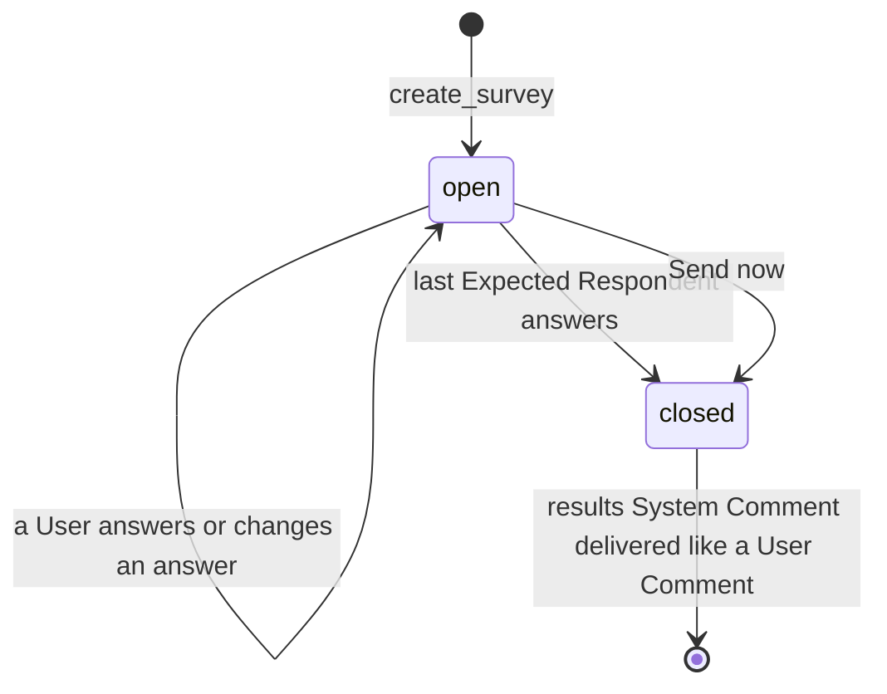
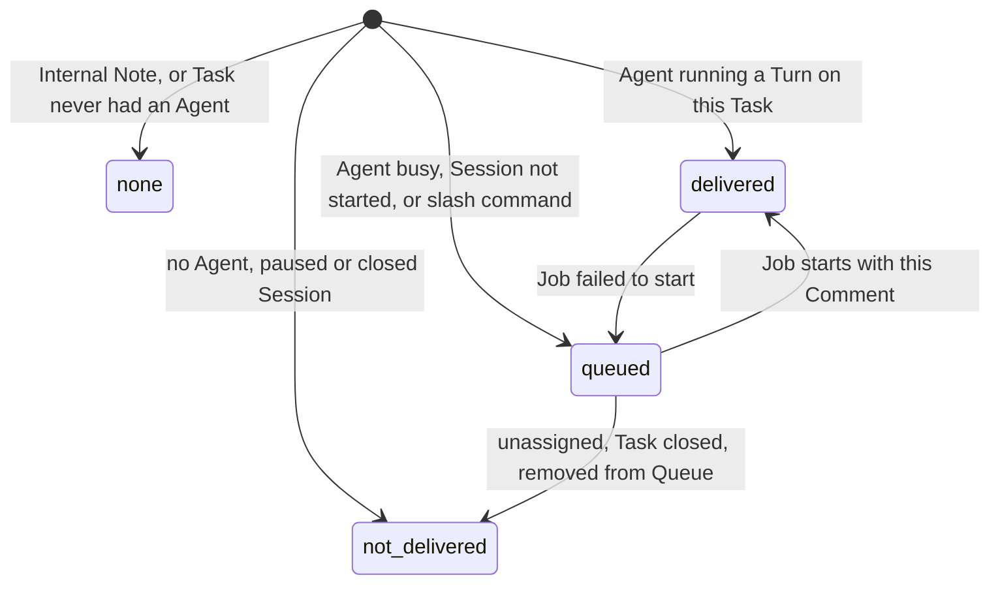
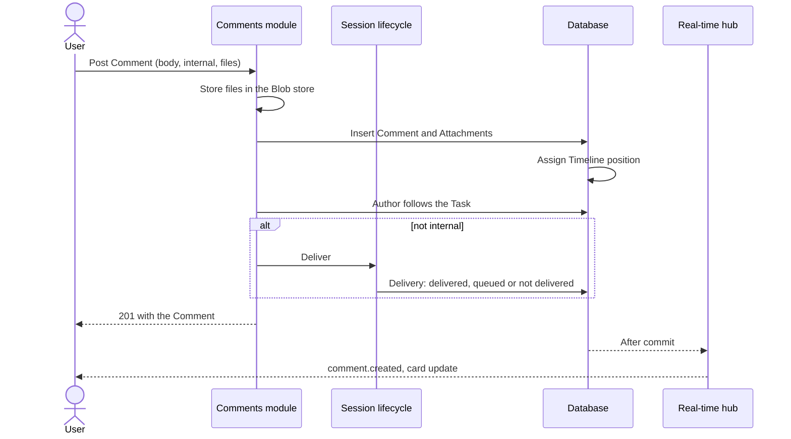

# Conversation

The conversation is the human side of a Task's Timeline: the Comments Users write to each other and to the Agent, the Internal Notes they keep among themselves, the files they attach, the indicators that tell them whether the Agent has received each Comment, and the notifications that bring them back to a Task when something happens. It exists because Comments are the only channel between people and Agents: everything a User wants an Agent to know arrives as a Comment, and everything the Agent says comes back as one. How a Comment travels to the Agent (Queue, Jobs, Turns, injection into a running Turn) is described in [Agent sessions](agent-sessions.md); this spec covers what Users write, see and receive.

## Concepts

- A **Comment** is an entry in a Task's conversation. Every Comment has a kind:
  - `user`: written by a User through the app, as a Comment or as an Internal Note.
  - `agent`: an **Agent Comment**, written by an Agent during a Turn. Its text is projected from the Agent's stream; files, Questions and Surveys are posted through the Task Tools (see [Agent sessions](agent-sessions.md)).
  - `system`: a **System Comment** written by the platform, such as errors, resumes after a restart, and the notice that a User notified the Agent of Task changes.
- An **Internal Note** is a User Comment flagged as internal when it is posted. It is shown to every User and delivered to no Agent.
- An **Attachment** is a file a User uploads or an Agent posts. A Comment carries up to 10 of them. Files uploaded from the Task description editor are Attachments of the Task itself rather than of a Comment.
- A **Message** is what the Agent receives: one or more Comments merged together, or a system notice. Users write Comments; the platform turns them into Messages.
- **Delivery** is the state of a User Comment towards the Agent: queued, delivered, handled (the Turn that received it has ended), or not delivered with a reason.
- A **Scheduled Message** is a Comment a User writes ahead of time for a chosen date and time. It stays off the Timeline until it is due, then is published as an ordinary Comment.
- A **Limit Resume** is a Scheduled Message the platform creates when a Turn stops at a usage limit that reports its reset time (see [Agent sessions](agent-sessions.md#usage-limits-and-limit-resume)).
- A **Question** is an Agent Comment asking Users to choose among options. The first User who answers closes it, and the answer reaches the Agent as a Message.
- A **Survey** is an Agent Comment collecting answers from several Users. Its **Expected Respondents** are the Task's Assignees when it was created. It reaches the Agent as one Message once they have all answered, or earlier when a User closes it.
- A **Notify agent** notice is a System Comment that carries, for the Agent only, the list of Task changes Users made since the Agent last read its Task.
- A **Task Preference** is one User's private state on one Task: whether they follow it, whether they muted it, and how far they have read its Timeline.
- A **Notification Event** is a moment worth alerting someone about: a completed Turn, a failed Turn, a Job that needs intervention, a User mention or a Schedule failure.
- An **Alert** is the phone notification for a Notification Event: the Task it is about, who it is from and an excerpt of what happened. The Alerts of one Task stack like the messages of one chat.

Comments, Revisions and the Agent's work items together form the Task's Timeline (see [Agent sessions](agent-sessions.md) for the Agent's items and [Board](board.md) for Revisions). A Wiki has several shared conversations, its Chats, each a Task of its Wiki Project; every Chat follows every rule in this spec (see [Wikis](wikis.md)).

## Behaviour

### Posting a Comment

Every signed-in User, Admin or Member, can comment on any Task. A Comment has a Markdown body of up to 100,000 characters and up to 10 Attachments. A Comment needs a non-blank body or at least one Attachment; an empty one is answered with `400`. A Comment on a Task that does not exist is answered with `404`.

A Comment is sent as plain JSON, or as a multipart form when it carries files: the form carries the body, the internal flag and the files. When any file is rejected, nothing is created: the Comment is discarded and every file already stored for it is removed.

Once the Comment is stored:

- the author starts following the Task (see [Following](#following-and-muting));
- a non-internal Comment is handed to the Agent's delivery (see [Delivery](#delivery-to-the-agent));
- everyone viewing the Task receives it live, and the Task's card shows the new Comment count.

The card's Comment count includes every Comment that is not deleted, of every kind, Internal Notes included.

In the web app the composer submits with Enter and inserts a new line with Shift+Enter. Files can be dropped onto the composer, pasted, or picked with the Attach button; pasted images without a meaningful name are renamed `pasted-<time>-<n>`. The composer checks the size and count limits before sending. While a Comment is being sent, text typed after it stays in the composer. Unsent drafts are kept per Task until the page is reloaded or the User logs out. The Flutter app keeps drafts across restarts and offline (see [Clients](clients.md)).

A User Comment whose body starts with a slash command offered for the Agent (for example `/compact` or a Skill) is a Session command: the composer suggests the available commands while typing, and the command runs between Turns. Its handling belongs to [Agent sessions](agent-sessions.md).

### Internal Notes

A User marks a Comment as an Internal Note before posting it. The flag is fixed for the Comment's lifetime: an edit changes only the body, and an edit request carrying the flag is answered with `400`.

Internal Notes stay among Users everywhere the Agent could see them:

- they get no Delivery and never enter a Message;
- the first Message of a Session, which includes the conversation so far, leaves them out;
- the Agent's Task Tools return only non-internal Comments;
- the Runner can download only Attachments of non-internal Comments.

Internal Notes look distinct on every client: a dashed, slate-coloured box with a lock and an "Internal chat" label. While the composer is in internal mode it takes the same styling, shows "Internal chat: only people see this, never the agent", and hides the slash-command suggestions. Posting an Internal Note counts as participation for following.

### Mentioning Users

In both clients, typing `@` at the start of text or after whitespace opens a suggestion overlay above the composer. Suggestions contain active Users, matched by display name or email, and remain available in Internal Notes. Users choose a suggestion by pointer, touch, or Up and Down followed by Enter or Tab. Escape dismisses the current suggestions; typing again reopens them. Shift+Enter inserts a newline. An `@` inside an email address stays ordinary text.

Choosing a User inserts a Markdown link labelled with `@` and their display name, targeting the User's stable identifier. The web composer displays the label while editing; the native plain Markdown composer keeps the link syntax in the Draft. The posted Comment displays the mention as highlighted text. Users with the same display name are distinguished by their email in the suggestions. Renaming a User preserves the recipient identity and the original label in existing Comments.

Posting a User Comment or Internal Note with selected mentions plans a `comment.mentioned` notification for each mentioned active User other than the author. Each recipient receives at most one alert per phone for that Comment, including when mentioned several times. Receipt is independent of following, including an explicit unfollow, and respects mute. The remaining device and Login eligibility rules below apply. Text mentions, email addresses, code, images and escaped Markdown links stay ordinary content. Saving an edit preserves the notification history; another alert requires a new Comment. Agent and System Comments follow their existing lifecycle notification rules.

### Editing a Comment

Editing applies to User Comments, and only their author can edit them; Admins edit their own Comments like everyone else. The new body must contain non-blank text and is at most 100,000 characters. Saving an unchanged body changes nothing; any other edit sets the "edited" time, which clients show next to the Comment, and is broadcast live. Editing a deleted Comment answers `404`.

An edit changes what Users see. A Comment still queued reaches the Agent in its edited form, because the Message is built when the Job starts. A Comment already delivered stays as the Agent received it; to correct it, the User posts a new Comment.

### Deleting a Comment

A Comment can be deleted by the author of a User Comment and by Admins, who can delete any Comment, Agent and System Comments included. Clients ask for confirmation first.

Deletion is soft: the Comment stays on the Timeline as a tombstone ("Mia deleted a comment", with the time), its body is cleared and its Attachments are removed, both their records and their stored files. Downloading an Attachment of a deleted Comment answers `404`. Deleting an already deleted Comment succeeds without changes.

A queued Comment that is deleted is withdrawn from the pending Message. When its Queue Entry is left with nothing to deliver, the entry is dropped so no Job starts for it; an entry that resumes an interrupted Turn stays. A Comment already delivered remains in the Agent's Session.

### Attachments

Attachment limits:

- up to 25 MB per file; a larger file is answered with `413` (`file_too_large`);
- up to 10 files per Comment; more are answered with `413` (`too_many_files`);
- up to 100 description files per Task (see below); more are answered with `400`.

File names are cleaned on upload: any directory part is dropped, control characters are removed, the name is trimmed and cut to 255 characters, and an empty name or one made only of dots becomes `file`. The content type is the one the client declared, or `application/octet-stream` when none was given.

Downloading an Attachment requires a signed-in User. PNG, JPEG, GIF, WebP and AVIF images are served inline so clients preview them in the conversation; asking for a download, or any other type (SVG included), serves the file as an `application/octet-stream` download under its original name. Every download carries `nosniff`, a sandboxing content security policy and a private cache lifetime of one hour.

**Description files.** The Task description editor uploads files as Attachments of the Task, and links them from the description text by URL. The Agent receives them with the description. A description file that the current description no longer links and that is older than 24 hours is removed the next time someone uploads a description file to that Task. Description files are kept by Reset Chat and removed with the Task. Editing the description itself is covered in [Board](board.md).

**The Task's attachment list.** `GET /tasks/:taskId/attachments` returns every Attachment of the Task, newest first: the description files and the files of every Comment, by Users and Agents alike. Files of a deleted Comment are not listed. Each entry adds to the usual Attachment fields its upload time (`createdAt`) and the Comment's author (`null` for a description file). Both clients show the list under the description, as a compact row per file with an image preview where available, its name, size, uploader (or "Description") and time, opening an image or downloading the others.

**What the Agent receives.** Image Attachments travel to the Agent as images, within a per-Message size and count budget, and every other file is saved in its Worktree with its path listed under the Comment. The rules are in [Agent sessions](agent-sessions.md).

### Files from the Agent

An Agent posts files from its Agent Container with the `send_files` Task Tool: up to 10 files of up to 25 MB each, with an optional Markdown caption. They form one Agent Comment whose body is the caption, placed on the Timeline at the moment of the call, between the text the Agent wrote before and after it. The files are Attachments like any other: images preview inline, other files download, and Admins can delete the Comment. How the files leave the container is described in [Agent sessions](agent-sessions.md) and [Runner](runner.md).

### Questions

An Agent asks a Question with the `ask_question` Task Tool, then ends its Turn. A Question holds 1 to 4 items, answered together. Each item has:

- a header of up to 12 characters, shown as a label;
- the question, in Markdown, up to 2,000 characters;
- 2 to 4 options, each with a label of up to 60 characters (unique within the item) and a description of up to 300 characters;
- whether it accepts one option or several.

Every item also offers "Other", a free text of up to 2,000 characters added by the clients. A single-choice item is answered with one option or with "Other"; a multiple-choice item with at least one option, "Other", or both. A Question can carry up to 10 files posted by the Agent, shown with it (for example mockups to choose from).

The Question Comment's body is a Markdown version of its items, generated by the platform. Clients that know Questions show an interactive card in its place; older clients show the text, and Agents that join the Task later read it in the conversation.

Answering:

- Any signed-in User can answer an open Question, once for the whole Question. The first answer closes it: a later or concurrent answer is answered with `409` and the name of who answered, and the card shows that answer.
- The answer is fixed once sent: the answer Comment can be deleted like any Comment, and editing it is answered with `403`. A User who changes their mind posts a Comment.
- The answer is posted as a User Comment by the answering User, linked to the Question. Its body is what the Agent receives: "Answer to your question from ‹time›:", then each item's header and question followed by the chosen options and the "Other" text. It follows every rule of a User Comment: the author starts following the Task and it gets a Delivery, so it reaches a newly assigned Agent too, and it is "not delivered" when the Task has no Agent or is closed.
- A Question stays open until someone answers it, whatever else is said in the conversation. Because the answer quotes the question and its time, the Agent can judge whether a late answer still matters.
- Answering a deleted Question answers `404`.

### Surveys

An Agent creates a Survey with the `create_survey` Task Tool when a User explicitly asks it to collect several people's answers. A Survey has the same items, files and generated body as a Question. Its Expected Respondents are the Task's User Assignees at the moment it is created; later assignment changes leave them as they are. A Task without Assignees gets a tool error that suggests asking people to assign themselves or asking a Question instead.

While a Survey is open:

- any signed-in User can answer it, Expected Respondent or not, and every answer counts in the results;
- each User has one answer, which they can change until the Survey closes;
- everyone sees the answers so far with names, how many Expected Respondents have answered and who is missing.

A Survey closes:

- by itself, in the same transaction as the answer that completes the set of Expected Respondents;
- when any signed-in User presses **Send now**, even with no answers yet.

Answering or closing a closed Survey answers `409`. A deactivated Expected Respondent stays expected, so such a Survey closes with Send now.

Closing posts a System Comment, "Survey closed: every expected respondent answered." or "*Name* closed the survey early.", that carries the results for the Agent and gets a Delivery like a User Comment. Unlike a Notify agent notice, delivering it leaves the Agent's last-read Task version as it is. The Agent receives, in one Message, each item's question, every option with its count and the names that chose it, the "Other" texts with names, the Expected Respondents who did not answer, and who closed the Survey.

### Delivery to the Agent

Every User Comment that is not an Internal Note gets a Delivery as soon as the Task has, or has had, an Agent Session. The state is shown on the Comment as a small badge, and changes live:

| State | Badge | Meaning |
| --- | --- | --- |
| queued | clock, "Queued" | Waiting in the Agent's Queue, either because the Agent is busy with another Task, the Session has not started, or a slash command waits for the Turn to end. |
| delivered | check, "Delivered" | Written to the Agent's running Turn, or included in the Message that started a Job. |
| not delivered | slashed circle, "Not delivered" | The Agent will never receive it. The reason appears on hover. |

Comments without a badge are Internal Notes, Agent Comments, System Comments other than Notify agent notices and Survey results, and Comments on a Task that never had an Agent.

The reasons for "not delivered" are:

- `no agent assigned`: the Task has no Agent, or its Agent's Session is paused;
- `task closed`: the Task is in a closed-category Status;
- `agent unassigned`: the Agent was unassigned or replaced while the Comment was queued;
- `removed from queue`: a User removed the Task's Queue Entry from the Agent's Queue;
- `comment deleted`: the Comment was withdrawn by deleting it.

When a Job fails to start, the Comments it carried go back to queued, at the front of the Agent's Queue, and wait for a User to press Retry or post another Comment.

The first User Comment on a Task with an assigned Agent is what starts the Agent's work; until then the Session stays pending. The full rules for injection into a running Turn, merging queued Comments into one Message, and the Session states shown next to the conversation are in [Agent sessions](agent-sessions.md).

### Scheduled Messages

Every signed-in User can schedule a Comment on any Task. In the composer a schedule control next to Send opens a date and time picker in the User's time zone. The Scheduled Message takes what the composer takes: a Markdown body of up to 100,000 characters, up to 10 Attachments, the Internal Note flag and Native Commands. It needs a body or an Attachment (`400` otherwise). The due time must be at least one minute and at most 366 days ahead (`400` with the allowed range otherwise).

A Scheduled Message is `pending`, `sent` or `cancelled`. While it is `pending`:

- it is listed on the Task, ordered by due time, with its author, text, files and due time, for every User with access to the Task, Internal Notes included (a Scheduled Message is shared, not a private Draft);
- any User can change its text and due time, cancel it or send it now. Its Internal Note flag and files are fixed, like a Comment's; a User who needs other files cancels it and schedules another;
- changing, cancelling or sending a message that is no longer `pending` is answered with `409`.

A cancelled message keeps its row with the reason (cancelled by a User, Task closed, Agent unassigned, replaced, or the Agent worked again) and loses its files. The list shows the pending messages and the 20 most recent finished ones, so Users can see what became of a message.

When a message is due, or a User sends it now, the platform publishes it in one transaction as a User Comment authored by whoever scheduled it, through the same path as a posted Comment: the author follows the Task, mentions are notified and the Comment gets its Delivery. The files move to the Comment and the message becomes `sent`, linked to it. The Comment is published in every case; a Task that is closed, or has no Agent, shows the usual "not delivered" reason on it. A message due while the backend was down is published when the background tick next runs. A message of a deleted Task disappears with it.

A Limit Resume is a Scheduled Message of its own kind: Users can change its due time, cancel it or send it now, but not its text. It is published as a System Comment whose notice, the text the Agent receives, tells it the usage limit was reset and to continue where it stopped; it is delivered like a Notify agent notice.

Creating, changing, cancelling and publishing a message publishes a `scheduled_message.updated` event with the whole message on the Task's topic.

### Notify agent

When Users edit a Task's title, description, priority or Tags after the Agent last read it, the Task view shows a banner offering **Notify agent**. Only edits made by Users to those four fields count; Status and User assignee changes leave the banner as it is. The banner is shown while the Session is idle or running.

Pressing Notify agent posts a System Comment, "*Name* notified the agent of task changes.", visible to every User. That Comment carries a Delivery like a User Comment (queued or delivered), and the Agent receives, in its place, a field-by-field list of the changes since it last read the Task: old and new values for title and priority, Tags added and removed, and a unified diff for the description, with any description files those changes link. Once the notice is delivered the banner disappears.

Notify agent answers `409` when:

- the Task has no Agent assigned;
- the Session is pending, paused or closed ("The agent has nothing to be notified about yet");
- the Agent has already seen every change.

How the Agent's read point moves is part of [Agent sessions](agent-sessions.md).

### Following and muting

Each User follows a Task or not, and can mute it, independently of other Users. Following decides who receives phone notifications for the Task.

A User starts following a Task automatically when they:

- create it;
- are added to its User assignees, at creation or later (assigning an Agent is a separate thing and follows nobody);
- post a Comment or an Internal Note on it.

A User can follow, unfollow, mute and unmute any Task explicitly. An explicit follow or unfollow choice is permanent: later automatic triggers leave it as it is. Mute is a separate switch that automatic following never changes, so a muted User who participates again stays muted. A User with no stored preference starts out not following the Task.

Preferences are stored on the server, so every installation of the same User shares them. A change is pushed live only to that User's own connections; other Users never see someone else's preferences.

### Read position and unread

The server gives every persisted Timeline entry of a Task (Comments of every kind, Revisions and the Agent's items) an increasing position at the moment it is stored. Positions follow commit order within a Task, so a reader who has seen position N never misses an entry that becomes visible later with a lower position.

Each User has a read position per Task:

- a client advances it by naming an entry of that Task; naming an entry of another Task answers `400`;
- it only moves forward: naming an older entry keeps the current position;
- fetching the Timeline or receiving live events leaves it unchanged;
- advancing it never makes the User follow the Task.

A Task is **unread** for a User when its latest entry position is greater than their read position. Timeline pages carry each entry's position so clients can mark progress precisely. A Task in a `closed` Status is never unread: closing it settles the conversation, and both `unread` and `unreadComments` answer false and 0 whatever the read position. Moving the Task back out of a `closed` Status restores the unread state computed from the unchanged read position. The Projects list aggregates it: a Project's `unreadTasks` counts its Tasks that are unread for the asking User, leaving out Tasks they muted and Tasks in a `closed` Status. A Wiki's read position, Draft and Internal Note flag belong to each Chat, which is a Task, (see [Wikis](wikis.md)).

The Flutter app advances the read position when the conversation is visible, the app is in the foreground and online, and the reader has reached the latest entry. The web app advances it whenever the Task's conversation is on screen and scrolled to the bottom, each time a newer entry arrives or the reader scrolls back down, and only while the browser tab is visible. Both clients report the newest entry they have loaded, so reading a Task on one client clears its unread state on the other.

Task Preferences include `unreadComments`, the count of Comments after the User's read position. It includes User, Agent and System Comments, Internal Notes and the User's own Comments. Deleted Comments contribute zero; Revisions and Agent Items affect the Task's unread state and contribute zero to this count. The count is computed on the server for the asking User, both for one Task and for every Task in a Project. Following and mute leave the Task's unread state and unread Comment count unchanged; a `closed` Status zeroes both.

The Board and native Task list show unread Tasks with a bold title and, when there are unread Comments, an orange glowing Comment icon and count (the count stays the total of Comments). Unread activity that isn't a Comment only bolds the title. Muted Tasks keep these indicators, while Tasks in a `closed` Status show none and keep only the plain total Comment count. New and deleted Comments refresh the count live; read-position changes reach the same User's other clients through their private topic. Reconnecting or subscribing to a Project refreshes its Task Preferences.

### Notifications

Notifications are Alerts on the User's phones, sent to Task followers for Agent outcomes and to mentioned Users for new User Comments. A Notification Event is recorded in the same transaction as the fact it reports:

| Event | When | Previewed Comment |
| --- | --- | --- |
| Turn completed | A Turn of the Task's Agent ends successfully. | The last Agent Comment of that Turn. |
| Turn failed | A Turn ends with an error. | The System Comment reporting the error, or else the last Agent Comment of that Turn. |
| Needs intervention | A Job fails (for example at Worktree, setup or start) without a failed Turn already reporting it. | The System Comment reporting the failure. |
| User mentioned | A User posts a Comment or Internal Note containing a selected User mention. | The mentioning Comment. |
| Scheduled run failed | A Scheduled Run ends as `Failed`. | None. |
| Schedule blocked | A Schedule is skipped for the third time in a row. | None. |

Each event is identified by the Turn, Job or Comment it reports, so the same fact is recorded once, and it records the Comment it previews. Streaming fragments and individual Agent Comments produce no event: an Agent outcome is alerted once per Turn, and an event's kind comes from the Turn and Job lifecycle, whatever the Agent wrote.

The recipients of an Agent outcome are the Users who, at that moment, follow the Task, have not muted it, are active, have no pending forced password change, and have a registered phone whose Login is still valid. One delivery is planned per recipient and phone. The push dispatcher looks for planned deliveries every 2 seconds and sends them straight away. Just before sending, every condition is checked again (a User who unfollowed, muted, was deactivated or whose Login expired in between receives nothing), and events older than 24 hours are dropped.

Mention recipients are determined from the stored User Comment in its posting transaction. Before dispatch, eligibility is checked again and only Comments still present on the Timeline qualify. Muting between posting and dispatch suppresses the alert. Mentioned Users keep their existing following preference.

The two Schedule events go to the creator of the Schedule only, whether or not they follow the Task (see [Schedules](schedules.md)). They are sent whatever the Status of the run's Task.

Agent outcome and mention Alerts are sent for Tasks in an open Status. Planned deliveries for them are discarded at dispatch time while the Task is in a `closed` Status, so closing a Task with alerts still pending suppresses them. Moving it back out of a `closed` Status before dispatch makes an unexpired alert eligible again, exactly as the other checks re-evaluate the Task's current state.

#### Alert content

The dispatcher builds each Alert when it sends it, from the current Task, Agent, User and Comment, so a renamed Task shows its new title. An Alert has a title, a sender and a text:

- **Title**: the Task Key and title, such as `API-42 · Fix login redirect`. For a Wiki's Chat, the Wiki's name and the Chat's title as the Chat list shows it. A blocked Schedule, which reports no Task, is titled with the Schedule's name.
- **Sender and text**, by event:

| Event | Sender | Text |
| --- | --- | --- |
| Turn completed | The Agent | The excerpt, or "finished its turn." when the Turn wrote no Agent Comment |
| Turn failed | The Agent | "turn failed: " followed by the excerpt, or "turn failed" |
| Needs intervention | The Agent | "needs your attention: " followed by the excerpt, or "needs your attention" |
| User mentioned | The Comment's author | The excerpt |
| Scheduled run failed | None | `Schedule "<name>": run failed` |
| Schedule blocked | None | `Schedule "<name>": keeps being skipped` |

The **excerpt** is the previewed Comment as plain text: Markdown emphasis and headings are removed, links keep their text, mentions read `@Name`, code blocks and images are left out, and whitespace collapses to single spaces. It is cut at 200 characters on a word boundary and ends with "…" when cut. A Comment with Attachments adds "📎 3 files" (or "📎 1 file") after its text, and a Comment with Attachments only shows just that; file names and contents stay out of the Alert. A previewed Comment deleted before dispatch leaves the text without its excerpt.

The Alert also carries the Task's id, so the app opens its conversation after sign-in; for a Wiki's Task the app opens the Wiki's Chat that the Task holds. How phones stack, show and remove Alerts, device registration, the push provider, retries and the unconfigured state are described in [Clients](clients.md).

## Architecture

- The **Comments module** owns Comments and Attachments: posting, editing, soft deletion, uploads and downloads, and the merged Timeline read. It hands every new non-internal User Comment to the Session lifecycle, which decides between delivering it to the running Job and queueing it (see [Agent sessions](agent-sessions.md)), and it publishes Comment events on the Task's real-time topic after the transaction commits.
- The **Blob store** keeps the bytes of every Attachment behind a small interface: store a stream with its name and type and get an id and size back, read it by id, delete it. The implementation writes each blob as a file plus a metadata sidecar in the backend's data directory. Database records point to blob ids; blobs are deleted only after the transaction that removed their records commits, and blobs stored for a request that fails are removed straight away.
- The **Notifications module** owns Task Preferences, read positions and phone registrations. The database assigns Timeline positions and records Agent outcome Notification Events. The Comments module records mention events and their planned recipients in the same transaction as the new Comment.
- The **push dispatcher** reads planned deliveries from the database every 2 seconds, builds each Alert's title, sender and text (the excerpt builder is a pure function shared by every event), and sends it through the push transport (see [Clients](clients.md)).
- **Scheduled Messages** have a module of their own next to Comments. The background tick that already starts due Schedules also publishes due Scheduled Messages, each in its own transaction that locks the Task and then the message (the order the Session lifecycle uses), so a send now racing the tick, a second backend or the closing of the Task publishes or cancels it once. The tick takes an injectable clock so tests can drive it.
- **The API** lists a Task's Scheduled Messages (`GET /tasks/:id/scheduled-messages`), creates one as JSON or multipart (`POST`, `201`), changes the text or due time (`PATCH /scheduled-messages/:id`), cancels it (`DELETE`) and sends it now (`POST /scheduled-messages/:id/send`). The offer to resume is answered with `POST /comments/:id/limit-resume` carrying `schedule: true` or `false`. A message that is not `pending` answers `409` to every change.
- **Real-time:** Comment created, updated and deleted events go to the Task topic; answering a Question and answering or closing a Survey publish the updated Comment, with its structured part, as an update event; the refreshed card goes to the Project topic; preference changes go to the User's private topic. Transport and reconnection are described in [Clients](clients.md).

## Data model

- **Comment**: Task, kind (`user`, `agent`, `system`), author Actor, Markdown body, internal flag, edited at, deleted at, created at. Delivery fields: state (`none`, `queued`, `delivered`, `handled`, `not_delivered`), reason, when the state last changed, the Job it was delivered in, the Queue Entry it waits in. Notify agent notices and Survey results also hold the text the Agent receives; Notify agent notices also hold the Task version they cover. Agent Comments hold the Job that produced them. An answer to a Question holds the Question it answers. Comments are soft-deleted and removed only with their Task (or by Delete Chat on a Wiki). 
- **Scheduled Message**: Task, kind (`user` or `limit_resume`), author User (none for a Limit Resume), Markdown body, internal flag, due time, state (`pending`, `sent`, `cancelled`), cancellation reason, the Comment it became, created at, updated at. Removed with its Task.
- **Limit Resume offer**: the structured part of the System Comment that reports a usage limit: reset time, state (`open`, `scheduled`, `declined`, `unneeded`), who decided and when, and the Limit Resume created. Removed with its Comment.
- **Attachment**: either a Comment, a Scheduled Message or a Task (exactly one), blob id, file name, content type, size in bytes, order within its Comment, created at.
- **Question or Survey**: its Comment, kind (`question`, `survey`), items, state (`open`, then `answered` for a Question or `closed` for a Survey), Expected Respondents (Survey), the answer, who answered and when, and the answer Comment (Question), who closed it and when, and the results Comment (Survey). Removed with its Comment.
- **Survey answer**: Survey, User, one answer per item (chosen option labels and the "Other" text), created and updated at. One per Survey and User.
- **Blob**: the stored bytes, identified by a random UUID, with file name, content type and size in a sidecar.
- **Task Preference**: User and Task, following, muted, whether following was set explicitly, read position.
- **Timeline position**: Task, entry id, position; one per persisted Timeline entry.
- **Notification Event**: id derived from the Turn, Job or Comment it reports, Task, Schedule (Schedule events), kind (`turn.completed`, `turn.failed`, `session.intervention`, `comment.mentioned`, `schedule.run_failed`, `schedule.blocked`), the previewed Comment, created at. The previewed Comment is a plain reference: a Comment removed later leaves the event in place.
- **Push delivery**: event, User, phone, attempts, next attempt time, finished time. Unique per event, User and phone.

## Non-functional requirements

- Attachments are capped at 25 MB per file and 10 per Comment; uploads stream to storage instead of being buffered in memory.
- Attachment downloads require a signed-in User; only raster image types render inline, and every response carries `nosniff` and a sandboxing content security policy, so an uploaded file never runs as a page of the app.
- An Internal Note never leaves the backend towards an Agent: no Message, no Task Tool result and no Runner download includes it or its files.
- Timeline positions follow commit order per Task, so unread state is exact across concurrent writers and independent of device clocks.
- A phone alert is sent at most once per event, User and phone: the delivery is marked done before the provider is called, so a crash after sending never repeats an alert. Unread state stays the authoritative signal when an alert is lost.
- Alerts carry Task titles and excerpts of Comments, so they show on the lock screen as the phone's settings allow; Attachment names and contents stay off the phone.
- Phone tokens are stored encrypted, looked up by hash, and kept out of logs.
- A User's preferences and read positions are visible only to that User.

## Decisions

- **A Scheduled Message is not a Comment until it is due.** Keeping it off the Timeline means nothing reaches the Agent, the Comment count or the unread state early, and an edit or cancellation never rewrites something the Agent already received. Publishing through the normal posting path means Delivery, following and mentions need no special cases.
- **Scheduled Messages are shared by every User with access to the Task.** A colleague must be able to cancel a plan, or an automatic resume, that no longer fits. The author stays the one who scheduled it.
- **A due message is always published, even when it cannot be delivered.** The Timeline then shows the Comment and why it did not reach the Agent, as for any Comment written to a closed Task, instead of a message that silently disappears.
- **Soft deletion of Comments.** The tombstone keeps the Timeline coherent: the Agent may have already received and answered the Comment, and Users see that something was there. The body and files are removed, which is what deletion is for.
- **The internal flag is fixed at posting time.** Turning a delivered Comment into a note cannot take it back from the Agent, and turning a note into a Comment would deliver it out of order. Users post a new Comment instead.
- **Only the author edits; Admins may also delete.** Editing someone else's words would misattribute them. Deleting is the moderation tool Admins need, for any kind of Comment.
- **Edits reach the Agent only while queued.** A delivered Comment is part of the Agent's Session and cannot be rewritten there; a correction is a new Comment, which the Agent sees in order.
- **Only raster images render inline.** SVG and other types can carry scripts; serving them as downloads with a sandboxing policy keeps uploaded content from running in the app's origin.
- **Attachment bytes behind a Blob store interface, on the local filesystem.** The app is self-hosted on one machine with a data volume; the interface keeps a move to object storage local to one component.
- **Description files are Task Attachments linked by URL.** The description stays plain Markdown that Users and the Agent can edit without breaking links, and unlinked uploads are pruned after a 24-hour grace period so drafts in progress keep their files.
- **Following and read positions live on the server.** Phone and desktop installations of one User share them, and push selection happens where the events are.
- **An explicit follow choice beats automatic following.** Users who unfollowed a noisy Task stay unfollowed when they comment again.
- **Questions and Surveys don't block the Agent.** The tool posts and the Agent ends its Turn; the answer is a Comment that travels through the Queue like any other. Holding the Turn open until a human answers (Claude Code's own `AskUserQuestion` through the stream-json permission protocol) would keep the Job, and with it the whole Agent, busy for hours.
- **A Question takes the first answer, and it is final.** Two answers would contradict each other in the Agent's Session, and a delivered answer cannot be taken back. Users who disagree say so in a Comment, which reaches the Agent in order.
- **Questions stay open until answered.** Closing them when the conversation moves on would need a rule about what counts as moving on; the answer quotes its question and time, so the Agent judges relevance itself.
- **The answer to a Question is a User Comment by the person who answered.** Delivery, following, unread state and reassignment then work without special cases, and the Timeline shows who decided.
- **Survey Expected Respondents are fixed at creation.** A moving target would make "everyone answered" unpredictable; Send now covers anyone missing.
- **Survey results reach the Agent as a System Comment with a notice, like Notify agent.** One Message with the whole picture, delivered through the normal Queue, and a Timeline entry that says why the Agent resumed.
- **Question and Survey bodies carry a Markdown version of the items.** Older clients and later Agents read them without knowing the structure.
- **Mention identity travels in Markdown links to stable User identifiers.** Both clients preserve mentions in Drafts and Comments with the existing Markdown contract, while names can change and duplicate names remain distinguishable. The backend parses Markdown to distinguish links from code, images and escaped text.
- **Mention alerts use the durable notification outbox and respect mute independently of following.** A direct mention can reach a User who has yet to participate while preserving their existing Task preferences. A Comment creates at most one event, and edits keep its notification history.
- **Agent outcome Notification Events are written by the database in the same transaction as the Turn or Job change.** An event exists exactly when its cause is committed, with no window where one is lost or invented. Events come from the Turn and Job lifecycle, never from reading the Agent's prose, so "intervention" means a Job that failed, which is reliable.
- **Unread comes from server-assigned positions, not timestamps.** Timestamps can tie and device clocks drift; a commit-ordered position per Task makes "read up to here" exact.
- **Alerts read like chat messages, with the Task and an excerpt.** A fixed generic text would make a finished Turn, a failure and a blocked Job look the same, and Users would have to open the app to learn which Task it is about. The title, sender and excerpt answer that from the notification. The Agent's text and Comments reach the lock screen, as in the chat apps the team already uses; phones offer their own setting to hide notification content on a locked screen, and that choice stays with each person. Excerpts are cut short and leave Attachments out, so a notification never carries a whole document.
- **Alert content is built at dispatch time from a recorded Comment reference.** The event stays a small, transactional record of a fact, while the title and excerpt reflect the Task as it is when the phone is alerted, and a Comment deleted in the meantime is never shown.
- **Alerts go out without a delay or an unread check.** The dispatcher sends within about 2 seconds of the event, so an Alert arrives while it is still news; holding it back to see whether the User reads the Task elsewhere was considered and rejected as a slower experience for every Alert.
- **Task badges count Comments separately from unread Timeline activity.** The number represents the conversation waiting to be read, while the existing unread state also covers Revisions and Agent Items. Mute controls alerts; Task indicators continue to show unread activity so Users can find it when they return.

## Related specs

- [Agent sessions](agent-sessions.md): how Comments become Messages, the Queue, injection into a running Turn, Session commands, Notify agent's effect on the Agent's read point, and the Agent's Timeline items.
- [Board](board.md): Tasks, Revisions and the description editor.
- [Wikis](wikis.md): a Wiki's Chats and Delete Chat.
- [Clients](clients.md): composer and Timeline UI, drafts, offline cache, real-time transport, phone registration and push delivery.
- [Users and authentication](users-and-auth.md): who is a signed-in User, roles, Logins.
- [Runner](runner.md): how attached files are fetched into the Worktree and how an Agent's files are uploaded.

- [Voice Rooms](voice-rooms.md): Voice Rooms provide live audio between Users alongside the text Conversation.
