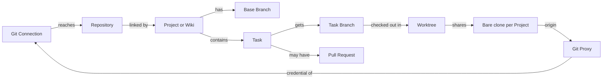
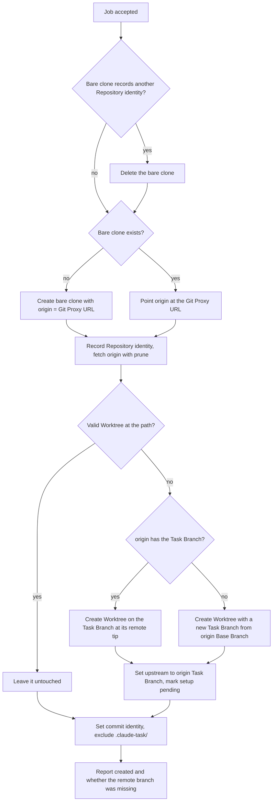
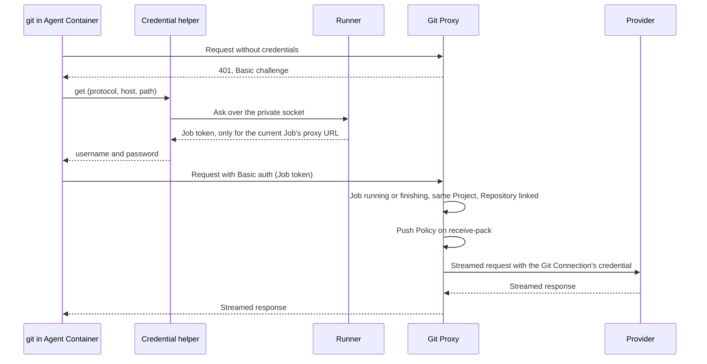
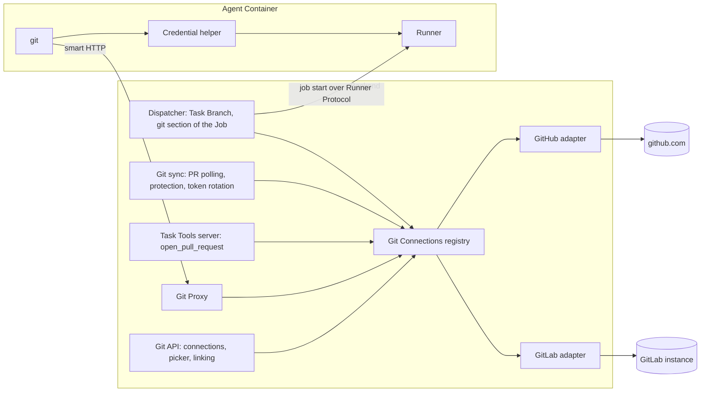

# Git integration

Git integration ties every Project to one code Repository on GitHub or GitLab and lets Agents work on it like a developer would: each Task gets its own Task Branch and Worktree, the Agent commits and pushes with plain git, and hands the work back as a Pull Request. Admins configure **Git Connections** to the code hosts; members link a Project's Repository through one of them. Agents reach git only through the backend's **Git Proxy**, which admits the active Job's Repository, accepts pushes to the Task Branch alone, and talks to the provider with a credential that stays in the backend. The area exists so Agents can run with full permissions inside their container while the Repository, its Base Branch and the provider credentials stay safe.

## Concepts

- A **Git Connection** is a configured access to one code host: a GitHub App (App ID and private key) on github.com, or a GitLab instance (URL and access token), gitlab.com or self-managed. There can be any number of them, of either provider. Each has a display name, a provider and a secret.
- An **environment connection** is a Git Connection defined by the backend's environment instead of the admin UI. There is at most one per provider, with the fixed ids `env-github` and `env-gitlab`.
- A **Repository** is the code repository linked to a Project (or a Wiki), reached through exactly one Git Connection. Its identity is the pair (Git Connection, provider's numeric repository id), so renames and moves on the provider keep working. Several Projects may link the same Repository.
- The **Base Branch** is the branch Task Branches start from and Pull Requests target. It defaults to the Repository's default branch.
- A **Task Branch** is the branch dedicated to one Task, named after its Task Key and title and fixed once chosen.
- A **Worktree** is the checkout of the Task's Task Branch inside the Agent Volume. All Worktrees of a Project in one Agent Volume share one **bare clone** of the Repository.
- The **Git Proxy** is the backend endpoint every Agent Container uses as its git remote. It authenticates the Agent with its **Job token** and forwards git traffic to the provider with the Git Connection's credential.
- The **Push Policy** is the Git Proxy's rule on pushes: an Agent can create and update its own Task Branch, force pushes included; every other ref update is rejected.
- A **Pull Request** is a request to merge a Task Branch into the Base Branch. On GitLab it is a merge request, shown as `!N`; on GitHub it is shown as `#N`. Its state (open, draft, merged, closed) is independent of the Task's Status.
- **Base Branch Protection** is the provider-side rule set that keeps the Git Connection's credential from pushing directly to the Base Branch. The platform shows it for information; the Push Policy is the guard.
- The **provider** of a Git Connection is its kind: GitHub or GitLab. Each provider is an adapter behind one common interface, so the rest of the system treats Repositories, branches and Pull Requests the same way whatever the host.

## Behaviour

### Managing Git Connections

Git Connections are managed by Admins on the **Git** page of the sidebar. Members see the Git Connections only through the repository picker.

The page lists every connection, environment ones first, then stored ones by creation time. Each card shows:

- the provider, the name and the host (`github.com` for GitHub, the GitLab instance's host otherwise);
- the GitHub App ID, or the last 4 characters of the GitLab token;
- the GitLab token's expiry date, when it has one;
- who the connection works as: the GitHub accounts where the App is installed (each a link), or the GitLab user the token belongs to;
- the number of Projects and Wikis linking its Repositories;
- its health (see below);
- for environment connections, an "Environment · read-only" badge in place of the edit and delete actions.

Health is checked live with the provider every time the list is loaded:

| Health | When |
| --- | --- |
| ok | The credential works. A stored GitLab token expiring soon is still ok while its automatic rotation hasn't failed. |
| error | The credential check failed. The card shows the provider's sanitized reason. |
| expiring | A GitLab token expires within 14 days and won't be rotated automatically: it is set through the environment ("renew GITLAB_TOKEN"), or its last rotation failed (with the failure reason). |

#### Creating a connection

The "Add connection" dialog asks for the provider and a name (1 to 80 characters), then:

- **GitHub App**: the numeric App ID and the App's private key in PEM format. The key must be an RSA private key.
- **GitLab**: the instance URL (default `https://gitlab.com`) and a token.

The credential is checked with the provider before anything is stored, and a failed check answers `400` with a specific message:

- GitHub: the App must be able to authenticate and list its installations. An App with no installations is accepted and shows "Installations: none".
- GitLab: the URL must answer like a GitLab instance; the token must be active and unrevoked and carry both the `api` and `write_repository` scopes. The messages name the problem: the token is invalid, expired or revoked; the token needs the missing scope(s); the URL doesn't answer like a GitLab instance; GitLab could not be reached.

The GitLab URL is normalized before use: it must be `https` (plain `http` is accepted when the backend runs with `GITLAB_ALLOW_HTTP`, for local development), it carries no credentials, query or fragment, and trailing slashes are removed. A path prefix is kept, so instances served under a subpath work.

Personal, group and project access tokens all work as GitLab tokens, because the platform never mints tokens of its own. The recommended setup is a GitLab service account (no license seat, available on every tier) with at least Developer on the groups or projects to link, and a personal access token with `api` and `write_repository`.

The GitHub App needs these repository permissions: Contents read/write, Pull requests read/write, Metadata read. Administration read is optional: it lets the platform read Base Branch Protection, and without it that status shows as unknown. The App needs no webhooks.

#### Editing, rotating and deleting

An Admin can rename a stored connection and replace its secret ("Edit / rotate"). An omitted secret keeps the current one; a GitHub connection can also change its App ID. A new credential is checked exactly as on creation, and saving it clears any rotation failure. Linked Projects keep working without being re-linked.

A connection's provider and GitLab URL are fixed once it exists: to move to another host, an Admin creates a new connection and re-links the Projects. A GitHub connection accepts only an App ID and private key, a GitLab one only a token; mixing them answers `400`.

A stored connection can be deleted while no Project or Wiki links one of its Repositories. Otherwise the delete answers `409` ("Projects still link repositories of this connection. Link them elsewhere first.") and the UI disables the button with the same explanation. Deleting and linking are serialized per connection, so a Repository can never be linked to a connection that is being deleted.

Environment connections are read-only: editing or deleting one answers `409`.

#### Environment connections

- `GITHUB_APP_ID` and `GITHUB_APP_PRIVATE_KEY` define `env-github`, named "GitHub". Escaped `\n` sequences in the key are turned into newlines.
- `GITLAB_TOKEN`, with `GITLAB_URL` (default `https://gitlab.com`), defines `env-gitlab`, named "GitLab".

They are listed like stored connections, are never written to the database and are never rotated.

#### GitLab token rotation

Stored GitLab tokens are rotated automatically before they expire. A background check runs at backend start and then every 5 minutes, together with Pull Request polling. For each stored GitLab connection whose token expires within 14 days it:

1. takes a per-connection database lock and re-reads the stored token under it;
2. asks GitLab to rotate the token with a new expiry 90 days ahead;
3. when the instance refuses that expiry (it caps token lifetimes), rotates again without one, taking the instance's default lifetime;
4. stores the new token encrypted, with its last 4 characters and its expiry.

A failed rotation is stored on the connection and shown to Admins as the "expiring" health; it is retried one hour after the failure. Admin edits take the same lock, so a rotation in flight never overwrites a token an Admin has just saved.

The lock and the re-read matter because GitLab revokes the whole token family when an already-rotated token is rotated again. GitLab token expiry is a date; the platform treats the token as expiring at the start of that day, UTC.

### Linking a Repository

Any User can link a Project's Repository from **Project settings → Repository**. Wikis link theirs when they are created (see [Wikis](wikis.md)), through the same checks.

The repository picker lists the Repositories of every Git Connection, grouped by connection and labelled with provider, connection name and host. Each entry shows `owner/name` (the GitLab namespace may be a nested group path) and "(private)" for non-public ones. A search field filters by owner, group or name. A connection that can't list its Repositories appears in an "Unavailable connections" list with its reason, and the other groups still show. With no Git Connection at all, the tab explains that an Admin must add one first.

Which Repositories a connection lists:

- GitHub: every Repository of every non-suspended installation of the App, sorted by owner and name.
- GitLab: every non-archived project where the token's user has at least Developer access, across all pages, sorted by namespace and name. A project without a default branch reports `main`.

Choosing a Repository fills the Base Branch with its default branch, which the User can change (up to 250 characters). On save the backend:

1. checks the connection still exists and that the Repository is among those it can access;
2. reads the Repository from the provider and checks its identity still matches;
3. checks that the Base Branch exists on the provider (`400` with the branch name otherwise);
4. checks Base Branch Protection;
5. stores the Repository on the Project and broadcasts the change.

Changing the Repository, to another one of the same connection or to another connection or provider, is accepted while every Session in the Project is closed. Paused and pending Sessions count as open, because a Session must resume against the same code; the request answers `409` ("Unassigning only pauses sessions. Close every non-closed session before changing the repository.") and the UI disables the picker with an explanation. The Base Branch alone can be changed at any time.

When the Repository changes, every Task in the Project loses its Pull Request link and its branch link, because both belong to the old Repository. Task Branch names stay: the next Job of each Task uses the same name in the new Repository.

### Base Branch Protection

The Repository settings show the provider's protection of the Base Branch as **Protected**, **Not protected** or **Unknown**, with the provider's explanation, when it was checked, a link to the provider's branch settings and a **Re-check protection** button. The copy states that pushes to the Base Branch are always blocked by the platform and that provider protection is an optional second line of defense. Nothing else in the app warns about it.

The check runs when a Repository is linked or its Base Branch saved, on demand from the button (any User), and again for every Project whose last check is older than 24 hours. A re-check whose Project changed Repository or Base Branch meanwhile is discarded.

How each provider decides:

- **GitHub**: the Base Branch is protected when an active ruleset applying to it requires pull requests and doesn't list the App as a bypass actor (a bypass limited to pull requests doesn't count), or when classic branch protection requires pull request reviews and doesn't allow the App to bypass them. A ruleset whose bypass list can't be read, or any refused request (typically missing Administration read), gives Unknown. Settings link: the Repository's rules settings page.
- **GitLab**: the protected-branch rules matching the Base Branch are collected, by exact name or wildcard. When several match, the most permissive applies, so the branch is protected only when every matching rule keeps the connection's user from pushing. A push entry allows the user when it names that user, when its access level is at most the user's role on the project (the higher of project and group access), or when it is the admin level and the user is an instance admin. Entries for "no one" and for deploy keys block; entries naming other users block. Entries for groups can't be evaluated and give Unknown. No matching rule means Not protected. A refused request gives Unknown. Settings link: the project's repository settings, protected branches section.

With a GitLab service account holding Developer, GitLab's default protection ("Maintainers can push") already shows as Protected.

### Task Branch

A Task gets its Task Branch when its first Job is dispatched in a Project with a Repository. The name is `task/<task key in lowercase>-<slug>`, for example `task/api-42-fix-login-redirect`. The slug is the title transliterated to ASCII, lowercased, with every run of other characters turned into one `-`, trimmed of leading and trailing dashes and cut to 40 characters (with any trailing dash removed again). A title that yields an empty slug gives `task/<key>`.

At dispatch the backend asks the provider whether the Task Branch already exists on the Repository, then stores the name and the branch's web link on the Task. From then on the name is fixed: renaming the Task, reassigning it to another Agent, or changing the Repository keeps it. The link is refreshed on every dispatch.

When the provider lookup fails (an outage, a broken connection), that Task's Queue Entry is held and a System Comment explains: "The agent couldn't start: checking the task branch on the git provider failed", with the reason and a hint to press Retry or post a Comment. The rest of the Agent's Queue goes on.

Branch web links:

- GitHub: the branch's tree page on github.com.
- GitLab: the project's `-/tree/<branch>` page under the connection's URL.

The Agent learns its Task Branch from its first Message and its system prompt, which also tell it to push only that branch, and to commit, push and open or update the Pull Request before moving the Task to a review Status.

### Worktrees in the Agent Volume

Each Agent Volume holds, under the Agent's home:

- one bare clone per Project: `repos/<project id>.git`;
- one Worktree per Task: `worktrees/<project id>/<Task Key>`.

Paths are deterministic per (Project, Task), because resuming a Claude Code Session needs the same working directory. The Worktree path is stored on the Session when it is created. A Project without a Repository gets a plain directory at the same path, with no git.

Each Job that has a Repository carries a git section: the Git Proxy URL of the Project, the Job token, the Repository identity (`<connection id>/<provider repository id>`), the Base Branch, the Task Branch, whether the Task Branch exists remotely (a hint), the bare clone path and the commit identity. The Runner prepares the Worktree right after accepting the Job, so the Job is already active for the Git Proxy:

Rules of the preparation:

- An existing valid Worktree is the Agent's working state, possibly with uncommitted changes from an earlier Turn, and is left as it is.
- A missing Worktree is recreated from the remote: the remote Task Branch wins over any stale local branch of the same name. Work that was committed but never pushed before the Worktree was removed is therefore gone; Agents push before a Task is closed.
- A directory at the Worktree path that isn't a valid Worktree is a leftover and is removed first.
- The upstream of the Task Branch is `origin/<Task Branch>` even before it exists remotely, so a plain `git push` works.
- The commit identity is `<Agent name> (claude-task)` with the email `<Agent name slug>@<AGENT_COMMIT_EMAIL_DOMAIN>` (default domain `agents.claude-task.local`; the slug is at most 64 characters, `agent` when empty). These emails match no provider account, so Agent commits show the Agent's name with no avatar.
- `.claude-task/` (attachments and platform markers) is excluded from git in the bare clone.
- The Git Proxy URL is the same for whatever Repository a Project links, so the bare clone records the Repository identity. A bare clone recording a different identity (the Project changed Repository) is discarded and cloned again; a bare clone without a recorded identity is adopted, with its Worktrees kept.
- Every git command and its output appear in the Job's setup output. Each command times out after 30 minutes and never prompts on a terminal.
- A new Worktree triggers the Project's Setup Script (see [Agent sessions](agent-sessions.md)).
- When a Worktree is newly created for a Session that already ran, and the remote Task Branch is missing, the backend posts the System Comment "The previous remote task branch was not found. The worktree was recreated from the base branch."
- A failure fails the Job at the `worktree` stage, with a System Comment and a Retry (see [Agent sessions](agent-sessions.md)).

When a Task is closed or deleted, its Worktree is removed as soon as the Agent's Runner is connected: the Runner force-removes the Worktree, deletes the directory and prunes the bare clone's worktree list. Branches, local and remote, are kept. Reopening the Task recreates the Worktree at the same path from the remote Task Branch.

### Git Proxy

The Git Proxy serves git smart HTTP on the backend's main listener, outside the API prefix, at `<AGENT_BACKEND_URL>/git/<project id>.git`. It serves exactly three requests: the ref advertisement for `git-upload-pack` or `git-receive-pack`, a `git-upload-pack` POST (fetch) and a `git-receive-pack` POST (push). Anything else is answered directly:

| Request | Answer |
| --- | --- |
| A path that isn't `<project id>.git` | `404` "Repository not found" |
| A ref advertisement for another service (dumb HTTP) | `403` "Only smart HTTP git is supported" |
| A POST with a content type other than the service's git request type | `415` naming the expected type, connection closed |

#### Authentication

The proxy uses HTTP Basic: any username, the Job token as password. The request is admitted when the token belongs to a Job that is `running` or `finishing`, whose Task belongs to the Project in the URL, and that Project has a Repository. A Job whose output is being discarded (a Reset Chat waiting for its cancellation) is refused too.

- Missing or malformed credentials, or an unknown token, get `401` with a `Basic realm="claude-task"` challenge, so git asks the credential helper.
- A known token outside those conditions gets `403` with "no active task for this repository", which git prints.

The check runs once when a request starts: a fetch or push in flight completes even if the Job ends meanwhile. The Job token is invalid for the proxy as soon as its Job leaves `running` and `finishing`. Agents can fetch every ref of their Repository; the Push Policy governs pushes.

#### Push Policy

On a push, the proxy reads the ref-update commands at the start of the request (the packet lines up to the first flush, decompressed when the request is gzip-encoded) before contacting the provider. It accepts the push when every command updates `refs/heads/<Task Branch>` of the Job's Task to a non-zero object. Creating the Task Branch and force-pushing it are both accepted; push options pass through unchanged. Shallow-clone lines are skipped.

Everything else rejects the whole push: another branch, the Base Branch, a tag, a deletion, or any line that can't be read as a ref update (such as a push certificate). The proxy never contacts the provider for a rejected push. It reads and discards the pack git has sent, then answers with a regular push report (`unpack ok` and an `ng` line for every ref), wrapped in side-band when git asked for it, so git prints a readable rejection:

- `claude-task: only <Task Branch> can be pushed`
- `claude-task: this task has no branch yet`, for a Task without a Task Branch.

Limits on the command section: at most 64 KiB once decompressed, and it must appear within the first 1 MiB of the request. A request that breaks them, or that isn't valid packet lines, gets `400` "Malformed push request" and the connection is closed. When the policy passes, the bytes already read are replayed to the provider, followed by the rest of the stream.

#### Forwarding

The proxy resolves the Project's Repository, its Git Connection's provider and the provider's upstream for that Repository, then forwards the request:

- GitHub: the Repository's HTTPS clone URL with an installation token limited to that one Repository and Contents write. The token is cached in the backend until 5 minutes before it expires.
- GitLab: the URL built from the connection's own URL and the project's namespace and path, with the connection's token. The URL GitLab reports for cloning is ignored, so a misconfigured instance can't send the token over plain HTTP or to another host.

Only git-relevant headers pass: content type, accept, accept-encoding, content encoding, content length, git protocol (so protocol v2 works) and user agent on the way up; content type, cache control, content encoding, expires and pragma on the way back. The provider credential replaces the Agent's.

Bodies stream in both directions and are never buffered whole; the proxy routes bypass body parsing and body size limits. There is no overall timeout, only an idle timeout of 5 minutes without bytes on the provider connection. A client that disconnects aborts the provider request.

Failures, all as `502` with a plain message and no provider detail:

| Situation | Message |
| --- | --- |
| The Git Connection or its credential can't be resolved | "The Git Connection is not available; check its configuration" |
| The provider answers 401, 403 or 404 | "the Git Connection could not access this repository; check its configuration" |
| The provider answers any other non-success status, including redirects | "the Git provider failed" |
| The provider can't be reached | "the Git provider could not be reached" |

Every proxied request is logged with Agent, Job, Project, service, refs pushed, provider status, bytes in and out, duration and any error. Rejected pushes are logged with their refs. Headers, credentials and URLs with credentials are never logged.

Concurrency is bounded by the one-Job-per-Agent rule: the proxy serves at most one active Job per Agent, and that bound is its only rate limit.

### Credential helper

The Base Image configures git, system-wide and for every host, to use the platform's credential helper and to send the request path to it. The helper:

- answers `get` only; `store` and `erase` do nothing, so git never persists the token;
- refuses on its own, before asking the Runner, requests that can never match a Git Proxy URL: a protocol other than `http`/`https`, an empty host or path, control characters or backslashes, `.` or `..` path segments;
- asks the Runner over a Unix socket in the Agent's home, readable by the agent user only (mode 0600), with a 3-second connect timeout and a 40-second overall deadline;
- returns username `claude-task` and the Job token as password when the request matches the current Job's Git Proxy URL exactly: same scheme, same host and port (case-insensitive host), same path ignoring a leading slash and a trailing `.git`;
- otherwise fails with "no active task for this repository", or with "the task Runner is unavailable" when the socket can't be reached.

For any other host, the helper's refusal lets git fall back to its usual behaviour, so public repositories needing no authentication still work. The Runner answers locally from the Job it is running, with no backend round trip and no cache. The Runner's own internals are covered in [Runner](runner.md).

### `open_pull_request`

`open_pull_request` is the Task Tool an Agent calls to hand off its work. It takes a `title` (1 to 500 characters), a `body` in Markdown (up to 100,000 characters) and an optional `draft` flag (default false). Its description tells the Agent it opens a merge request on GitLab, that the branch must be committed and pushed first, and that it never changes the Task's Status. The other Task Tools are described in [Agent sessions](agent-sessions.md).

The call is accepted while the calling Job is `running` or `finishing` (`409` "The job is no longer active" otherwise) and the Task has a Repository and a Task Branch (`409` otherwise). Then:

1. The backend checks on the provider that the Task Branch exists. If it doesn't, the tool fails with "Push the branch `<Task Branch>` before opening a pull request."
2. The body gets a footer: a separator, then `Task: <Task Key>` linking to the Task in the web app (`<APP_URL>/t/<Task Key>`), and `Agent: <Agent name>`.
3. The provider looks for an **open** Pull Request from the Task Branch to the Base Branch:
   - found: its title and body are updated, and its draft state is kept as it is;
   - not found (none yet, or the previous one was closed or merged): a new one is created, as a draft when asked.
4. The Pull Request (provider, number, link, state, draft) is stored on the Task. When any of those changed, a Revision attributed to the Agent is recorded and the Board is updated.
5. A System Comment is posted: "Pull request [#N](link) opened." or "updated." on GitHub, "Merge request [!N](link) opened." or "updated." on GitLab. It says "updated" when the Task already pointed to that same Pull Request.
6. The tool returns the number, link, state and draft flag.

Provider specifics:

- GitHub: the open Pull Request is searched by head `<owner>:<Task Branch>` and base. A Pull Request reported as merged is `merged`; otherwise its state is `open` or `closed`.
- GitLab: drafts are expressed with the `Draft: ` title prefix. Draft markers the Agent puts at the start of its title (`Draft:`, `[Draft]`, `(Draft)`, `Draft `) are stripped first, and the prefix is added back when the request is a draft or, on update, when the existing merge request is one. States map as `opened` to open, `merged` to merged, `closed` and `locked` to closed.

### Pull Request state sync

The platform polls providers; it needs no webhooks, so the backend can stay unreachable from the internet.

- Every 5 minutes (and once at backend start) every Task whose Pull Request is open, drafts included, is refreshed from its provider.
- Opening a Task refreshes its Pull Request, whatever its state, when the last check is older than 1 minute. The Task loads after the refresh.

A refresh updates the stored Pull Request and, when it changed, records a Revision attributed to the system and broadcasts the Task change to the Board and the Task view. A refresh is discarded when the Project changed Repository meanwhile, when the Task now points to another Pull Request, or when a newer check or `open_pull_request` already updated it. A failing provider is logged and skipped; the Task keeps its last known state.

Pull Request state never changes a Task's Status or a Session: merging doesn't close the Task.

### What Users see

- **Task view**: a "Task code" section with the Task Branch name (linking to the branch page on the provider) and the Pull Request badge. The branch link appears once a Job has stored it; after a Repository change it returns with the next Job.
- **Board card**: the Pull Request badge, linking to the provider: `#N` or `!N` followed by `open`, `draft`, `merged` or `closed`, coloured green for open, muted for draft, violet for merged and red for closed. Its label says "Pull request" or "Merge request" by provider.
- **Timeline**: Pull Request changes appear as Revisions, such as "updated merge request !3 (merged)", next to the System Comments posted by `open_pull_request`.
- **Wikis** show the branch and Pull Request of their Task the same way.
- **Project settings → Repository**: the picker, the Base Branch, a link to the Repository on the provider, and the Base Branch Protection status.
- **Git page** (Admins): Git Connections as described above.

## Architecture

- **Git Connections registry**: lists environment and stored connections, decrypts secrets, and resolves the provider adapter for a connection id. Adapter instances are kept per connection and rebuilt whenever the connection changes, so their token caches survive between requests and reset on any edit. Every part of the backend that talks to a provider resolves it from the Project's Repository's connection.
- **Provider adapters** (GitHub, GitLab): the only place that knows a provider. Each one validates its credential, lists accessible Repositories, reads a Repository by id, checks whether a branch exists, builds branch links, checks Base Branch Protection, gives the Git Proxy its upstream, opens or updates Pull Requests and reads their state; the GitLab adapter also rotates its token. Provider requests time out after 15 seconds, refuse redirects, and report failures as short messages with the HTTP status, never the provider's response body or the credential.
- **GitHub adapter**: authenticates as the App with a short-lived signed JWT (valid 9 minutes), finds the installation for each Repository, and requests installation tokens limited to the one Repository and to the permissions each operation needs: Metadata read to list, Contents read to read and check branches, Pull requests write to open, Pull requests read to poll, Contents and Administration read for protection, Contents write for the Git Proxy. Tokens are cached per installation, Repository and permission set until 5 minutes before they expire. It talks to the github.com REST API.
- **GitLab adapter**: the REST API v4 under the connection's URL, with the token in the `PRIVATE-TOKEN` header. It follows GitLab's pagination and caches the token's user.
- **Git Proxy**: described above; it shares the backend's listener and database.
- **Dispatcher**: computes and stores the Task Branch, checks it remotely, and puts the git section into the Job start (see [Agent sessions](agent-sessions.md)).
- **Git sync**: a background loop every 5 minutes, also run at start. Each run rotates expiring GitLab tokens, refreshes open Pull Requests one by one, then re-checks Base Branch Protection older than 24 hours. Runs never overlap, and concurrent refreshes of the same Task share one provider call.
- **Runner and credential helper**: prepare bare clones and Worktrees, remove Worktrees on request, and serve the Job token to git (see [Runner](runner.md)).

The backend's public address `APP_URL` is used for Task links in Pull Request footers; the internal address `AGENT_BACKEND_URL` is what Agent Containers use for the Git Proxy.

### API

| Endpoint | Who | Purpose |
| --- | --- | --- |
| List, create, update, delete Git Connections | Admins | Connection management, with live health |
| List repositories | Any User | Repositories grouped by connection, with an error per failing connection |
| Read, set a Project's Repository | Any User | Repository and Base Branch, plus whether the Project has non-closed Sessions |
| Re-check protection | Any User | Refreshes Base Branch Protection |

The shared types package defines the payloads. Secrets are accepted on create and update and never returned.

## Data model

- **Git Connection**: id, provider (`github` or `gitlab`), name, provider configuration (GitHub: App ID; GitLab: base URL, token user name, token expiry), encrypted secret (private key or token), secret last 4 characters (GitLab tokens only), last rotation error, created and updated times. Environment connections have the same shape but live only in configuration.
- **Project Repository** (stored on the Project, also on a Wiki's Project): connection id, provider, provider repository id, owner (GitHub owner or GitLab namespace path), name, default branch, private flag, provider clone URL, web URL, Base Branch, and the last Base Branch Protection result (protected: yes, no or unknown; explanation; provider settings link; checked at).
- **Task**: Task Branch name (empty until the first dispatch with a Repository, then fixed), branch web link, and Pull Request (provider, number, link, state `open`/`merged`/`closed`, draft flag, checked at). Pull Request changes are recorded as Revisions.
- **Session**: its Worktree path, fixed at creation, and whether its Worktree is waiting to be removed.
- **Job**: a token, stored as a hash, that authenticates both the Task Tools and the Git Proxy.
- **Bare clone** (in the Agent Volume): records the Repository identity it was cloned from.

## Non-functional requirements

- **Credential isolation**: provider credentials (GitHub private keys and installation tokens, GitLab tokens) live only in the backend. The only git secret in an Agent Container is the Job token, valid while its Job is `running` or `finishing`, for its own Project only.
- **Secrets at rest**: connection secrets are encrypted with `SECRETS_MASTER_KEY`, write-only through the API (GitLab tokens show their last 4 characters), and absent from logs, API responses, raw Session events, error messages and the Agent Containers' environment.
- **Transport**: the Job token travels over `AGENT_BACKEND_URL`, the backend's internal address, the same way as the Task Tools token. Provider traffic is HTTPS, except GitLab instances explicitly allowed over HTTP for development.
- **Streaming**: the proxy holds at most the push command section (64 KiB decoded, 1 MiB raw) in memory; packs of any size stream through. Large first clones put their bytes on the backend host; later fetches are incremental.
- **Timeouts**: provider API calls 15 seconds; proxy idle 5 minutes; each Runner git command 30 minutes; credential helper 40 seconds.
- **Freshness**: Pull Request state on the Board is at most 5 minutes old for open Pull Requests and at most 1 minute old when a Task is opened. Base Branch Protection is at most 24 hours old.
- **Availability**: a broken Git Connection or provider outage affects only the Projects that use it: the picker still lists the other connections, polling skips it, and the Agent Queue continues with other Tasks.
- **Observability**: every proxied request is logged with Agent, Job, Project, service, refs, status, bytes and duration; rotations and their failures are logged per connection.

## Decisions

- **Agent git traffic goes through a backend Git Proxy instead of provider tokens in the container.** GitLab has nothing like GitHub's per-repository installation tokens: the closest option, a per-Job project access token, lives until midnight UTC of the next day at best, creates a bot user per token and needs Premium on gitlab.com, and every further provider would need its own scheme. With the proxy, the only secret in the container is the Job token, which dies with the Job, and a new provider needs only its API adapter. Alternatives rejected: provider-minted tokens per Job (lifetime longer than the Job, tier requirements, Base Branch protected only by the provider); a long-lived bot token in the container (works for every repository and outlives the Job); SSH (a key per Agent registered with every provider, and the backend could no longer inspect pushes). The cost is that all git traffic, large first clones included, flows through the backend.
- **The Job token is the proxy password.** It already lives in the Agent Container for the Task Tools and is invalid as soon as the Job leaves `running`/`finishing`, so using it for git adds no new secret.
- **The Push Policy guards the Base Branch; provider protection is informational.** Agents run with full permissions and no platform hooks, so nothing inside the container can stop a push. Checking ref updates in the proxy works the same on every provider and needs no provider configuration. Provider protection is still shown, as an optional second line of defense, with no warnings.
- **A rejected push gets a git push report, not an HTTP error.** git then prints a readable reason per ref and the Agent understands what to do, while the provider is never contacted.
- **Fetches are unrestricted within the Repository.** Agents read the whole Repository like a developer would; only writes need a policy.
- **Several Git Connections of either provider.** Teams keep code on github.com, gitlab.com and self-managed GitLab at the same time, and separate GitHub Apps may serve separate organizations. Each Repository names its connection, so Projects on different hosts sit side by side.
- **Provider and GitLab URL are fixed per connection.** Linked Repository identities are only meaningful on the host they came from; moving hosts means a new connection and re-linking.
- **Environment connections are read-only and never rotated.** Infrastructure-managed configuration stays the source of truth; Admins get an expiry warning from 14 days out instead.
- **Stored GitLab tokens rotate themselves, serialized per connection.** Tokens expire, and a missed renewal would stop every Agent on that host. GitLab revokes the whole token family when a revoked token is rotated, so each rotation holds a per-connection lock and re-reads the token under it; Admin edits take the same lock.
- **The GitLab upstream URL is built from the connection's URL.** GitLab's reported clone URL can point to plain HTTP or another host when the instance's external URL is misconfigured, and the token must only go to the configured host.
- **GitHub tokens are scoped per operation.** The token the proxy uses can write contents of one Repository only; Pull Request operations use separate tokens; all of them stay in the backend.
- **Polling instead of webhooks.** The backend needs no public address and no webhook secret per provider; a 5-minute delay is acceptable for Pull Request state.
- **Pull Request state is independent of Task Status.** Status never drives Agents, and merging doesn't mean the Task is done; humans decide.
- **Deterministic Worktree paths and a bare clone per Project.** `claude --resume` needs the same working directory, and Worktrees sharing one bare clone keep disk use and fetch time low for an Agent working on many Tasks of the same Project.
- **The Task Branch name is fixed once chosen.** Links, open Pull Requests and the Agent's own memory of the branch all depend on it, so renaming the Task keeps it.
- **The bare clone records its Repository identity.** The Git Proxy URL is the same whatever Repository a Project links, so the identity is what tells a reusable clone from one of another Repository, while clones from before the proxy are adopted without losing Worktrees.
- **Repository changes wait for every Session to close.** A paused Session resumes in its Worktree and would otherwise continue on code from another Repository.

## Related specs

- [Users and authentication](users-and-auth.md): Admin and Member roles behind connection management and linking.
- [Board](board.md): Projects, Tasks, Statuses, cards and Revisions that show branches and Pull Requests.
- [Conversation](conversation.md): System Comments posted for Pull Requests, branch problems and failures.
- [Agents](agents.md): Agent configuration, Credentials, the Base Image that installs the credential helper, and Agent Containers.
- [Agent sessions](agent-sessions.md): Sessions, Jobs, the Queue, Setup Scripts, the other Task Tools and Worktree removal on close.
- [Runner](runner.md): the Runner, its protocol and how it prepares Worktrees and serves the credential helper.
- [Wikis](wikis.md): Wikis link a Repository through the same Git Connections and work on a Task Branch through the same proxy.
- [Clients](clients.md): how the web and native apps present branches and Pull Requests.
