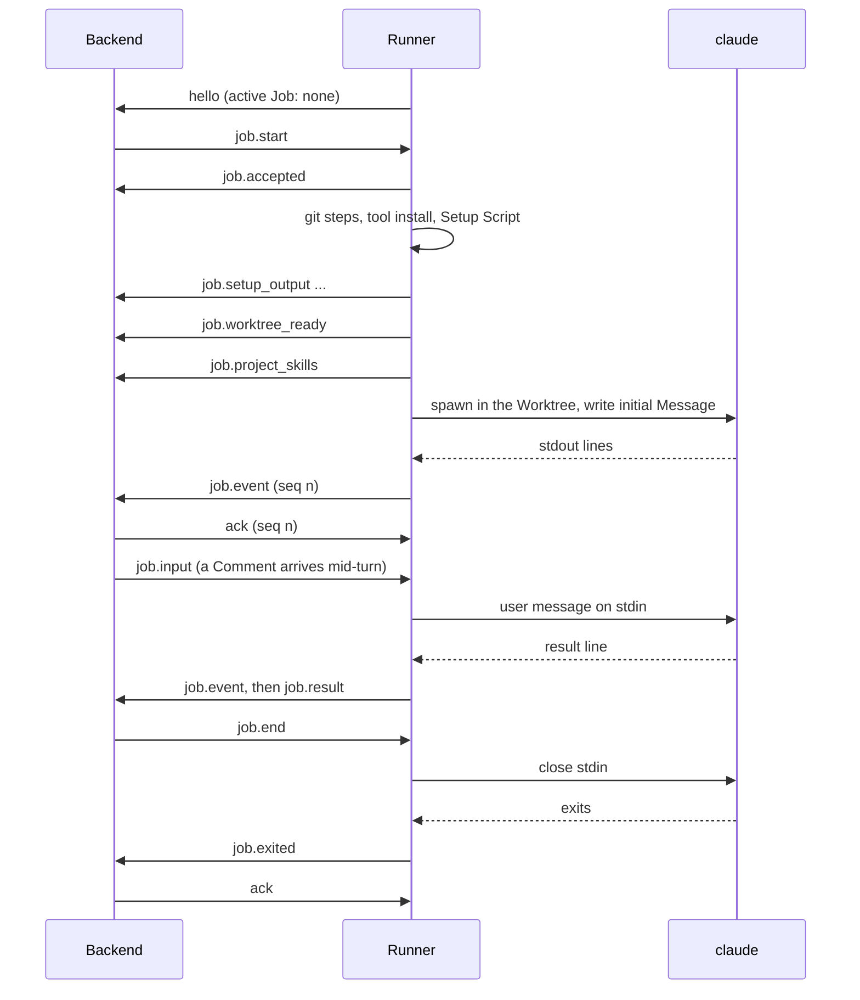
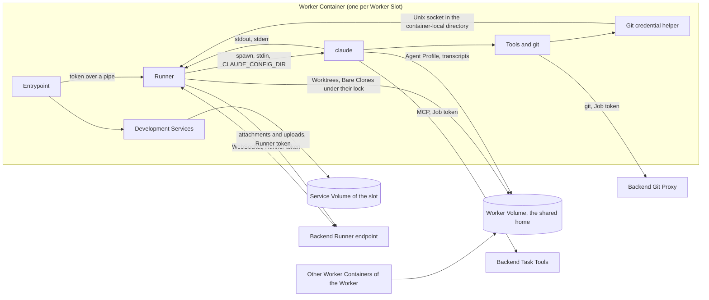

# Runner

The **Runner** is the platform's process inside every Worker Container. It dials out to the backend over one authenticated WebSocket, receives Jobs, prepares the Task's Worktree, runs `claude` in headless stream-json mode, writes Messages to its stdin and streams every line it prints back to the backend. All scheduling state lives in the backend: the Runner holds only what it needs for the Job in progress and the messages the backend hasn't acknowledged yet, so a restarted container or a dropped connection costs no work. It also answers the Git credential helper, which hands the current Job's token to git for the Git Proxy. The Runner is a single static Go binary baked into the Base Image, together with the Git credential helper.

## Concepts

- The **Runner** belongs to one Worker Container and runs at most one Job at a time, for any Agent. It starts with the Worker Container and lives as long as the container does. A Worker runs one Runner per running Worker Container, and all of them share the Worker Volume as their home.
- The **Runner token** identifies one Worker Container (its Worker and Worker Slot) to the backend. Each Worker Container has its own, stored hashed by the backend and regenerated every time that Worker Container is recreated (see [Workers](workers.md)). The Runner uses it for the WebSocket, for attachment downloads and for file uploads, and keeps it to itself.
- The **Job token** is the per-Job secret the backend puts in `job.start`. Claude Code uses it for the Task Tools MCP server, and the Git credential helper uses it as the Git Proxy password. It is valid only while the Job is active (see [Agent sessions](agent-sessions.md) and [Git integration](git-integration.md)).
- The **Agent Profile** of a Job is the Claude Code configuration directory of the Job's Agent inside the Worker Volume. `job.start` names it, and the Runner runs `claude` with `CLAUDE_CONFIG_DIR` set to it (see [Workers](workers.md)).
- The **home** is the agent user's home directory, where the Worker Volume is mounted. Worktrees, Bare Clones and Agent Profiles live there, and every path the backend sends is relative to it, so it means the same in every Worker Container of the Worker.
- The **container-local directory** is a fixed directory outside the home, private to one Worker Container. It holds what belongs to this Runner alone: the Git credential socket, the outbox spill files and the Runner's own lock files.
- The **Bare Clone lock** is an exclusive file lock per Bare Clone, kept in the Worker Volume next to the clone, held around every git command that touches the clone.
- The **Runner Protocol** is the JSON message contract over the WebSocket, with a protocol version (currently 4). The shared TypeScript types are its single source of truth and the Go Runner mirrors them.
- A **Job-scoped message** is any message the Runner sends about a Job. Each carries the Job id and a **seq**: one counter per Job, starting at 1 and shared by every message type, so the backend processes them exactly once and in order.
- The **outbox** is the Runner's per-Job list of Job-scoped messages the backend hasn't acknowledged yet. It is what gets resent after a reconnect.
- **Worktree preparation** covers everything the Runner does before starting `claude`: the git steps, the tool install, the Setup Script and the attachment downloads. Its output streams to the backend as setup output.
- A Worktree carries a **setup-pending mark** from the moment it is created until its Setup Script has succeeded. The mark, not the creation itself, decides whether the Setup Script runs.

## Behaviour

### Starting up

The Worker Container's entrypoint starts the Worker's Development Services, then the Runner, all as the non-root `agent` user. Each service keeps its data and logs in the slot's Service Volume, and the entrypoint removes stale locks there before starting it, so several Worker Containers sharing one home start their services side by side (see [Workers](workers.md)). The container receives the backend's Runner endpoint URL and its own Runner token as environment variables. The entrypoint re-executes itself without the token and hands it to the Runner alone over a pipe, so the container's first process, the services and every later `docker exec` carry no token in their environment. Backend execs into the container (for example to synchronize an Agent Profile) set the token variable to empty.

On start the Runner:

1. Reads its configuration and refuses to start without the backend URL and the Runner token.
2. Removes both from its own environment, so every process it starts inherits an environment without them.
3. On Linux, marks itself non-dumpable, which keeps other processes of the `agent` user (the Agent's tools) out of its memory and its process environment.
4. Asks `claude --version` for the CLI version (10 seconds at most; `unknown` on failure).
5. Opens the Git credential socket in the container-local directory (see [Git credentials](#git-credentials)). When the socket fails to open, the Runner logs the error and stays idle, unconnected.
6. Connects to the backend.

### Connection

The Runner opens the WebSocket with the Runner token as a bearer `Authorization` header. The backend answers an unknown or missing token with `401`. The backend keeps one connection per Worker Container: a second connection with the same token replaces the first, and the backend closes the old one. Runners of other Worker Containers of the same Worker are unaffected.

Right after connecting, the Runner sends `hello`, then resends every unacknowledged message of every Job it still holds, oldest Job first and in seq order. New messages produced meanwhile wait behind the resent ones. Only then does the connection become current for new sends.

While disconnected, the Runner keeps working: the running Job continues, its output accumulates in the outbox, and input waits until the backend is back.

**Reconnecting.** After a failed or lost connection the Runner waits and dials again. The wait starts at 1 second and doubles after every attempt, up to 30 seconds. Each actual wait is random between half and all of the current value, so many Runners don't reconnect in lockstep. Any attempt that gets as far as an open WebSocket resets the wait to 1 second. A dial gives up after 15 seconds.

**Heartbeats.** Both sides check the connection:

- The backend sends a WebSocket ping frame and a JSON `ping` every 30 seconds. The Runner answers the JSON `ping` with `pong`. The backend disconnects a Runner that stayed silent (no pong and no message) for a whole interval, so a half-open connection lets its Job be recovered.
- The Runner sends a WebSocket ping every 30 seconds and drops the connection when the answer takes more than 15 seconds.
- Every write has 10 seconds to complete; a failed write drops the connection and starts a reconnect.

**Versioning.** `hello` carries the protocol version, the Runner's build version and the `claude` version. The backend records the Runner and `claude` versions on the Worker Container. The Runner, the Git credential helper and the protocol are built from the same source as the backend into the Base Image, and a Base Image change rebuilds every Worker's image and recreates its Worker Containers (see [Workers](workers.md)), so both ends of a connection share a protocol version by construction.

### Runner Protocol

Backend to Runner:

| Message | Fields | Effect |
| --- | --- | --- |
| `job.start` | Job id; session id; mode (`new` or `resume`); resume-interrupted flag; Worktree path; Agent Profile path; git spec or none; Setup Script; environment; Claude arguments, the forward-subagent-text switch among them; initial Message; attachments to fetch | Prepares the Worktree and starts `claude` (see below). |
| `job.input` | Job id; Message (stream-json content blocks); attachments to fetch | Downloads the attachments, then writes the Message to `claude`'s stdin. |
| `job.interrupt` | Job id | Stops the current Turn; the process stays alive. |
| `job.end` | Job id | Closes stdin: `claude` works through what was already written, then exits. |
| `job.cancel` | Job id | Interrupts, closes stdin and escalates to signals. |
| `job.upload` | Job id; request id; upload URL; file paths | Reads the files and uploads them to the URL (see [Uploading files](#uploading-files)). |
| `project_skills.request` | Request id; Worktree path | Reads the Worktree's Project Skills now, without a Job, and answers with `project_skills.result`. |
| `worktree.status.request` | Request id; Worktree path | Reads the Worktree's uncommitted changes now, without a Job, and answers with `worktree.status.result`. |
| `worktree.remove` | Worktree path; bare clone path or none | Deletes the Worktree directory. Branches stay. |
| `ack` | Job id; seq | Everything up to and including that seq is processed. |
| `ping` | | Answered with `pong`. |

The git spec holds the Git Proxy clone URL (without credentials), the Job token as the proxy password, the Repository's stable identity, the Base Branch, the Task Branch, a hint on whether the Task Branch exists remotely, the bare clone path and the commit identity (name and email). The Claude arguments are the model, the effort, the permission mode, the text appended to the system prompt, the tools to disallow and the MCP configuration (a JSON string carrying the Task Tools server with the Job token, plus the Agent's MCP Extensions). The environment is the merged map of the Project's env vars and secrets, the Agent's environment, the Credential's variable and, for a resumed interrupted Turn, the resume flag. Paths (the Worktree, the bare clone, the Agent Profile) are relative to the home, so they name the same directories in every Worker Container of the Worker. The values themselves are chosen by the backend (see [Agent sessions](agent-sessions.md), [Agents](agents.md), [Workers](workers.md) and [Git integration](git-integration.md)).

**Which Runner gets what.** Job messages (`job.start`, `job.input`, `job.interrupt`, `job.end`, `job.cancel`, `job.upload`, `ack`) go to the Runner of the Worker Container that runs the Job. `worktree.remove`, `project_skills.request` and `worktree.status.request` belong to no Job, and any Runner of the Worker can serve them, since every one sees the same Worker Volume:

- `worktree.remove` goes to the Runner of the Job still working in that Worktree (a cancelled Job that has not exited yet), which removes it once that Job ends. With no such Job, it goes to a connected Runner of the Worker, the Runner of the Session's last Worker Slot first. While no suitable Runner is connected, the removal stays pending in the backend and is sent to the first one that says hello.
- `project_skills.request` and `worktree.status.request` go to any connected Runner of the Worker.

Runner to backend:

| Message | Fields | Meaning |
| --- | --- | --- |
| `hello` | protocol version; Runner version; `claude` version; active Job id or none | First message of every connection. The active Job is the one being prepared or running, or else the oldest Job with unacknowledged messages. |
| `project_skills.result` | Request id; files (name and beginning of each) | The answer to `project_skills.request`; no seq and no ack. |
| `worktree.status.result` | Request id; files (path and status of each), total, truncated, error or none | The answer to `worktree.status.request`; no seq and no ack. |
| `job.accepted` | Job id; seq | The Runner took the Job and starts preparing it. |
| `job.worktree_ready` | Job id; seq; created; remote branch missing | The git Worktree is ready (sent only for Jobs with a git spec). |
| `job.setup_output` | Job id; seq; chunk | Output of the git steps, the tool install and the Setup Script. |
| `job.project_skills` | Job id; seq; files (name and beginning of each) | The Worktree's Project Skills, read right before `claude` starts (see [Project Skills](#project-skills)). |
| `job.event` | Job id; seq; line | One raw stdout line of `claude`. |
| `job.result` | Job id; seq; event seq | The `job.event` with that seq was a `result` line: a Turn ended. |
| `job.stderr` | Job id; seq; chunk | `claude`'s stderr, plus the Runner's own notes about the Job. |
| `job.exited` | Job id; seq; exit code or none; signal name or none | The `claude` process ended. Last message of a Job that started. |
| `job.failed` | Job id; seq; stage (`worktree`, `setup` or `spawn`); message | The Job ended before `claude` started. Last message of that Job. |
| `pong` | | Answer to `ping`. |

Messages of unknown type or that fail to parse are logged and ignored on both sides.

### Delivery: seq, ack and resend

Every Job-scoped message gets the Job's next seq, goes into the outbox and is sent at once when connected. The backend processes each message inside a transaction, records the highest seq it processed for the Job, and then sends `ack` with that seq. A message with a seq it has already processed is skipped and acknowledged again, and a message for a Job unknown to the backend or belonging to another Worker Container is acknowledged without effect. An `ack` drops every message up to that seq from the outbox.

A Job stays in the Runner's memory while its process runs or while its outbox holds anything. Once it has finished and everything is acknowledged, the Runner forgets it.

The outbox keeps up to 50 MiB of messages in memory per Job. Beyond that, further messages spill to a file in the container-local directory, readable only by the `agent` user, and the file is deleted once the outbox empties. Memory use therefore stays bounded however long a disconnect lasts. A new Runner process starts with an empty outbox.

On `hello` the backend reconciles the active Job:

- When it is still active in the backend, the backend acknowledges up to the last seq it processed, so the Runner keeps only the rest; when the Job's Chat was deleted in the meantime, it also cancels the Job.
- When the backend has already settled it, the backend acknowledges everything and sends `job.cancel`.
- Every other Job the backend considers active for this Worker Container is gone (the container restarted or crashed) and the backend recovers it as interrupted (see [Agent sessions](agent-sessions.md)). Jobs of the Worker's other Worker Containers are left as they are.

The backend also recovers a Job as interrupted when the Runner stays disconnected for more than 5 minutes.

### Receiving a Job

The Runner runs one Job at a time:

- A `job.start` for a Job id the Runner already holds (a resend) is ignored.
- With no other Job in progress, the Runner starts it right away.
- When the Job in progress is being cancelled, the new Job waits for it to end. The backend dispatches the next Job as soon as it cancels one, so this is the normal path after closing a Task. The wait lasts at most the cancel's kill delay plus 5 seconds (25 seconds with the defaults); after that, or if the waiting Job is itself cancelled, it fails at stage `spawn`.
- When another Job is running normally, the new Job fails at once at stage `spawn` with "another job is running", without `job.accepted`.

`job.input`, `job.interrupt`, `job.end` and `job.cancel` for a Job the Runner doesn't hold, or that has already finished, are logged and ignored. For a Job still preparing, they wait in order (up to 1024) and apply once `claude` starts, after the initial Message. A `job.cancel` also starts its signal escalation immediately.

### Preparing the Worktree

On `job.start` the Runner sends `job.accepted` and prepares the Worktree. Within one Runner, preparation and Worktree removal for all Jobs happen one at a time, in the order the backend asked for them. Across the Worker Containers of a Worker, the backend runs at most one Job per Worktree, and the Bare Clone lock keeps git work on a shared clone one at a time.

Every path in a Job (the Worktree, the bare clone, the Agent Profile, each attachment) must resolve inside its base directory: the home for the Worktree, the bare clone and the Agent Profile, the Worktree for attachments. A Worktree or bare clone path that is absolute or leads outside fails the Job at stage `worktree`, an Agent Profile path that does fails it at stage `spawn`, and an attachment path that does skips that file.

**With a Repository** (the Job has a git spec), the Runner runs the git steps described in [Git integration](git-integration.md): it discards a bare clone that belongs to a different Repository, creates or updates the bare clone with the Git Proxy as `origin`, fetches with prune, leaves an existing valid Worktree untouched, or else creates it on the Task Branch (from the remote Task Branch when it exists, otherwise from the latest Base Branch), sets the commit identity and keeps the platform's directory inside the Worktree out of git. Each git command runs with terminal prompts disabled and a 30-minute limit, and its command line and output stream as setup output.

**Bare Clone lock.** Two Worker Containers of a Worker can prepare Worktrees of the same Project at once, and they share its bare clone. Every git command that touches the clone (creating, discarding or fetching it, adding, removing or pruning a Worktree) therefore runs while the Runner holds the clone's exclusive file lock, kept in the Worker Volume next to the clone. A Runner that finds the lock taken waits for it, and releases it as soon as its own command ends. The lock belongs to the Runner's process, so it is also released when that Runner or its container dies. A newly created Worktree receives the setup-pending mark as soon as it exists. The Runner then sends `job.worktree_ready` with whether the Worktree was created and whether the remote Task Branch is missing.

A failure of these steps gets up to 3 **Preparation Retries**, waiting 1, 2 and 4 seconds with up to 50% of jitter, because most of them are transient: the Git Proxy can still see the Job as not started when the first fetch arrives, and provider or network blips clear on their own. Every attempt repeats the whole preparation, which is idempotent: an existing valid Worktree is left alone, and one created halfway is recreated. Each retry is announced in the setup output ("preparing the worktree failed …, retrying in …"), so the failure's System Comment shows it. A cancel during the wait stops it and fails the Job as cancelled. When the last attempt fails too, the Job fails at stage `worktree` with that error.

If creation of a git Worktree fails or is cancelled before its upstream and setup-pending mark are ready, the Runner removes that incomplete Worktree and prunes its registration. A Retry recreates it, configures its upstream and runs its Setup Script.

**Without a Repository** (no git spec), the Runner creates the Worktree directory when missing and gives a new one the setup-pending mark.

**Tool install.** For Jobs with a Repository, when the Worktree was just created, still carries the setup-pending mark or the Job starts a new Claude Code session, and the Worktree root holds a mise configuration (`.tool-versions` or one of mise's standard TOML locations), the Runner runs `mise install --yes` in the Worktree. Mise reuses matching Base Image system installs and installs other requested versions in the Worker Volume, where every Worker Container of the Worker finds them. The Runner starts `claude` through mise's shims in the Worktree, so Repository and user mise configurations can override the Base Image's Claude Code, Node.js and Python defaults (see [Workers](workers.md)). Resuming a session in an existing, fully set-up Worktree skips the tool install. A failure fails the Job at stage `setup`.

**Setup Script.** When the Worktree carries the setup-pending mark and the Project has a Setup Script, the Runner runs it with `bash -lc` in the Worktree, with the same environment `claude` gets. When it succeeds (or there is none), the mark is removed. A failure fails the Job at stage `setup` with the exit code ("setup script exited with code N"), and the mark stays, so the next Job on that Worktree (after a Retry or a new Comment) runs the Setup Script again. The same holds when preparation failed right after creating the Worktree.

The tool install and the Setup Script each:

- run in their own process group, with stdout and stderr streamed as setup output;
- get 30 minutes; past that the whole group is killed and the Job fails with "timed out after" the limit;
- end with their whole process group killed, so the Job ends even when they left a background process behind.

**Attachments.** Before starting `claude`, the Runner downloads the `job.start` attachments into the Worktree. Each download uses the Runner token as bearer, has 5 minutes, writes to a temporary file and renames it into place. The backend serves only attachments of the Task of the active Job of this Worker Container, from non-internal, non-deleted Comments or from the Task description. A failed download is reported on stderr as a Runner note and the Job continues. Attachments of a `job.input` are downloaded the same way right before that Message is written.

**Project Skills.** After the attachments, the Runner reads the Worktree's Project Skills and sends them in one `job.project_skills`, for every Job that gets this far, with or without a Repository, and with an empty list when there are none. It reads the files `claude` loads from the project: `.claude/skills/<name>/SKILL.md` first, then `.claude/commands/<name>.md`, each in name order. Symlinks are followed, as `claude` follows them, but only while they resolve inside the Worktree. Of each regular file it sends the name (the skill's directory or the command's file name without `.md`) and the first 8 KiB, cut on a character boundary, which is enough for the frontmatter and the first paragraph. It sends at most 200 files and skips unreadable ones silently. Parsing is the backend's job (see [Agent sessions](agent-sessions.md)), so the Runner needs no YAML parser and both ends parse skills the same way.

`project_skills.request` reads the same files off the Job stream: a Worktree created by an earlier Job already has them, and the backend wants them for a composer before the Session's next Job. Any Runner of the Worker can answer, whichever Worker Container created the Worktree, since they all see the same Worker Volume. It answers `project_skills.result` with the same list, or an empty one when the path is outside the home or the Worktree isn't there yet. Like `job.upload` it carries no seq and gets no `ack`; unlike it, it doesn't need a running Job.

**Worktree changes.** `worktree.status.request` reads a Worktree's uncommitted changes without a Job, for the Task view's Changes dialog (see [Git integration](git-integration.md#what-users-see)). The Runner checks the path into the home like every other, then runs `git status --porcelain=v2 -z --untracked-files=normal` with `GIT_OPTIONAL_LOCKS=0`, so the read neither waits for nor disturbs a Job working in the same Worktree, and with a 10-second limit. One answer carries at most 1000 files and 256 KiB of git output, `total` counting the changes it saw and `truncated` set when more were cut; each file has one status: `modified`, `added`, `deleted`, `renamed`, `copied`, `type-changed`, `untracked` or `conflicted`. A missing path answers `not-found`, a plain directory (a Project without a Repository) `not-a-worktree`, and a failed command `failed`, with no paths in the error answer.

### Running claude

The Runner starts `claude` (the path is configurable, so tests can use a fake) in the Worktree with:

- `-p --input-format stream-json --output-format stream-json --verbose --include-partial-messages`;
- `--session-id <session id>` for mode `new`, `--resume <session id>` for mode `resume`;
- `--model` and `--effort` when set, `--permission-mode` when set, `--append-system-prompt` when non-empty, `--mcp-config` when non-empty, and `--disallowedTools <name>` for each tool to disallow;
- `--forward-subagent-text` when the Job asks to forward subagent text and the `claude` that starts understands the flag.

The Runner leaves `--bare` out, so the repository's CLAUDE.md, `.claude/` settings, skills and `.mcp.json` load as in a normal session.

**Forwarding subagent text.** Before starting `claude` for a Job that asks for it, the Runner asks the same executable it is about to start, in the Worktree and through mise's shims, for `--version` (10 seconds at most). The flag goes on the command line when that version parses as 2.1.211 or later. A probe that fails, times out or answers something unparseable leaves the flag out, and the Job starts as usual: only the subagent's text is missing from its transcript (see [Agent sessions](agent-sessions.md)). The answer is kept for the rest of the Job.

The environment is the Runner's own environment (already without the Runner token and the backend URL) plus the Job's environment: Project env vars and secrets, the Agent's environment, the Credential's variable (`CLAUDE_CODE_OAUTH_TOKEN`, `ANTHROPIC_API_KEY` or `ANTHROPIC_AUTH_TOKEN`) and `CLAUDE_CODE_RESUME_INTERRUPTED_TURN=1` for a resumed interrupted Turn. On top of it the Runner sets `CLAUDE_CONFIG_DIR` to the absolute path of the Job's Agent Profile, so `claude` loads that Agent's Skills, Plugins and settings and reads and writes transcripts in the directory every Agent Profile shares. `CLAUDE_CONFIG_DIR` is a reserved name that only the Runner sets (see [Agents](agents.md)). These secrets exist only in the environment of that Job's processes.

`claude` runs in its own process group, so signals reach the tools it started. Once it is running, the Runner writes the initial Message to stdin as one stream-json user message (nothing when the initial Message is empty), then the queued control messages in order. A spawn error fails the Job at stage `spawn`. The CLI's own refusals (for example a session id already in use for mode `new`, or a missing transcript for mode `resume`) come back as stderr plus a non-zero `job.exited`; the backend reads them (see [Agent sessions](agent-sessions.md)).

### Messages, interrupt, end and cancel

Control messages for a running Job apply in arrival order:

- **`job.input`**: the Runner writes the Message to stdin as one stream-json user message, whether a Turn is in progress or not. Mid-turn, `claude` picks it up at its next model call, within the same Turn; while idle, it starts a new Turn. The backend merges queued Comments into one Message before sending it. When stdin is already closed, the Runner reports "could not deliver a message: claude's stdin is already closed" on stderr.
- **`job.interrupt`**: the Runner writes a stream-json `control_request` with subtype `interrupt` and a unique request id. `claude` ends the Turn and stays alive for the next Message. When stdin is already closed, the Runner sends SIGINT to the process group instead, which ends the Turn and the process.
- **`job.end`**: the Runner closes stdin. `claude` processes every Message already written, each possibly producing its own Turn, then exits.
- **`job.cancel`**: the Runner interrupts and closes stdin, which normally makes `claude` exit on its own. If the Job hasn't ended 10 seconds after the cancel, the process group gets SIGTERM; at 20 seconds, SIGKILL. When the cancel arrives during the tool install or the Setup Script, that step's process group gets SIGTERM right away (it has no gentler stop), and the Job fails with "cancelled". A cancel during the git steps takes effect when the current git command ends. A Job cancelled before `claude` starts fails at stage `spawn` with "cancelled before start".

### Uploading files

`job.upload` asks for files the Agent posts through a Task Tool (see [Agent sessions](agent-sessions.md)). It is a request outside the Job's message stream, so it carries no seq and gets no `ack`. The Runner handles it while the Job is running, alongside the Job's other messages:

- Each path is resolved against the Job's Worktree when relative, or taken as given when absolute, with symlinks followed. It must name a regular file of at most 25 MB.
- The Runner answers with one `multipart/form-data` POST to the upload URL, with the Runner token as bearer. The first part is a manifest listing every requested path in order, each with an error message when it failed ("not found", "not a regular file", "larger than 25 MB", or the read error). One file part per successful path follows, in order, named after the file's base name, with its content type taken from the extension, otherwise detected from its first 512 bytes, otherwise `application/octet-stream`.
- The backend accepts the POST only from the Runner of the Worker Container it asked, while the request is pending, and answers `404` otherwise. The upload has 60 seconds, the time the backend's tool call waits for it. A failed POST is reported on the Job's stderr as a Runner note while the Job runs, and in the container log once it has ended; the waiting tool call then times out on the backend. A `job.upload` for a Job the Runner doesn't hold is logged and ignored.

### Streaming output

The Runner reads `claude`'s stdout line by line through a 1 MiB buffer. Each non-blank line, with its line ending trimmed, becomes one `job.event`, verbatim. The Runner parses a line only to read its `type`; when that is `result`, it sends `job.result` right after the event, carrying the event's seq. The backend answers `job.result` with `job.end` (see [Agent sessions](agent-sessions.md)): ending the Job is the backend's decision.

**Oversized lines.** Every outgoing message is capped at 32 MiB, half of the 64 MiB the backend accepts, because a bigger message would drop the connection again on every resend. A stdout line longer than the cap, or one whose escaped message would exceed it, is replaced by a placeholder line: a stream-json object of type `unparsed`, marked truncated, carrying the first 16 KiB of the line (cut on a character boundary) and its full size in bytes. The projection skips it. When the oversized line starts with a `type` of `result`, the Runner still sends `job.result`.

**Stderr and setup output** stream as chunks of at most 64 KiB. A chunk always ends on a whole UTF-8 character: an incomplete one waits for the next bytes or for the end of the stream. The backend keeps the last 64 KiB of each per Job, for Job details and failure comments.

### Exit and cleanup

When `claude` exits, the Runner:

1. Kills its whole process group, so background processes started by tools (servers, watchers) release ports and files before the next Job.
2. Keeps forwarding output already written: it reads stdout and stderr until they stay silent for 2 seconds, for at most 1 minute in total, since a leftover process could hold a pipe open forever.
3. Closes stdin.
4. Sends `job.exited` with the exit code, or with the signal name (`SIGKILL`, `SIGTERM`, `SIGINT`, or `SIG<n>`) and no exit code when a signal ended it.

`job.exited` and `job.failed` are each a Job's last message. The Runner marks the Job finished as it sends either one, so a `job.start` the backend sends right after reading it is always accepted.

### Removing a Worktree

`worktree.remove` names a Worktree path and, for Projects with a Repository, the bare clone path. The backend sends it to the Runner of a Job still working in the Worktree, otherwise to a connected Runner of the Worker, preferring the Session's last Worker Slot (see [Runner Protocol](#runner-protocol)), so the Runner that removes a Worktree can be another one than the Runner that created it. The removal waits for any earlier Worktree work of this Runner and for every unfinished Job of this Runner on that Worktree, without holding up the connection. Then, under the Bare Clone lock, the Runner runs `git worktree remove --force` in the bare clone, deletes the directory and prunes the clone's Worktree list. Local and remote branches stay. Errors are logged. A removal sent to a Runner before a later `job.start` for the same Worktree happens first, so the new Job recreates the Worktree.

### Git credentials

The Base Image configures the Git credential helper for every host, with the request path included. Git uses it for every HTTP(S) request that needs authentication:

- **`get`**: the helper reads the protocol, host and path git sends. It accepts only `http` or `https` with a non-empty host and path, free of control characters, backslashes and `.` or `..` segments. It asks the Runner of its own Worker Container over a Unix socket in the container-local directory (mode 0600, directory 0700), with 3 seconds to connect and 40 seconds for the exchange, and prints the username and password it gets.
- **`store` and `erase`** do nothing, so git keeps no credential on disk.

The Runner answers from memory, with no backend round trip. It returns username `claude-task` and the Job token when there is a current, unfinished Job with a git spec and a token, and the request matches that Job's clone URL exactly: same scheme, same host and port (case-insensitive), and the same path once the leading slash and a trailing `.git` are ignored. Any other request, or one with no current Job, gets "no active task for this repository"; when the Runner is unreachable the helper reports "the task Runner is unavailable". Either way the helper exits with an error and git falls back to its normal behaviour, so public repositories on other hosts keep working.

The token works from `job.start` until the process exits, so it covers the Runner's own git steps and every git command `claude` runs, including during the final Turns after `job.end`. The backend's Git Proxy separately checks that the Job is still active (see [Git integration](git-integration.md)).

### Shutdown and restarts

On SIGTERM or SIGINT (the container stopping), the Runner sends SIGTERM to the running process group, gives it 5 seconds before SIGKILL, and exits. Unacknowledged messages are dropped with the process. When the container comes back, the new Runner has no Job: its `hello` reports none, and the backend recovers the interrupted Job and queues its resumption (see [Agent sessions](agent-sessions.md)). Worktrees, bare clones, Agent Profiles and Claude Code transcripts live on the Worker Volume and survive, and Development Service data survives in the slot's Service Volume.

## Architecture

- **Entrypoint**: starts the Worker's Development Services with their data in the slot's Service Volume, then the Runner, and hands the Runner token to the Runner alone.
- **Runner**: the connection loop (dial, `hello`, resend, read, heartbeats, reconnect), the outbox per Job, Job execution (preparation, process supervision, stdin feeding, output forwarding), the Bare Clone lock and the credential socket.
- **Git credential helper**: a small separate binary git calls; it only relays to the socket of its own container's Runner.
- **Backend Runner endpoint**: authenticates the Runner token and maps it to its Worker Container, keeps at most one connection per Worker Container, processes messages from one Runner one at a time and in arrival order, and acknowledges them. Its handling of each message (Turns, Timeline projection, Queue, recovery) is described in [Agent sessions](agent-sessions.md).

The Runner reaches the backend at its internal URL; every connection starts from inside the Worker Container.

### Configuration

The Runner reads its settings from the container environment. Besides the backend URL and the Runner token, these are configurable, mostly for tests:

| Setting | Default |
| --- | --- |
| `claude` executable | `claude` on the path |
| Home | the user's home directory, where the Worker Volume is mounted |
| Container-local directory | `claude-task` in the container's temporary directory (`/tmp/claude-task`), outside the home |
| Cancel: SIGTERM after | 10 seconds |
| Cancel: SIGKILL after | 20 seconds |
| Tool install and Setup Script limit, each | 30 minutes |
| Outbox memory per Job | 50 MiB |
| Git credential socket | a socket in the container-local directory |

## Data model

The Runner keeps no database. In memory it holds:

- the connection, when there is one;
- the Jobs still running or with unacknowledged messages, oldest first, each with its `job.start`, its seq counter, its outbox, its process group and its stdin;
- the Job currently being prepared or running;
- the order of pending Worktree work.

On the Worker Volume, shared with the other Worker Containers of the Worker, it relies on:

- the bare clones and Worktrees (layout in [Git integration](git-integration.md)), each new Worktree with its setup-pending mark until setup succeeds;
- one Bare Clone lock file next to each bare clone;
- the Agent Profiles that Jobs name, with the transcripts they share, created and kept up to date by the backend's synchronization (see [Workers](workers.md)).

In the container-local directory, private to its Worker Container, it keeps:

- the outbox spill files, one per Job, while a Job's outbox exceeds its memory budget;
- the Git credential socket;
- the Runner's own lock files.

## Limits and timeouts

| What | Value |
| --- | --- |
| Dial | 15 s |
| Reconnect wait | 1 s doubling to 30 s, randomized between half and all of it; reset after a successful connection |
| Runner ping | every 30 s, 15 s to answer |
| Backend ping | every 30 s; disconnect after a silent interval |
| Write of one message | 10 s |
| Incoming message | up to 64 MiB (`job.start` can carry base64 images) |
| Outgoing message | up to 32 MiB; backend accepts up to 64 MiB |
| Placeholder for an oversized line | first 16 KiB plus the original size |
| Setup output and stderr chunks | up to 64 KiB, whole UTF-8 characters |
| Outbox in memory per Job | 50 MiB, then spill to the container-local directory |
| Control messages waiting for a Job to start | 1024 |
| Each git command | 30 min |
| Worktree changes read | 10 s; 1000 files and 256 KiB of git output |
| Backend wait for a Worktree changes answer | 5 s |
| Tool install, Setup Script | 30 min each |
| Attachment download | 5 min each |
| File upload | 10 files of 25 MB each per request, 60 s per request |
| Cancel escalation | interrupt and close stdin at once, SIGTERM at 10 s, SIGKILL at 20 s |
| New Job waiting for a cancelled one | kill delay + 5 s (25 s) |
| Output drain after exit | 2 s of silence, 1 min at most |
| Runner shutdown | SIGTERM, SIGKILL after 5 s |
| `claude --version` | 10 s |
| `claude --version` before a Job that forwards subagent text | 10 s, once per Job |
| Credential helper | connect 3 s, exchange 40 s; request up to 4 KiB, answer up to 20 000 bytes |
| Backend reconnect timeout before recovery | 5 min |
| Setup output and stderr kept by the backend | last 64 KiB each per Job |

## Non-functional requirements

- **Secrets.** The Runner token reaches only the Runner process: the entrypoint passes it over a pipe, the Runner removes it from its environment before starting anything, and on Linux the Runner is non-dumpable. Every process the Runner starts (git, mise, the Setup Script, `claude` and its tools, repository git hooks) runs without it. The Job token and the Job's environment exist only for that Job's processes. The Runner keeps them out of its logs; the Git credential helper prints a token only to git.
- **No lost output.** Every Job-scoped message is processed by the backend exactly once and in order, across reconnects and backend restarts, for as long as the Runner process lives. Output written by `claude` before it exits is forwarded.
- **Containment.** Every file the Runner writes for a Job stays inside the home or its container-local directory, and attachments inside their Worktree. Each Runner's socket, spill files and lock files stay in its own Worker Container. Uploads read files wherever the `agent` user can read them, which is what the Agent itself can already read and show. Processes started for a Job end with it.
- **Memory.** The Runner's memory stays bounded per Job (50 MiB of outbox, 32 MiB per message) whatever the length of a disconnect or the size of a line.
- **Observability.** The Runner logs connection changes, ignored messages and Worktree removal errors to the container log. Everything about a Job reaches the backend as setup output, stderr or a failure message, and the Runner's own notes on stderr start with `[runner]`.

## Decisions

- **The Runner dials out and holds no scheduling state.** The backend owns the Queue, Sessions, Jobs and Comment Delivery in Postgres. Calling into the container would need reachable ports or `docker exec` plumbing tied to Docker networking, and a queue inside the Runner would be lost on container recreation and invisible to the UI. With an outbound, stateless Runner, a restart or a dropped connection loses no work, and the same design works on remote hosts later.
- **One seq per Job across every message type, cumulative acks, full resend after `hello`.** The backend processes Runner messages in transactions and must apply each exactly once and in order: setup output, events, results and exits all affect the same Job. A single counter makes that a simple "highest processed seq" check, and resending everything unacknowledged after `hello` needs no negotiation.
- **The outbox spills to the container-local directory past 50 MiB.** A Job can produce a lot of output during a long disconnect; spilling keeps memory bounded without dropping anything. The spill files belong to one Runner process, so they stay out of the shared Worker Volume.
- **One Runner and one Runner token per Worker Container.** Each Worker Container runs its own Jobs, so the backend needs to tell its Runners apart for routing, recovery and attachment access. A token per container makes the connection itself say which Worker Slot is talking, and recreating one container rotates only its token.
- **An exclusive file lock per Bare Clone.** The Worker Containers of a Worker share the Worker Volume, so two Jobs of one Project on two containers would otherwise fetch, add or prune Worktrees in the same clone at once, and git's own short-lived locks would make one of them fail with an error. A file lock next to the clone serializes them across containers with no backend round trip, and since the lock belongs to the holding process, a crashed Runner or container never leaves it held. Coordinating clone access from the backend was rejected: it would need a round trip per git command and a lease to recover from a container that dies holding it.
- **Per-container state lives in a container-local directory, paths for shared data stay relative to the home.** The Git credential socket must answer only for the Job of its own container: in the shared home every Runner would bind the same path, and git in one container could reach another container's Runner and its Job token. Spill files and the Runner's lock files belong to one process just as much. Worktrees, Bare Clones and Agent Profiles must mean the same in every container, so the backend keeps sending them relative to the shared home.
- **The Agent Profile is named per Job and applied through `CLAUDE_CONFIG_DIR`.** Any Agent can run on any Worker Container, so the container itself carries no Agent. Pointing `claude` at the Agent's profile for each Job loads that Agent's Skills, Plugins and settings, while the shared transcripts directory lets `--resume` continue a Session started by another Agent. The path is checked to lie inside the home like every other path the backend sends.
- **Secrets travel with each Job, outside the container environment.** Rotating a Credential or a project secret applies at the next Job, and a Project's secrets reach only that Project's Jobs. The container environment carries only what the Runner needs to connect.
- **Messages go to stdin mid-turn.** A Comment for the running Task is written to stdin right away, and `claude` takes it at its next model call within the same Turn. This is supported by the platform's default CLI version; user-selected versions are expected to support the same stream-json contract. Since Messages written while idle each start their own Turn, merging queued Comments into one Message happens in the backend before sending.
- **Interrupt through a stream-json `control_request`.** It ends the Turn and keeps the process and Session alive. SIGINT also ends the Turn but exits the process, so it is used only when stdin is already closed.
- **An interrupt followed directly by a Message opens a new Turn in the same process.** This is what Interrupt and send relies on (see [Agent sessions](agent-sessions.md#comments-reaching-the-agent)): the aborted Turn ends, the Message is read right after it, and the backend closes stdin as usual once the new Turn's `result` arrives. The Runner applies the two in arrival order and needs no extra state.
- **The backend decides when a Job ends.** The Runner reports each `result` and the backend answers with `job.end`; `claude` then finishes what was already written and exits. This keeps "inject or queue" for new Comments a backend decision.
- **Every child runs in its own process group, killed when it exits.** Tools and setup steps start servers and watchers; left running, they hold ports and files into the next Job, or keep a pipe open and hang the Job.
- **Oversized lines become a placeholder.** A message above the backend's limit drops the connection, and since it would be resent after every reconnect, the Job would stay stuck. A 32 MiB cap, half the backend's limit, leaves room for escaping.
- **A setup-pending mark instead of "the Worktree was just created".** A Setup Script that failed or was interrupted leaves a Worktree that exists but isn't ready. The mark makes the next Job run the setup again, and a successful setup runs exactly once.
- **The Runner token stays inside the Runner process.** It outlives every Job, while `claude`, its tools, the Setup Script and git hooks run Agent-controlled code whose output reaches the Timeline. Handing it over on a pipe, removing it from the environment and making the Runner non-dumpable keep it out of their environments and memory.
- **The Git credential helper is answered locally from the current Job.** The Job token already lives in the container for the MCP server, so using it for the Git Proxy adds no secret. Answering from the Runner's memory, only for the exact proxy URL of the current Job, needs no backend round trip, cache or expiry handling. Provider credentials stay in the backend.
- **Worktree work runs one at a time per Runner, in arrival order.** A removal and a new Job for the same Task can arrive back to back; ordering them, and making a removal wait for the Jobs on its Worktree, keeps a reopened Task from losing a freshly created Worktree. Across Runners, the backend sends a removal to the Runner whose Job still works in the Worktree, or to any Runner once no Job does, and runs one Job per Worktree.
- **Files go up on request, over HTTP.** The backend asks with a small `job.upload` message and the Runner streams the files in a multipart POST, the mirror of attachment downloads. Large bytes stay off the WebSocket, whose messages are capped and resent after reconnects, and the request needs no seq because a lost one simply times out the tool call that asked for it.
- **A Job arriving during a cancel waits for it.** The backend dispatches the next Queue Entry as soon as it cancels a Job, so the Runner lets the new Job wait out the cancel escalation rather than refusing it.
- **Project Skills are read from the Worktree right before `claude` starts.** The Setup Script, or the Agent itself in an earlier Job, may add skills, and the Worktree can differ from the Base Branch, so reading the repository through the Git Provider would show a different set from the one `claude` loads. `system/init` lists command names, but with no descriptions and no way to tell a Project Skill from a bundled one. The Runner sends the files' beginnings rather than parsed fields because the backend already parses `SKILL.md` frontmatter for the catalog.
- **The backend can also read them on request, without a Job.** A Worktree outlives its Jobs, so a Session that hasn't run one since a deploy, or whose image changed, would otherwise suggest no Project Skills until the next Job. `project_skills.request` costs one WebSocket round trip and reuses the same reader; the backend waits only briefly and falls back to what the latest Job reported. Any connected Runner of the Worker can answer, since they share the Worker Volume. Reading the Worktree from the backend was rejected because the files are in the Worker Volume, which only the Worker Containers mount.
- **Worktree changes are read on request, with no lock and no Job.** The Changes dialog asks when it opens, so a long Turn costs nothing, and `git status` with optional locks off is a read: it neither takes the index lock nor needs the Bare Clone lock, and it can run beside a Job. The same request shape as Project Skills keeps the backend unchanged; the last answer is kept on the Session because a Worker at its minimum of 0 has no connected Runner when its Task is idle (see [Git integration](git-integration.md)).
- **The Runner probes the `claude` it will start, not the one on the Base Image.** A repository's mise configuration can override the pinned CLI in its Worktree, and `--forward-subagent-text` exists only from 2.1.211. Asking that executable for its version before each Job that wants the flag costs one short process per Job and keeps an older or unusual CLI from failing the Job on an unknown argument; caching the answer per Worker Container was rejected because a repository change can swap the CLI between Jobs without touching the container.

## Related specs

- [Agent sessions](agent-sessions.md): the backend side of the protocol: Sessions, Jobs, Turns, the Worker's Queue, dispatch to Worker Containers, `job.start` composition, recovery and the Timeline projection.
- [Workers](workers.md): the Base Image, Worker Containers and their recreation, Runner tokens, the Worker Volume and Service Volumes, Development Services, and Agent Profiles and their synchronization.
- [Agents](agents.md): Agent configuration, Credentials, environment, reserved variable names and Extensions.
- [Git integration](git-integration.md): the git steps of Worktree preparation, Worktree and Bare Clone layout in the Worker Volume, Task Branch naming, the Git Proxy and its Push Policy.
- [Conversation](conversation.md): Comments, Messages, Delivery and attachments as Users see them.
- [Wikis](wikis.md): Wiki conversations run through the same Runner and Jobs.
