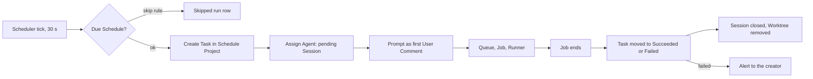

# Schedules

Schedules make Agents work on their own. An Admin configures a **Schedule** with a name, an Agent, a cron expression, a time zone and an initial prompt. At every due time the platform starts a **Scheduled Run**: it creates a Task, assigns the Agent and posts the prompt as the first User Comment, so the normal Session, Queue and Timeline machinery does the work. A Schedule is tied to a Repository, and then its runs work on a clean Worktree of it, or it is global, and then its Agent can read the state of every board and act on Tasks. Schedules and their runs live in their own section of the web app, shown as a list with a history table instead of a kanban board. It exists for recurring, unattended work (a nightly review, a morning triage, a weekly report) that would otherwise depend on someone remembering to start it.

## Concepts

- A **Schedule** is a configured recurring job: name, Agent, cron expression, time zone, initial prompt, an optional Repository with its Base Branch, a read-only flag and an enabled flag.
- A **Schedule Project** is the Project of kind `schedule` that carries one Schedule. It is hidden from the Projects list and the Boards list, like a Wiki Project, and each Scheduled Run is a Task of it.
- A **Scheduled Run** is one execution of a Schedule: a Task of its Schedule Project with one Session, normally with one Job. Its first User Comment is the Schedule's prompt, posted by the platform as `System` on behalf of the Schedule.
- A **skipped run** is a due time that did not start a run. It has no Task and appears as a row in the Schedule's history with its reason.
- A **tied Schedule** has a Repository. A **global Schedule** has none, and its Agent receives the global Task Tools.
- A **read-only Schedule** has every git push of its Jobs refused by the Git Proxy. Nothing else about the Agent's permissions changes.
- The **run history** of a Schedule lists its Scheduled Runs and skipped runs, newest first.

## Behaviour

### API

Schedules are served under `/schedules`: list and read for every User; create, edit (`PATCH`), delete, and `POST /schedules/:id/run` for Admins; and `GET /schedules/:id/runs` for the history. Changes publish `schedule.changed` on the `schedules` topic, which clients refetch from.

### Permissions

| Action | Who |
| --- | --- |
| List Schedules, open one, read its run history and open a run's Task | Every User |
| Create, edit, pause, resume, delete and run a Schedule | Admins |

Requests outside these permissions are answered with `403`.

### Creating and editing a Schedule

| Field | Rule | Default |
| --- | --- | --- |
| Name | 1 to 100 characters, trimmed, unique ignoring case among Schedules (`409` otherwise) | required |
| Agent | an existing enabled Agent (`400` otherwise) | required |
| Cron expression | five fields (minute, hour, day of month, month, day of week), with lists, ranges and steps; at most one run per minute | required |
| Time zone | an IANA name such as `Europe/Rome` | `UTC` |
| Prompt | 1 to 50,000 characters | required |
| Repository and Base Branch | optional; checked like a Project's Repository (see [Git integration](git-integration.md)) | none, meaning global |
| Read-only | yes or no | no |
| Enabled | yes or no | yes |

An invalid field is answered with `400` and nothing is stored. The Schedule Project is created in the same transaction, with a Project Key generated from the name and the fixed Statuses below. The creator is recorded. Editing any field applies from the next run; runs already started keep what they started with. Changing the cron expression, the time zone or the enabled flag recomputes the next run time. Deleting a Schedule deletes its Schedule Project, its Tasks and its history. While an Agent is working on one of its runs, the deletion is answered with `409`, as for a Task.

The list shows each Schedule with its Agent, the cron expression in words, its scope (Repository or global), a read-only badge, the next run time, the outcome of the latest run and an enabled switch.

### Starting a run

The scheduler's 30-second tick looks for enabled Schedules whose next run time has passed. Each due Schedule goes through these steps in order:

1. **Skip checks.** The tick skips the run, and records the reason, when the Agent is disabled or deleted ("agent unavailable") or when the previous run is still active ("previous run still active"). A run is active while its Task is not in a `closed` Status, which covers a waiting, running or idle Session.
2. **Catch-up check.** After downtime, a Schedule that is overdue by less than its own period starts one catch-up run, however many due times it missed. When it is overdue by its period or more, the overdue run is skipped and recorded ("missed"), and the Schedule continues from the next due time.
3. **Creating the run.** The platform creates a Task titled "<Schedule name> · <date and time in the Schedule's time zone>" in the Schedule Project, created by the Schedule, in the `Running` Status, assigns the Agent (a `pending` Session) and posts the prompt as the first User Comment, authored by `System`. That Comment is the trigger of the first Job, as for any Task.
4. **Next time.** The next run time is computed from the cron expression in the Schedule's time zone, after every start or skip.

**Run now** starts a run immediately, for Admins, ignoring the "previous run still active" check but not the Agent availability check, and leaves the next run time unchanged. The request is answered with the new run.

The cron expression is evaluated in the Schedule's time zone. A time that does not exist on a daylight saving change runs at the first valid minute after the gap; a time that happens twice runs once, at its first occurrence.

### Statuses and the end of a run

A Schedule Project has three fixed Statuses that no one edits:

| Status | Category |
| --- | --- |
| Running | open |
| Succeeded | closed |
| Failed | closed |

When the Job of a run ends, the scheduler moves the Task: to `Succeeded` when the Job completed, and to `Failed` when it failed, was interrupted or never started. The `closed` Category ends the Session at once and removes the Worktree, as for any Task. While the run is `Running`, Users can write Comments to it, for example to steer or stop the Agent. The Timeline of a closed run stays readable, and starting the Schedule again goes through Run now. Editing, moving, merging or deleting the Task of a run is answered with `403`: the scheduler manages it, and the run disappears with its Schedule.

### Global Schedules and the global Task Tools

A global Schedule has no Repository, so its runs work in a plain directory without git, the same as any Project without a Repository (see [Runner](runner.md)). Its Agent receives, besides the Task Tools of its own run, the global Task Tools, which act on every Project:

| Tool | Behaviour |
| --- | --- |
| `list_projects` | The ordinary Projects that are not archived: key, name and Task counts per Category. |
| `list_tasks` | Gains an optional `project` key; without it, lists the Project of the run's own Task. |
| `get_task` | Accepts the key of a Task of any Project. |
| `search_comments` | Gains an optional `project` key, like `list_tasks`; `read_comments` reads around a Comment of any Project. |
| `update_task_by_key` | Updates the title, description, priority and tags of any open Task, as Revisions attributed to the Agent. A Task in a `closed`-category Status is refused. |
| `set_task_status` | Moves any open Task to a Status of its Project. Closed Tasks and Statuses of the `closed` Category are refused: closing is for humans. |
| `create_task_in_project` | Creates a Task in any ordinary Project, in its first `open` Status, with no assignees and no Agent. |
| `assign_task_to_me` | Assigns the Agent to an open Task that has no Agent or already has this one. This opens a `pending` Session and starts no work; a Task of another Agent is answered with an error naming it, and a closed Task is refused. |
| `start_task` | Posts the given prompt as an Agent Comment written by the Agent on an open Task assigned to it, and delivers it, so that Task's Session starts (or receives a Message) after the run, in the Agent's Queue. It is not counted against the start limit of [Board Write Access](agent-sessions.md#writing-to-the-board). |

A Task started this way is an ordinary Task in an ordinary Project: it joins the Agent's Queue, runs in the same Agent Container one Job at a time, and its Timeline is read there. `update_task_by_key` and `set_task_status` are the tools Board Write Access gives, with the same rules over every Project. Tied Schedules keep the Task Tools of their own Project and receive no global tools. Only ordinary, non-archived Projects appear in the global tools' project list and accept targets; Tasks of Wiki Projects and Schedule Projects are answered with an error.

### Read-only Schedules

The Git Proxy rejects every push of a Job of a read-only Schedule, with `claude-task: this schedule is read-only`, and keeps accepting fetches. The proxy reads the flag from the Schedule at the time of each push. Claude's tools, Bash and the Task Tools work as for any Job.

### Runs without a person

Nobody answers an Agent during a Scheduled Run. The Task Tools for Questions and Surveys (`ask_question`, `create_survey`) are not offered in a Scheduled Run, nor are the Task Tools that edit or move the run's own Task (`update_task`, `set_status`, `create_task`), because the scheduler manages it. A read-only Schedule is not offered `open_pull_request` either, since every push is refused. The Job's system prompt tells the Agent that it works unattended, that no human will answer, and that it should decide on its own or finish with an explanation.

### Notifications

A failed run produces a `schedule.run_failed` Notification Event for the run's Task, and the third skipped run in a row produces `schedule.blocked`, which reports no Task. Both are delivered as Alerts to the creator of the Schedule only. The run-failed Alert is titled with the run's Task and reads `Schedule "<name>": run failed`; the blocked Alert is titled with the Schedule's name and reads `Schedule "<name>": keeps being skipped` (see [Conversation](conversation.md#alert-content)). The consecutive skip counter resets when a run starts. A succeeded run and a single skipped run produce no alert. These alerts are not suppressed by the closed Status of the run's Task, since a failed run is always closed. When the creator is deleted or deactivated, nobody is notified. Delivery eligibility (active User, registered phone, valid Login) is the one of [Conversation](conversation.md).

### Where Schedules appear

The web app has a **Schedules** section in the main navigation, open to every User, with the list described above and a detail page holding the configuration and the run history. The history table, which lists the latest 200 runs, shows start time, duration, outcome (`Running`, `Succeeded`, `Failed`, `Skipped` with its reason) and a link to the run's Task, which opens on a run page of the Schedule with the Task's conversation and Timeline. Skipped rows have no link. The Tasks of Schedule Projects do not appear in the Projects list, the Boards list or Project search.

The native app has the same section, adapted to its layout: a **Schedules** entry in the drawer and a button in the Project rail, a list showing the same fields, and a Schedule page with the configuration and the run history. The creation, edit, pause, resume, Run now and delete actions are offered to Admins only. A run's Task opens in the normal conversation view, read-only once the run has closed, with no way to edit, move or delete it. A push alert about a run opens the app on its Task within its Schedule.

## Architecture

- The **Schedules module** owns the Schedule configuration, the run history, the skip and catch-up rules, the next run time computation and the creation of runs. It calls the same Task, assignment and Comment operations as the API.
- The **Scheduler** gains the Schedule step in its tick. It reads time from an injectable clock and exposes the tick, so the behaviour can be tested without waiting.
- The **Task Tools server** resolves the Job to its Schedule and exposes the global tools only for global Schedules, and withholds the Question, Survey and own-Task tools for every Scheduled Run and `open_pull_request` for read-only ones.
- The **Git Proxy** reads the read-only flag from the Job.
- The **Notifications module** records `schedule.run_failed` and `schedule.blocked` in the transaction that reports them.

## Data model

- **Schedule**: id, its Schedule Project, name, Agent (cleared when the Agent is deleted), cron expression, time zone, prompt, read-only, enabled, next run time, consecutive skips, creator.
- **Schedule run**: id, Schedule, due time, state (`started` or `skipped`), manual flag, the Task (null for skipped), skip reason, created at. The outcome of a started run is its Task's Status.
- The Schedule Project reuses the Project's Repository and Base Branch fields; its Statuses are the three fixed ones.
- A Task's creator can be a Schedule, and a Comment's author can be a Schedule.

## Non-functional requirements

- A run starts at most 30 seconds after its due time while the backend is running; the scheduler's tick is the only clock.
- A tick creates at most one run per Schedule, whatever the number of missed due times.
- A prompt, a cron expression or a time zone is validated at the API; a Schedule that cannot compute a next run time is not stored.
- Schedule creation, edits, deletion, manual runs and failures are logged without the prompt text.

## Decisions

- **A Schedule is a Project of kind `schedule`, and each run is a Task.** Session, Queue, Timeline, Worktree, Git and alerts all assume a Project, so reusing them as the Wiki does costs one more Project kind. Making `project_id` of Tasks nullable would touch every query and invariant, and a separate run entity would need its own Session, Timeline and UI.
- **The Schedule's prompt is a User Comment, so the first-Comment invariant holds.** The Agent still starts only on a User Comment; the Schedule stands in as the author.
- **Skipped runs overlap rather than queue.** When the previous run is active, the new one is skipped. Queueing would build a backlog behind a slow Agent and replay stale work.
- **At most one catch-up run.** Replaying every missed due time after downtime would start a burst of identical work; one catch-up bounded by the period keeps recent work and drops the rest.
- **Succeeded and Failed are closed.** Unattended runs need no follow-up conversation. Closing at the end of the first Job frees the Worktree and uses the one existing mechanism that ends a Session.
- **Read-only means read-only git.** The Push Policy is the only guard that the platform can enforce reliably for every provider, while restricting Claude's tools or Bash would remove most of what a review or report needs. The Task Tools stay available, except `open_pull_request`, which would need a pushed branch, so a read-only global Schedule can still change Tasks.
- **Global tools exist only for global Schedules.** Ordinary Jobs keep Project-scoped tools. The global tools give a few explicit, auditable ways to act across boards, not a wider scope for every Agent. Where they overlap with Board Write Access they are the same tools with the same rules (closed Tasks are out of reach, a start is an Agent Comment by the caller), so an Agent learns one contract.
- **Alerts for Schedules are phone alerts to the creator.** The platform has no other notification channel. Alerts go to one person, since an Admin who created the Schedule is the one expected to fix it.

## Related specs

- [Board](board.md): Project kinds, Statuses and Task creation.
- [Agent sessions](agent-sessions.md): Sessions, Jobs, the Queue, the Task Tools and the system prompt.
- [Agents](agents.md): the Agents that Schedules run.
- [Git integration](git-integration.md): the Repository, Worktrees and the Push Policy.
- [Wikis](wikis.md): the hidden Project pattern that Schedules follow.
- [Conversation](conversation.md): Notification Events and alert delivery.
- [Clients](clients.md): the Schedules sections of the web and native apps.
