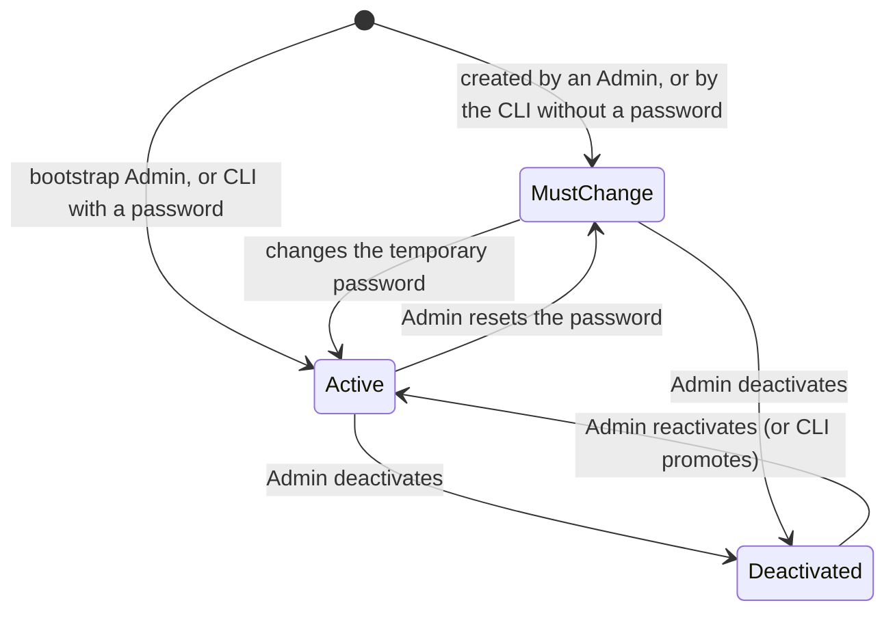
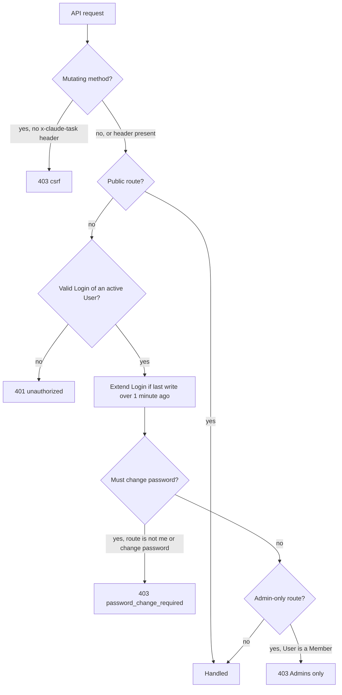

# Users and authentication

This area establishes who is using the platform and what they may do. It covers **Users** and their two roles (**Admin** and **Member**), **Logins** (authenticated browser and app sessions), logging in and out, setting, changing and resetting passwords, deactivation, the first Admin of a new installation, recovery through the command line, how web and native clients authenticate their requests, and the permission rules every other area relies on. The platform is a self-hosted tool for one internal team, so access is all-or-nothing per installation: every active User sees every Project, and the role only decides who administers the platform.

## Concepts

- A **User** is a team member with a Login to the app. A User has an email address, a display name, a password, a role, and an active flag. Email addresses are unique and compared case-insensitively; the address is stored as entered.
- The **role** is either **Admin** or **Member**. Members work with Projects, Tasks, Comments and Agent assignments. Admins can do everything Members can, and also manage Users, Agents, Credentials, Extensions, Git Connections, project secrets, and permanent Project deletion. The full matrix is in [Permissions](#permissions).
- A **Login** is one authenticated browser or app session of a User. A User can hold many Logins at once, one per browser or device. A Login is unrelated to an Agent's **Session** (see [Agent Sessions](agent-sessions.md)).
- A **temporary password** is a password chosen by an Admin or generated by the platform. A User holding one has the "must change password" flag set and has to choose their own password before doing anything else.
- An **Actor** is whoever performed an action: a User, an Agent or the system. Revisions, Comments and created Tasks record their Actor, and the display name is resolved when read, so a renamed User shows the new name everywhere.

## Behaviour

### Logging in

A User logs in with email and password.

- The email is trimmed and matched case-insensitively. Both fields are required; the email accepts up to 320 characters and the password up to 200.
- On success the platform creates a new Login and answers with the User (id, email, display name, role, active flag, "must change password" flag, timestamps). Responses leave out the password hash.
- A wrong password, an unknown email and a deactivated account all get the same answer: `401` with the message "Invalid email or password". For an unknown email the platform still spends the time of a full password check, so response timing reveals nothing about which addresses exist.
- A User holding a temporary password logs in normally; the response carries the "must change password" flag and the web app goes straight to the password change screen.

The web login page sends the User back to the page they originally asked for (a `next` parameter holding a path on the same site), or to the Projects list. Logging in clears every cached query and unsent Comment draft of the previous User in that browser.

#### Rate limiting

Failed login attempts are counted per client IP address and per email, in fixed 15-minute windows. After 10 failures for the same IP or the same email within a window, further attempts for that key are answered with `429`, code `rate_limited`, and a `Retry-After` header in seconds, even when the password is right. Blocked attempts are not counted again.

- The per-email limit protects one account from guessing spread over many addresses; the per-IP limit protects all accounts from one client.
- A successful login clears that email's counter. The IP counter keeps running until its window ends.
- Counters live in the backend's memory, so they reset when the backend restarts.
- Behind a reverse proxy, `TRUST_PROXY=true` makes the client IP come from `X-Forwarded-For`; otherwise the direct peer address is used.

### Logins

A Login is identified by a random 256-bit token handed to the client in the `ct_login` cookie. The backend stores only the token's SHA-256 hash.

- The cookie is `HttpOnly`, `SameSite=Lax`, scoped to the whole site, and `Secure` unless `COOKIE_SECURE=false` (meant only for plain-HTTP local development). Its lifetime is 30 days.
- A Login expires after 30 days without activity. Every authenticated request pushes the expiry to 30 days from now. To spare the database, the last-activity time is written at most once a minute; whenever it is written, the cookie is sent again with a fresh 30-day lifetime, so a Login in daily use never expires.
- Expired Logins are purged every hour.
- A Login stops working as soon as its User is deactivated, even before the Login row is removed.

A Login ends when:

| Event | Logins ended |
| --- | --- |
| The User logs out | That Login |
| The User changes their password | Every other Login of the User; the current one stays |
| An Admin resets the User's password | Every Login of the User |
| An Admin deactivates the User | Every Login of the User |
| 30 days pass without activity | That Login |

When a Login ends through logout, password change, reset or deactivation, every live WebSocket connection opened with it is closed at once with close code `4001` ("logged out"). Phone push registrations made through a Login are removed together with it, so a phone stops receiving notifications for a User who logged out there (see [Clients](clients.md)).

### Logging out

Logging out ends the current Login, closes its live connections, and clears the cookie. It always answers `204`, also when the Login had already ended. Other Logins of the same User, on other browsers or devices, keep working.

### Changing your password

A logged-in User changes their password by giving the current one and a new one.

- The new password has 8 to 200 characters and differs from the current one. A wrong current password is answered with `400` "Current password is wrong"; reusing it with `400` "The new password must be different".
- On success the "must change password" flag is cleared and every other Login of the User ends; the Login used for the change stays signed in. The web app confirms with "Password changed" and, for a voluntary change, says the other sessions were logged out.
- The web form asks for the new password twice and checks that both match before sending.

### Forced password change

While a User holds a temporary password, their Login can reach only three things: reading their own User, changing their password, and logging out. Every other API request is answered with `403` and code `password_change_required`, and the live WebSocket connection is refused with `403`.

The web app routes such a User to the "Choose your password" screen, which labels the first field "Temporary password" and has no Cancel button. The navigation sidebar stays hidden until the change is done. After the change the User lands on the Projects list.

### Team list

Every User can list all Users, ordered by display name, including deactivated ones (with their active flag). This list feeds the assignee pickers and filters and shows names and avatars across the app. Pickers offer active Users only, plus whoever is already assigned to the Task being edited.

### User management (Admins)

The Users page (under the admin section of the sidebar) lists every User with name, email, role and a status badge: **Active**, **Invited** (still holding a temporary password) or **Deactivated** (shown dimmed).

**Creating a User.** An Admin gives an email (a valid address, up to 320 characters), a display name (1 to 100 characters after trimming) and a role (Member by default). The temporary password is either chosen by the Admin (8 to 200 characters, through the API) or generated: 16 URL-safe random characters. The response, `201`, carries the new User and the temporary password; this is the only time the password is shown. The web app displays it in a dialog with a copy button and asks the Admin to share it. An email already in use, in any letter case, is answered with `409` "A user with this email already exists".

**Editing a User.** An Admin can change any User's display name, role and active flag. Role changes take effect on the User's next request, since the role is read on every request. The web Users page offers the role and the active flag; the display name is editable through the API.

**Deactivating a User.** Deactivation ends every Login of the User and closes their live connections immediately. A deactivated User's login attempts get the same answer as a wrong password. Their Comments, Revisions, created Tasks and assignments stay, still showing their name. The web app asks for confirmation first. **Reactivating** a User restores login with their existing password.

**Resetting a password.** An Admin can give any User a new generated temporary password. The User's Logins all end, the "must change password" flag is set, and the response shows the temporary password once. The web app confirms first, warning that the User will be logged out everywhere. Resetting keeps the active flag as it is.

**At least one active Admin.** The platform always keeps at least one active Admin. Demoting or deactivating the last active Admin, including oneself, is answered with `400` "There must always be at least one active admin". Concurrent role and activation changes are serialized, so two Admins demoting each other at the same moment leave exactly one Admin and every request gets a clean answer.

Users stay in the system for good: deactivation is how access ends, so every Actor reference keeps resolving to a name. An unknown User id is answered with `404`.

### The first Admin

A new installation gets its first Admin from the environment. On startup, when the database has no Users at all and both `ADMIN_EMAIL` and `ADMIN_PASSWORD` are set, the backend creates an active Admin with that email and password and the display name from `ADMIN_NAME` (default "Admin"). This Admin has no temporary password and can log in right away. Once any User exists, these variables are ignored, so changing them later has no effect.

Without these variables nobody can log in until an Admin is created with the command line.

### Recovering access from the command line

The backend ships a `create-admin` command, run where the backend can reach the database (`DATABASE_URL`). It applies pending migrations first. It takes `--email` (required), `--password` (optional, or taken from `ADMIN_PASSWORD`) and `--name` (optional).

- **No User with that email** (case-insensitive): it creates an active Admin. With a password, that password is set and the Admin can log in directly. Without one, a temporary password is generated, printed once, and must be changed at first login. The display name defaults to the part of the email before `@`.
- **A User with that email exists**: it promotes them to Admin and reactivates them. A given password replaces theirs and clears the "must change password" flag; without one they keep their current password. A given name replaces their display name.
- A given password needs at least 8 characters; a shorter one stops the command with an error.

The command prints "Created admin <email>" or "Promoted admin <email>". It is the way back in when every Admin is locked out or deactivated.

### How clients authenticate

Every API request is authenticated with the `ct_login` cookie, for the web app and for the native app alike.

**Web app.** The browser holds the cookie and sends it with same-origin requests. When any request comes back `401`, the app re-checks the current User and, if the Login is gone, sends the User to the login page, keeping the page they were on as the destination after login.

**Native app.** The Flutter app asks for the installation URL at login: an `http` or `https` address with a host and no path, query, fragment or credentials. It logs in with email and password, reads the `ct_login` value from the response, and keeps it, together with the installation URL and the User, in the platform's secure storage; the password itself stays out of storage. It sends the cookie explicitly on every HTTP request and on the WebSocket handshake, and stores the refreshed value whenever the backend sends the cookie again. A `401` ends the app's Login locally with "Your Login expired. Sign in again." On logout the app asks the backend to end the Login; if the backend is unreachable, it keeps the Login aside in secure storage, uses it for nothing else, and retries the logout on the next start or reconnection. Each app profile holds one installation and one User at a time. Local caches, offline behaviour and push registration are described in [Clients](clients.md).

**Cross-site request forgery.** Every API request with a method other than GET, HEAD or OPTIONS carries the `x-claude-task` header (any value). A request without it is answered with `403` and code `csrf`, before authentication is checked. Combined with the `SameSite=Lax` cookie, this keeps other sites from making state-changing requests on a User's behalf. The WebSocket handshake carries no such header; instead, when the handshake has an `Origin`, its host must match the backend's host, or the connection is refused with `403`. Native clients send no `Origin`.

**Other credentials.** Machine callers use their own tokens and no Login: the Runner authenticates with its Agent's runner token (see [Runner](runner.md)), the Task Tools server with the Job token (see [Agent Sessions](agent-sessions.md)), and the Git Proxy with the Job token over HTTP Basic auth (see [Git integration](git-integration.md)). These endpoints need no CSRF header because they receive no cookies.

### Request guard

Every API route requires a Login unless it is explicitly public. The public routes are login, logout, and the machine endpoints above, which check their own tokens.

Errors share one shape: an `error` object with a machine-readable `code`, a human `message`, and optional `details` (for validation failures, the list of invalid fields).

### Permissions

There are no per-Project permissions: every active User sees and works on every Project. The role decides administration only.

| Area | Every User | Admins only |
| --- | --- | --- |
| Users | List all Users; change own password | Create Users, edit display name, role and active flag, reset passwords |
| Projects | Create, edit, archive, unarchive; manage Statuses and Tags; link the Repository; edit the Setup Script and Agent Instructions; read environment variables (secret values redacted) | Permanently delete an archived Project; create, import, overwrite and delete environment variables and secrets |
| Tasks | Create, edit, move, delete; assign Users and Agents | |
| Comments | Post Comments and Internal Notes; edit own Comments; delete own Comments | Delete any Comment |
| Agents | List Agents and see their state, builds, Queue, Jobs and usage; reorder and remove Queue Entries; Stop, Retry and Notify agent on a Task | Create, edit, duplicate, delete Agents; set and remove avatars; rebuild, restart and recreate containers; read container logs |
| Credentials | | Everything, including listing |
| Extensions | List Skills and Plugins | Import and delete Skills; list, create, edit and delete MCP servers; create, edit, update and delete Plugins |
| Git | List linkable Repositories | List, create, edit and delete Git Connections |
| Wikis | Create, edit, Reset Chat, delete; converse | |
| Notifications | Own follow, mute and read preferences; own push devices | |

Admin-only actions answer anyone else with `403` "Admins only". The web app hides the Extensions, Credentials, Git and Users entries of the sidebar from Members, and shows "Delete permanently" on archived Projects to Admins only; a Member opening the Users, Credentials or Git page by URL sees "Not found", and the Extensions page says "Admin access required." Details of each action live in the area's own spec.

## Architecture

The **auth module** in the backend owns password hashing, Logins, the request guard and the login rate limiter. The guard runs before every API route: it applies the CSRF check, resolves the Login from the cookie, extends it, enforces the forced password change and the route's required role, and hands the authenticated User to the route. Routes declare their access level (public, any User, Admin), whether they stay reachable during a forced password change, and whether they skip the CSRF check.

The **users module** owns the team list, User management, the first-Admin bootstrap and the create-or-promote operation used by the command line. Changes to Users that end Logins happen in one database transaction; once it commits, the realtime hub closes the affected live connections.

The **realtime hub** tracks each live connection's User and Login, so it can close them by Login (logout, password change) or by User (deactivation, reset). The transport itself is described in [Clients](clients.md).

The **command-line entry point** runs outside the web server, connects to the same database, and reuses the users module.

## Data model

- **User**: email (unique case-insensitively), display name, password hash, role (`admin` or `member`, default `member`), active (default true), must change password (default false), created at, updated at.
- **Login**: id (SHA-256 of the cookie token), User, created at, last seen at, expires at. Deleted when it ends; removed together with its User's push device registrations.
- **Actor** (used by other areas): a type (`user`, `agent`, `system`) and, for Users and Agents, an id. The display name is resolved at read time: "System" for the system, "Unknown user" or "Deleted agent" when the referenced record is gone.

## Non-functional requirements

- Passwords are hashed with argon2id. Login tokens carry 256 bits of randomness and are stored only as SHA-256 hashes.
- Failed logins are limited to 10 per 15 minutes per IP and per email.
- Logging out, changing a password, resetting a password and deactivating a User take effect on the very next request and close live connections immediately.
- An unknown email takes as long to reject as a wrong password.
- Secrets handled by other areas are encrypted at rest and never logged; responses leave out password hashes, and temporary passwords appear only in the response that issues them.

## Decisions

- **Server-side Logins with an opaque cookie token.** Logout, password changes, resets and deactivation must end access at once, including open WebSocket connections. A database row per Login gives that directly; stateless tokens would need a revocation list consulted on every request anyway.
- **Sliding expiry written at most once a minute.** A Login in use never expires, while the database sees one write per minute per active Login instead of one per request.
- **Two roles and no per-Project permissions.** The platform serves one small internal team. Every User sees every Project; the Admin role guards only what can leak secrets, cost money or destroy data: Users, Agents, Credentials, Extensions, Git Connections, project secrets and permanent deletion.
- **Admins hand out temporary passwords, and Users must replace them.** Onboarding needs no email setup, and the forced change means the Admin never knows a User's real password.
- **First Admin from the environment, recovery from the command line.** A new installation is usable immediately without a setup wizard, and an installation whose Admins are all locked out can always be recovered by someone with database access.
- **Always at least one active Admin.** Without one, User and Agent administration would be unreachable from the app.
- **CSRF defense through a required custom header plus `SameSite=Lax`.** Browsers refuse to send custom headers cross-site without a CORS preflight the backend never grants, so the header proves the request came from the app. It costs clients one constant header and needs no token handshake.
- **Native apps reuse the browser cookie as their credential.** The backend keeps one authentication mechanism for every client, with the same expiry, revocation and rate limiting. The app stores the cookie in the platform's secure storage instead of a cookie jar.
- **In-memory login rate limiter.** The backend runs as a single process, so a counter in memory is enough to slow down password guessing without another datastore.
- **Uniform login errors.** Wrong passwords, unknown emails and deactivated accounts look the same from outside, so the login form reveals nothing about who has an account.

## Related specs

- [Board](board.md): Projects, Statuses, Tags and Tasks, which every User can work on.
- [Conversation](conversation.md): Comments and the rules for editing and deleting them.
- [Agents](agents.md): the Admin-only management of Agents, Credentials, Extensions and project secrets.
- [Agent Sessions](agent-sessions.md): the Job token used by Task Tools, and Session controls open to every User.
- [Runner](runner.md): how the Runner authenticates with its Agent's token.
- [Git integration](git-integration.md): Admin-managed Git Connections and the Git Proxy's Job-token authentication.
- [Wikis](wikis.md): Wikis, open to every User.
- [Clients](clients.md): the web and native apps, the realtime transport, local storage and push registrations.
