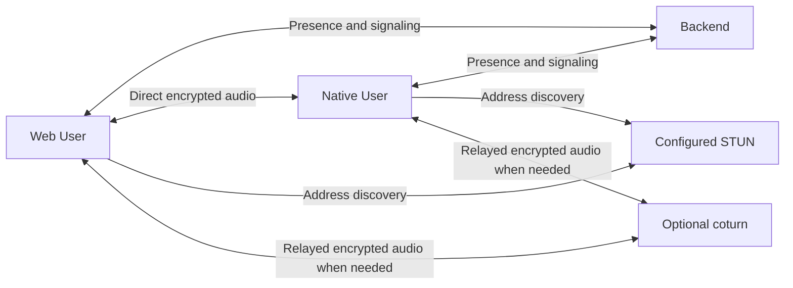

# Voice Rooms

Each Task has a shared Voice Room where up to six Users talk simultaneously. Users join from the web app or native app and keep talking while navigating elsewhere. WebRTC prefers direct audio between devices and uses an optional TURN service when direct connectivity fails. The backend handles membership, connection negotiation and temporary relay credentials.

## Concepts

A Voice Room belongs to one Task. Its participants are Users, each represented by one active connection and a fresh participation identifier. The room is available even when empty. Task Status and Agent assignment are independent of voice participation.

## Behaviour

### Joining and leaving

Every authenticated User can inspect and join a Task's room. Join requests first acquire microphone permission and enable local audio processing. A room accepts six Users, including the joining User. A seventh receives a room-full error. Opening a Task or subscribing to its events only observes the room.

A User participates in one room on one device at a time across the Installation. Joining elsewhere returns the current participation and asks for confirmation before transferring. The confirmed request names the participation being replaced, so a stale confirmation cannot replace a newer participation. Capacity and Task existence are checked before replacing the previous participation.

The room displays participant names, microphone mute state and each local connection's condition. Users can mute their microphone, silence incoming audio, retry failed peer connections and leave. Navigation preserves participation and displays persistent voice controls with a link back to the Task. Closing the client, ending its Login or deleting its Task releases participation. The last departure releases the room's transient state.

### Connection failures

Each participant creates a WebRTC connection to every other participant. ICE chooses direct connectivity where possible and may use the configured TURN relay when needed. With six Users, each device has five peer connections. Successful links remain usable when another link fails. The interface identifies each connecting, connected or unavailable peer and offers retry. A device marks a link unavailable after 20 seconds without a successful connection. It explains that the current networks may prevent an audio connection and offers retry or a different network.

Losing the signaling connection stops local audio and clears participation. The client explains the interruption and offers an explicit join after signaling reconnects. This prevents an old device from silently reclaiming participation after a transfer. A backend restart clears the in-memory rooms; clients recover through the same explicit join flow.

### Audio and platforms

Microphones request echo cancellation, noise suppression and automatic gain control through the platform's WebRTC implementation. Processing happens locally before transmission. Platform support and acoustic quality vary; users receive permission and capture failures as actionable errors. Incoming audio playback blocked by a browser requires an explicit resume action.

Web capture requires HTTPS or localhost. The native app uses the same signaling contract and interoperable WebRTC audio. iOS configures communication audio and the audio background mode. Android starts a microphone foreground service, with an ongoing notification, while the app is visible and microphone permission is granted. A User can continue an active room while another app is open or the screen is locked. Leaving, transfer, logout and connection loss stop capture and background resources.

Audio is live communication between Users. The Conversation and Agent Session retain their existing text-based delivery rules.

## Architecture

The authenticated live WebSocket carries join, leave, mute and peer-directed signaling commands. Shared types define the contract. Room snapshots reach participants directly and Task observers through the existing Task topic. An authenticated HTTP endpoint returns a room snapshot for initial loading, and join responses include the Installation's STUN/TURN configuration and the expiry of any temporary relay credentials.

The backend keeps membership in memory and indexes it by User and connection. Each room's membership changes are synchronous after asynchronous Task validation. It validates command schemas and applies per-connection rate and message-size limits. Signaling accepts bounded offers, answers and ICE candidates only between current participants of the same room. Sender identity comes from the authenticated socket. Expired participation identifiers are rejected. Each negotiation has a fresh exchange identifier; peers discard candidates from older negotiations and buffer at most 64 candidates while awaiting a description. The participant whose identifier sorts first creates offers, including when its peer requests a retry.

STUN URLs are configured through `VOICE_STUN_URLS`, a comma-separated list of `stun:` or `stuns:` URLs; an empty value selects host candidates only. The default is `stun:stun.l.google.com:19302`. Peers use STUN for address discovery. When `VOICE_TURN_HOST` and `VOICE_TURN_SECRET` are both set, the backend also provides authenticated `turn:` URLs for UDP and TCP on `VOICE_TURN_PORT` (default 3478). Setting `VOICE_TURN_TLS_PORT` additionally provides a `turns:` TCP URL for that public port. The TURN hostname has no default. Partial settings, URLs in place of hostnames, invalid ports and secrets shorter than 32 characters fail at startup.

### Temporary relay access

Each successful join receives credentials scoped to a User and a random issuance identifier. The username starts with its Unix expiry timestamp. The password is a base64 HMAC-SHA1 of that username using the shared TURN secret, following coturn REST authentication. `VOICE_TURN_TTL_SECONDS` defaults to 86400 and accepts 300 through 86400 seconds. Only the temporary username and password reach the joining client; the shared secret stays on the backend and relay.

Clients request fresh ICE configuration halfway through its remaining lifetime using the authenticated live connection and current participation identifier. The backend rejects stale participation identifiers. A successful refresh supplies new credentials and expiry; clients renew their peer connections with the new configuration while retaining room membership. A failed refresh or temporary signaling issue follows the existing connection recovery behavior.

### Additional relay service

The main Compose stack includes a pinned coturn service on its own network behind an explicitly enabled `turn` profile. Normal application deployment and development start the application and database only, and work with TURN settings unset. The application has no dependency on the local relay; explicit backend TURN settings may instead identify an independently deployed compatible service. Enabling the relay profile starts coturn alongside the application and database. At startup, the relay requires an explicit hostname, shared secret and public IPv4 address; the hostname has no default.

The relay publishes UDP and TCP 3478 and UDP relay ports 30000 through 30199. Administrators set the public hostname and external IPv4 address explicitly and forward these ports unchanged through NAT. The relay binds its concrete container IPv4 address and maps that address to the supplied public IPv4 address. A separate optional TLS overlay publishes an explicitly supplied public TLS port mapped to container TCP 5349 and requires a certificate and private key mounted read-only. TLS uses version 1.2 or newer. Empty TLS configuration enables UDP/TCP relay without TLS. Leaving backend hostname, secret and TLS port unset selects direct connections with configured STUN discovery.

The service renders its shared secret into a temporary configuration with mode 0600, uses a read-only root filesystem and disables its administration interface. Allocations require temporary credentials. Production peer policy excludes loopback, private, link-local and multicast destinations. Each credential accepts 64 allocations; total allocations are bounded at 1000, bandwidth at 64 KiB/s per allocation and 10 MiB/s overall. Coturn reserves per-allocation bandwidth while gathering candidates, including unused transport alternatives. The 64 KiB/s reservation and 10 MiB/s overall cap accommodate the six-User mesh across UDP, TCP and TLS candidates. The relay range bounds simultaneous UDP allocation capacity independently of those quotas.

## Data model

Room snapshots contain Task identity and participants. Each participant contains a fresh identifier, User identity and microphone mute state. Participation identifiers also scope signaling messages so delayed messages from a previous room cannot reach a new one. Room state, SDP and ICE data are transient. Persistent storage continues to hold Tasks, Users and Logins.

## Non-functional requirements

Each room accepts at most six Users. Client control messages accept up to 64 KiB; individual descriptions accept up to 16 KiB and candidate strings up to 2 KiB. Voice commands accept 120 messages per ten seconds per live connection, with at most 128 queued commands. Overloaded leave requests close the live connection and release membership. Audio processing remains on participating devices. Media packets travel directly or through the separate TURN service; the application backend carries signaling. The existing live connection heartbeat removes dead clients. Server logs omit SDP, candidate payloads and microphone content.

## Decisions

- **A WebRTC mesh serves small rooms with an optional TURN fallback.** The six-person limit bounds device fan-out. TURN improves connectivity while keeping media off the application backend.
- **TURN is an optional service in the main Compose stack.** An explicit profile starts the local relay, keeping development and normal deployments free of relay startup and configuration requirements. Explicit backend settings can also select an independently deployed relay. Media prefers direct connections, and the public hostname always comes from explicit configuration.
- **Existing live connections carry signaling.** Authentication, Login revocation and reconnect behavior stay consistent with the rest of the app.
- **Membership is transient.** Voice has no durable content; storing membership would retain stale participants after restarts.
- **Transfers require a current participation identifier.** Confirmation is deliberate and a delayed confirmation cannot evict a newer device.
- **Built-in local processing comes first.** Real-device audio checks determine whether later local filters are useful.

## Related specs

- [Clients](clients.md): navigation, live connections and persistent voice controls.
- [Users and authentication](users-and-auth.md): User identity and Login revocation.
- [Board](board.md): Task lifecycle.
- [Conversation](conversation.md): text communication and Agent delivery.
