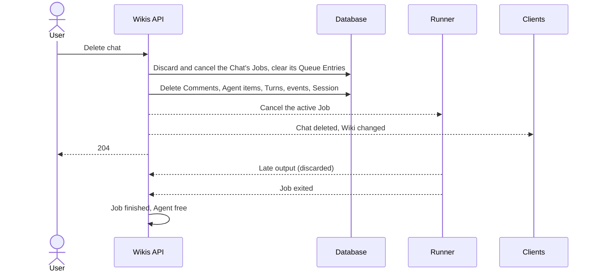
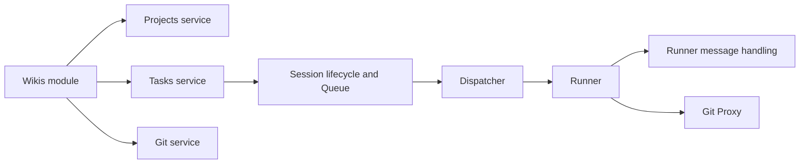

# Wikis

A Wiki is a shared knowledge base kept in a Repository of Markdown files, together with the Skills and conventions that maintain it, plus any number of **Chats** that every User shares with the Wiki's Agent. Users ask questions and request changes in a Chat; the Agent reads and edits the Repository from its Worktree, following the Repository's own instructions. Wikis have their own section in the web and Flutter apps, separate from Projects. Underneath, each Chat is a Task of the Wiki's own Project: its Comments, Agent Session, Queue, streaming, Git access and notifications are those of a Task, so every rule of [Conversation](conversation.md) and [Agent sessions](agent-sessions.md) applies to a Chat. The area adds what is specific to Wikis: creating and managing them, and the Chats themselves. **New Chat** starts a clean Claude conversation while keeping the others, past Chats stay readable and continuable, and **Delete Chat** removes one for everyone while keeping the Repository files.

## Concepts

- A **Wiki** has a name, a description, a Repository with its Base Branch, and one assigned Agent.
- Each Wiki is stored as a **Wiki Project**: a Project of kind `wiki`, with its own default Statuses and an internal Project Key made of `W` followed by five uppercase letters (for example `WKDPAB`). Wiki Projects appear only in the Wiki section.
- Every Chat of a Wiki is a **Task** of its Wiki Project, numbered from 1 and carrying the Wiki's name and description as its title and description. The first Task, the **backing Task**, also holds what the Wiki shares: its Task Branch and pull request, and the preferences clients read for the Wiki as a whole. Task Keys (for example `WKDPAB-2`) are internal, though they can appear in the Agent's Task Tools, Agent Queues and notifications.
- A **Chat** is one of the Wiki's separate conversations: one such Task with its Comments, Agent work, Session and Claude conversation. Chats are open to every User. A Chat has an Agent: the Wiki's Agent when the Chat was created, never changed afterwards. A Chat's id is its Task's id, and clients use the Task APIs (Comments, Timeline, Session controls, preferences, real-time topic) with it.
- A Chat is listed from its first User Comment. **New Chat** hands out the Wiki's empty Task (one with no Comments), creating one when there is none; nothing is listed until a Comment is sent.
- Every Chat shares the Wiki's Repository, Task Branch, Worktree and pull request, which belong to the backing Task.
- The **chat generation** of a Task counts how many times its conversation was deleted. It starts at 0 and grows by one on each Delete Chat, so a client can tell that the Chat it cached was emptied.
- A Session has a **Claude session identity**: the id its `claude` conversation is created and resumed with. It is the Session's own id until its Chat is deleted, which gives it a new random identity.
- **Delete Chat** clears one Chat for every User. The Repository, Task Branch, Worktree and pull request stay as they are.

## Behaviour

### Wiki section

The web app has a Wiki entry in the sidebar, next to Projects. It lists every Wiki as a card with its name, its description (or the Repository's `owner/name` when the description is empty) and the Repository, ordered by name, with a **New wiki** button. Opening a Wiki shows its latest Chat and its Chat list.

The Flutter app has a Wiki entry in its navigation rail and a permanent Wikis entry in the phone drawer. Both open the Wiki list even when it is empty. The list header, its empty state and the phone drawer offer **New wiki**. On wide windows the Wiki list sits beside the selected Wiki's Chats; on narrow ones the screens are successive (Wiki list, Chat list, Chat), and going back returns one level. Creating a Wiki and deleting a Chat need a connection; a Wiki whose Chats are cached opens offline.

Every signed-in User sees every Wiki. Wiki Projects stay out of the Projects list and its counts.

### Creating a Wiki

Every User, Admin or Member, can create a Wiki. The form asks for:

- **Name**: required, 1 to 200 characters after trimming.
- **Description**: optional, up to 100,000 characters.
- **Agent**: required. Clients offer the enabled Agents; the API accepts any existing Agent.
- **Repository**: required, chosen among the Repositories reachable through every Git Connection, labelled with the connection's name and `owner/name`. Connections that fail to list their Repositories show their error next to the list. Users add Git Connections from the web Git settings (see [Git integration](git-integration.md)).
- **Base Branch**: optional, pre-filled with the Repository's default branch, which is also the value when it is left empty.

The Repository is expected to already contain the Markdown files and the Skills that maintain them; a `CLAUDE.md` describes its conventions.

Creation checks the Repository first: the Git Connection must exist, the Repository must be reachable through it, and the Base Branch must exist there. Base Branch Protection is checked and stored as information, as for any Project. A missing or unreachable Repository, a missing Base Branch, an unknown Git Connection or an unknown Agent answers `400`.

Then, in one transaction, the backend:

1. picks a free internal Project Key;
2. creates the Wiki Project with the default Statuses, the Repository, and the fixed Wiki Agent Instructions (below);
3. creates the backing Task with the Wiki's name as title and description as description, priority `none`, no Tags and no User assignees, created by the User, who therefore follows it;
4. assigns the Agent (each Chat creates its own Session, so none exists yet);
5. announces the change on the Wikis real-time topic.

Any failure leaves nothing behind. The new Wiki opens right after creation.

The Wiki Agent Instructions, appended to every Wiki Session's system prompt as the Project's Agent Instructions, read: "This repository is a shared Wiki made of Markdown files. Follow its CLAUDE.md, repository skills and conventions for reading and maintaining the Wiki. Treat the conversation as a shared discussion with multiple Users. Preserve existing documentation and skills."

### Chats

Opening a Wiki shows its most recently active Chat. When the Wiki has no Chat yet, it shows an empty composer, on the Wiki's empty Task that New Chat reserves. The Chat list, ordered by latest activity, shows for each Chat its title, the time of its last Comment, an unread indicator and whether the Agent is working on it. A User opens any Chat to read it and to write in it.

**Starting a Chat.** **New Chat** opens an empty composer on the Wiki's empty Task. The first User Comment sent from it makes the Chat appear in the list; the Chat's Session is created `pending` by the Task's Agent assignment (the Wiki's current Agent) and that Comment acts as its trigger, as on any Task. Calling New Chat again before a Comment returns the same empty Chat, so empty Chats never pile up.

**Titles.** Any User can rename a Chat. Before a rename the title is the first User Comment of the Chat, trimmed and truncated to 60 characters ("Chat" when it has none). A renamed title stays as it is; titles are not generated by Claude.

**Continuing a Chat.** A new Comment in an older Chat is delivered to that Chat's Session, which resumes its own Claude conversation in the Wiki's shared Worktree. Two Chats of one Wiki queue like any two pieces of work of an Agent: the Agent runs one Job at a time, in the order of its Queue, and each Chat has its own Queue Entry.

**Chats and the Wiki's Agent.** A Chat belongs to the Agent that was the Wiki's when it was created. When the Wiki's Agent changes, the Sessions of the Chats run by the previous Agent are paused and those Chats stay readable; a Comment sent to one of them is answered with `409` naming the Agent that runs it, and clients disable the composer with that explanation. When the Wiki returns to that Agent, its Chats continue where they stopped. An empty Chat, or one whose Agent was deleted, takes the current Agent when its next Comment arrives, and Chats created afterwards belong to the new Agent. Internal Notes, which no Agent receives, are accepted in every Chat.

**A Chat whose conversation is no longer available.** When `claude` cannot resume a Chat's Session because its transcript is missing (for example after the Agent Volume was recreated), the Session is marked not started and a System Comment in the Chat says so. The next Comment starts a new conversation in the same Chat, whose first Message holds the Wiki's description and the Chat's earlier Comments (see [Agent sessions](agent-sessions.md)).

### The shared conversation

A Chat is a conversation open to every User: Comments, Internal Notes, Attachments, delivery badges, streaming Agent output, Thinking, Activity and Turn Summaries all work as on a Task (see [Conversation](conversation.md) and [Agent sessions](agent-sessions.md)). Read positions, Drafts and the Internal Note flag belong to each Chat.

- A Wiki's Session stays `idle` between conversations. It keeps the Agent's container running for 30 minutes after the last Job (`AGENT_WIKI_IDLE_MINUTES`); after that the container stops until the next Comment (see [Agents](agents.md)).
- Assigning an Agent to a Wiki starts nothing. The first User Comment of a Chat starts its Session; later Comments are injected into the running Turn or queued, as on any Task.
- The Agent works in the Worktree of the Wiki's Repository on the backing Task's Task Branch, whichever Chat it serves. `claude` loads the Repository's `CLAUDE.md`, Skills and settings, so the Wiki's own conventions drive the Agent. A Chat resumed later sees the files as they are now, which may differ from what it remembers.
- The Agent reaches git only through the Git Proxy and pushes only its Task Branch; it opens or updates the Wiki's single pull request towards the Base Branch with its Task Tools, as on a Task (see [Git integration](git-integration.md)). The Wiki view shows the Task Branch link and the pull request badge once they exist.
- Session controls are the Chat's own: the Session state chip, **Stop** while a Turn runs, and **Retry** after a Job failed to start. The Flutter app also offers Notify agent when the Wiki's name or description changed since the Agent last read it.
- The web Wiki view shows Comments and the Agent's work and leaves out Revisions. The Flutter app shows the Chat without the Task details panel.
- Users follow, unfollow, mute and unmute a Wiki like a Task, for all its Chats at once (the choice applies to every Task of the Wiki Project, and a new Chat starts with it; commenting in a Chat follows the whole Wiki); the Flutter app labels these actions "Follow wiki" and "Mute wiki". Phone notifications for a Wiki carry the Chat's id and open that Chat in the Flutter app.
- The Agent's Task Tools act on the Task of the Job, which is the Chat it works in.

### Editing a Wiki

Any User can change a Wiki's name, description and Agent from the Wiki settings (a dialog on the web, a sheet in the Flutter app). The settings in the Flutter app also link to the Repository, the Wiki's Task Branch and its pull request.

- A new name renames the Wiki Project and the title of every Chat's Task; a new description updates their descriptions too. Both are recorded as Revisions of those Tasks, so Notify agent can tell each Agent what changed.
- A new Agent pauses the Sessions of the previous Agent's Chats and unpauses the Sessions of the new Agent's earlier Chats (see Chats and the Wiki's Agent above and [Agent sessions](agent-sessions.md)). The Wiki's Agent is kept on its Project; Chats keep the Agent they were created with.
- A Wiki always has an Agent: the API accepts a different Agent and keeps the current one otherwise.
- The Repository and Base Branch are fixed at creation.

Every change is announced on the Wikis real-time topic so lists and open Wikis refresh.

### Delete Chat

Any User can delete a Chat. Clients confirm first: "Delete this chat and everything in it for everyone. Wiki files are kept."

In one transaction, Delete Chat:

- cancels every active Job of the Chat's Task and marks every Job of the Task to discard its output;
- removes the Task's Queue Entries from every Agent's Queue;
- deletes every Comment (with their Attachments' files), every Agent work item, every Revision, every Timeline position, every Turn and every raw stream event of the Task, and clears the stored projection, error output and setup output of its Jobs;
- sets every User's read position on the Task back to zero;
- gives every Session of the Task, including those of previously assigned Agents, a new Claude session identity and marks it as never started. The Task's current Agent's Session becomes `pending`; every other Agent's Session becomes `paused`. Each Session's Unseen Changes point, last Job time and closing state are cleared;
- increments the Task's version and its chat generation;
- broadcasts a reset event to everyone viewing the Chat and the Wiki changed event to the Wikis topic, and refreshes the Session and Queue views.

The emptied Task is not listed any more and is handed out again by the next New Chat. The next User Comment in it starts a new `claude` conversation (no resume) with the new identity, in the Wiki's shared Worktree. Its first Message contains the Wiki's description and only the Comments posted since the deletion.

Delete Chat keeps:

- the Wiki's Repository and every file in it;
- the Task Branch, the Worktree and the pull request;
- the Wiki's name, description and Agent, the other Chats, and every User's follow and mute choices;
- the Claude transcript of the Chat on the Agent Volume, which stays there until the Agent and its volume are deleted;
- the Task itself, emptied and unlisted, which the next New Chat reuses.

**A Job running during the deletion.** The cancelled Job keeps its Agent busy until the Runner reports that the process has exited, so the Agent never runs two processes at once. Until then:

- every event it sends, including output buffered before the cancellation, is acknowledged and dropped, so nothing reappears;
- the Git Proxy refuses that Job's token, so it can no longer push;
- when its Runner reconnects still holding the Job, the backend sends the cancellation again; when its Runner reconnects without it, the Job is closed as interrupted, with no projection, no resume and no System Comment.

When the process exits, the Job is finished and the Agent takes the next entry of its Queue.

**Clients.** The web and Flutter apps remove the Chat from the list as soon as they receive the reset event (or their own request succeeds), drop its cached pages and its live streaming text, and open the most recent remaining Chat. A client that missed the event, for example while offline, notices on its next fetch that the Chat is no longer in the Wiki's Chat list, or that its Task's chat generation differs from the one it cached, and discards its cached copy. Each Timeline page carries the chat generation it was read at, read consistently with its entries; when a page's generation differs from the Task's, the Flutter app fetches again (up to two more times when a deletion lands between the two requests) and reloads the whole conversation when an older page belongs to another generation.

### Deleting a Wiki

Any User can delete a Wiki after confirming: "Delete this wiki and its chat from the app. The remote repository is kept." Deletion removes the Wiki Project, its backing Task, Chats, Sessions, Comments, Attachments and their files, and asks the Agents to remove their Worktrees. The Repository, its Task Branch and any pull request stay on the code host.

Deleting a Wiki whose Agent is running a Job, including a Job cancelled by a Chat deletion that has not exited yet, answers `409`, as for a Task (see [Board](board.md)); the User stops the Agent and tries again.

## Architecture

- The **Wikis module** exposes the Wiki API: list, read, create, update and delete, plus its Chats: list, rename and delete (a Chat is created by its first Comment). It builds on the Projects and Tasks services for storage and on the Git service to resolve and check the Repository. Every other Wiki behaviour comes from the Task it owns.
- The **Projects module** treats a Wiki Project as absent: listing, reading, editing, archiving, deleting, its Statuses, Tags, Agent settings and Repository all answer `404` for a Wiki Project. Its Tasks (every Chat) answer `403` to changes, moves and deletion through the Tasks API, which leaves Comments, Attachments, the Session controls and the Timeline working. Both use the Wiki API instead.
- The **Session lifecycle and dispatcher** (see [Agent sessions](agent-sessions.md)) treat each Chat as a unit of work of its Agent, with its own Session and Queue Entry. The dispatcher starts `claude` with the Session's Claude session identity, as a new conversation when the Session has never started and as a resume after that, in the Wiki's shared Worktree. Delivery queues Comments while the Chat's running Job is marked to discard its output.
- The **Runner message handling** accepts only the exit of a discarded Job and ignores the rest of its events; reconnection and recovery skip the projection for it.
- The **Git Proxy** admits a Job only while it is active and not discarded, and lets a Chat's Job push the Task Branch of the Wiki's backing Task (see [Git integration](git-integration.md)).
- **Real-time:** the `wikis` topic carries a "Wiki changed" event with the Wiki's id on create, update, Chat rename, Chat deletion, delete and every Comment in any Chat (so Chat lists keep their order and unread state); each Chat's Task topic carries its conversation events and the reset event. See [Clients](clients.md) for transport.

## Data model

- **Wiki**, as the API returns it: id (the Wiki Project's id), name, description, Repository (with Base Branch and Base Branch Protection), Agent, backing Task id, created and updated times.
- **Task**: a Wiki's Chat. Gains a chat generation, starting at 0, and an optional Chat title set by a rename. A Chat's title, last-activity time and Agent are read from its Task, its Comments and its Session.
- **Project**: gains a kind, `project` or `wiki`. A Wiki Project keeps the Wiki's Agent as its default Agent.
- **Session**: an optional Claude session identity (the Session's id when empty); Sessions keep their `started` flag, which Delete Chat clears.
- **Job**: a discard-output flag, set by Delete Chat on every Job of the Chat's Task.

A Wiki lives until it is deleted; deleting it removes the Wiki Project and everything that belongs to it.

## Non-functional requirements

- Creating a Wiki is atomic: a failed creation leaves no Project, Task or Session.
- Delete Chat is atomic and complete: once it commits, no User and no client can read the Chat's Comments, Agent output, Turns or stream events, and no late event from a running process brings any back.
- Deleting a Chat keeps the one-Job-per-Agent rule: the Agent stays busy until its cancelled process exits.
- The Chat list returns every Chat of a Wiki in one response, with no paging.
- Wiki APIs require a signed-in User, as every API.

## Decisions

- **A Wiki is a Project of kind `wiki`, and each of its Chats is a Task of that Project.** It reuses the multi-user conversation, Attachments, Queue, streaming projection, Git isolation, read positions and notifications without a second scheduling model, and gives each Chat its own Session. The alternative, adding a Chat entity and a Chat reference to Comments, Sessions, Jobs, Queue Entries and every notification path, would touch every runtime path for identical behaviour. The cost is that internal Task Keys can appear in Agent tools, Queues and notifications (Wiki clients open those notifications in the right Chat), and that the Wiki's shared state (branch, pull request, following) is kept on the first Task.
- **A separate Wiki API and section on web and mobile.** Users meet Wikis as their own thing, with no Board, Statuses or Task fields to manage. The ordinary Project and Task APIs treat a Wiki Project as absent and refuse changes to its backing Task, so a Wiki's only way to change is its own API and the conversation.
- **The Repository, Wiki Project and backing Task are created in one transaction.** A Wiki exists completely or not at all. Later Chats are created by New Chat.
- **Git keeps the Task Branch policy.** The Agent edits the Wiki on its Task Branch and proposes changes through a pull request, under the same Push Policy as any Task.
- **A Wiki holds many Chats, each with its own Session and Claude conversation.** Users want a clean Claude session without losing history, and to go back to an old conversation and keep talking. One Session per Chat makes that a plain resume. The alternative, a single active Chat with an archive and a swap on "Resume", needs an archived state and a swap that surprises people. With Chats the one-Job-per-Agent rule still holds, so nothing runs in parallel.
- **A Chat is bound to the Agent that was assigned when it was created.** Its transcript lives on that Agent's volume, so only that Agent can resume it. When the Wiki changes Agent, those Chats stay readable and cannot be continued until the Wiki returns to that Agent. Changing the Agent silently on resume, or restarting the Chat on the new Agent, would have side effects for every User.
- **A Chat is listed from its first Comment, and an unused one is handed out again.** No empty Chats pile up and the first User Comment stays the trigger.
- **A Chat's title is its first Comment, renamable.** `claude -p` neither streams nor writes the title that interactive sessions have, so a Claude-generated title would need an extra Job on an Agent that runs one at a time.
- **Follow and mute belong to the Wiki; read positions, Drafts and the Internal Note flag belong to the Chat.** Following per Chat would make everyone subscribe to every new Chat, and unread and Drafts are about one conversation. Because Chats are Tasks, the Wiki-wide choice is applied to every Task of the Wiki Project and copied to each new Chat.
- **A cancelled Job keeps its Agent busy and discards its output.** Freeing the Agent at once would let a second process start beside the dying one; keeping its output would bring deleted messages back, even after a reconnect or a recovery.
- **The chat generation lets clients detect a deleted Chat without the live event.** The WebSocket event is transient; offline clients and clients that reconnect late compare generations (or notice the Chat gone from the list) and drop their cached conversation.
- **A Chat whose transcript is missing restarts from its own history.** An old Chat never becomes a dead end: the next Comment starts a new conversation seeded with the Chat's Comments, as for any Task. The cost is a Claude memory rebuilt from text instead of the original conversation, and the Chat says so.
- **Delete Chat clears the Task and keeps it for reuse.** Deleting the Task row would race with a Job still being cancelled and its late output; an emptied Task reuses the proven clearing rules. It also keeps the Claude transcript on the Agent Volume: volumes are short lived enough, and deleting the Agent removes the volume, so the platform does not add a message to the Runner just to remove a file.
- **Chats share the Repository, Worktree, Task Branch and pull request of the backing Task.** The Wiki's value is in its files and is one body of knowledge. Resume needs the same working directory, and a branch per Chat would multiply pull requests and conflicts for Users to resolve. Deleting a Chat never touches the files.
- **Deleting a Wiki keeps the remote Repository.** The app only stops tracking it; the code host remains the source of truth.

## Related specs

- [Conversation](conversation.md): Comments, Internal Notes, Attachments, delivery, following and notifications, all shared by Wikis.
- [Agent sessions](agent-sessions.md): Sessions, Jobs, Queue, assignment and reassignment, system prompt and the Timeline.
- [Board](board.md): Projects, Statuses and Tasks that Wikis are built on.
- [Git integration](git-integration.md): Git Connections, Repositories, Task Branch, Git Proxy and pull requests.
- [Agents](agents.md): the Agents a Wiki is assigned to.
- [Clients](clients.md): web and Flutter UI, real-time transport and the offline cache.
