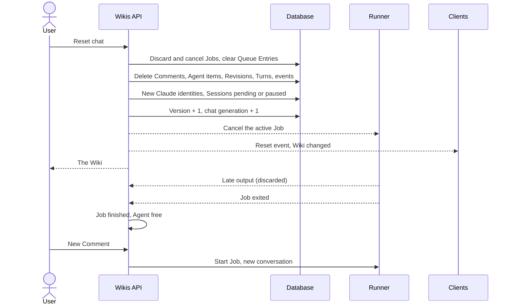
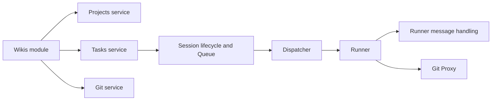

# Wikis

A Wiki is a shared knowledge base kept in a Repository of Markdown files, together with the Skills and conventions that maintain it, plus one conversation that every User shares with the Wiki's Agent. Users ask questions and request changes in that conversation; the Agent reads and edits the Repository from its Worktree, following the Repository's own instructions. Wikis have their own section in the web and Flutter apps, separate from Projects. Underneath, each Wiki runs on the same machinery as a Task: its conversation, Agent Session, Queue, streaming, Git access and notifications are those of a backing Task, so every rule of [Conversation](conversation.md) and [Agent sessions](agent-sessions.md) applies to it. The area adds what is specific to Wikis: creating and managing them, and **Reset Chat**, which clears the conversation for everyone and starts a fresh Agent Session while keeping the Repository files.

## Concepts

- A **Wiki** has a name, a description, a Repository with its Base Branch, and one assigned Agent.
- Each Wiki is stored as a **Wiki Project**: a Project of kind `wiki`, with its own default Statuses and an internal Project Key made of `W` followed by five uppercase letters (for example `WKDPAB`). Wiki Projects appear only in the Wiki section.
- The Wiki's conversation lives on its **backing Task**: the Wiki Project's Task number 1, whose title and description mirror the Wiki's name and description and whose assigned Agent is the Wiki's Agent. The backing Task's Task Key (for example `WKDPAB-1`) is internal, though it can appear in the Agent's Task Tools, Agent Queues and notifications.
- **Reset Chat** clears the Wiki's conversation for every User and gives the next Comment a new Claude Code conversation, while the Repository, the Task Branch and the Worktree stay as they are.
- The **chat generation** of a Task counts its resets. It starts at 0 for every Task and grows by one on each Reset Chat, so a client can tell that the conversation it cached belongs to an earlier generation.
- A Session has a **Claude session identity**: the id its `claude` conversation is created and resumed with. It is the Session's own id until the first Reset Chat, which gives it a new random identity.

## Behaviour

### Wiki section

The web app has a Wiki entry in the sidebar, next to Projects. It lists every Wiki as a card with its name, its description (or the Repository's `owner/name` when the description is empty) and the Repository, ordered by name, with a **New wiki** button. Opening a Wiki shows its conversation.

The Flutter app has a Wiki entry in its navigation rail. On wide windows the Wiki list sits beside the selected Wiki's conversation; on narrow ones the list and the conversation are successive screens, and going back from a conversation returns to the list. Creating a Wiki and resetting its chat need a connection; a Wiki whose conversation is cached opens offline.

Every signed-in User sees every Wiki. Wiki Projects stay out of the Projects list and its counts.

### Creating a Wiki

Every User, Admin or Member, can create a Wiki. The form asks for:

- **Name**: required, 1 to 200 characters after trimming.
- **Description**: optional, up to 100,000 characters.
- **Agent**: required. Clients offer the enabled Agents; the API accepts any existing Agent.
- **Repository**: required, chosen among the Repositories reachable through every Git Connection, labelled with the connection's name and `owner/name`. Connections that fail to list their Repositories show their error next to the list. Users add Git Connections from the web Git settings (see [Git integration](git-integration.md)).
- **Base Branch**: optional, pre-filled with the Repository's default branch, which is also the value when it is left empty.

The Repository is expected to already contain the Markdown files and the Skills that maintain them; a `CLAUDE.md` describes its conventions.

Creation checks the Repository first: the Git Connection must exist, the Repository must be reachable through it, and the Base Branch must exist there. Base Branch Protection is checked and stored as information, as for any Project. A missing or unreachable Repository, a missing Base Branch, an unknown Git Connection or an unknown Agent answers `400`.

Then, in one transaction, the backend:

1. picks a free internal Project Key;
2. creates the Wiki Project with the default Statuses, the Repository, and the fixed Wiki Agent Instructions (below);
3. creates the backing Task with the Wiki's name as title and description as description, priority `none`, no Tags and no User assignees, created by the User, who therefore follows it;
4. assigns the Agent, which creates a `pending` Session;
5. announces the change on the Wikis real-time topic.

Any failure leaves nothing behind. The new Wiki opens right after creation.

The Wiki Agent Instructions, appended to every Wiki Session's system prompt as the Project's Agent Instructions, read: "This repository is a shared Wiki made of Markdown files. Follow its CLAUDE.md, repository skills and conventions for reading and maintaining the Wiki. Treat the conversation as a shared discussion with multiple Users. Preserve existing documentation and skills."

### The shared conversation

The Wiki's conversation is the backing Task's conversation, open to every User: Comments, Internal Notes, Attachments, delivery badges, streaming Agent output, Thinking, Activity and Turn Summaries all work as on a Task (see [Conversation](conversation.md) and [Agent sessions](agent-sessions.md)).

- Assigning the Agent starts nothing. The first User Comment starts the Session; later Comments are injected into the running Turn or queued, as on any Task.
- The Agent works in the Worktree of the Wiki's Repository on the backing Task's Task Branch. `claude` loads the Repository's `CLAUDE.md`, Skills and settings, so the Wiki's own conventions drive the Agent.
- The Agent reaches git only through the Git Proxy and pushes only its Task Branch; it opens or updates a pull request towards the Base Branch with its Task Tools, as on a Task (see [Git integration](git-integration.md)). The Wiki view shows the Task Branch link and the pull request badge once they exist.
- Session controls are the Task's: the Session state chip, **Stop** while a Turn runs, and **Retry** after a Job failed to start. The Flutter app also offers Notify agent when the Wiki's name or description changed since the Agent last read it.
- The web Wiki view shows Comments and the Agent's work and leaves out Revisions. The Flutter app shows the Wiki conversation without the Task details panel.
- Users follow, unfollow, mute and unmute a Wiki like a Task; the Flutter app labels these actions "Follow wiki" and "Mute wiki". Phone notifications for a Wiki's backing Task open the Wiki's conversation in the Flutter app.

### Editing a Wiki

Any User can change a Wiki's name, description and Agent from the Wiki settings (a dialog on the web, a sheet in the Flutter app). The settings in the Flutter app also link to the Repository, the Wiki's Task Branch and its pull request.

- A new name renames both the Wiki Project and the backing Task's title; a new description updates both descriptions. Both are recorded as Revisions of the backing Task.
- A new Agent follows the reassignment rules of [Agent sessions](agent-sessions.md): the previous Agent's Session is paused, and the new Agent gets a fresh `pending` Session, or its own paused Session back.
- A Wiki always has an Agent: the API accepts a different Agent and keeps the current one otherwise.
- The Repository and Base Branch are fixed at creation.

Every change is announced on the Wikis real-time topic so lists and open Wikis refresh.

### Reset Chat

Any User can reset a Wiki's chat. Clients confirm first: "Delete all messages for everyone and start a fresh agent session. Wiki files are kept."

In one transaction, Reset Chat:

- cancels every active Job of the backing Task and marks every Job of the Task to discard its output;
- removes the Task's Queue Entries from every Agent's Queue;
- deletes every Comment (with their Attachments' files), every Agent work item, every Revision, every Timeline position, every Turn and every raw stream event of the Task, and clears the stored projection, error output and setup output of its Jobs;
- sets every User's read position on the Task back to zero;
- gives every Session of the Task, including those of previously assigned Agents, a new Claude session identity and marks it as never started. The current Agent's Session becomes `pending`; every other Agent's Session becomes `paused`. Each Session's Unseen Changes point, last Job time and closing state are cleared;
- increments the Task's version and its chat generation;
- broadcasts a reset event to everyone viewing the conversation and to the Wikis topic, and refreshes the Session and Queue views.

Reset Chat keeps:

- the Repository and every file in it;
- the Task Branch, the Worktree and the pull request;
- the Wiki's name, description, Agent and the backing Task's description files;
- every User's follow and mute choices.

The next User Comment starts a new `claude` conversation (no resume) with the new identity, in the same Worktree. Its first Message contains the Wiki's description and only the Comments posted since the reset.

**A Job running during the reset.** The cancelled Job keeps its Agent busy until the Runner reports that the process has exited, so the Agent never runs two processes at once. Until then:

- every event it sends, including output buffered before the cancellation, is acknowledged and dropped, so nothing reappears in the cleared conversation;
- Comments posted after the reset are queued rather than written to that process, and start the new conversation once the Job ends;
- the Git Proxy refuses that Job's token, so it can no longer push;
- when its Runner reconnects still holding the Job, the backend sends the cancellation again; when its Runner reconnects without it, the Job is closed as interrupted, with no projection, no resume and no System Comment.

When the process exits, the Job is finished and the Agent takes the next entry of its Queue.

**Clients.** The web app empties the conversation as soon as it receives the reset event (or its own reset succeeds), drops any in-flight conversation page and the live streaming text, and refetches the conversation and the Session. The Flutter app does the same and also empties its cached copy of that conversation; for a Wiki that is not open, it empties the cached copy. A client that missed the event, for example while offline, notices on its next fetch that the Task's chat generation differs from the one it cached and discards its cached conversation. Each conversation page carries the chat generation it was read at, read consistently with its entries; when a page's generation differs from the Task's, the Flutter app fetches again (up to two more times when a reset lands between the two requests) and reloads the whole conversation when an older page belongs to another generation.

### Deleting a Wiki

Any User can delete a Wiki after confirming: "Delete this wiki and its chat from the app. The remote repository is kept." Deletion removes the Wiki Project, its backing Task, Sessions, Comments, Attachments and their files, and asks the Agents to remove their Worktrees. The Repository, its Task Branch and any pull request stay on the code host.

Deleting a Wiki whose Agent is running a Job, including a Job cancelled by a reset that has not exited yet, answers `409`, as for a Task (see [Board](board.md)); the User stops the Agent and tries again.

## Architecture

- The **Wikis module** exposes the Wiki API: list, read, create, update, reset and delete. It builds on the Projects and Tasks services for storage and on the Git service to resolve and check the Repository. Every other Wiki behaviour comes from the Task it owns.
- The **Projects module** treats a Wiki Project as absent: listing, reading, editing, archiving, deleting, its Statuses, Tags, Agent settings and Repository all answer `404` for a Wiki Project. Its backing Task answers `403` to changes, moves and deletion through the Tasks API, which leaves Comments, Attachments, the Session controls and the Timeline working. Both use the Wiki API instead.
- The **Session lifecycle and dispatcher** (see [Agent sessions](agent-sessions.md)) treat the backing Task like any Task. The dispatcher starts `claude` with the Session's Claude session identity when it has one and with the Session's id otherwise, as a new conversation when the Session has never started and as a resume after that. Delivery queues Comments while the Task's running Job is marked to discard its output.
- The **Runner message handling** accepts only the exit of a discarded Job and ignores the rest of its events; reconnection and recovery skip the projection for it.
- The **Git Proxy** admits a Job only while it is active and not discarded (see [Git integration](git-integration.md)).
- **Real-time:** the `wikis` topic carries a "Wiki changed" event with the Wiki's id on create, update, reset and delete; the backing Task's topic carries the conversation events and the reset event. See [Clients](clients.md) for transport.

## Data model

- **Wiki**, as the API returns it: id (the Wiki Project's id), name, description, Repository (with Base Branch and Base Branch Protection), Agent, backing Task id, created and updated times.
- **Project**: gains a kind, `project` or `wiki`.
- **Task**: gains a chat generation, starting at 0. Task cards, Task details and conversation pages carry it.
- **Session**: gains an optional Claude session identity; when it is empty the Session's id is the identity. Sessions keep their `started` flag, which a reset clears.
- **Job**: gains a discard-output flag, set by Reset Chat on every Job of the backing Task.

A Wiki lives until it is deleted; deleting it removes the Wiki Project and everything that belongs to it.

## Non-functional requirements

- Creating a Wiki is atomic: a failed creation leaves no Project, Task or Session.
- Reset Chat is atomic and complete: once it commits, no User and no client can read pre-reset Comments, Agent output, Turns or stream events of the Wiki, and no late event from a running process brings any back.
- A reset keeps the one-Job-per-Agent rule: the Agent stays busy until its cancelled process exits.
- A conversation page and its chat generation are read under the same lock on the Task, so a page always describes one generation.
- Wiki APIs require a signed-in User, as every API.

## Decisions

- **A Wiki is a Project of kind `wiki` with one backing Task.** It reuses the multi-user conversation, Attachments, Queue, streaming projection, Git isolation and notifications without a second scheduling model. The alternative, making Comments, Sessions, Jobs and Queue Entries polymorphic between Tasks and Wikis, would touch every runtime and notification path for identical behaviour. The cost is that internal Task Keys can appear in Agent tools, Queues and notifications; Wiki clients open those notifications in the Wiki conversation.
- **A separate Wiki API and section on web and mobile.** Users meet Wikis as their own thing, with no Board, Statuses or Task fields to manage. The ordinary Project and Task APIs treat a Wiki Project as absent and refuse changes to its backing Task, so a Wiki's only way to change is its own API and the conversation.
- **The Repository, Wiki Project and backing Task are created in one transaction.** A Wiki exists completely or not at all.
- **Git keeps the Task Branch policy.** The Agent edits the Wiki on its Task Branch and proposes changes through a pull request, under the same Push Policy as any Task.
- **Reset Chat rotates a separate Claude session identity.** A reset needs a fresh `claude` conversation while the Session row keeps its Worktree, Task Branch and running Job bookkeeping. Sessions therefore carry an optional identity that falls back to their own id, so Sessions created before Wikis keep resuming the conversation they already have.
- **Reset rotates the identity of every Agent's Session, paused ones included.** Reassigning a previous Agent after a reset would otherwise resume its pre-reset conversation.
- **A cancelled Job keeps its Agent busy and discards its output.** Freeing the Agent at once would let a second process start beside the dying one; keeping its output would bring deleted messages back, even after a reconnect or a recovery.
- **The chat generation lets clients detect a reset without the live event.** Offline clients and clients that reconnect late compare generations and drop their cached conversation, since the WebSocket event is transient.
- **Reset keeps the Repository, Worktree and Task Branch.** The Wiki's value is in its files; only the conversation is disposable.
- **Deleting a Wiki keeps the remote Repository.** The app only stops tracking it; the code host remains the source of truth.

## Related specs

- [Conversation](conversation.md): Comments, Internal Notes, Attachments, delivery, following and notifications, all shared by Wikis.
- [Agent sessions](agent-sessions.md): Sessions, Jobs, Queue, assignment and reassignment, system prompt and the Timeline.
- [Board](board.md): Projects, Statuses and Tasks that Wikis are built on.
- [Git integration](git-integration.md): Git Connections, Repositories, Task Branch, Git Proxy and pull requests.
- [Agents](agents.md): the Agents a Wiki is assigned to.
- [Clients](clients.md): web and Flutter UI, real-time transport and the offline cache.
