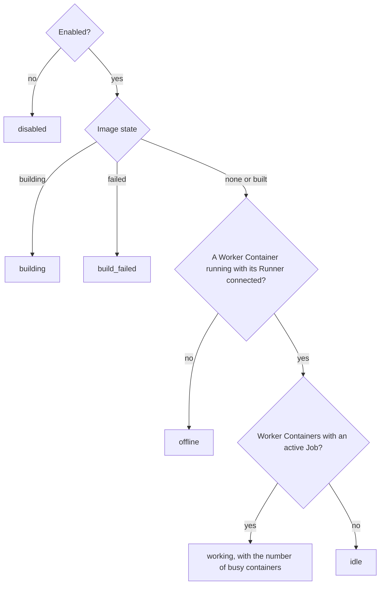
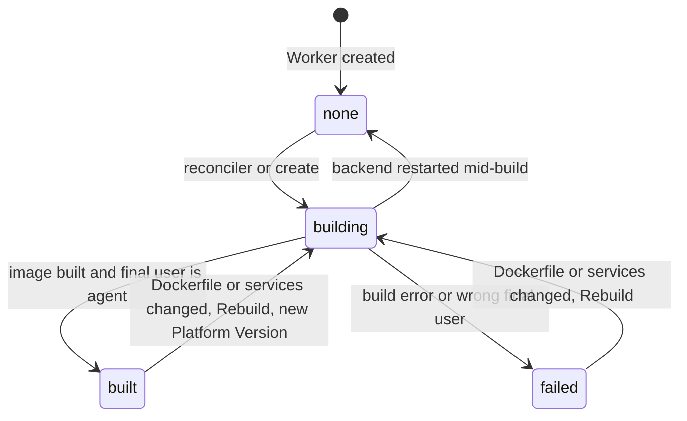
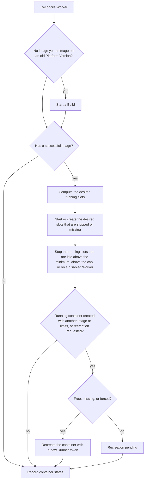
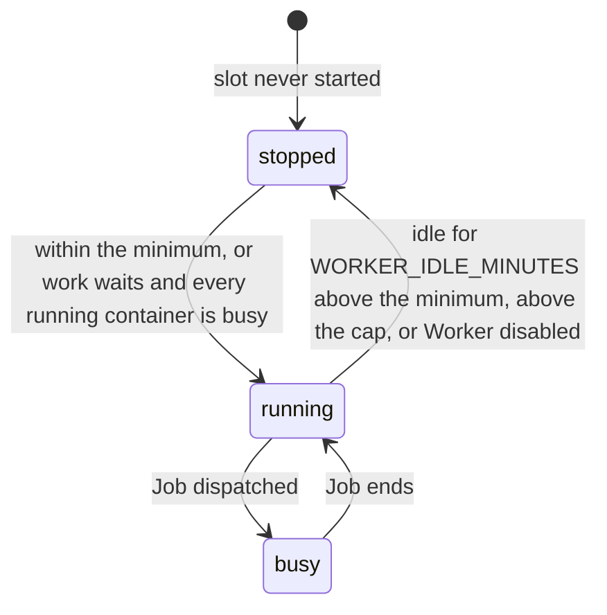
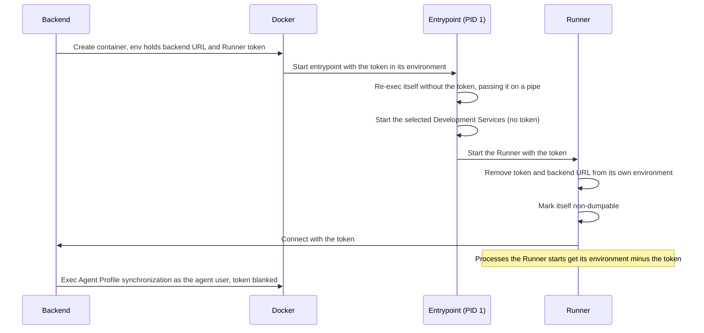
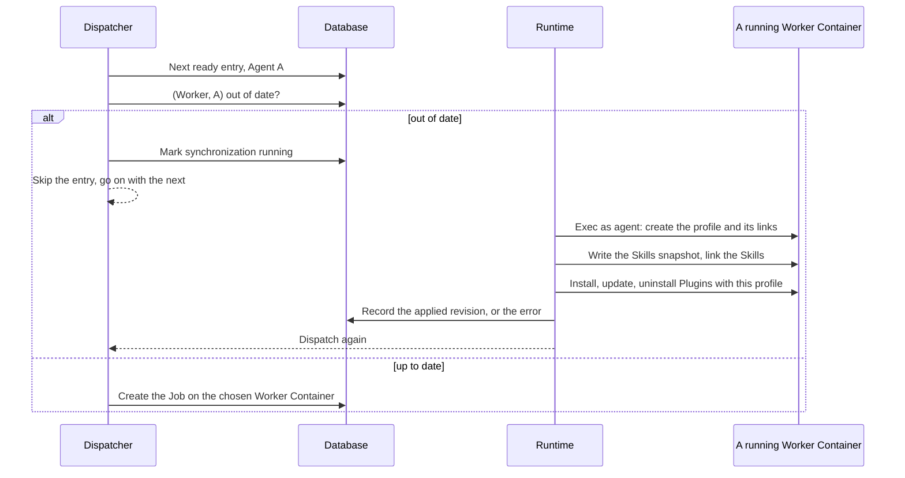
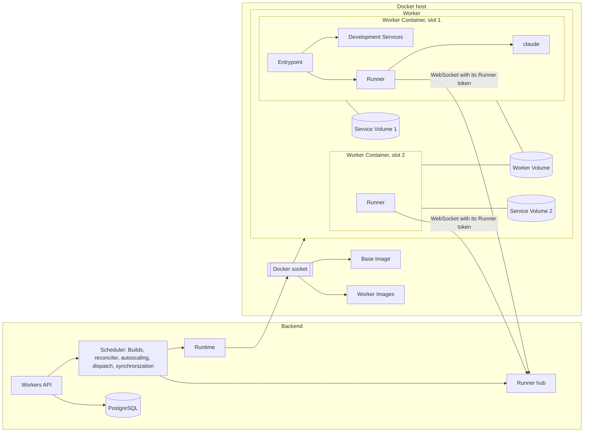
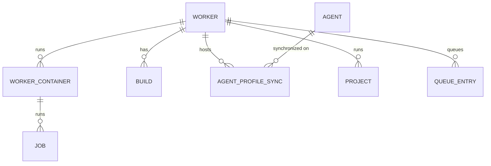

# Workers

Workers are the platform's execution environments. A **Worker** is a Docker environment an Admin configures once (a Dockerfile, Development Services, resource limits and a range of Worker Containers) and that every Project assigned to it runs on, whatever Agent works its Tasks. This area covers the Worker as a configured entity, the Base Image and the Builds that turn its Dockerfile into a Worker Image, the Worker Containers the backend starts and stops to work the Worker's Queue, the volumes they share and keep apart, the Development Services inside them, the Agent Profiles that let any Agent run in any Worker Container, and the Docker host the backend manages. It exists so that toolchains are set up once per kind of work, throughput is a number on a Worker, and the platform runs Docker for the Admins. The Claude Code configuration that runs inside a Worker Container is an Agent, described in [Agents](agents.md); Sessions, Jobs and the Queue are described in [Agent sessions](agent-sessions.md); the process inside each container is described in [Runner](runner.md).

## Concepts

- A **Worker** is global: Admins configure it and every User sees it. Each Project (ordinary, Wiki or Schedule) runs on exactly one Worker, and one Worker serves any number of Projects. Every Job of a Project's Tasks runs on that Worker, for whichever Agent is assigned.
- A Worker runs between its **minimum** and its **cap** of **Worker Containers** (cap from 1 to 20). Each Worker Container occupies one **Worker Slot**, a stable number from 1 to the cap. A Worker Container runs one Job at a time, for any Agent; the same Agent can run Jobs on several Worker Containers at once.
- The **Base Image** (`claude-task/agent-base`) is the platform-provided image every Worker Image builds on. It carries the default `claude` CLI, the Runner, the git credential helper, mise, the Development Service scripts and the non-root `agent` user.
- The **Platform Version** is the Base Image's version. It combines the default Claude Code version with a fingerprint of the Base Image recipe, its scripts and the Runner sources, so any change to one of them produces a new version.
- A **Worker Image** is built from the Worker's Dockerfile on top of the Base Image at the current Platform Version. A **Build** is one attempt to produce it, with its log and outcome. Every Worker Container of the Worker runs the same Worker Image.
- The **Worker Volume** is shared by every Worker Container of one Worker and mounted as the agent user's home. It holds Bare Clones, Worktrees, Session transcripts, mise tool installs and Agent Profiles, so any Worker Container of the Worker can resume any Session of its Projects.
- A **Service Volume** belongs to one Worker Slot and holds the data and logs of that slot's Development Services. It survives the Worker Container being stopped or recreated, and is deleted with the Worker or when a Cleanup removes its slot.
- An **Agent Profile** is an Agent's own Claude Code configuration directory inside a Worker Volume, holding its Skills, Plugins and settings. Every Agent Profile of a Worker Volume shares the same Session transcripts and session data, so a Session started by one Agent resumes under another.
- The **Runner token** identifies one Worker Container's Runner to the backend. Each Worker Container has its own, and it changes every time the container is recreated. It is distinct from the Job token, which authorizes one Job's MCP and Git Proxy calls (see [Agent sessions](agent-sessions.md) and [Git integration](git-integration.md)).
- **Development Services** are local databases and tools (PostgreSQL, Redis, MySQL, Mailpit, RustFS/MinIO, Chrome) installed in the Worker Image and started inside each Worker Container, selected per Worker.
- A **Cleanup** removes what the Installation's Workers no longer need from the Docker host and from their Worker Volumes (see [Cleanup](#cleanup)).
- The **Installation id** is a random identifier the backend creates on first start and keeps in its database. Every container, volume and Worker Image the backend creates is labelled with it, so several Installations can share one Docker host.
- The **Worker State** is the single status the Workers list shows, derived from the Worker's configuration, image and Worker Containers.

## Behaviour

### Permissions

| Action | Who |
| --- | --- |
| List Workers, open a Worker, see its Worker Containers, Builds and Build logs, Queue and Projects | Every User |
| Reorder and remove a Worker's Queue Entries (see [Agent sessions](agent-sessions.md#the-queue)) | Every User |
| Choose the Worker of a Project or a Wiki, at creation and in its settings | Every User |
| Choose the Worker of a Schedule | Admins |
| Create, edit, duplicate, disable, delete a Worker | Admins |
| Rebuild the image, Recreate when idle (whole Worker) | Admins |
| Restart, Force recreate and read the logs of one Worker Container | Admins |
| Run a Cleanup and see the last one | Admins |

Requests outside these permissions are answered with `403`.

### Creating a Worker

An Admin creates a Worker from the Workers page with "Create worker", which submits the complete form. The fields and their rules:

| Field | Rule | Default |
| --- | --- | --- |
| Name | 1 to 100 characters, trimmed, unique ignoring case (a duplicate gets `409`) | required |
| Description | up to 2,000 characters | empty |
| Dockerfile | 1 to 100,000 characters, validated as described in [Worker Dockerfiles](#worker-dockerfiles) | `FROM claude-task/agent-base` followed by `USER agent` |
| Services | any subset of PostgreSQL, Redis, MySQL, Mailpit, RustFS/MinIO and Chrome, without duplicates | PostgreSQL and Redis |
| CPU limit | per Worker Container: more than 0 and up to 256 CPUs, fractions allowed | no limit |
| Memory limit | per Worker Container: 256 to 1,048,576 MB | no limit |
| Minimum | 0 to the cap | 0 |
| Cap | 1 to 20 | 1 |
| Enabled | yes or no | yes |

An invalid field is answered with `400` and nothing is stored; that includes a minimum above the cap, whether the request sets the minimum or lowers the cap under it. The service selection is stored in a fixed canonical order, whatever order the request used.

Creating the Worker starts its first Build right away and answers immediately; the Worker shows `building` until the Build ends, so it is usually ready by the time someone assigns it to a Project. Once the image is built, the reconciler starts the slots from 1 to the minimum, and further slots as work arrives (see [Autoscaling](#autoscaling)).

### Editing a Worker

Admins edit a Worker from its Configuration tab. Name, description, minimum, cap and enabled save automatically after 600 ms without edits or when a field loses focus, with the same saving, saved or failed state, Retry and ordering as the Agent form (see [Agents](agents.md#editing-an-agent)).

Docker configuration groups the Dockerfile, Development Services and CPU and memory limits. These fields are applied together through "Save Docker configuration", after validation, so an unfinished Dockerfile stays in the editor and the running Worker Containers keep their configuration until the Admin applies it. Each saved change takes effect as follows:

| Change | Effect |
| --- | --- |
| Dockerfile (when its text differs) or services (when the selection differs) | A new Build starts; on success each Worker Container is recreated with the new image as soon as it has no active Job, independently of the others |
| CPU or memory limit | Each Worker Container is recreated with the new limits as soon as it has no active Job, with no Build |
| Minimum | Raising it starts the slots up to the new minimum; lowering it makes the slots above it subject to the idle stop |
| Cap | Raising it lets the Worker start more slots when work waits; lowering it stops the slots above the new cap as soon as each is free, keeping their Service Volumes, so raising the cap again reuses their databases. A Cleanup removes a slot above the cap once it has had no Job for 7 days (see [Cleanup](#cleanup)) |
| Enabled | See [Disabling a Worker](#disabling-a-worker) |
| Name, description | Display only |

A stopped Worker Container whose recreation is pending gets it at its next start. While a recreation waits for a running Job, the Worker Container's row shows "Recreation is waiting for the current job to finish".

### Duplicating a Worker

An Admin duplicates a Worker to start a variant of an existing toolchain. The copy takes every configuration field of the source: description, Dockerfile, services, limits, minimum, cap and enabled flag, so it starts disabled only when the source is disabled. Its name is the one given, or the first free one of "‹name› (copy)", "‹name› (copy 2)", and so on, shortened to fit 100 characters. The copy gets its own Build, an empty Worker Volume and empty Service Volumes; Projects, Queue and Builds stay with the source.

### Disabling a Worker

A disabled Worker shows `disabled`. Its running Jobs finish normally, and its Queue keeps accumulating entries for its Projects' Tasks, which wait until an Admin enables it again. A disabled Worker starts no slot: its running Worker Containers stop once each has been idle for `WORKER_IDLE_MINUTES`, the minimum included. A due Schedule whose Worker is disabled is skipped with "worker unavailable" (see [Schedules](schedules.md)). Enabling the Worker starts its minimum slots and lets its Queue dispatch right away, starting more slots as needed.

### Deleting a Worker

An Admin deletes a Worker once no Project uses it, whatever its kind and archived Projects included. Otherwise the request is answered with `409` naming those Projects, and nothing changes.

When the deletion goes ahead, the Worker's Builds, Worker Container records and Agent Profile synchronization records are deleted with it. Its Runner connections are closed, and its containers, images, Worker Volume (with every Agent Profile and Session transcript) and Service Volumes are removed in the background. A failure there is logged, and the next Cleanup removes the leftovers that carry the Installation id (see [Cleanup](#cleanup)).

### Assigning a Worker to Projects

Every Project has a Worker, required at creation:

- **Projects**: any User picks the Worker in the Project form; a request without an existing Worker is answered with `400`. The Worker picker is also in the Project's Agents settings section (see [Agents](agents.md#project-environment-variables)).
- **Wikis**: any User picks the Worker, together with the default Agent, at creation and in the Wiki's settings (see [Wikis](wikis.md)).
- **Schedules**: an Admin picks the Worker in the Schedule form (see [Schedules](schedules.md)).

The picker preselects the Worker when exactly one exists, and shows each Worker's state with the same colored dot as the Agent pickers. An installation starts with no Worker until an Admin creates one. Until then the Project, Wiki and Schedule forms show "Create a Worker first" with a link to the Workers page for Admins, and "Ask an Admin to create a Worker" for Members.

**Changing the Worker.** A Project changes Worker once its conversations can start over on the new Worker Volume: the change is accepted while none of its Sessions is started and in a state other than `closed`, and none of its Jobs is active. Otherwise it is answered with `409` listing the Tasks to close (for a Wiki, the Chats to delete, since Delete Chat makes a Chat's Session not started). When the change is accepted, the Project's Queue Entries move to the new Worker's Queue in the same transaction, keeping their relative order at the end of the new Queue. The Project's Worktrees and Bare Clone stay on the old Worker Volume, and the new Worker creates its own on the next Job.

### Worker State

The state shown for a Worker is the first that applies:

`offline` is the resting state of a Worker with minimum 0 and no work: the first entry in its Queue starts a Worker Container. `building` and `build_failed` describe the latest Build, not the containers: while a new image builds, or after it failed, the existing Worker Containers keep running on the previous image and keep taking Jobs, because dispatch only needs a container matching the last successful image (see [Dispatch readiness](#dispatch-readiness)).

### Workers list and Worker page

The Workers list shows every Worker with its state, the number of busy and running Worker Containers against its cap, its Queue length and the Projects it runs. Admins also see a "Clean up" action and a line summarizing the last Cleanup (see [Cleanup](#cleanup)). The Worker page has these tabs:

- **Containers**: one row per slot, from 1 to the cap plus any slot above the cap that is still running. Each row shows the container state (`running`, `exited`, `restarting`, `missing`, ...), whether its Runner is connected, the Task and Agent of its current Job, the Runner and Claude versions it reported, its last activity (updated at most every 10 seconds while a Job streams output) and a pending recreation. Admins get Restart, Force recreate and Logs per row; Logs shows the last 500 lines of the container output, refreshed every three seconds (the API serves 1 to 5,000 lines). Below the rows, the synchronizations of Agent Profiles that are running or failed on this Worker, with the Agent and the error.
- **Queue**: the Worker's Queue, each entry with its Task and Agent, reordered and edited by any User (see [Agent sessions](agent-sessions.md#the-queue)).
- **Builds**: the 20 most recent Builds with status, start time and Platform Version. The latest Build's log comes with the list and updates live while building; older logs load on request.
- **Configuration** (Admins): the Worker form, with a Dockerfile editor that highlights instructions and checks the Base Image rule before saving.
- **Projects**: the Projects of every kind that run on the Worker.

Admin actions on the page: Rebuild image, Recreate when idle, Duplicate, Delete. Restart and Force recreate ask for confirmation, since they interrupt the running Job.

The native app lists Workers in Settings and opens a Worker sheet with the slots and their state, plus Rebuild image, Restart per slot, Recreate when idle and Force recreate per slot among its Admin actions, with the same confirmations. Build history and container logs are in the web app.

### Workers API

| Request | Who |
| --- | --- |
| `GET /workers`, `GET /workers/:id` | Every User |
| `POST /workers`, `PATCH /workers/:id`, `DELETE /workers/:id`, `POST /workers/:id/duplicate` | Admins |
| `POST /workers/:id/rebuild`, `POST /workers/:id/recreate` (when idle, every container) | Admins |
| `POST /workers/:id/containers/:slot/restart`, `POST /workers/:id/containers/:slot/force-recreate`, `GET /workers/:id/containers/:slot/logs` | Admins |
| `GET /workers/:id/builds`, `GET /workers/:id/builds/:buildId/log` | Every User |
| `GET /workers/:id/queue`, reordering and removing its entries | Every User |
| `GET /cleanup` (the latest Cleanup, or none), `POST /cleanup` (starts a Cleanup, answered `202` with it, or with the running one) | Admins |

Changes reach open clients in real time on the `workers` topic (the list, and `cleanup.updated` for every change of a Cleanup) and on the `worker:<id>` topic (the Worker, its Worker Containers, its Queue, its Builds and Build log chunks).

### Base Image

The Base Image is Ubuntu 24.04 (the `buildpack-deps:noble` image) with:

- bash, ca-certificates, curl, git, jq, less, OpenSSH client, procps and vim;
- FFmpeg and ffprobe for audio/video processing and inspection, ImageMagick's `convert` and `identify` commands for image transformations, and libvips' command-line tools for image processing;
- ripgrep (`rg`) and fd (`fdfind`) for searching source text and filenames, Poppler's tools for extracting text and rendering PDF pages, and the `sqlite3` CLI for inspecting and querying SQLite databases;
- the `claude` CLI at the platform's default version, installed through mise outside the agent's home so that the Worker Volume mounted there leaves it visible, with the auto-updater turned off. The Runner resolves `claude` through mise's shims, so a Repository or user mise configuration can select another version;
- Node.js and Python, installed through mise outside the agent's home and available as defaults during Worker Image builds and in every Worker Container, including login shells. The Base Image build arguments `NODE_VERSION` and `PYTHON_VERSION` select their versions, defaulting to `26` and `3.14`. Release-line requests select the latest available patch when installed. Repository mise shims take precedence when a Project declares its own runtime versions;
- the Runner and the git credential helper, compiled from the Runner sources in the same build and configured system-wide as git's credential helper (see [Git integration](git-integration.md));
- mise, which initializes its user and system shim paths through its shell activation script for login shells, Worker Image build commands and the Runner's environment, and the `flutter` mise plugin. The backend runs Claude's Plugin commands through mise's command execution so they also resolve the selected tools. The Base Image's default tools are selected in mise's system configuration and installed in its system installs directory; mise manages their shims and reuses those installs when a Repository requests matching versions. User shims precede system shims. The plugin is installed outside the agent's home, and the container entrypoint links it into the Worker Volume's mise data when that has no plugin of the same name, so existing Worker Volumes get it too. Every Node.js that mise installs gets Corepack enabled, so `pnpm` and `yarn` are on the `PATH` at the version a `package.json`'s `packageManager` field names, downloaded without Corepack's confirmation prompt (a prompt would stall a Job). The container entrypoint also enables Corepack for Node.js versions already in the Worker Volume. Node.js 25 and later ship without Corepack: repositories on those versions declare `pnpm` or `yarn` in their mise configuration instead;
- the Development Service installer, used while building Worker Images, the container entrypoint and the `minio` command that the RustFS/MinIO service puts on the `PATH`;
- the non-root user `agent` with uid 1000 and home `/home/agent`, which is also the image's final user and working directory.

The Base Image sets `PLAYWRIGHT_MCP_ALLOW_UNRESTRICTED_FILE_ACCESS=true`, so Playwright MCP can save screenshots and read files outside the Worktree, including in `/tmp`. File access follows the `agent` user's filesystem permissions throughout the Worker Container.

The backend builds the Base Image locally through the Docker socket, without a registry. It is built on demand, as the first step of a Worker's Build, whenever the image for the current Platform Version is missing, and is tagged with the Platform Version and as `latest`. Its build output appears in the log of the Build that triggered it. The production backend image ships the Base Image recipe and the Runner sources, so it builds the Base Image without a source checkout.

The default Claude Code version comes from the `CLAUDE_CODE_VERSION` setting (2.1.310 by default). Repository and user mise configurations can override it, just like Node.js and Python. The selected Claude version is responsible for compatibility with the platform's stream-json contract.

**Platform upgrades.** When the backend starts with a different Platform Version (a new Claude Code version, Base Image recipe, service scripts or Runner), the reconciler finds every Worker whose last successful image was built on an older version and rebuilds it. Each Worker Container keeps working during the Build and switches to the new image as soon as it is free, following the normal recreation rule. Workers whose latest Build failed keep their state until their next Build (a Dockerfile or service change, or a manual Rebuild).

### Worker Dockerfiles

The Worker's Dockerfile is where Admins install the toolchains its Projects need, including the runtimes of the stdio MCP servers assigned to the Agents that work there (see [Agents](agents.md#mcp-servers)). The backend checks it on save (and the form checks it while editing), ignoring comments and blank lines and joining continuation lines:

- The first instruction is `FROM claude-task/agent-base`, with any tag or digest, an optional `--platform` flag and an optional stage name. Only `ARG` instructions may precede it. Anything else is answered with `400`: "The Dockerfile must start FROM claude-task/agent-base", "Only ARG instructions may come before the first FROM", or "The first FROM must be claude-task/agent-base (any tag)".
- The Dockerfile may switch to `root` for installs and ends as `USER agent`. This is checked on the built image: its final user must be `agent`, `agent:agent`, `1000` or `1000:1000`, otherwise the Build fails with "The image must end with `USER agent`", because `bypassPermissions` refuses to run as root.

When building, the backend rewrites the first `FROM` to the Base Image at the exact current Platform Version, whatever tag the Dockerfile names, and inserts the installation of the selected Development Services right after the complete instruction, including its stage name. Validation and rewriting both join continuation lines across blank lines and comments, keeping the installation before the Admin's own instructions.

### Image Builds

A Build runs when a Worker is created or duplicated, when its Dockerfile or service selection changes, when an Admin clicks Rebuild, when the reconciler finds no image yet, and after a Platform Version change. One Build runs per Worker at a time; a request arriving during a Build queues exactly one more Build after it, which uses the configuration current at that point.

Each Build records the Dockerfile as saved, the Platform Version, its status (`building`, `succeeded`, `failed`), its log and its start and end times. The log keeps the most recent 256 KB, is saved every half second, and streams live to everyone viewing the Worker. A failed Build appends "Build failed:" with the reason to the log.

- **Success**: the Worker Image is tagged after the Worker and the Build, the Worker records it as its current image together with its Platform Version, and the reconciler recreates each Worker Container on it as soon as that container is free.
- **Failure**: the Worker shows `build_failed`; the previous image and its Worker Containers stay in service, so a broken Dockerfile leaves the Worker's Projects working.
- **Backend restart during a Build**: on startup the interrupted Build is marked failed with the note "The backend restarted during this build", and the Worker goes back to having no Build in progress, which makes the reconciler build it again.

Each time a Worker Container is created, the Worker's older images that no container uses any more are removed. A stopped Worker Container still on an older image is removed by the reconciler (see [Cleanup](#cleanup)), so once every slot has moved on or been removed, only the current image is left. After each successful Build, Base Images of older Platform Versions are untagged as well.

### Worker Containers and the reconciler

The backend's reconciler brings each Worker's image and Worker Containers in line with its configuration and its Queue. It runs for every Worker at startup, every 30 seconds, after every Build, after each Job ends, when a Runner connects, and after configuration changes. Runs for one Worker are serialized.

#### Autoscaling

The reconciler keeps running the slots that work needs, between the Worker's minimum and its cap:

- **Minimum.** Slots 1 to the minimum run whenever the Worker is enabled and has an image.
- **Scaling up.** While the ready entries of the Worker's Queue outnumber its free running Worker Containers (running, with no active Job, including those whose Runner is still connecting), the reconciler starts one more slot per waiting entry, up to the cap. An entry is ready as described in [Agent sessions](agent-sessions.md#dispatch); an entry waiting for its Agent's [synchronization](#agent-profiles-and-extension-synchronization) counts as ready, since the synchronization needs a running container. For each entry beyond the free containers, in Queue order, the new slot is the entry's affine slot (the slot of its Session's latest Job) when that slot is stopped and within the cap, otherwise the lowest-numbered stopped slot within the cap.
- **Idle stop.** A slot above the minimum whose Worker Container has had no Job for `WORKER_IDLE_MINUTES` (10 by default), counted from its last Job's end or from its Runner connecting, whichever is later, is stopped. A disabled Worker stops every slot this way, the minimum included.
- **Cap decrease.** Slots above the cap stop as soon as each has no active Job. A Cleanup removes them, with their Service Volumes, once they have had no Job for 7 days.
- **`WORKER_STOP_WHEN_UNUSED=false`.** The idle stop is off: every running Worker Container within the cap keeps running. Slots 1 to the minimum still start on their own, and the others start when work needs them, within the cap.

The stop is decided under the Worker's row lock: the container state is set to stopped in the same transaction that rechecks the slot has no Job, so a Job is dispatched only to a container that stays up. The Runner connection closes when the container stops (close code 4003), and the slot shows `exited`.

A Worker Container the Worker still wants, but whose Runner has not connected (or reconnected) within the Runner reconnect timeout, cannot take a Job. The reconciler recreates it instead of leaving the Queue waiting for a Runner that is not coming, keeping the Worker Volume and its Service Volume. On backend startup every Runner connection is treated as lost, so a Runner that never comes back is recovered after the same timeout rather than waiting for a close event the new process cannot receive.

Stopping keeps the container: the image, the Worker Volume and the slot's Service Volume stay, so repositories, Worktrees, transcripts and Development Service data survive. A pending recreation (new image, limits or an Admin's request) is applied at the slot's next start. A stopped container created with an image other than the Worker's current one is removed by the reconciler, which frees that image; the slot shows as stopped and is created from the current image at its next start, on the same volumes. A Queue Entry held after a failed Job is not ready, so it waits for a Retry without keeping a container up.

When the dispatcher finds ready entries and no free Worker Container, it asks the reconciler to scale up right away, so a Comment, a reopened Task or a Retry starts a container at once. The Job dispatches once the Runner has connected and the Agent's Extensions are synchronized there, so the first reply after a scale-up waits for the container and its Development Services to start (up to 60 seconds for the services, see [Development Services](#development-services)).

#### Containers

Every Worker Container:

- is named after the Worker and the slot (`claude-task-worker-‹worker id›-‹slot›`) and labelled with the Installation id, the Worker's id and the slot number;
- restarts automatically unless stopped, by hand or by the reconciler;
- mounts the Worker Volume (`claude-task-worker-‹worker id›`) as the agent user's home, and its slot's Service Volume (`claude-task-worker-‹worker id›-services-‹slot›`) at a fixed path outside the home;
- keeps what belongs to that container alone (the git credential socket, the Runner's lock files, its outbox spill files) in a container-local directory outside the Worker Volume;
- joins the network named by the `AGENT_NETWORK` setting, or Docker's default bridge, with outbound internet access and no published ports; `host.docker.internal` resolves to the Docker host, so a backend running on the host is reachable;
- gets the Worker's CPU and memory limits;
- receives two environment variables: the Runner's WebSocket URL, derived from the `AGENT_BACKEND_URL` setting, and its own fresh Runner token.

Recreating a Worker Container replaces it with a new one on the same Worker Volume and Service Volume, so repositories, Worktrees, Session transcripts, Agent Profiles, service data and tool installs survive. Recreation generates a new Runner token and closes the old Runner connection; the Agent Profiles need no new synchronization, since they live on the Worker Volume. Because recreating kills whatever runs inside, it waits until that container has no active Job, unless the container is missing or an Admin forced it. A pending recreation runs right after the container's Job ends, before it takes another. Each Worker Container recreates on its own schedule, so a rebuild rolls out as containers free up while the others keep working.

### Backend shutdown

On a graceful backend shutdown, every Worker Container of this Installation is stopped when `WORKER_STOP_ON_SHUTDOWN` is enabled. The setting defaults to enabled during local development and disabled when `NODE_ENV=production`; an explicit true or false overrides that default. The supplied local Compose stack enables it and allows 30 seconds for shutdown. Closing a web or native client leaves the backend and its Worker Containers running.

The backend stops scheduling new Jobs, Builds and reconciliations and starts stopping the Installation's containers while already started work drains. This lets containers stop within the Compose grace period even while a Build is running. After the scheduler drains, it stops any containers left running by a creation or restart that finished during shutdown. Container stops and scheduler drain run alongside HTTP shutdown, so an HTTP keepalive timeout leaves container stops free to finish. Stops run concurrently across Workers and slots. Docker gets 10 seconds per container to stop its processes before terminating them. Missing and already stopped containers count as stopped. An error stopping one container is logged, the remaining stops are attempted, and backend cleanup finishes with a failed shutdown result.

Stopping preserves containers, images, Worker Volumes and Service Volumes. At the next backend start the reconciler starts the minimum slots of every enabled Worker and the slots its Queue needs; Jobs interrupted by the stop recover through the Runner reconnection and Session resume rules, which queue their resumption and so start a container. With the setting disabled, Worker Containers continue running through backend restarts and their Runners reconnect.

### Restart and recreate

Admins have these actions:

- **Restart** (one Worker Container) restarts the existing running container. Its running Job, if any, stops; when the Runner reconnects without it, the Job is treated as interrupted and its Session resumes at the front of the Queue (see [Agent sessions](agent-sessions.md)). A stopped or missing container answers Restart with `409`, since it starts when the minimum or work needs it. The restart starts a fresh idle window, so an idle container above the minimum is not stopped again immediately by the idle stop.
- **Force recreate** (one Worker Container) recreates it immediately with the current image and limits. The running Job is interrupted and resumes after the new Runner connects, like after a crash. A stopped container records the recreation and applies it at its next start.
- **Recreate when idle** (whole Worker) recreates every Worker Container with the current image and limits, each as soon as it has no active Job. It is answered with `409` while the Worker has no image yet. Stopped containers apply it at their next start.
- **Rebuild image** (whole Worker) starts a Build.

A container found stopped while its slot should run (for example after `docker stop` or a crash that Docker did not restart) is started by the next reconciler run.

### Dispatch readiness

From the runtime's side, a Worker Container takes a Job when all of these hold:

- the Worker is enabled;
- the container is running and was created with the Worker's current image and limits, with no recreation pending;
- its Runner is connected;
- it has no Job in `dispatched`, `running` or `finishing`;
- the reconciler is not stopping it.

The dispatcher picks, for each ready entry in Queue order, the Session's last slot when it can take a Job, otherwise the lowest-numbered other Worker Container that can, otherwise none (the reconciler scales up). The Queue, entry readiness and the dispatch itself are described in [Agent sessions](agent-sessions.md#dispatch).

### Runner connection and the Runner token

Each Worker Container's Runner connects out to the backend over a WebSocket, authenticated by its Runner token as a bearer token. The backend stores only the token's SHA-256 hash and maps it to exactly one (Worker, slot); an unknown or outdated token is answered with `401`. The Runner hub holds one connection per Worker Container, and a second connection for the same container replaces the first. The backend pings each Runner every 30 seconds and drops a connection that misses a whole round, so a half-open connection shows as disconnected and its Job can be recovered. Jobs whose Runner stays away for more than 5 minutes are treated as interrupted. Connection codes tell the Runner why it was closed: replaced by a new connection, container recreated, container stopped, or Worker deleted. The protocol is described in [Runner](runner.md).

The token reaches only the Runner process, so that the code an Agent runs (its tools, the Setup Script, git hooks, Development Services, Plugins) has no way to impersonate the Runner:

- The container's first process re-executes itself without the token and reads it back from a pipe, so the environment Docker started it with (readable by any process of the agent user) holds no token any more.
- The Development Services start without the token.
- The Runner reads the token, removes it and the backend URL from its own environment, marks its process non-dumpable so its memory and environment stay private to it, and starts `claude`, the Setup Script, mise and git with an environment that leaves the token out.
- The backend's own commands inside the container (Agent Profile synchronization) run as the `agent` user with the token variable set to empty, since commands executed in a container otherwise inherit its environment.

### Worker Volume

The Worker Volume is the agent user's home in every Worker Container of the Worker. It holds:

- one Bare Clone per Project with a Repository, and the Worktrees of the Project's Tasks, at paths that are deterministic per Project and Task, so any Worker Container resumes a Session in the same working directory (see [Git integration](git-integration.md));
- the Session transcripts and session data, in one directory shared by every Agent Profile;
- the mise tools installed for Repositories;
- the Agent Profiles.

Several Worker Containers work on one Bare Clone at once, so the Runner holds an exclusive file lock per Bare Clone, kept next to the clone in the Worker Volume, around every git command that updates it (fetch, worktree add, worktree remove, prune). Removing a Worktree goes to the Runner of the Job still working in it (a cancelled Job that has not exited yet), which removes it once that Job ends; with no such Job, to any connected Runner of the Worker, the Session's last slot first. It stays pending until a suitable Runner connects. Reading a Worktree's Project Skills goes to any connected Runner of the Worker (see [Runner](runner.md)).

**Leftovers.** A Cleanup asks one connected Runner of each Worker, the lowest slot first, to clean its Worker Volume. The request lists the Projects that run on the Worker (plus any Project with an active Job there) and every existing Agent. The Runner removes the Bare Clone, its lock file and the Worktree directory of every other Project, and the Agent Profile of every other Agent, skipping whatever a Job of its own container is using. It considers only the directories the platform names after Project and Agent ids, so the shared session data, tool installs, caches and anything an Agent created stay. A Worker with no connected Runner records the request as pending, and it goes out when a Runner of the Worker connects; a newer Cleanup replaces a pending request. A Project that moves back to the Worker later clones its repository again at its next Job.

**Tool versions.** When a Job prepares a Worktree whose repository declares tool versions for mise (a `.tool-versions` file or a standard mise configuration file at the repository root), the Runner runs `mise install` before the Setup Script, trusting the repository's configuration. Installed tools persist in the Worker Volume, so every Worker Container of the Worker reuses them, and are on the `PATH` for the Runner, `claude` and login shells. Application packages stay the Setup Script's job. When this step runs, how its output is shown and how its failure is retried are described in [Runner](runner.md).

### Development Services

Each Worker selects the Development Services installed in its image and started in each of its Worker Containers. PostgreSQL and Redis are selected by default; MySQL, Mailpit, RustFS/MinIO and Chrome are optional; an empty selection is valid. Selected services are installed while building the image (packages for PostgreSQL 16, Redis and MySQL 8.0; release binaries for Mailpit and RustFS, on amd64 or arm64; Playwright's Chromium build with the system libraries browsers need, so a Project's own Playwright browsers run too), and the container entrypoint starts them as the `agent` user before the Runner. Chrome is the exception: it runs when a tool launches it. The others listen on the loopback interface only:

| Service | Address | Access |
| --- | --- | --- |
| PostgreSQL 16 | `postgresql://agent@127.0.0.1:5432/agent` | trust authentication; `agent` is a superuser and can create databases |
| Redis | `redis://127.0.0.1:6379` | no password; append-only persistence |
| MySQL 8.0 | `mysql://agent@127.0.0.1:3306/agent` | no password; `agent` holds every privilege and can create databases |
| Mailpit 1.32.0 | SMTP `127.0.0.1:1025`, web UI and API `http://127.0.0.1:8025` | messages kept in its own database |
| RustFS/MinIO (RustFS 1.0.4) | S3 API `http://127.0.0.1:9000`, console `http://127.0.0.1:9001` | access key and secret key `rustfsadmin` |
| Chrome (Chromium from Playwright 1.64.0) | `chromium` on the `PATH`, started on demand | the entrypoint points the Playwright MCP server at it (`PLAYWRIGHT_MCP_*` variables: Chromium, headless, without the browser sandbox), so that server works with no arguments |

**`minio` on RustFS.** The RustFS/MinIO service also installs a `minio` command that runs `minio server` command lines on RustFS, so a Project whose scripts or tests start their own MinIO works unchanged. It is a separate server from the one the entrypoint starts, with its own storage, so a Project starting it picks a port other than 9000. The command:

- accepts `minio server [flags] DIR...`, MinIO's `{1...N}` directory ranges included, plus `minio --version` and `minio --help`; other MinIO commands end with an error;
- creates missing local storage directories, as MinIO does (RustFS stops when a volume is missing), and lets several directories on one disk form a pool, as MinIO does;
- translates `--address`, `--console-address` and `--certs-dir` (MinIO's `public.crt` and `private.key`, also per-domain subdirectories, linked under RustFS's file names), defaulting to `~/.minio/certs` when it holds a certificate;
- translates MinIO's environment: root user and password (also their `_FILE` variants, read from Docker secrets first), volumes, addresses, domain, region and `MINIO_BROWSER=off`. MinIO's variables win over RustFS's, and credentials default to MinIO's `minioadmin` / `minioadmin`;
- serves the console on the first free port after the API's when no console address is given, standing in for MinIO's random console port, so it stays clear of the entrypoint's RustFS on 9001;
- ignores, with a warning, MinIO flags RustFS has no equivalent for (configuration files, FTP and SFTP, network tuning) and passes RustFS's own flags through.

MinIO's health endpoints (`/minio/health/live`, `/minio/health/ready`) answer on RustFS too.

PostgreSQL and MySQL also listen on the Unix sockets their clients look for by default (`/var/run/postgresql` and `/var/run/mysqld/mysqld.sock`), inside the container, so `psql`, `mysql` and applications with no host configured connect without options. The Agent learns the selected services, with their addresses, from its system prompt (see [Agent sessions](agent-sessions.md#system-prompt-composition)).

**Data per slot.** Service data and logs live in the slot's Service Volume, so they survive restarts and recreation of that slot's container. Nothing runs in the container before the entrypoint, so it removes the lock files a killed container leaves behind in the Service Volume (PostgreSQL's `postmaster.pid` and socket locks, MySQL's socket lock): process IDs repeat in a new container, and a stale lock with a reused PID would make a service refuse to start or look ready before it is. The entrypoint waits up to 60 seconds for each service to become ready; a service that exits or never becomes ready stops the container start with the tail of its log in the container logs, and Docker's restart policy tries again.

Each Worker Slot has its own services, shared by every Task that runs on that Worker Container, whatever its Project or Agent. Projects keep apart by using separate database names, Redis key namespaces or databases, and S3 buckets. A later Job of the same Task can run on another slot, whose services hold different data: the dispatcher prefers the slot that last worked the Task, and the system prompt tells the Agent that the services are shared with the other Tasks on the container and may differ from one Job to the next, so it creates the data it needs (see [Agent sessions](agent-sessions.md#system-prompt-composition)). Deselecting a service keeps its data, and selecting it again reuses it.

Changing the selection rebuilds the image. A failed Build keeps the previous containers and their services running; a successful one replaces each container once it is free, or immediately when forced.

### Agent Profiles and Extension synchronization

Every Job runs with `CLAUDE_CONFIG_DIR` set to the Agent Profile of the Task's Agent, `~/.claude-agents/‹agent id›/` in the Worker Volume. The backend sends the path in the Job's start message, and the Runner checks that it lies inside the home before starting `claude` (see [Runner](runner.md)). Inside each Agent Profile, the `projects`, `todos`, `file-history`, `session-env` and `shell-snapshots` directories are symbolic links to one shared directory of the Worker Volume, so a Session's transcript and its session data are the same for every Agent and `claude --resume` finds the conversation whichever Agent works the Task next. Everything else in the profile (Skills, Plugins and their marketplaces, settings) belongs to that Agent.

Each (Worker, Agent) pair has a synchronization record with the Extensions revision last applied, the error of the last attempt and whether one is running. The Agent's Extensions revision increases whenever its selection changes or one of its assigned entries is reimported, edited or updated (see [Agents](agents.md#extensions)). A pair is out of date when its applied revision is older than the Agent's, or when it has no record yet, which is the case for every Agent before its first Job on a Worker.

A Worker synchronizes the pairs its work needs and the pairs it already holds that fell behind: when an Agent's Extensions change, every Worker that holds the Agent's Profile synchronizes it on its next reconcile, right away when the Agent has no Job there. When the dispatcher meets a ready entry whose pair is out of date, it starts a synchronization, provided none is running for the pair and the Agent has no active Job on the Worker, and skips the entry; the entries of other Agents keep dispatching. The synchronization runs through `docker exec` in one running Worker Container of the Worker, the lowest-numbered first, as the `agent` user with the Runner token blanked. That container keeps taking Jobs while it runs. When no Worker Container runs, the waiting entry still counts as ready, so the reconciler starts one and the synchronization follows. It:

1. creates the Agent Profile and its links to the shared session data, when missing;
2. **Skills**: writes the assigned Skills' files into a snapshot for this revision inside the Agent Profile, then links each Skill into the profile's `skills` directory. Links to earlier snapshots and earlier snapshots themselves are removed. Entries in that directory that the platform did not create stay in place; a Skill whose name matches one of them fails the synchronization with "Skill name conflicts with an unmanaged skill". Claude discovers the Skills natively; the platform's system prompt lists none;
3. **Plugins**: installs each assigned Plugin with Claude Code's plugin manager in user scope for this profile, as the `agent` user and without a shell. Then each marketplace is refreshed and each Plugin updated, best effort, so an unreachable marketplace keeps the installed version. Plugins the platform installed earlier in this profile and that are no longer assigned are uninstalled. The platform records the Plugins it installed in the Agent Profile, so plugins installed by hand stay untouched.

Each command inside the container has a 5-minute timeout. Synchronization changes neither the image nor the containers, and holds no database lock while Docker works. On success the pair records the revision it applied and the Worker dispatches again. MCP servers need no files in the profile: they reach each Job through its MCP configuration.

A failed synchronization (an unknown plugin, an unreachable marketplace, a Skill name conflict) stores its error on the pair, up to 2,000 characters, shown on the Agent page with the Worker's name and on the Worker page with the Agent's name. The dispatcher tries again on its next pass, every 30 seconds at the latest, and the Agent's entries on that Worker wait until a synchronization succeeds. Any new change to the Agent's Extensions clears the stored errors. A recreated Worker Container keeps every Agent Profile, so the applied revisions stay valid.

An Agent's profiles stay in the Worker Volumes after the Agent is deleted, until the next Cleanup of each Worker Volume removes them.

### Cleanup

A Cleanup frees the space that the Installation's Workers no longer need, on the Docker host and in their Worker Volumes. It removes only what the platform created and knows to be unused, so it is safe to run at any time, while Jobs and other Installations keep working.

**When it runs.**

- At backend start and every 24 hours after that, unless `WORKER_CLEANUP` is `false`.
- When an Admin clicks "Clean up" on the Workers list, whatever the setting. A request while a Cleanup runs returns the running one.
- Two parts also run on their own, outside a full Cleanup and under the same setting: after each successful Build, the old Base Images step; and in every reconciler run, the removal of stopped Worker Containers on an outdated image, followed by the Worker's unused images.

**What it removes**, in this order:

1. **Old Base Images.** Every tag of the Base Image other than the current Platform Version, and the `latest` tag when it points to another image. Tags are removed without force: Docker keeps the layers a Worker Image still builds on, and frees them once no image needs them. This step covers every Base Image on the host, labelled or not, since a Base Image holds no data and any Installation rebuilds a missing one at its next Build.
2. **Untagged platform images.** Every stage of the Base Image recipe carries the `claude-task.platform` label, which Worker Images and the intermediate images of every platform Build inherit. The untagged images that carry it are pruned.
3. **Older Worker Images.** For each Worker of the Installation, every tag of its image repository other than its current image. An image that a container still uses stays.
4. **Slots above the cap.** A slot above the Worker's cap, with its container stopped or missing and no active Job, is removed with its container, its Service Volume and its record once it has had no Job for 7 days (counted from its last Job's end, or from its creation). A manual Cleanup removes such slots whatever their age. Jobs that ran there keep their slot number in their history.
5. **Leftovers of deleted Workers.** Containers, then volumes, then images that carry this Installation's id and the id of a Worker that no longer exists. The resources are listed before the Workers are read, so a Worker created meanwhile is never taken for a deleted one.
6. **Worker Volume leftovers.** For each Worker, a request to one of its Runners to remove the Bare Clones and Worktree directories of Projects that no longer run on the Worker, and the Agent Profiles of Agents that no longer exist (see [Worker Volume](#worker-volume)).

Steps 1 and 2 are skipped while any Build of the Installation runs, and step 3 skips a Worker whose Build is running: a Build in progress needs its parent images, and its new image is not yet the Worker's current one. The next Cleanup catches up.

**What it keeps.** Images used by any container, running or stopped; the current Base Image and every Worker's current image; Worker Volumes and Service Volumes of existing slots; resources without this Installation's id, apart from Base Images; package caches and mise tools in Worker Volumes; and everything on the host that the platform did not create.

**Report.** Each Cleanup is recorded with its trigger (automatic, or the Admin who asked), its start and end, the number of resources removed per kind, an approximate amount of space reclaimed, the Worker Volumes still to answer and the errors. An error removing one resource is logged and listed, and the Cleanup goes on with the rest. Worker Volume results arrive after the Docker part, possibly much later for a Worker with no running container, and are added to the Cleanup that asked for them. The 20 latest Cleanups are kept. Every change is published as `cleanup.updated` on the `workers` topic.

**In the web app.** The Workers list header shows Admins a "Clean up" button. It opens a confirmation that lists what a Cleanup removes and states that it keeps what is in use and other Installations' data. Confirming starts it, and the dialog follows it live: running, then the counts, the space reclaimed (marked approximate), the Worker Volumes still pending and the errors. Under the header, Admins see the last Cleanup in one line: when it ran, whether it was automatic or who asked, the space freed and its errors, which open the details.

### Fake runtime

With the `AGENT_RUNTIME` setting at `fake`, the backend simulates images and containers in memory, several per Worker: Builds succeed with a one-line log, containers report `running` as soon as they are created, synchronizations succeed, the Docker part of a Cleanup removes nothing, and nothing runs Claude. Runners attach only through a test harness, which connects a fake Runner with each container's token as the fake exposes it per (Worker, slot), so autoscaling and parallel Jobs can be exercised. It serves the backend test suite, the browser end-to-end suite and demos without Docker.

## Architecture

- **The runtime** is the only component that talks to Docker. It builds the Base Image and Worker Images, creates, starts, stops, restarts, inspects and removes containers, volumes and images, runs the Docker part of a Cleanup, reads container logs, and runs Agent Profile synchronization inside a container. Two implementations exist: the Docker one, which talks to the host daemon over the socket named by the `DOCKER_SOCKET` setting, and the in-memory fake.
- **The scheduler** runs all background work around Workers: one Cleanup at a time, one Build at a time per Worker, the serialized per-Worker reconciler with autoscaling, the per-Worker dispatcher, Agent Profile synchronizations, the 30-second tick (reconcile every Worker, recover Jobs whose Runner stayed away, dispatch Workers with waiting Queue Entries) and the coalesced real-time publishing of Worker, Worker Container, Build, Queue and Job changes.
- **The Runner hub** holds one WebSocket per Worker Container, authenticates Runners by token, pings them, and lets the backend send messages to a Worker Container's Runner or close its connection.
- The **database** is the source of truth for configuration, Builds, the observed container states, the Queue and the synchronization records; the containers hold no scheduling state, so any Worker Container can be stopped or recreated at any time between Jobs (see [Runner](runner.md)).

### Deployment

The production image serves the API, the WebSocket endpoints and the web app, and runs as a non-root user. It contains the Base Image recipe and the Runner sources (so it builds every image locally), plus git and the OpenSSH client for Skill imports.

The Docker Compose deployment runs the app plus, optionally, PostgreSQL (profile `db`; an external database is set with `DATABASE_URL`) and the TURN relay (profile `turn`). A deploy script sets up a fresh Amazon Linux host interactively: it installs Docker, writes `.env` and starts the stack. The app mounts the host's Docker socket, joins the host group that owns the socket (the `DOCKER_GID` setting, `0` by default, which suits Docker Desktop), keeps the app data and the bundled database in host directories under `CLAUDE_TASK_HOME` (default `~/claude-task`, bind mounts, no compose volumes; Worker Volumes and Service Volumes are Docker volumes created by the backend), and joins a dedicated `claude-task-agents` network. Worker Containers join that same network and reach the backend by its service name, so the Runners need no backend port reachable from outside. Worker Containers are siblings of the app container on the host's Docker daemon.

In local development the backend runs on the host and Worker Containers reach it through `host.docker.internal`.

When the backend stops, the scheduler stops and Runner connections close. Worker Containers follow the [backend shutdown setting](#backend-shutdown); containers kept running reconnect their Runners when the backend is back (see [Runner](runner.md)).

### Configuration settings

| Setting | Effect | Default |
| --- | --- | --- |
| `AGENT_RUNTIME` | `docker` manages real containers, `fake` simulates them | `docker` |
| `DOCKER_SOCKET` | Docker daemon socket the backend uses | `/var/run/docker.sock` |
| `CLAUDE_CODE_VERSION` | Default Claude Code version in the Base Image; changing it rebuilds every Worker Image. Repository and user mise configurations can override it | `2.1.310` |
| `AGENT_BACKEND_URL` | How Worker Containers reach the backend (HTTP base URL; the Runner, MCP and Git Proxy URLs derive from it) | `http://host.docker.internal:‹PORT›` |
| `AGENT_NETWORK` | Docker network Worker Containers join | Docker's default bridge |
| `AGENT_COMMIT_EMAIL_DOMAIN` | Domain of Agents' commit email addresses (see [Git integration](git-integration.md)) | `agents.claude-task.local` |
| `WORKER_IDLE_MINUTES` | Minutes a Worker Container above the minimum stays running without a Job | `10` |
| `WORKER_STOP_WHEN_UNUSED` | `false` turns off the idle stop: running Worker Containers within the cap keep running | `true` |
| `WORKER_CLEANUP` | `false` turns off the automatic Cleanup: the daily and startup runs, the removal of old Base Images after Builds and of stopped containers on outdated images. "Clean up" keeps working | `true` |
| `WORKER_STOP_ON_SHUTDOWN` | Stops every Worker Container on a graceful backend shutdown | enabled in development, disabled when `NODE_ENV=production` |
| `DOCKER_GID` | Docker Compose only: group that owns the Docker socket on the host | `0` |
| `AGENT_BASE_DOCKERFILE`, `RUNNER_SOURCE_DIR` | Locations of the Base Image recipe and the Runner sources, when they differ from the bundled ones | bundled |

The backend reads the lifecycle settings under their Worker names. When one of `AGENT_STOP_WHEN_UNUSED`, `AGENT_WIKI_IDLE_MINUTES` or `AGENT_STOP_ON_SHUTDOWN` is set, it logs a warning at startup naming the replacement (`WORKER_STOP_WHEN_UNUSED`, `WORKER_IDLE_MINUTES` and `WORKER_STOP_ON_SHUTDOWN` respectively).

Fixed values: Cleanup every 24 hours, slots above the cap removed after 7 days without a Job, 20 Cleanups kept, cap up to 20 Worker Containers per Worker, reconciler interval 30 seconds, Runner ping interval 30 seconds, Runner reconnect timeout 5 minutes, Build log cap 256 KB, container command timeout 5 minutes, Development Service readiness wait 60 seconds.

## Data model

- **Installation**: one record with the Installation id and its creation time.
- **Cleanup**: trigger (`automatic` or `manual`), the User who asked (kept empty once that User is deleted), start and end times, counts removed per kind (Base Images, Worker Images, untagged images, leftover containers, volumes and images, slots, Bare Clones, Agent Profiles), approximate bytes reclaimed, Worker Volumes still to answer, errors. The 20 latest are kept.
- **Worker**: name (unique ignoring case), description, Dockerfile, services, CPU limit, memory limit, minimum, cap, enabled; current image and its Platform Version, image state (`none`, `building`, `built`, `failed`), pending Build flag, the Cleanup whose Worker Volume request waits for a Runner, timestamps.
- **Worker Container**: one record per Worker Slot that has been started, until a Cleanup removes the slot. Worker and slot number (unique together), Runner token hash, the image and limits the container was created with, last observed container state, pending forced recreation flag, Runner connection and disconnection times, Runner and Claude versions reported by the Runner, last Job end time (for the idle stop and the slot retention), last activity. Deleted with its Worker or by a Cleanup.
- **Build**: Worker, Dockerfile as saved, Platform Version, status (`building`, `succeeded`, `failed`), image produced, log (latest 256 KB), start and end times. Deleted with its Worker.
- **Agent Profile synchronization**: Worker and Agent (unique together), applied Extensions revision, error, in-progress flag. Deleted with its Worker or its Agent.
- A **Project** references exactly one Worker. Queue Entries belong to a Worker's Queue, and each Job records the Worker and the Worker Slot it ran on (see [Agent sessions](agent-sessions.md)).

## Non-functional requirements

- **Runner token**: 256 random bits per Worker Container, stored as a SHA-256 hash, rotated on every recreation, readable only by the Runner process inside the container.
- **Isolation**: every Worker Container runs as the non-root `agent` user, with optional CPU and memory limits, loopback-only services and no published ports. The Projects of one Worker share its Worker Volume, and the Tasks on one Worker Container share its Development Services, so Projects that need a separate filesystem run on separate Workers. The backend holds the host's Docker socket, which gives it full control of the Docker host, so it is the only component with that access.
- **Capacity**: a Worker runs up to its cap of Jobs in parallel, at most 20; any Agent can use every Worker Container. A Worker with no work holds only its minimum of containers.
- **Availability**: a ready entry finds a free running container or starts one within one reconcile; a failed Build keeps the previous image serving; a configuration change interrupts a running Job only when an Admin forces it; containers restart automatically; the reconciler repairs drift within 30 seconds.
- **Responsiveness**: an Agent Profile synchronization holds no database lock while Docker works and holds back only that Agent's entries on that Worker, so Comments and other Agents' Jobs keep flowing during long Plugin installs.
- **Observability**: Build logs stream live and are kept per Build; container logs are available to Admins per container; the Worker page shows image, container, Runner and synchronization status with their errors.

## Decisions

- **A Worker is separate from the Agent.** The Agent is the Claude Code configuration; the Worker is where it runs. Changing the Agent of a Task then keeps the Session, because the transcript lives on the Worker Volume that both Agents share instead of on a volume owned by the old Agent. A toolchain is configured once per Worker and reused by every Project and Agent, instead of being repeated in each Agent's Dockerfile and rebuilt per Agent. Throughput is the Worker's cap instead of duplicated Agents, so Users pick an Agent for what it is, not for which copy is free. This replaces the earlier model of one container per Agent working one Job at a time, which coupled all three.
- **One Worker per Project, not per Task.** All Tasks of a Project share a Bare Clone, mise installs and the toolchain, so they share a Worker Volume, and a Worker serves many Projects with one image. A per-Task choice would scatter a Project's Worktrees across volumes and lose that sharing.
- **A shared Worker Volume with one Service Volume per slot.** Every Worker Container sees every Worktree, transcript and Agent Profile, so any of them can resume any Session. Development Service data stays per slot because a database data directory belongs to one server process: two PostgreSQL postmasters on one data directory corrupt it, and the entrypoint removes `postmaster.pid` at start to clear stale locks, so a second container would remove the lock of a running server and start alongside it. A single volume for everything was therefore impossible. A volume per container with hard affinity of each Task to its container was rejected: Tasks would wait for one busy container while others sit free, and a slot's volume, holding its Tasks' Sessions, could be removed only once every one of those Tasks closed.
- **Soft affinity.** The dispatcher prefers the slot that last worked the Task, which keeps its databases and background processes, but a free running container wins over a stopped affine slot, because starting a container can take about 60 seconds while its services become ready. Agents are told that services may differ between Jobs, so a Task on a new slot recreates what it needs.
- **Scale to zero, with a configurable minimum.** Idle Worker Containers hold CPU, memory and Development Services for nothing, and an Installation can run many Workers. The default minimum 0 stops everything after `WORKER_IDLE_MINUTES` without a Job; an Admin who prefers a warm first reply sets a minimum. The idle timeout replaces the earlier rule that counted open Sessions as work, which kept containers up for Tasks nobody was writing to and needed a separate grace period for Wikis. `WORKER_STOP_WHEN_UNUSED=false` turns the idle stop off.
- **An Agent Profile per Agent, with shared transcripts.** `CLAUDE_CONFIG_DIR` gives each Agent its own Skills, Plugins and plugin manager state, while symbolic links make the session data common, so `--resume` works across Agents. A generated plugin per Agent loaded with `--plugin-dir` was rejected: Claude Code prefixes plugin skills with the plugin name, changing every Skill's command, and one plugin manager shared by Agents with different Plugin selections would install and uninstall under each other.
- **Synchronization per (Worker, Agent), between that Agent's Jobs.** Installing Skills and Plugins needs a running container of each Worker, and installing into a profile that a Job of the same Agent is using would change it mid-Turn. Holding back only that Agent's entries keeps a slow Plugin install from stalling the Worker. The profiles live on the Worker Volume, so recreating a container needs no new synchronization.
- **A Project's Worker changes only while no Session is started and open.** A started Session's transcript and Worktree live on the old Worker Volume. Migrating transcripts between volumes needs a cross-volume copy while containers may be stopped, restarting the Sessions would silently drop Claude's memory of the conversation, and a single installation-wide volume would bring back the shared Development Service data problem. Refusing with the list of Tasks to close keeps the choice with the User.
- **No installation default Worker.** The toolchain, services and capacity are decisions for an Admin; a built-in Worker would start a Build and hold resources before anyone asked, and would become an implicit dependency of every Project. The forms explain what to do instead.
- **A file lock per Bare Clone.** Worker Containers of one Worker run Jobs of the same Project in parallel, and concurrent fetches and worktree changes on one clone collide on git's own lock files or race each other. An exclusive lock next to the clone, taken by the Runner around those commands, serializes them across containers.
- **A failed Build keeps the previous image in service, and each recreation waits for its container to be free.** A Worker's Projects stay online through a typo in its Dockerfile, and a rebuild interrupts work in progress only when an Admin forces it. Recreating container by container rolls a change out as soon as each one frees up.
- **The Runner token is handed to the Runner alone.** Every tool the Agent runs shares the `agent` user, which can read any of its processes' start-up environment. The entrypoint therefore re-executes without the token and passes it over a pipe, the Runner scrubs it and makes itself non-dumpable, and the backend's own execs blank it. The token outlives any single Job, unlike the Job token, so it has to stay out of reach of Agent code. One token per Worker Container lets the backend tell containers apart and replace one without touching the others.
- **The Base Image is built locally from bundled sources, with a default Claude Code version.** The platform supplies a tested `claude` default with the auto-updater off. Repository and user mise configurations can choose a different version for their work. Building locally needs no registry and keeps the Runner and the Base Image versioned together. The Platform Version fingerprints the default CLI version, the recipe, its scripts and the Runner sources, so any of them changing rebuilds every Worker on its own.
- **Mise manages the base toolchains as system installs.** Claude Code, Node.js and Python share the image's tool manager, system configuration and shims. System installs keep the defaults available across home-volume mounts and image upgrades, while Repository and user configurations select their own versions of any tool, including Claude Code. The agent user owns the system installs and shims so mise can maintain its version aliases and language package managers can add global commands.
- **Worker Dockerfiles start from the Base Image and end as the `agent` user.** `bypassPermissions` refuses to run as root, and the Runner, credential helper and entrypoint come from the Base Image. The backend pins the base to the exact Platform Version itself, so a Dockerfile naming any tag still builds on the current platform.
- **Chrome is installed, not started.** Browser clients (the Playwright MCP server, test runners) launch their own browser per session, so a resident browser would only cost memory on every idle container and share one profile across Tasks. Unconfigured, the Playwright MCP server looks for Google Chrome, which has no Linux arm64 build, and runs it headed with the sandbox, which needs a display and user namespaces; the entrypoint's variables point it at Chromium instead.
- **MinIO is provided as a `minio` command on RustFS.** MinIO's open-source server is no longer distributed as maintained binaries, while RustFS speaks the same S3 API and health endpoints. A `minio` command that translates MinIO's command line, environment and certificate layout keeps Projects that start MinIO themselves working with a single object store in the image.
- **Development Services run inside the Worker Container, as the `agent` user, on loopback.** Agents run tests against real databases with no extra infrastructure or credentials; one set per container matches the one-Job-at-a-time model of a container, and data lives on the slot's Service Volume so it survives rebuilds.
- **Extensions synchronize into the Worker Volume instead of the image.** Skills and Plugins change more often than toolchains, and they belong to Agents while the image belongs to the Worker; synchronizing into Agent Profiles between Jobs avoids a rebuild and a recreation for each change. Plugins are installed with Claude Code's own plugin manager, so the platform stores only where they come from.
- **The platform configures no hooks and no guardrails inside the container.** The Timeline comes from the stdout stream, and the Base Branch is protected by the Git Proxy's Push Policy, so an Agent's permission mode governs only what it does inside its Worker Container.
- **Cleanup removes only what the platform knows is unused, and labels decide ownership.** Several Installations can share one Docker host, so a Worker id unknown to this database may belong to another Installation. Every data-bearing resource carries the Installation id, and only labelled resources of unknown Workers count as leftovers; older unlabelled volumes go only with their Worker, as before. Base Images are the exception: they hold no data, a missing one is rebuilt at the next Build, and the unlabelled ones from before the label are the largest leftovers, so every outdated tag goes. A host-wide `docker system prune` was rejected because it would reach resources the platform did not create.
- **A stopped Worker Container on an outdated image is removed, not kept.** Its next start recreates it anyway, and its volumes hold everything worth keeping, while the stopped container pins its image on disk. Removing it lets scale-to-zero Workers drop old images without waiting for every slot to run again.
- **Slots above the cap are kept for 7 days.** An Admin who lowers the cap and raises it again soon gets the slot's databases back, while slots nobody brings back stop holding Service Volumes forever. A manual Cleanup removes them at once for an Admin who needs the space now.
- **Worker Volume leftovers go through a Runner, when one is connected.** The Runner already owns the Bare Clone lock and the path checks in the home, so cleaning there cannot collide with a Job preparing a Worktree. Leftovers do not grow while a Worker has no running container, so waiting for its next start costs nothing; starting a container or a throwaway helper just to clean would add a second way to write into the volume.
- **Caches stay.** Package stores and mise tools make Jobs faster, and the platform has no record of which ones a Repository still needs.
- **Docker through the host socket, behind one runtime component.** It is the simplest way to manage sibling containers on one host. Keeping every Docker call in one component, with each Runner dialing out, leaves room for remote hosts or Kubernetes later and lets tests run against an in-memory fake with several containers per Worker.

## Related specs

- [Agents](agents.md): the Claude Code configuration that runs in Worker Containers, Credentials, the Extensions catalog that Agent Profiles are synchronized from, and Project environment variables.
- [Agent sessions](agent-sessions.md): Sessions, Jobs, the Worker's Queue, entry readiness, dispatch and the system prompt that describes the Development Services.
- [Runner](runner.md): the process inside each Worker Container, its protocol, the Agent Profile per Job, the Bare Clone lock and Job preparation.
- [Git integration](git-integration.md): Worktrees and Bare Clones in the Worker Volume, the Git Proxy and the credential helper in the Base Image.
- [Board](board.md): Projects and the Worker each one runs on.
- [Wikis](wikis.md): the Worker and default Agent of a Wiki.
- [Schedules](schedules.md): the Worker of a Schedule and the "worker unavailable" skip.
- [Users and auth](users-and-auth.md): Admins, who manage Workers, and Members, who choose them.
- [Clients](clients.md): the Workers pages, sheets and pickers.
